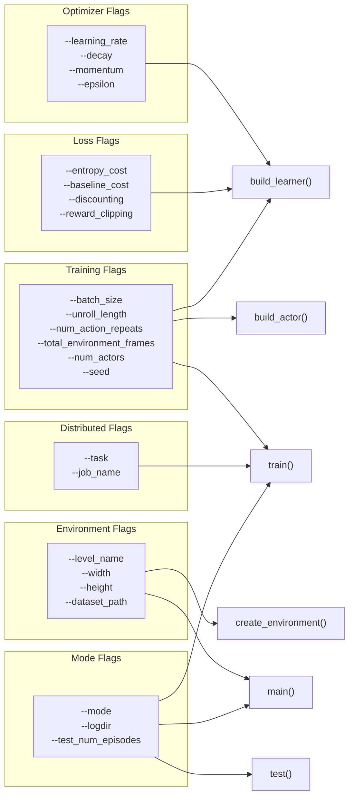
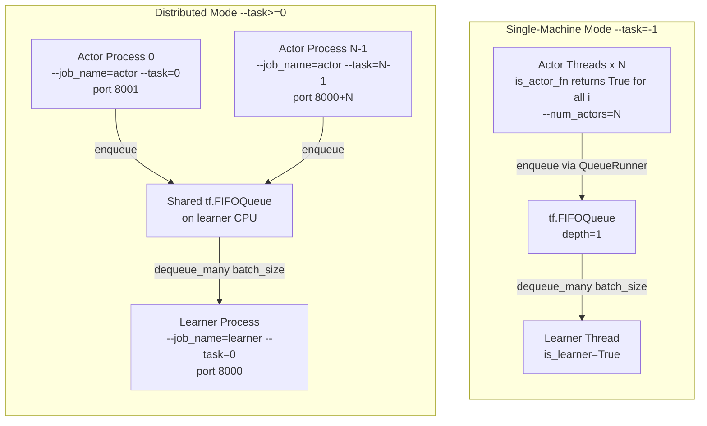

<!-- source: DeepWiki mcp.deepwiki.com · repo google-deepmind/scalable_agent · page 2.4 Configuration and Flags · fetched 2026-10-26 -->

# Configuration and Flags

<details>
<summary>Relevant source files</summary>

The following files were used as context for generating this wiki page:

- [README.md](README.md)
- [experiment.py](experiment.py)

</details>


This page is a reference for all command-line flags accepted by `experiment.py`. It covers their types, defaults, and the code locations that consume each flag. For explanation of the functions these flags control, see:
- Actors and the actor loop: [2.2](#2.2)
- Learner, loss computation, and the optimizer: [2.3](#2.3)
- Environment construction: [5.1](#5.1)
- DMLab-30 level sets: [6](#6)

All flags are declared using `tf.app.flags` at [experiment.py:45-90]().

---

## Complete Flag Reference

### General / Mode

| Flag | Type | Default | Description |
|---|---|---|---|
| `--logdir` | string | `/tmp/agent` | Directory for TensorFlow checkpoints and summaries. |
| `--mode` | enum | `train` | `train` or `test`. Selects the top-level execution path in `main()`. |
| `--test_num_episodes` | integer | `10` | Episodes per level to collect before reporting test score. Only used in `test()`. |

### Distributed Setup

| Flag | Type | Default | Description |
|---|---|---|---|
| `--task` | integer | `-1` | Process task index. `-1` triggers single-machine mode via `is_single_machine()`. For distributed runs, set to the actor or learner index. |
| `--job_name` | enum | `learner` | `learner` or `actor`. Determines this process's role in a distributed cluster. Ignored when `--task=-1`. |

### Training

| Flag | Type | Default | Description |
|---|---|---|---|
| `--total_environment_frames` | integer | `1,000,000,000` | Training terminates when this many environment frames have been processed. Also controls learning-rate decay. |
| `--num_actors` | integer | `4` | Number of actor processes/threads. In distributed mode, determines the size of the `actor` job in the `ClusterSpec`. |
| `--batch_size` | integer | `2` | Number of actor trajectories dequeued per learning step via `queue.dequeue_many(FLAGS.batch_size)`. |
| `--unroll_length` | integer | `100` | Steps in each actor trajectory. Controls the `tf.scan` range in `build_actor()`. |
| `--num_action_repeats` | integer | `4` | How many environment steps each agent action is held for. Applied inside `PyProcessDmLab`. |
| `--seed` | integer | `1` | Random seed passed to `tf.set_random_seed()` to make weight initialization deterministic. |

### Loss Settings

| Flag | Type | Default | Description |
|---|---|---|---|
| `--entropy_cost` | float | `0.00025` | Multiplier on the entropy regularization term in the total loss. |
| `--baseline_cost` | float | `0.5` | Multiplier on the baseline (value function) loss term. |
| `--discounting` | float | `0.99` | Reward discount factor γ. Used to construct the V-trace discount tensor. |
| `--reward_clipping` | enum | `abs_one` | `abs_one` clips rewards to \[-1, 1\]. `soft_asymmetric` applies a tanh-based asymmetric clip. |

### Environment Settings

| Flag | Type | Default | Description |
|---|---|---|---|
| `--level_name` | string | `explore_goal_locations_small` | DeepMind Lab level name. Use `dmlab30` to run the full DMLab-30 benchmark suite. |
| `--width` | integer | `96` | Pixel width of the observation passed to the environment config. |
| `--height` | integer | `72` | Pixel height of the observation passed to the environment config. |
| `--dataset_path` | string | `''` | Path to the Brady–Konkle–Oliva 2008 image dataset, required for `psychlab_*` levels. |

### Optimizer Settings

| Flag | Type | Default | Description |
|---|---|---|---|
| `--learning_rate` | float | `0.00048` | Initial learning rate. Decays linearly to 0 over `--total_environment_frames` steps. |
| `--decay` | float | `0.99` | RMSProp moving-average decay factor. |
| `--momentum` | float | `0.0` | RMSProp momentum. |
| `--epsilon` | float | `0.1` | RMSProp epsilon (numerical stability denominator). |

Sources: [experiment.py:45-90]()

---

## Flag-to-Function Consumption Map

The following diagram shows which flag groups are read by which functions in `experiment.py`.

**Diagram: Flags → Functions**



Sources: [experiment.py:284](), [experiment.py:334-415](), [experiment.py:418-439](), [experiment.py:459-643](), [experiment.py:646-679](), [experiment.py:682-696]()

---

## Distributed Setup Flags in Detail

The `--task` and `--job_name` flags determine whether the process runs in single-machine or distributed mode. The function `is_single_machine()` at [experiment.py:100-101]() simply checks `FLAGS.task == -1`.

**Diagram: Single-Machine vs. Distributed Topology**



Sources: [experiment.py:100-101](), [experiment.py:462-485](), [experiment.py:521-534]()

### Cluster port assignment

In distributed mode, `train()` builds a `ClusterSpec` at [experiment.py:479-484]() with these conventions:

- Learner: `localhost:8000`
- Actor `i`: `localhost:8001 + i`

Actor task index `i` maps to level `level_names[i % len(level_names)]`, enabling round-robin level assignment across actors when `--level_name=dmlab30`.

---

## Loss and Optimizer Flags in Detail

### `--reward_clipping`

Consumed at [experiment.py:365-370]() in `build_learner()`. The two modes are:

| Value | Behaviour |
|---|---|
| `abs_one` | `tf.clip_by_value(rewards, -1, 1)` |
| `soft_asymmetric` | `tanh(r/5)` scaled by 5; negative rewards additionally multiplied by 0.3 |

`soft_asymmetric` is the setting used for distributed DMLab-30 training (see the README example below).

### `--total_environment_frames` and learning-rate decay

The learning rate does not stay constant. `build_learner()` at [experiment.py:398-400]() constructs:

```
tf.train.polynomial_decay(
    FLAGS.learning_rate,
    num_env_frames,           # global step = environment frames processed
    FLAGS.total_environment_frames,
    end_learning_rate=0
)
```

The global step is incremented by `batch_size × unroll_length × num_action_repeats` per training step at [experiment.py:407-408]().

### `--entropy_cost` and `--baseline_cost`

Both are scalar multipliers applied to their respective loss components before summation at [experiment.py:389-395]():

- **Policy gradient loss**: no multiplier (weight 1.0)
- **Baseline loss**: `FLAGS.baseline_cost * compute_baseline_loss(...)`
- **Entropy loss**: `FLAGS.entropy_cost * compute_entropy_loss(...)`

Sources: [experiment.py:365-402]()

---

## `--level_name` Special Value: `dmlab30`

When `--level_name=dmlab30`, `main()` at [experiment.py:686-691]() selects level sets from `dmlab30.LEVEL_MAPPING`:

| Mode | Level list used |
|---|---|
| `train` | `dmlab30.LEVEL_MAPPING.keys()` (training levels) |
| `test` | `dmlab30.LEVEL_MAPPING.values()` (held-out test levels) |
| any other `--level_name` | `[FLAGS.level_name]` (single level) |

See page [6](#6) for the full `LEVEL_MAPPING` table and human-normalized score computation.

Sources: [experiment.py:682-696]()

---

## Example Invocations

These examples are drawn directly from the README.

**Single-machine training (single level):**
```
python experiment.py --num_actors=48 --batch_size=32
```

**Distributed DMLab-30 — learner:**
```
python experiment.py --job_name=learner --task=0 --num_actors=150 \
    --level_name=dmlab30 --batch_size=32 \
    --entropy_cost=0.0033391318945337044 \
    --learning_rate=0.00031866995608948655 \
    --total_environment_frames=10000000000 \
    --reward_clipping=soft_asymmetric
```

**Distributed DMLab-30 — actors (0 through 149):**
```
python experiment.py --job_name=actor --task=$i \
    --num_actors=150 --level_name=dmlab30 --dataset_path=[...]
```

**Test score evaluation:**
```
python experiment.py --mode=test --level_name=dmlab30 \
    --dataset_path=[...] --test_num_episodes=10
```

Sources: [README.md:41-79]()

---

