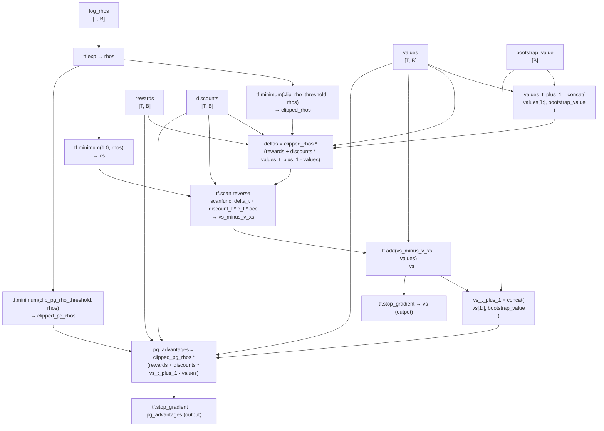
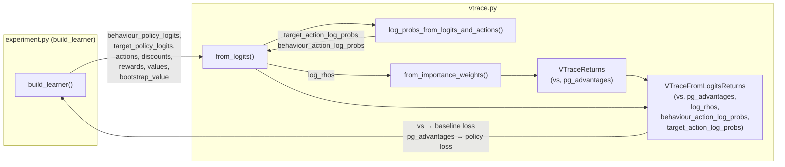
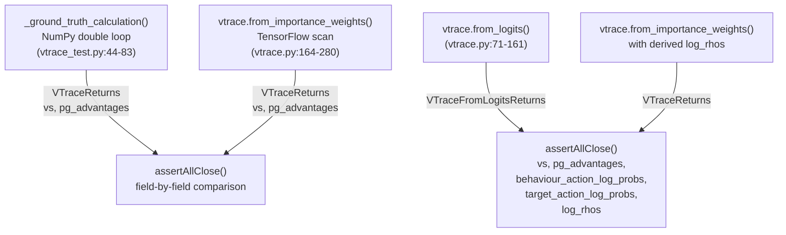

<!-- source: DeepWiki mcp.deepwiki.com · repo google-deepmind/scalable_agent · page 3 V-trace Algorithm · fetched 2026-10-26 -->

# V-trace Algorithm

<details>
<summary>Relevant source files</summary>

The following files were used as context for generating this wiki page:

- [vtrace.py](vtrace.py)
- [vtrace_test.py](vtrace_test.py)

</details>


This page covers the V-trace off-policy correction algorithm as implemented in `vtrace.py`: its mathematical basis, the public API (functions and return types), the clipping thresholds, the internal computation graph, and how `vtrace_test.py` validates the implementation against a NumPy reference. For how the learner consumes these outputs to build loss terms, see [Learner and Loss Computation](#2.3).

---

## Background

IMPALA actors run a *stale* copy of the policy weights and send experience trajectories to a central learner. By the time the learner processes a trajectory, the target policy (the one being trained) has diverged from the behaviour policy (the one that collected the data). V-trace corrects for this distributional shift using per-step importance weights, producing stable off-policy value targets without requiring on-policy data.

The algorithm is described in full in *"IMPALA: Scalable Distributed Deep-RL with Importance Weighted Actor-Learner Architectures"* (Espeholt, Soyer, Munos et al., arXiv:1802.01561).

---

## Core Notation

| Symbol | Meaning | Tensor shape |
|---|---|---|
| `T` | Trajectory (time) length | — |
| `B` | Batch size (number of parallel actors) | — |
| `ρ_t` | Importance weight: `π(a_t\|x_t) / μ(a_t\|x_t)` | `[T, B]` |
| `c_t` | Trace coefficient: `min(1, ρ_t)` | `[T, B]` |
| `ρ̄` | `clip_rho_threshold` — clips `ρ_t` in value target | scalar |
| `ρ̄_pg` | `clip_pg_rho_threshold` — clips `ρ_t` in policy gradient advantage | scalar |
| `v_s` | V-trace target at step `s` | `[T, B]` |
| `δ_t` | TD-error: `clip(ρ_t) * (r_t + γ V(x_{t+1}) - V(x_t))` | `[T, B]` |

---

## Mathematical Definition

The V-trace target at step `s` for a trajectory of length `T` is:

```
v_s = V(x_s)
    + Σ_{t=s}^{T-1}  γ^{t-s} * (Π_{i=s}^{t-1} c_i) * δ_t
```

where:
- `δ_t = min(ρ̄, ρ_t) * (r_t + γ * V(x_{t+1}) - V(x_t))`
- `c_i = min(1, ρ_i)`

The policy gradient advantage at step `s` uses a separate clipping threshold:

```
A_s = min(ρ̄_pg, ρ_s) * (r_s + γ * v_{s+1} - V(x_s))
```

Note that `v_{s+1}` (not `V(x_{s+1})`) is used in the advantage, so the advantage already incorporates the multi-step correction.

The two clipping thresholds serve different roles:

| Parameter | Paper symbol | Default | Effect |
|---|---|---|---|
| `clip_rho_threshold` | `ρ̄` | `1.0` | Controls how aggressively multi-step return targets are corrected |
| `clip_pg_rho_threshold` | `ρ̄_pg` | `1.0` | Controls the policy gradient step size from off-policy data |

Both can be set to `None` to disable clipping entirely (used in some tests).

---

## Public API

### Return Types

[vtrace.py:37-42]()

Two named tuples carry results out of the module:

**`VTraceReturns`** — returned by `from_importance_weights`:

| Field | Shape | Description |
|---|---|---|
| `vs` | `[T, B]` | V-trace value targets (stop-gradient applied) |
| `pg_advantages` | `[T, B]` | Policy gradient advantages (stop-gradient applied) |

**`VTraceFromLogitsReturns`** — returned by `from_logits` (superset of above):

| Field | Shape | Description |
|---|---|---|
| `vs` | `[T, B]` | Same as above |
| `pg_advantages` | `[T, B]` | Same as above |
| `log_rhos` | `[T, B]` | Log importance weights per step |
| `behaviour_action_log_probs` | `[T, B]` | `log μ(a_t)` from behaviour policy |
| `target_action_log_probs` | `[T, B]` | `log π(a_t)` from target policy |

---

### `log_probs_from_logits_and_actions`

[vtrace.py:45-68]()

Converts raw policy logits and sampled actions into per-step log-probabilities.

**Inputs:**

| Argument | Type | Shape |
|---|---|---|
| `policy_logits` | `float32` | `[T, B, NUM_ACTIONS]` |
| `actions` | `int32` | `[T, B]` |

**Returns:** `float32` tensor of shape `[T, B]` — the log-probability of the chosen action at each step under the given policy.

Implemented as the negation of `tf.nn.sparse_softmax_cross_entropy_with_logits`, which is numerically stable.

---

### `from_logits`

[vtrace.py:71-161]()

The primary entry point when raw logits are available from both the behaviour and target policies.

**Inputs:**

| Argument | Type | Shape | Description |
|---|---|---|---|
| `behaviour_policy_logits` | `float32` | `[T, B, NUM_ACTIONS]` | Logits from the actor's policy (μ) |
| `target_policy_logits` | `float32` | `[T, B, NUM_ACTIONS]` | Logits from the learner's current policy (π) |
| `actions` | `int32` | `[T, B]` | Actions sampled under behaviour policy |
| `discounts` | `float32` | `[T, B]` | Per-step discount factors |
| `rewards` | `float32` | `[T, B]` | Per-step rewards |
| `values` | `float32` | `[T, B]` | Baseline value estimates under target policy |
| `bootstrap_value` | `float32` | `[B]` | Value estimate at the end of the trajectory |
| `clip_rho_threshold` | `float32` scalar | — | Default `1.0`; pass `None` to disable |
| `clip_pg_rho_threshold` | `float32` scalar | — | Default `1.0`; pass `None` to disable |

**Returns:** `VTraceFromLogitsReturns`

Internally this function:
1. Calls `log_probs_from_logits_and_actions` for both policy logits.
2. Computes `log_rhos = target_action_log_probs - behaviour_action_log_probs`.
3. Delegates to `from_importance_weights`.

---

### `from_importance_weights`

[vtrace.py:164-280]()

The lower-level entry point when log importance weights are already computed.

**Inputs:**

| Argument | Type | Shape |
|---|---|---|
| `log_rhos` | `float32` | `[T, B]` (or `[T, B, C]`) |
| `discounts` | `float32` | `[T, B]` |
| `rewards` | `float32` | `[T, B]` |
| `values` | `float32` | `[T, B]` |
| `bootstrap_value` | `float32` | `[B]` |
| `clip_rho_threshold` | scalar or `None` | — |
| `clip_pg_rho_threshold` | scalar or `None` | — |

Supports higher-rank inputs: if all tensors have an extra trailing dimension `C`, the same computation is broadcast over it (e.g., `rewards` as `[T, B, C]`).

**Returns:** `VTraceReturns`

---

## Computation Graph

The following diagram maps the mathematical steps to the TensorFlow operations inside `from_importance_weights`.

**V-trace computation graph inside `from_importance_weights`**



Sources: [vtrace.py:233-280]()

The reverse `tf.scan` is the key operation. It computes the recurrence from the end of the trajectory backward:

```
acc_{t} = delta_t + discount_t * c_t * acc_{t+1}
```

starting from `acc_T = 0` (zero tensor of the same shape as `bootstrap_value`). The `back_prop=False` and `parallel_iterations=1` flags ensure correct sequential backward evaluation [vtrace.py:255-262]().

Both `vs` and `pg_advantages` have `tf.stop_gradient` applied before being returned, preventing gradients from flowing through the targets.

---

## API Call Flow

The following diagram shows how `from_logits` relates to the lower-level primitives, and how the learner uses the outputs.

**V-trace API call hierarchy**



Sources: [vtrace.py:71-161](), [vtrace.py:164-280]()

---

## Clipping Thresholds in Detail

Both thresholds default to `1.0` in the function signatures [vtrace.py:74](), matching the IMPALA paper's recommendation.

| Threshold | Role | Effect when increased | Effect of `None` |
|---|---|---|---|
| `clip_rho_threshold` | Clips `ρ_t` when computing `δ_t` for `v_s` | More off-policy correction allowed in value targets | No clipping; full IS weight used |
| `clip_pg_rho_threshold` | Clips `ρ_t` in `pg_advantages` | Larger policy gradient steps from off-policy data | No clipping; full IS weight used |

Setting both to a large value (or `None`) brings the estimator closer to a full importance-sampled return but increases variance. Setting both to `1.0` gives the strongest variance reduction at the cost of some bias.

---

## Test Suite

`vtrace_test.py` validates the implementation with three test classes.

### `LogProbsFromLogitsAndActionsTest`

[vtrace_test.py:86-115]()

Compares `log_probs_from_logits_and_actions` against a NumPy reference that manually applies softmax and indexes by action. Parameterized over batch sizes 1 and 2.

### `VtraceTest`

[vtrace_test.py:118-272]()

Contains four test methods:

| Test method | What it checks |
|---|---|
| `test_vtrace` | `from_importance_weights` vs `_ground_truth_calculation` (NumPy) |
| `test_vtrace_from_logits` | `from_logits` agrees with `from_importance_weights` when fed the same derived log-rhos |
| `test_higher_rank_inputs_for_importance_weights` | Accepts `[T, B, C]` shaped inputs; output has correct trailing dimension |
| `test_inconsistent_rank_inputs_for_importance_weights` | Raises `ValueError` when `bootstrap_value` rank is wrong |

#### NumPy Ground Truth

`_ground_truth_calculation` [vtrace_test.py:44-83]() implements the V-trace formula directly as a double loop over `s` and `t`, making it easy to verify against the paper's equations but intentionally inefficient. It returns a `VTraceReturns` namedtuple so it can be compared field-by-field against the TensorFlow output.

The test uses log-rhos spanning approximately `[-2.5, 2.5)` so that `ρ_t` ranges from near-zero to ~12, covering the sub-threshold, at-threshold, and over-threshold regions of the clipping function [vtrace_test.py:126-129]().

**Test validation flow**



Sources: [vtrace_test.py:118-156](), [vtrace_test.py:158-247]()

---

