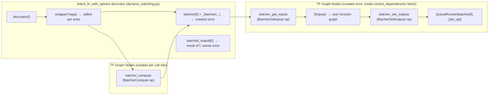

<!-- source: DeepWiki mcp.deepwiki.com · repo google-deepmind/scalable_agent · page 4 Dynamic Batching · fetched 2026-10-26 -->

# Dynamic Batching

<details>
<summary>Relevant source files</summary>

The following files were used as context for generating this wiki page:

- [batcher.cc](batcher.cc)
- [dynamic_batching.py](dynamic_batching.py)
- [dynamic_batching_test.py](dynamic_batching_test.py)

</details>


This page explains the purpose, design, and end-to-end operation of the dynamic batching system. It covers the motivation for batching, the overall architecture, and how the Python and C++ layers cooperate at runtime. For the detailed Python API reference see [Python API](#4.1), and for the detailed C++ op implementation see [C++ Backend](#4.2).

---

## Motivation

In IMPALA, many actor processes each run their own copy of the policy network to generate experience. When actors run on the same machine as the learner (or share a GPU), each actor's forward pass is a tiny, independent tensor operation — typically a single-sample inference through the LSTM/conv network. Running these one at a time is inefficient: modern hardware (CPU and GPU) achieves far higher throughput when operations are batched together.

Dynamic batching solves this by transparently collecting the individual per-actor inference requests that arrive concurrently, grouping them into a single batched operation, executing that operation once, and then distributing the results back to each caller — all without the callers being aware that batching happened.

The key constraint is that actors produce inputs with **batch size 1** at unpredictable times. The batcher must therefore decide dynamically when a batch is "large enough" to dispatch, using configurable size limits and a timeout.

---

## Architecture Overview

The system has three layers:

| Layer | Files | Role |
|---|---|---|
| User-facing Python API | `dynamic_batching.py` | Decorator that wires TF graph nodes |
| TF graph structure | `dynamic_batching.py` | `_Batcher`, `QueueRunner`, shape inference |
| C++ custom ops | `batcher.cc` → `batcher.so` | Blocking queues, batching, condition variables |

**Architecture: Layers and Code Entities**

```mermaid
graph TD
    subgraph "User Code"
        UC["decorated function call\n e.g. agent_output = f(obs)"]
    end

    subgraph "dynamic_batching.py"
        WRP["wrapper() in batch_fn_with_options"]
        BATCHER_PY["_Batcher object"]
        QR["tf.train.QueueRunner\n(drives set_op loop)"]
    end

    subgraph "batcher.so (batcher.cc)"
        OP_COMPUTE["BatcherCompute op\n(ComputeOp)"]
        OP_GETINPUTS["BatcherGetInputs op\n(GetInputsOp)"]
        OP_SETOUTPUTS["BatcherSetOutputs op\n(SetOutputsOp)"]
        OP_BATCHER["Batcher op\n(BatcherHandleOp) → resource handle"]
        BATCHER_RES["Batcher C++ resource\n(inputs_ deque, being_computed_ map)"]
    end

    UC -->|"calls"| WRP
    WRP -->|"issues batcher_compute"| OP_COMPUTE
    WRP -->|"creates _Batcher"| BATCHER_PY
    BATCHER_PY -->|"wraps handle"| OP_BATCHER
    OP_BATCHER --> BATCHER_RES
    OP_COMPUTE -->|"enqueues input, blocks"| BATCHER_RES
    QR -->|"loops: get_inputs → f() → set_outputs"| OP_GETINPUTS
    QR -->|""| OP_SETOUTPUTS
    OP_GETINPUTS -->|"dequeues batch"| BATCHER_RES
    OP_SETOUTPUTS -->|"unblocks callers"| BATCHER_RES
```

Sources: [dynamic_batching.py:25-163](), [batcher.cc:35-90]()

---

## End-to-End Data Flow

When `batch_fn` or `batch_fn_with_options` is applied to a function `f`, the decorator builds a fixed TF graph once on the first call, then reuses it. There are **two concurrent execution paths** sharing the same `Batcher` resource:

1. **Caller path** — each actor thread runs `BatcherCompute`, which enqueues its input and blocks.
2. **Runner path** — a `QueueRunner` thread loops: runs `BatcherGetInputs` (blocks until batch ready), calls `f` on the batch, then runs `BatcherSetOutputs` (unblocks all callers in that batch).

**Sequence: Single Batched Computation**

```mermaid
sequenceDiagram
    participant "Actor 1\n(compute thread)" as A1
    participant "Actor 2\n(compute thread)" as A2
    participant "Batcher C++ resource\n(inputs_ deque)" as BQ
    participant "QueueRunner thread\n(set_op loop)" as QR

    A1 ->> BQ: "BatcherCompute(input1)\n[enqueue, block]"
    A2 ->> BQ: "BatcherCompute(input2)\n[enqueue, block]"
    Note over BQ: "inputs_.size() >= minimum_batch_size\n→ notify condition variable"
    QR ->> BQ: "BatcherGetInputs()\n[was blocking on cond_var]"
    BQ -->> QR: "batched_input [input1; input2], computation_id=N"
    Note over QR: "runs user function f(batched_input)"
    QR ->> BQ: "BatcherSetOutputs(batched_output, computation_id=N)"
    BQ -->> A1: "output slice [0]"
    BQ -->> A2: "output slice [1]"
```

Sources: [batcher.cc:206-391](), [dynamic_batching.py:104-158]()

---

## TF Graph Construction

When the decorated wrapper is first called, it constructs the following subgraph inside a `tf.control_dependencies(None)` block (to avoid inheriting dependencies from surrounding graph context):

```
_Batcher handle
    │
    ├── BatcherGetInputs ──→ inputs (shape: [batch_size, ...]) + computation_id
    │                               │
    │                               └── f(inputs)  ← user function called here
    │                                       │
    └── BatcherSetOutputs ←──────────────── result
              │
              └── registered as QueueRunner enqueue op
```

The `set_op` (output of `BatcherSetOutputs`) is passed to `tf.train.QueueRunner`, which calls `tf.train.start_queue_runners()` to launch the runner thread. This is why tests and the main training loop must call `tf.train.start_queue_runners()` before any session runs will complete.

On every subsequent call to the wrapper, only a `BatcherCompute` op is added to the graph — one per caller site.

**Graph Structure: Python Objects to TF Ops**



Sources: [dynamic_batching.py:104-158]()

---

## Batching Parameters

Three parameters control when and how the batcher groups inputs into a batch:

| Parameter | Default | Effect |
|---|---|---|
| `minimum_batch_size` | `1` | Runner blocks in `BatcherGetInputs` until at least this many inputs are queued, or until `timeout_ms` elapses |
| `maximum_batch_size` | `1024` | Even if more inputs are queued, at most this many are taken per computation |
| `timeout_ms` | `100` | If fewer than `minimum_batch_size` inputs arrive within this window, the runner proceeds with whatever is available. Set to `None` to disable the timeout. |

**Static shape optimization**: If `minimum_batch_size == maximum_batch_size` and `timeout_ms=None`, the batch dimension is statically known and `set_shape` can use a concrete integer. Otherwise it is set to `None` (dynamic). This is reflected in [dynamic_batching.py:125-134]().

**Timeout behavior** (from `test_minimum_batch_size` in `dynamic_batching_test.py`): when only one input is queued and `minimum_batch_size=2, timeout_ms=1000`, the call completes after approximately 1 second — the timeout fires and the batcher proceeds with the undersized batch.

Sources: [dynamic_batching.py:65-102](), [batcher.cc:228-270](), [dynamic_batching_test.py:242-275]()

---

## Input and Output Constraints

The C++ backend enforces several structural constraints:

- **Each caller's input tensors must have batch dimension 1** on the first axis. The `GetInputsInternal` method checks `dim_size(0) == 1` before stacking [batcher.cc:282-285]().
- **All inputs in a batch must have the same shape**. Mismatched shapes raise `InvalidArgument: Shapes of inputs much be equal` [batcher.cc:297-303]().
- **Each output tensor must have a batch dimension** (i.e., `dims() > 0`) [batcher.cc:352-357]().
- **The output batch dimension must equal the input batch size** for that computation [batcher.cc:358-363]().

When any of these checks fail, the batcher calls `CancelAndClose`, which cancels all pending `BatcherCompute` ops with `CancelledError` and marks the batcher permanently closed.

Sources: [batcher.cc:273-391](), [dynamic_batching_test.py:101-200]()

---

## Shutdown and Error Handling

The `_Batcher` class mimics the TF queue interface (it has a `close()` method and a `name` property) so that it can be used directly with `tf.train.QueueRunner` [dynamic_batching.py:30-57](). When the `tf.train.Coordinator` requests a stop, it calls `close()` on queue-like objects, which invokes `BatcherClose`.

`BatcherClose` calls `CancelAndClose` under the mutex, then broadcasts on `full_batch_or_cancelled_cond_var_` to wake any blocked `GetInputs` operations. All pending `Compute` ops receive `CancelledError` [batcher.cc:393-431]().

Once `is_closed_` is set to `true`, any new `Compute` call immediately returns `Cancelled("Batcher is closed")`.

Sources: [batcher.cc:393-431](), [dynamic_batching.py:55-57](), [dynamic_batching_test.py:202-239]()

---

## Usage in IMPALA

In `experiment.py`, `batch_fn` is applied to the agent's inference function so that all concurrent actor threads share a single batched forward pass through the neural network, rather than each issuing a separate (and much smaller) computation. This is the primary mechanism by which the system achieves efficient hardware utilization at inference time across many parallel actors.

For details on how actors are structured around this, see [Actors](#2.2). For the Python API specifics see [Python API](#4.1). For the C++ op internals see [C++ Backend](#4.2).

---

