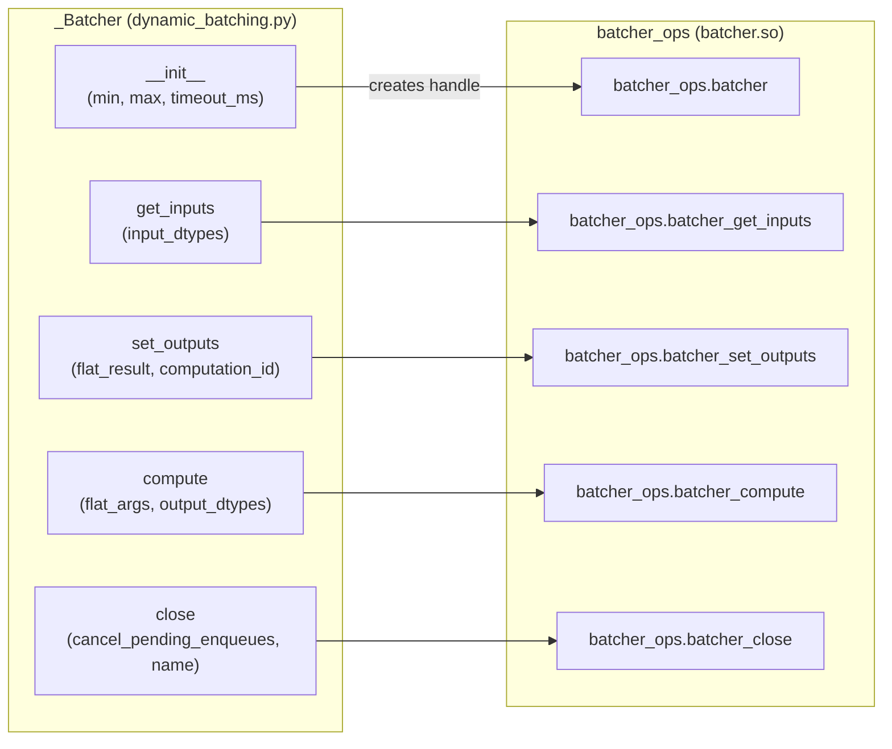

<!-- source: DeepWiki mcp.deepwiki.com · repo google-deepmind/scalable_agent · page 4.1 Python API · fetched 2026-10-26 -->

# Python API

<details>
<summary>Relevant source files</summary>

The following files were used as context for generating this wiki page:

- [dynamic_batching.py](dynamic_batching.py)
- [dynamic_batching_test.py](dynamic_batching_test.py)

</details>


This page documents the user-facing Python interface in `dynamic_batching.py`: the `batch_fn` and `batch_fn_with_options` decorators, and the lower-level `_Batcher` class that wraps the C++ TensorFlow ops. It covers decorator usage, parameter semantics, graph-construction behavior, and input/output constraints.

For the C++ ops that implement the batching queue (`BatcherCompute`, `BatcherGetInputs`, `BatcherSetOutputs`, `BatcherClose`), see [C++ Backend](#4.2). For context on why dynamic batching is used in the training system, see [Dynamic Batching](#4).

---

## Public Decorators

The module exposes two decorators. Both transform a TF-graph-building function so that concurrent callers are transparently batched together at runtime.

| Decorator | Signature | Description |
|---|---|---|
| `batch_fn` | `batch_fn(f)` | Decorator with default options (`min=1`, `max=1024`, `timeout_ms=100`) |
| `batch_fn_with_options` | `batch_fn_with_options(minimum_batch_size, maximum_batch_size, timeout_ms)` | Parameterized decorator factory |

`batch_fn` is a thin wrapper that calls `batch_fn_with_options` with its defaults [dynamic_batching.py:60-62]().

---

## `batch_fn_with_options`

[dynamic_batching.py:65-162]()

### Parameters

| Parameter | Type | Default | Behavior |
|---|---|---|---|
| `minimum_batch_size` | `int` | `1` | Processing will not begin until this many inputs have accumulated, unless `timeout_ms` elapses first |
| `maximum_batch_size` | `int` | `1024` | The batcher will not combine more than this many inputs into one batch |
| `timeout_ms` | `int` or `None` | `100` | If set, a batch smaller than `minimum_batch_size` is released after this many milliseconds. If `None`, no timeout; the batcher waits indefinitely |

### Static Shape Inference

The batch dimension of inputs passed into the decorated function is set statically only when `minimum_batch_size == maximum_batch_size` **and** `timeout_ms is None`. In all other cases it is `None` (unknown at graph construction time), because a timeout can cause a batch smaller than `minimum_batch_size` to be released [dynamic_batching.py:125-128]().

### Input Constraints

- Each tensor argument must have its first (batch) dimension equal to `1`. The batcher concatenates these unit inputs to form a larger batch.
- All inputs across concurrent calls must have the same shape (excluding the batch dimension). Mismatched shapes raise `InvalidArgumentError: Shapes of inputs much be equal`.

### Output Constraints

- The decorated function must return tensors whose first dimension matches the batch size. Scalars raise `InvalidArgumentError: Output shape must have a batch dimension`.
- The batch dimension of each output must equal the input batch size. A mismatch raises `InvalidArgumentError: Output shape must have the same batch dimension as the input batch size`.

---

## Graph Construction Behavior

When the decorated wrapper is called for the **first time**, it builds the following subgraph (inside `tf.control_dependencies(None)` to avoid inheriting outer control edges):

**Title: Graph construction on first call to a `batch_fn`-decorated function**

```mermaid
flowchart TD
    subgraph "First call (graph build)"
        A["wrapper(*args)"] -->|"creates"| B["_Batcher\n(minimum_batch_size, maximum_batch_size, timeout_ms)"]
        B -->|"get_inputs(input_dtypes)"| C["inputs, computation_id\ntensors"]
        C -->|"set shapes"| D["nest.map_structure\n(set_shape)"]
        D -->|"call user function f"| E["result = f(*inputs)"]
        E -->|"nest.flatten"| F["flat_result"]
        F -->|"set_outputs(flat_result, computation_id)"| G["set_op"]
        G -->|"register"| H["tf.train.QueueRunner\n(batcher, [set_op])"]
    end
    subgraph "Every call (including first)"
        I["batcher.compute(flat_args, output_dtypes)"] -->|"returns"| J["flat_result tensors"]
        J -->|"nest.pack_sequence_as + set_shape"| K["structured output"]
    end
```



Sources: [dynamic_batching.py:104-162]()

On every call (including the first), `batcher.compute(flat_args, output_dtypes)` is invoked to enqueue the caller's inputs and block until the result is available [dynamic_batching.py:147-157]().

The `QueueRunner` registered via `tf.train.add_queue_runner` must be started with `tf.train.start_queue_runners()` before any `session.run` call that touches a batched output. Without it, all `compute` calls block indefinitely.

---

## `_Batcher` Class

[dynamic_batching.py:30-57]()

`_Batcher` is a lower-level class that maps directly onto the five C++ ops in `batcher.so`. It implements a subset of the TF queue interface (specifically `name` and `close`) so it can be passed as the queue argument to `tf.train.QueueRunner`.

**Title: `_Batcher` methods and the C++ ops they invoke**



Sources: [dynamic_batching.py:30-57]()

### Method Reference

| Method | Arguments | Returns | Role |
|---|---|---|---|
| `__init__` | `minimum_batch_size`, `maximum_batch_size`, `timeout_ms` | — | Creates the C++ `Batcher` resource; `timeout_ms=None` is converted to `-1` |
| `get_inputs` | `input_dtypes: list[dtype]` | `(inputs: list[Tensor], computation_id: Tensor)` | Dequeues one batch of inputs and a scalar ID for the in-progress computation |
| `set_outputs` | `flat_result: list[Tensor]`, `computation_id: Tensor` | `op` | Pushes computed outputs back, keyed by `computation_id`, releasing waiting callers |
| `compute` | `flat_args: list[Tensor]`, `output_dtypes: list[dtype]` | `list[Tensor]` | Enqueues one unit of input; blocks until the corresponding outputs are set |
| `close` | `cancel_pending_enqueues=False`, `name=None` | `op` | Signals the batcher to stop; used by `QueueRunner` on coordinator stop |

The `_Batcher` class is technically private (prefixed `_`) but is directly accessible and used in tests for out-of-order execution scenarios [dynamic_batching_test.py:334-402]().

---

## `compute` / `get_inputs` / `set_outputs` Protocol

The three ops implement a rendezvous pattern. The following diagram shows how the caller thread (via `compute`) and the `QueueRunner` thread (via `get_inputs` + `set_outputs`) interact at runtime.

**Title: Runtime rendezvous between `compute` and `get_inputs`/`set_outputs`**

```mermaid
sequenceDiagram
    participant "Actor thread (compute)" as ACTOR
    participant "C++ Batcher resource" as BATCHER
    participant "QueueRunner thread (get_inputs/set_outputs)" as QR

    ACTOR->>BATCHER: "batcher_compute(flat_args)"
    Note over BATCHER: "Enqueues inputs; blocks on result"
    QR->>BATCHER: "batcher_get_inputs(input_dtypes)"
    Note over BATCHER: "Returns accumulated batch + computation_id"
    QR->>QR: "Runs user function f(inputs)"
    QR->>BATCHER: "batcher_set_outputs(flat_result, computation_id)"
    Note over BATCHER: "Signals waiting compute calls"
    BATCHER-->>ACTOR: "Returns slice of flat_result"
```

Sources: [dynamic_batching.py:130-144](), [dynamic_batching_test.py:334-375]()

Out-of-order execution is supported: `set_outputs` can be called with `computation_id` values in any order. Each `compute` call is unblocked only when its own `computation_id` is satisfied [dynamic_batching_test.py:355-375]().

---

## Behavioral Semantics of Batching Parameters

### `minimum_batch_size` and `timeout_ms` interaction

```
minimum_batch_size=2, timeout_ms=1000
```

If only one input is queued, the batcher waits up to 1000 ms before releasing a batch of size 1. This is validated in `test_minimum_batch_size` [dynamic_batching_test.py:242-275](): a single-input call takes ~1 second; two concurrent calls complete immediately with `batch_size=2`.

### `maximum_batch_size`

Caps the number of inputs combined into one call to the decorated function. When more than `maximum_batch_size` inputs are queued simultaneously, they are split across multiple sequential invocations. `test_maximum_batch_size` [dynamic_batching_test.py:277-298]() verifies that with `maximum_batch_size=2`, each reported batch size is ≤ 2.

### `timeout_ms=None`

Disables the timeout entirely. Combined with `minimum_batch_size == maximum_batch_size`, this allows TensorFlow to set the batch dimension statically at graph construction time. This is the only configuration that produces a statically known input shape inside the decorated function [dynamic_batching_test.py:319-331]().

---

## Error Conditions

| Condition | Exception |
|---|---|
| Input first dimension ≠ 1 | `InvalidArgumentError: requires batch size 1` |
| Mismatched input shapes across concurrent calls | `InvalidArgumentError: Shapes of inputs much be equal` |
| Output has no batch dimension | `InvalidArgumentError: Output shape must have a batch dimension` |
| Output batch size ≠ input batch size | `InvalidArgumentError: Output shape must have the same batch dimension as the input batch size` |
| Invalid `computation_id` passed to `set_outputs` | `InvalidArgumentError: Invalid computation id` |
| Session closed while `get_inputs` is waiting | `CancelledError: GetInputs operation was cancelled` |
| Any error during batch processing | Pending `compute` calls raise `CancelledError` |

Sources: [dynamic_batching_test.py:101-201](), [dynamic_batching_test.py:377-401]()

After any error, all subsequent `session.run` calls on affected outputs raise `CancelledError` [dynamic_batching_test.py:119-135]().

---

