<!-- source: DeepWiki mcp.deepwiki.com · repo google-deepmind/scalable_agent · page 4.2 C++ Backend · fetched 2026-10-26 -->

# C++ Backend

<details>
<summary>Relevant source files</summary>

The following files were used as context for generating this wiki page:

- [Dockerfile](Dockerfile)
- [batcher.cc](batcher.cc)

</details>


This page documents the C++ implementation of the dynamic batching system in [batcher.cc](). It covers the five TensorFlow custom ops registered in `batcher.so`, the `Batcher` resource class that manages the shared state, and the compilation process that produces the shared library.

For the Python-side decorator API that loads and calls these ops, see [4.1](#4.1). For the overall purpose and design rationale of the dynamic batching system, see [4](#4).

---

## Overview

`batcher.cc` compiles into `batcher.so`, a TensorFlow custom op shared library. It registers five TensorFlow ops that together implement the producer/consumer protocol underlying dynamic batching:

| Op name | Role |
|---|---|
| `Batcher` | Creates and returns a resource handle to a `Batcher` instance |
| `BatcherCompute` | Called by actors; enqueues one input and blocks until output is ready |
| `BatcherGetInputs` | Called by the compute loop; blocks until a batch is ready, returns it |
| `BatcherSetOutputs` | Called by the compute loop; delivers results back to all blocked `BatcherCompute` callers |
| `BatcherClose` | Cancels all pending ops and marks the batcher closed |

All five ops are CPU-only. [batcher.cc:537-547]()

---

## The `Batcher` Resource Class

`Batcher` extends TensorFlow's `ResourceBase` [batcher.cc:91-204](). A single instance lives in the TF resource manager and is shared among all op kernels that hold its resource handle.

### Internal State

| Field | Type | Purpose |
|---|---|---|
| `inputs_` | `std::deque<Input>` | Queue of pending inputs from `BatcherCompute` calls |
| `being_computed_` | `gtl::FlatMap<int64, std::vector<Input>>` | In-flight batches indexed by `computation_id` |
| `curr_computation_id_` | `int64` | Monotonically increasing counter for assigning batch IDs |
| `is_closed_` | `bool` | Set on error or close; causes future ops to return `Cancelled` |
| `minimum_batch_size_` | `const int32` | Minimum number of inputs before `GetInputs` returns |
| `maximum_batch_size_` | `const int32` | Cap on batch size per `GetInputs` call |
| `timeout_` | `optional<chrono::milliseconds>` | If set, `GetInputs` returns a partial batch after this interval |
| `mu_` | `mutex` | Guards all mutable state above |
| `full_batch_or_cancelled_cond_var_` | `condition_variable` | Signals `GetInputs` when the queue has enough entries |

[batcher.cc:182-203]()

### The `Input` Inner Class

`Input` [batcher.cc:120-168]() is a move-only wrapper that binds together three things for a single actor's pending request:

- `context_` — the `OpKernelContext*` for the blocked `BatcherCompute` op
- `input_list_` — the actor's input tensors
- `callback_` — the `DoneCallback` that unblocks the async op when called via `Done()`

When `SetOutputs` finishes writing results into `context_` and calls `input.Done()` [batcher.cc:382](), the `BatcherCompute` op returns to the actor.

---

## Data Flow Through the Five Ops

**Diagram: Op interaction sequence**

```mermaid
sequenceDiagram
    participant A as "Actor thread\n(BatcherCompute)"
    participant Q as "inputs_ deque"
    participant L as "Compute loop\n(BatcherGetInputs)"
    participant M as "being_computed_ map"
    participant R as "Compute loop\n(BatcherSetOutputs)"

    A->>Q: "Batcher::Compute() — push Input, notify cond_var if size >= min_batch_size"
    L->>Q: "Batcher::GetInputs() — wait on cond_var until size >= min_batch_size (or timeout)"
    Q-->>L: "pop up to max_batch_size Inputs, concatenate into batch tensors"
    L->>M: "move batch into being_computed_[new_computation_id]"
    L-->>A: "returns batched tensors + computation_id"
    Note over A: "actor waits (callback not yet called)"
    R->>M: "Batcher::SetOutputs() — find batch by computation_id"
    M-->>R: "vector<Input> for this batch"
    R-->>A: "scatter output slices back into each Input.context_, call input.Done()"
    Note over A: "BatcherCompute returns to actor"
```



Sources: [batcher.cc:206-391]()

---

## Op-by-Op Reference

### `Batcher` / `BatcherHandleOp`

[batcher.cc:35-46](), [batcher.cc:433-459]()

`BatcherHandleOp` extends `ResourceOpKernel<Batcher>`. Its `CreateResource` method [batcher.cc:445-452]() instantiates a `Batcher` with the three attributes read from the op definition: `minimum_batch_size`, `maximum_batch_size`, and `timeout_ms`. A `timeout_ms` of `-1` maps to `optional<milliseconds>` with no value, disabling the timeout.

### `BatcherCompute` / `ComputeOp`

[batcher.cc:48-57](), [batcher.cc:461-478]()

Implemented as an `AsyncOpKernel`. `ComputeAsync` [batcher.cc:465-474]() looks up the `Batcher` resource, reads the actor's `input_list`, and calls `Batcher::Compute()`. The callback passed in is not invoked until `SetOutputs` calls `input.Done()`, so the actor thread is effectively parked until the batch has been processed.

### `BatcherGetInputs` / `GetInputsOp`

[batcher.cc:59-72](), [batcher.cc:480-497]()

A synchronous `OpKernel`. `Compute` [batcher.cc:484-492]() calls `Batcher::GetInputs`, which blocks on `full_batch_or_cancelled_cond_var_` [batcher.cc:241-258]() until:

- `inputs_.size() >= minimum_batch_size_`, **or**
- `timeout_` has elapsed and `inputs_` is non-empty, **or**
- `is_closed_` is set, **or**
- the TF session cancellation manager fires.

Once unblocked, `GetInputsInternal` [batcher.cc:273-328]() allocates output tensors of shape `[batch_size, ...]`, copies each `Input`'s tensors into the appropriate slice using `batch_util::CopyElementToSlice`, assigns a new `computation_id`, moves the batch into `being_computed_`, and returns the batched tensors plus the `computation_id` scalar.

Tensor copying is parallelised across TF's CPU worker threads using `Shard` [batcher.cc:311-313]().

### `BatcherSetOutputs` / `SetOutputsOp`

[batcher.cc:74-83](), [batcher.cc:499-519]()

`SetOutputsInternal` [batcher.cc:339-391]() looks up the `computation_id` in `being_computed_`, validates that the output batch dimension matches, and then in parallel:

1. Allocates an output tensor in each blocked actor's `OpKernelContext`.
2. Copies the actor's slice from the batched output into that tensor using `batch_util::CopySliceToElement`.
3. Calls `input.Done()` to invoke the async callback and unblock the actor.

After all actors in the batch are unblocked, the entry is erased from `being_computed_`.

### `BatcherClose` / `CloseOp`

[batcher.cc:84-89](), [batcher.cc:521-535]()

Calls `Batcher::Close` [batcher.cc:393-401](), which acquires the mutex, calls `CancelAndClose` [batcher.cc:414-431]() to cancel every pending `Input` in both `inputs_` and `being_computed_`, sets `is_closed_ = true`, then broadcasts on `full_batch_or_cancelled_cond_var_` to wake any blocked `GetInputs` calls.

`CancelInput` [batcher.cc:403-412]() marks each `Input`'s context with a `Cancelled` status and calls `Done()` so the actor unblocks with an error.

---

## Concurrency Model

**Diagram: Mutex and condition variable usage**

```mermaid
flowchart TD
    subgraph "Actor threads (N concurrent)"
        CO["ComputeOp::ComputeAsync\ncalls Batcher::Compute()"]
    end

    subgraph "Compute loop thread"
        GI["GetInputsOp::Compute\ncalls Batcher::GetInputs()"]
        SO["SetOutputsOp::Compute\ncalls Batcher::SetOutputs()"]
    end

    subgraph "Batcher state (mu_ guards all)"
        IQ["inputs_\nstd::deque<Input>"]
        BC["being_computed_\nFlatMap<int64, vector<Input>>"]
        CV["full_batch_or_cancelled_cond_var_"]
        CL["is_closed_"]
    end

    CO -->|"lock mu_, push to inputs_,\nnotify_one if size >= min"| IQ
    IQ -->|"wait_for on cond_var"| CV
    CV -->|"wake when notified or timeout"| GI
    GI -->|"move batch from inputs_ to being_computed_"| BC
    SO -->|"scatter outputs, call input.Done()"| BC
    SO -->|"erase computation_id"| BC
    CL -->|"checked in Compute, GetInputs, SetOutputs"| CO
    CL -->|"checked in Compute, GetInputs, SetOutputs"| GI
```



Sources: [batcher.cc:182-204](), [batcher.cc:206-401]()

All mutable state (`inputs_`, `being_computed_`, `curr_computation_id_`, `is_closed_`) is guarded by `mu_`. The condition variable `full_batch_or_cancelled_cond_var_` is used only to signal `GetInputs`; `SetOutputs` wakes actors directly through `DoneCallback`s rather than through the condition variable.

---

## Error Propagation and Cleanup

Any error in `GetInputs` or `SetOutputs` calls `CancelAndClose` [batcher.cc:414-431]() while holding `mu_`. This:

1. Iterates over all entries in `inputs_` and `being_computed_`, calling `CancelInput` on each.
2. Sets `is_closed_ = true`.

After the lock is released, `Close` broadcasts on the condition variable so any concurrently waiting `GetInputs` thread wakes up and sees `is_closed_`. Future `BatcherCompute` calls return immediately with `Cancelled`.

---

## Compilation

`batcher.cc` is compiled into `batcher.so` as a TF custom op shared library. The Dockerfile shows the exact command used [Dockerfile:68-70]():

```
g++-4.8 -std=c++11 -shared batcher.cc -o batcher.so -fPIC \
  -I $TF_INC -O2 -D_GLIBCXX_USE_CXX11_ABI=0 \
  -L $TF_LIB -ltensorflow_framework
```

Key points:

| Flag | Reason |
|---|---|
| `g++-4.8` | Required; g++ 5.4 has a known incompatibility with TF 1.9 ([Dockerfile:4-5]()) |
| `-D_GLIBCXX_USE_CXX11_ABI=0` | Matches TF 1.9's ABI; without this, linking fails at runtime |
| `-ltensorflow_framework` | Provides TF op, kernel, and resource infrastructure |
| `-fPIC` | Required for shared library output |

`dynamic_batching.py` loads the resulting file at import time via `tf.load_op_library`. See [4.1](#4.1) for details of that call.

Sources: [Dockerfile:67-70](), [batcher.cc:1-31]()

---

