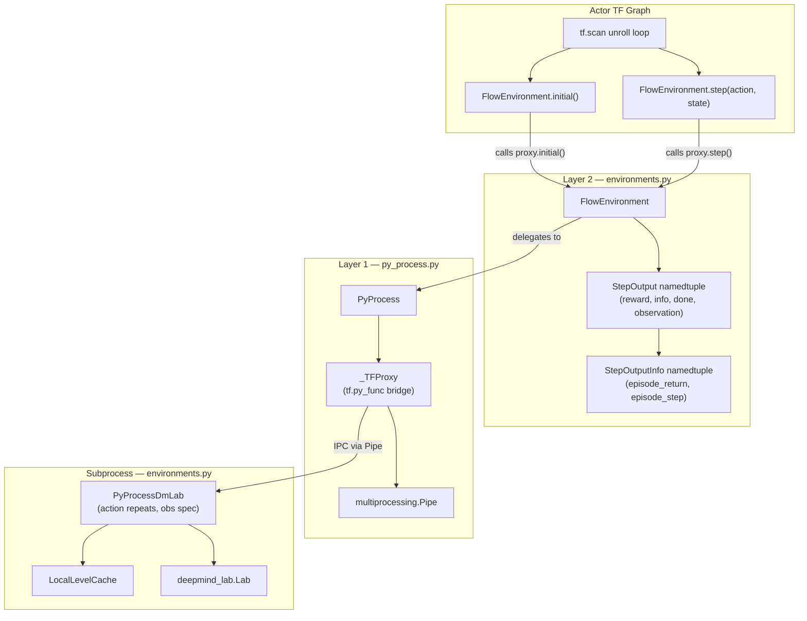
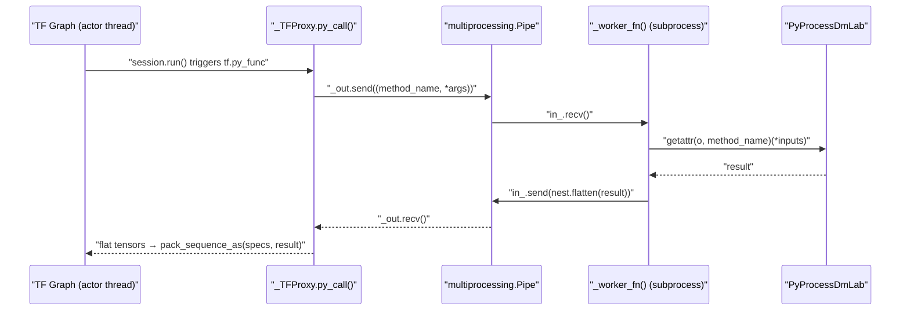
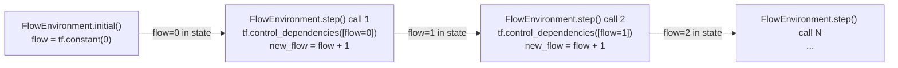
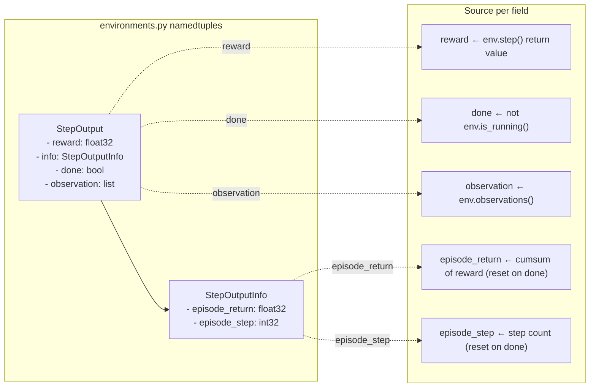
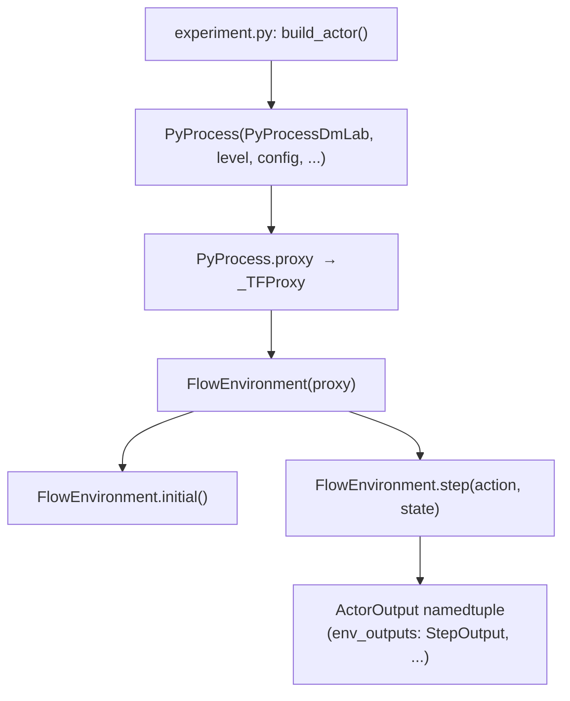

<!-- source: DeepWiki mcp.deepwiki.com · repo google-deepmind/scalable_agent · page 5 Environment Infrastructure · fetched 2026-10-26 -->

# Environment Infrastructure

Relevant source files

The following files were used as context for generating this wiki page:

- [environments.py](environments.py)
- [py_process.py](py_process.py)

This page describes the two-layer wrapper stack that connects DeepMind Lab to the TensorFlow training graph. The stack has two concerns: **subprocess isolation** (handled by `py_process.py`) and **TF-graph-compatible sequential execution** (handled by `environments.py`). For detailed API documentation of each layer, see [DeepMind Lab Integration](#5.1) and [Python Process Management](#5.2).

---

## Why a Two-Layer Stack?

Running DeepMind Lab inside a TensorFlow graph creates two problems:

1. **GIL contention**: DeepMind Lab is a Python C extension. Running multiple environments in threads inside the same process serializes execution under the Python GIL.
2. **Graph ordering**: TensorFlow's dataflow graph does not guarantee that ops execute in the order they are written. An environment requires strict sequential ordering — each `step` must complete before the next begins.

The two-layer stack solves each problem independently:

| Problem | Solution | Location |
|---|---|---|
| GIL contention | Run each environment in its own subprocess | `py_process.py` → `PyProcess` |
| Graph ordering | Thread a "flow counter" through `tf.control_dependencies` | `environments.py` → `FlowEnvironment` |

---

## Stack Architecture

**Diagram: Environment Infrastructure Layer Stack**

Sources: [environments.py:66-218](), [py_process.py:61-204]()

---

## Layer 1: Subprocess Isolation via `PyProcess`

`PyProcess` in `py_process.py` manages the full lifecycle of a Python object running in a separate OS process. It exposes a `proxy` attribute whose method calls are transparently forwarded to the subprocess via a `multiprocessing.Pipe`.

**Diagram: `PyProcess` IPC mechanism**

Sources: [py_process.py:82-104](), [py_process.py:126-158]()

The `_TFProxy.__getattr__` method [py_process.py:69-105]() intercepts any attribute access and returns a `call` function. When invoked, it:

1. Looks up output shapes and dtypes by calling the user class's static `_tensor_specs(method_name, kwargs, constructor_kwargs)` method.
2. Wraps the IPC send/receive in a `tf.py_func`, producing typed tensors with known static shapes.
3. Reconstructs the original nested output structure with `nest.pack_sequence_as`.

The lifecycle is managed by `PyProcessHook`, a `tf.train.SessionRunHook` [py_process.py:186-203]() that calls `start()` on all registered `PyProcess` instances in `begin()` and `close()` in `end()`.

---

## Layer 2: TF Graph Ordering via `FlowEnvironment`

`FlowEnvironment` in `environments.py` wraps any object exposing `initial()` and `step(action)` methods (typically a `_TFProxy`) and makes it safe to use inside a `tf.scan` loop by enforcing strict sequential execution.

The mechanism is a monotonically increasing integer called the **flow counter**, threaded through every call as part of the environment state.

**Diagram: Flow counter control dependency chain**

Sources: [environments.py:155-218]()

### `initial()` [environments.py:155-181]()

Returns a `(StepOutput, state)` pair with:
- `reward = 0.0`, `done = True`, `info = StepOutputInfo(0.0, 0)`, and the first real observation from `env.initial()`.
- `initial_flow = tf.constant(0, dtype=tf.int64)` inside a `tf.control_dependencies` block that waits for all output tensors to be consumed before the flow scalar is created.

### `step(action, state)` [environments.py:183-218]()

1. Unpacks `(flow, info)` from `state`.
2. Wraps the actual `env.step(action)` call inside `tf.control_dependencies([flow])`, forcing it to wait for the previous step's flow counter.
3. After receiving the observation, increments `new_flow = tf.add(flow, 1)` inside another `tf.control_dependencies` on the observation tensors.
4. Accumulates episode statistics in `new_info` by adding `reward` and `1` to `info.episode_return` and `info.episode_step`.
5. Resets the running totals on episode end using `tf.where(done, zero_info, new_info)`.

---

## DeepMind Lab Wrapper: `PyProcessDmLab`

`PyProcessDmLab` [environments.py:66-126]() is the concrete environment class that runs inside the subprocess. It satisfies the `PyProcess` user-class contract.

### Constructor parameters

| Parameter | Type | Role |
|---|---|---|
| `level` | `str` | DMLab level name |
| `config` | `dict` | DMLab configuration (width, height, etc.) |
| `num_action_repeats` | `int` | Frames per `step()` call |
| `seed` | `int` | Seeds a `np.random.RandomState` for episode resets |
| `runfiles_path` | `str \| None` | Path passed to `deepmind_lab.set_runfiles_path()` |
| `level_cache` | `object \| None` | Optional `LocalLevelCache` instance |

### Observation spec

Two observations are requested from DMLab [environments.py:76-82]():
- `RGB_INTERLEAVED` → `uint8` tensor of shape `[height, width, 3]`
- `INSTR` → `string` scalar (the current instruction text)

### `_tensor_specs` contract [environments.py:107-125]()

This static method is called by `_TFProxy` before any `tf.py_func` is created. It returns a nest of `tf.contrib.framework.TensorSpec` objects that define the dtype and shape of the method's outputs. Without this, the proxy cannot set static shapes on the output tensors.

| Method | Return spec |
|---|---|
| `initial` | `[TensorSpec([H,W,3], uint8), TensorSpec([], string)]` |
| `step` | `(TensorSpec([], float32), TensorSpec([], bool), [TensorSpec([H,W,3], uint8), TensorSpec([], string)])` |

### Action repeats

`step()` [environments.py:95-102]() calls `self._env.step(action, num_steps=self._num_action_repeats)`, accumulating reward over `num_action_repeats` simulator frames before returning. On episode end (`not self._env.is_running()`), it immediately calls `_reset()` and returns the first observation of the new episode.

### `LocalLevelCache` [environments.py:33-50]()

An optional file-system cache for compiled DMLab level `.pk3` files. It implements `fetch(key, pk3_path)` and `write(key, pk3_path)` using `tf.gfile` operations. Passed directly to `deepmind_lab.Lab(level_cache=...)`.

---

## `DEFAULT_ACTION_SET`

[environments.py:53-63]()

A tuple of nine discrete actions mapping to 7-dimensional DMLab action vectors `(look_left_right_pixels_per_frame, look_down_up_pixels_per_frame, strafe_left_right, move_back_forward, fire, jump, crouch)`:

| Index | Name | Vector |
|---|---|---|
| 0 | Forward | `(0, 0, 0, 1, 0, 0, 0)` |
| 1 | Backward | `(0, 0, 0, -1, 0, 0, 0)` |
| 2 | Strafe Left | `(0, 0, -1, 0, 0, 0, 0)` |
| 3 | Strafe Right | `(0, 0, 1, 0, 0, 0, 0)` |
| 4 | Look Left | `(-20, 0, 0, 0, 0, 0, 0)` |
| 5 | Look Right | `(20, 0, 0, 0, 0, 0, 0)` |
| 6 | Look Left + Forward | `(-20, 0, 0, 1, 0, 0, 0)` |
| 7 | Look Right + Forward | `(20, 0, 0, 1, 0, 0, 0)` |
| 8 | Fire | `(0, 0, 0, 0, 1, 0, 0)` |

---

## Data Structures

**Diagram: Named tuples and their field sources**

Sources: [environments.py:128-131](), [environments.py:197-217]()

`StepOutputInfo` is part of the `state` tuple passed between `step()` calls. It accumulates across the episode. When `done` is `True`, `new_info` (the final accumulated values) is placed in the output, but `new_state` resets to zeros so the next episode starts fresh [environments.py:209-215]().

---

## Wiring Diagram: Actor Construction

**Diagram: How the layers are composed inside an actor**

Sources: [environments.py:134-218](), [py_process.py:161-183]()

In `experiment.py`, for each actor, a `PyProcess` is constructed around `PyProcessDmLab`, then its `.proxy` is wrapped in a `FlowEnvironment`. The actor's `tf.scan` loop calls `FlowEnvironment.step()` on each timestep. The `StepOutput` produced at each step becomes part of the `ActorOutput` trajectory that is enqueued for the learner. For more detail on the actor loop, see [Actors](#2.2).

---

