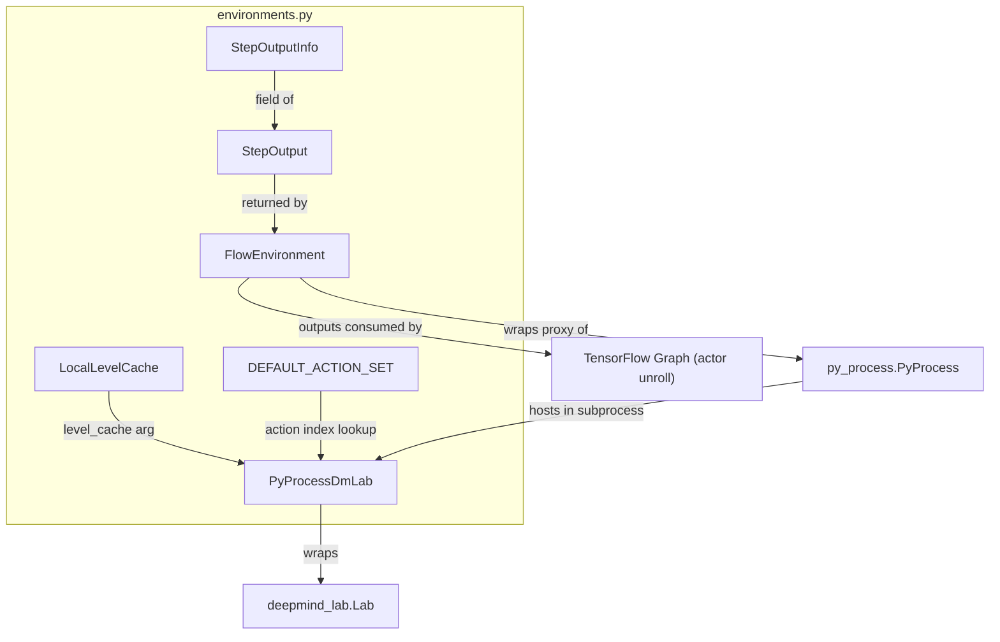
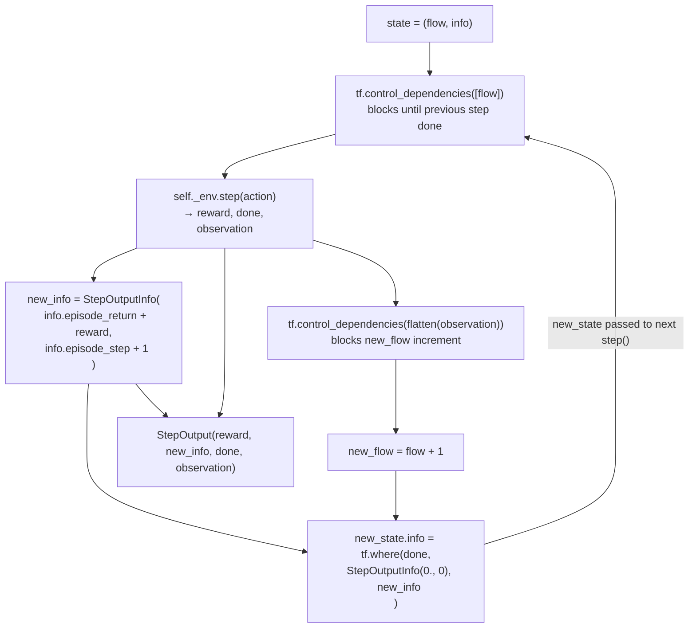

<!-- source: DeepWiki mcp.deepwiki.com · repo google-deepmind/scalable_agent · page 5.1 DeepMind Lab Integration · fetched 2026-10-26 -->

# DeepMind Lab Integration

<details>
<summary>Relevant source files</summary>

The following files were used as context for generating this wiki page:

- [environments.py](environments.py)
- [py_process_test.py](py_process_test.py)

</details>


## Purpose and Scope

This page documents `environments.py`, which contains the two classes that bridge DeepMind Lab to the IMPALA training graph: `PyProcessDmLab` and `FlowEnvironment`. It also documents the `DEFAULT_ACTION_SET`, `LocalLevelCache`, and the `StepOutput`/`StepOutputInfo` named tuples.

- For how `PyProcessDmLab` is isolated into a subprocess and exposed as TensorFlow ops, see the Python Process Management page ([5.2](#5.2)).
- For how `FlowEnvironment` is wired into the actor unroll loop, see the Actors page ([2.2](#2.2)).
- For the broader two-layer design rationale, see the Environment Infrastructure overview ([5](#5)).

---

## Component Map

**Figure: `environments.py` component relationships**



Sources: [environments.py:33-218]()

---

## `DEFAULT_ACTION_SET`

The agent selects a discrete action index; `DEFAULT_ACTION_SET` maps each index to a 7-element tuple consumed by `deepmind_lab.Lab.step`.

[environments.py:53-63]()

| Index | Tuple | Description |
|-------|-------|-------------|
| 0 | `(0, 0, 0, 1, 0, 0, 0)` | Forward |
| 1 | `(0, 0, 0, -1, 0, 0, 0)` | Backward |
| 2 | `(0, 0, -1, 0, 0, 0, 0)` | Strafe Left |
| 3 | `(0, 0, 1, 0, 0, 0, 0)` | Strafe Right |
| 4 | `(-20, 0, 0, 0, 0, 0, 0)` | Look Left |
| 5 | `(20, 0, 0, 0, 0, 0, 0)` | Look Right |
| 6 | `(-20, 0, 0, 1, 0, 0, 0)` | Look Left + Forward |
| 7 | `(20, 0, 0, 1, 0, 0, 0)` | Look Right + Forward |
| 8 | `(0, 0, 0, 0, 1, 0, 0)` | Fire |

The tuple fields map to the DeepMind Lab action specification: `(LOOK_LEFT_RIGHT_PIXELS_PER_FRAME, LOOK_DOWN_UP_PIXELS_PER_FRAME, STRAFE_LEFT_RIGHT, MOVE_BACK_FORWARD, FIRE, JUMP, CROUCH)`.

Sources: [environments.py:53-63]()

---

## `LocalLevelCache`

`LocalLevelCache` implements the level cache interface expected by `deepmind_lab.Lab`. DeepMind Lab can compile procedurally generated levels and cache the compiled `.pk3` files to avoid recompilation on repeated runs.

[environments.py:33-51]()

| Method | Behavior |
|--------|----------|
| `__init__(cache_dir)` | Creates `cache_dir` (default `/tmp/level_cache`) via `tf.gfile.MakeDirs`. |
| `fetch(key, pk3_path)` | If `key` exists in the cache directory, copies it to `pk3_path` and returns `True`. Otherwise returns `False`. |
| `write(key, pk3_path)` | If `key` is not yet cached, copies `pk3_path` into the cache directory. |

An instance of `LocalLevelCache` is passed as the `level_cache` argument to `PyProcessDmLab` and forwarded directly to `deepmind_lab.Lab`.

Sources: [environments.py:33-51]()

---

## `PyProcessDmLab`

`PyProcessDmLab` is the class that `py_process.PyProcess` runs inside a subprocess. It owns the live `deepmind_lab.Lab` instance and exposes three methods to the TensorFlow graph: `initial`, `step`, and `close`.

### Constructor

[environments.py:69-82]()

| Parameter | Type | Purpose |
|-----------|------|---------|
| `level` | `str` | DeepMind Lab level name (e.g. `"nav_maze_random_goal_01"`) |
| `config` | `dict` | Passed to `deepmind_lab.Lab` as string-valued key/value pairs |
| `num_action_repeats` | `int` | How many simulator steps each `step()` call executes |
| `seed` | `int` | Seeds `np.random.RandomState` for reproducible episode resets |
| `runfiles_path` | `str\|None` | If set, calls `deepmind_lab.set_runfiles_path` before creating the Lab instance |
| `level_cache` | `LocalLevelCache\|None` | Passed to `deepmind_lab.Lab` for compiled level caching |

The observation spec is hardcoded to `['RGB_INTERLEAVED', 'INSTR']` — a pixel buffer and an instruction string.

### Methods

[environments.py:84-125]()

| Method | Arguments | Returns | Notes |
|--------|-----------|---------|-------|
| `_reset()` | — | — | Calls `self._env.reset` with a random seed drawn from `self._random_state` |
| `_observation()` | — | `list` | Reads `RGB_INTERLEAVED` and `INSTR` from the lab's observation dict |
| `initial()` | — | `[rgb, instr]` | Resets the environment and returns the first observation |
| `step(action)` | `action` (7-element array) | `(reward, done, [rgb, instr])` | Runs `num_action_repeats` simulator steps; if `done`, resets immediately and returns the first observation of the next episode |
| `close()` | — | — | Calls `self._env.close()` |

**Action repeat detail:** `self._env.step(action, num_steps=self._num_action_repeats)` accumulates reward over all repeated steps and returns the scalar sum. [environments.py:96-96]()

**Auto-reset on done:** When `not self._env.is_running()`, the environment resets before returning the observation, so the caller always receives a valid observation. [environments.py:98-100]()

### `_tensor_specs` Contract

`py_process.PyProcess` calls `_tensor_specs` at graph construction time to determine output shapes and dtypes without running the subprocess. `PyProcessDmLab._tensor_specs` is a `@staticmethod` and receives `method_name`, `unused_kwargs`, and `constructor_kwargs`.

[environments.py:107-125]()

```
method_name='initial'  →  [TensorSpec([H,W,3], uint8), TensorSpec([], string)]
method_name='step'     →  (TensorSpec([], float32),
                            TensorSpec([], bool),
                            [TensorSpec([H,W,3], uint8), TensorSpec([], string)])
```

Width and height default to `320` and `240` respectively, but are read from `constructor_kwargs['config']` if present, allowing the graph to be built correctly for any resolution.

---

## `FlowEnvironment`

`FlowEnvironment` wraps an environment (typically the `_TFProxy` of a `PyProcessDmLab` subprocess) and adds:

1. **Sequential ordering** — `tf.control_dependencies` prevent the TF runtime from reordering environment steps.
2. **Episode accounting** — Accumulates `episode_return` and `episode_step` across steps, resetting them at episode boundaries.
3. **Standard interface** — Returns `StepOutput`/`StepOutputInfo` named tuples that the actor unroll loop consumes.

### Named Tuples

[environments.py:128-131]()

```python
StepOutputInfo = namedtuple('StepOutputInfo', 'episode_return episode_step')
StepOutput     = namedtuple('StepOutput', 'reward info done observation')
```

| Field | Type | Description |
|-------|------|-------------|
| `StepOutput.reward` | `float32` scalar | Reward for the most recent step |
| `StepOutput.info` | `StepOutputInfo` | Accumulated episode return and step count up to and including this step |
| `StepOutput.done` | `bool` scalar | Whether this step ended the episode |
| `StepOutput.observation` | `[uint8 tensor, string tensor]` | Pixel frame and instruction string |

### `initial()`

[environments.py:155-181]()

Returns `(StepOutput, state)`.

- `reward` is `0.0`, `done` is `True`, `info` is `StepOutputInfo(0.0, 0)`.
- Calls `self._env.initial()` to get the first observation.
- Places a `tf.control_dependencies` on all tensors in `initial_output` before constructing `initial_flow = tf.constant(0, dtype=tf.int64)`. This ensures the next `step()` cannot execute until the initial observation has been read.
- `state` is `(initial_flow, initial_info)`.

### `step(action, state)`

[environments.py:183-218]()

Returns `(StepOutput, new_state)`.

**Figure: `FlowEnvironment.step` data flow**



Key points:

- **Sequential ordering:** `tf.control_dependencies([flow])` ensures each `step()` call waits for the previous one to complete before issuing any environment call. [environments.py:202-203]()
- **Episode return accumulation:** `new_info.episode_return = info.episode_return + reward`. The final-step reward is included in the *output* `info` but not in the *state* `info` — the state resets on `done`. [environments.py:210-215]()
- **Episode reset logic:** `tf.where(done, StepOutputInfo(0., 0), new_info)` resets the accumulated counters in `new_state` when `done` is `True`, but the output `StepOutput` still carries the full episode totals for that last step. [environments.py:212-215]()
- **`new_flow`** is incremented only after `observation` tensors are available (`control_dependencies` on the flattened observation). This makes `new_flow` a proxy for "the step is fully complete." [environments.py:205-206]()

Sources: [environments.py:128-218]()

---

## End-to-End Flow

**Figure: Full call chain from actor graph to DeepMind Lab**

```mermaid
sequenceDiagram
    participant ACTOR as "Actor TF Graph"
    participant FLOW as "FlowEnvironment"
    participant PROXY as "PyProcess._TFProxy"
    participant PIPE as "multiprocessing.Pipe"
    participant PPLAB as "PyProcessDmLab (subprocess)"
    participant LAB as "deepmind_lab.Lab"

    ACTOR->>FLOW: "step(action, state)"
    FLOW->>FLOW: "tf.control_dependencies([flow])"
    FLOW->>PROXY: "self._env.step(action)"
    PROXY->>PIPE: "send (method, args)"
    PIPE->>PPLAB: "receive"
    PPLAB->>LAB: "env.step(action, num_steps=N)"
    LAB-->>PPLAB: "reward (sum over N steps)"
    PPLAB-->>PIPE: "send (reward, done, observation)"
    PIPE-->>PROXY: "receive → tf.py_func outputs"
    PROXY-->>FLOW: "reward, done, observation tensors"
    FLOW->>FLOW: "accumulate StepOutputInfo, increment flow"
    FLOW-->>ACTOR: "StepOutput, new_state"
```

Sources: [environments.py:183-218](), [py_process_test.py:33-64]()

---

## Summary of Public API

| Symbol | Kind | Role |
|--------|------|------|
| `DEFAULT_ACTION_SET` | `tuple` of `tuple` | 9-action discrete action space |
| `LocalLevelCache` | class | Filesystem-backed level cache for `deepmind_lab.Lab` |
| `PyProcessDmLab` | class | DeepMind Lab adapter for `py_process.PyProcess` |
| `PyProcessDmLab._tensor_specs` | `@staticmethod` | Graph-time output shape/dtype specification |
| `StepOutputInfo` | `namedtuple` | `(episode_return, episode_step)` |
| `StepOutput` | `namedtuple` | `(reward, info, done, observation)` |
| `FlowEnvironment` | class | TF-graph-safe sequentially-ordered environment wrapper |
| `FlowEnvironment.initial()` | method | Returns initial `StepOutput` and state |
| `FlowEnvironment.step(action, state)` | method | Returns next `StepOutput` and updated state |

Sources: [environments.py:1-218]()

---

