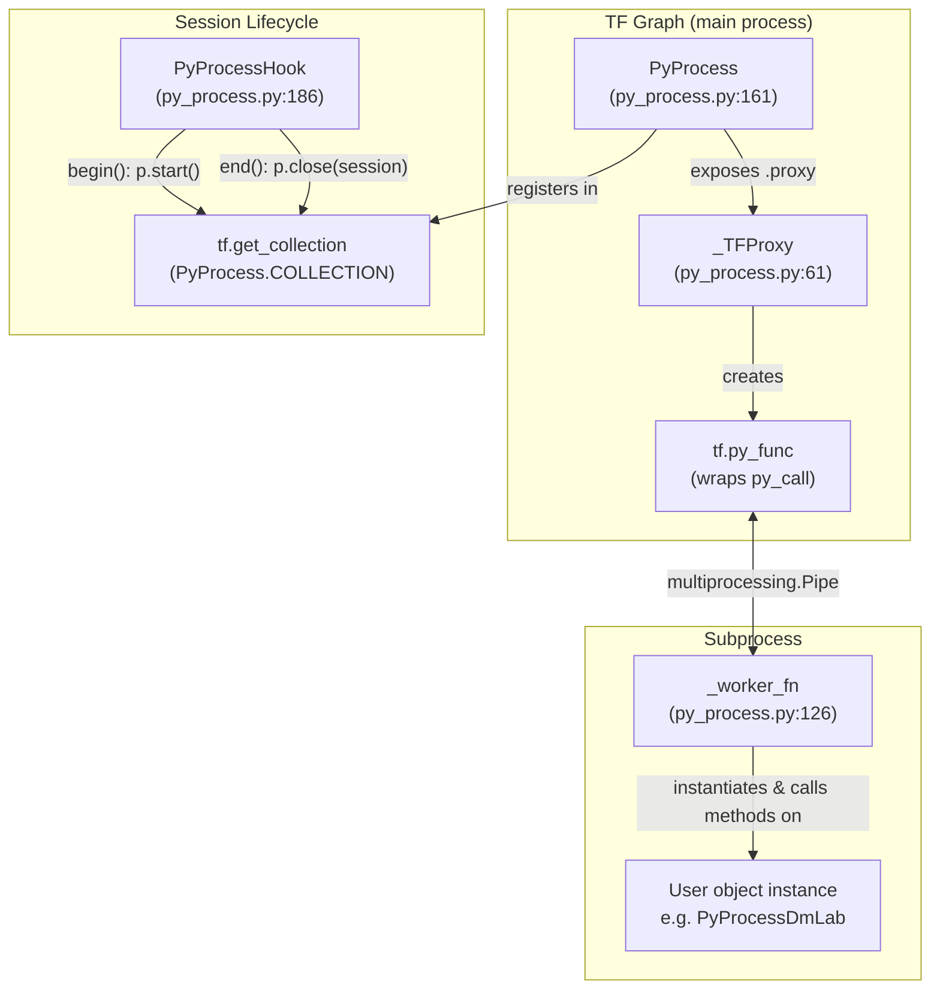
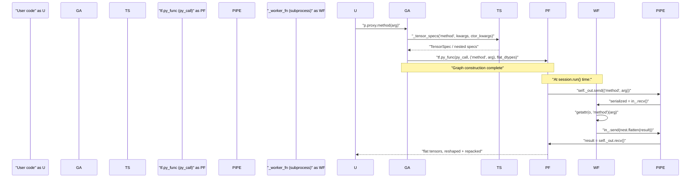
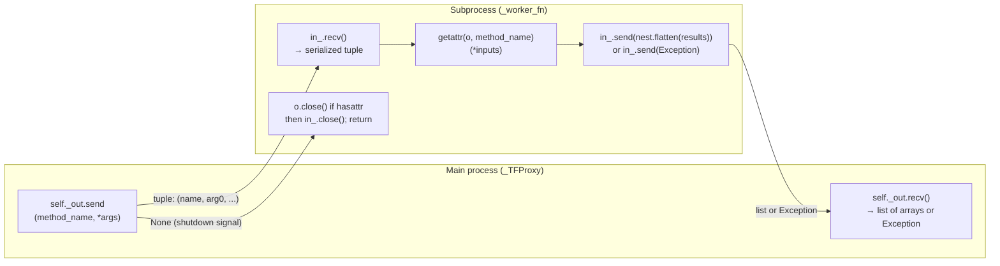
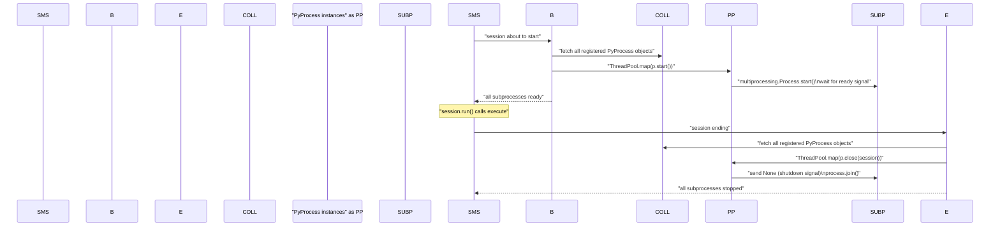

<!-- source: DeepWiki mcp.deepwiki.com · repo google-deepmind/scalable_agent · page 5.2 Python Process Management · fetched 2026-10-26 -->

# Python Process Management

<details>
<summary>Relevant source files</summary>

The following files were used as context for generating this wiki page:

- [py_process.py](py_process.py)
- [py_process_test.py](py_process_test.py)

</details>


This page documents `py_process.py`, which provides a mechanism for running arbitrary Python objects in isolated subprocesses while keeping them callable from within a TensorFlow graph. The module bridges `multiprocessing.Pipe`-based IPC with `tf.py_func` so that subprocess calls appear as ordinary TF operations at graph execution time.

For documentation of how environments use this infrastructure (specifically `PyProcessDmLab`), see the DeepMind Lab Integration page [5.1](#5.1). For the broader environment stack overview, see [5](#5).

---

## Purpose

TensorFlow's `tf.py_func` can call Python functions from within a graph, but all such calls share the GIL with the main TF session process. `py_process.py` works around this by spawning each wrapped object into a **dedicated subprocess** and routing `tf.py_func` calls through a `multiprocessing.Pipe`. This enables true parallelism across multiple environment instances without GIL contention.

---

## Architecture Overview

**Diagram: py_process module component map**



Sources: [py_process.py:1-204]()

---

## Public Classes

| Class | File Location | Role |
|---|---|---|
| `PyProcess` | [py_process.py:161-183]() | Constructs a subprocess-backed wrapper; registers itself in the TF collection |
| `_TFProxy` | [py_process.py:61-158]() | Intercepts attribute access to return TF-graph-compatible callables |
| `PyProcessHook` | [py_process.py:186-203]() | `SessionRunHook` that starts/stops all registered `PyProcess` instances |

---

## The `_tensor_specs` Contract

Any class passed to `PyProcess` must implement a `@staticmethod` named `_tensor_specs`. This is the only interface requirement `py_process.py` imposes on user classes.

**Signature:**

```
_tensor_specs(method_name, kwargs, constructor_kwargs)
```

| Parameter | Type | Description |
|---|---|---|
| `method_name` | `str` | Name of the method being called |
| `kwargs` | `dict` | Keyword arguments the method will receive, as passed at graph-build time |
| `constructor_kwargs` | `dict` | Keyword arguments used to construct the object |

**Return value:**

The method must return one of:
- A `tf.contrib.framework.TensorSpec` (single tensor output)
- A nested structure of `TensorSpec` objects (multiple tensor outputs)
- An empty tuple `()` if the method returns nothing (produces a `tf.Operation`)
- `None` is not acceptable and raises a `ValueError` [py_process.py:75-78]()

**Why it exists:** Because `tf.py_func` requires output dtypes and shapes to be declared statically at graph-construction time, before any subprocess call happens. `_tensor_specs` is queried during `__getattr__` on the proxy [py_process.py:73]() to extract this information.

**Example from tests:**

```
# From py_process_test.py:47-51
@staticmethod
def _tensor_specs(method_name, unused_args, unused_constructor_kwargs):
    if method_name == 'compute':
        return tf.contrib.framework.TensorSpec([], tf.int32)
    elif method_name == 'inc':
        return ()
```

Sources: [py_process.py:61-105](), [py_process_test.py:47-51](), [py_process_test.py:109-113]()

---

## `PyProcess` Class

`PyProcess` [py_process.py:161-183]() is instantiated once per object that needs subprocess isolation.

**Constructor:**

```
PyProcess(type_, *constructor_args, **constructor_kwargs)
```

- `type_` is the class to instantiate in the subprocess.
- Positional `constructor_args` are matched to `__init__` parameter names using `function_utils.fn_args` [py_process.py:167]().
- The resulting `constructor_kwargs` dict is stored and passed to both `_TFProxy` and later to `_worker_fn`.
- The instance registers itself into the TF collection `PyProcess.COLLECTION = 'py_process_processes'` [py_process.py:162](), which `PyProcessHook` uses to locate all processes.

**Key methods:**

| Method | Description |
|---|---|
| `proxy` (property) | Returns the `_TFProxy` instance; used to build TF ops |
| `start()` | Delegates to `_proxy._start()`; spawns the subprocess |
| `close(session)` | Delegates to `_proxy._close(session)`; shuts down subprocess |

Sources: [py_process.py:161-183]()

---

## `_TFProxy`: Attribute Interception

`_TFProxy` [py_process.py:61-158]() makes subprocess method calls look like ordinary attribute accesses on the proxy object.

**Attribute lookup (`__getattr__`):**

When `p.proxy.some_method(arg)` is called:

1. `__getattr__` is triggered with `name = 'some_method'` [py_process.py:69]().
2. A `call` closure is returned. When invoked with `args`, it:
   a. Maps positional args to keyword names using `function_utils.fn_args` [py_process.py:71-72]().
   b. Calls `_tensor_specs` to get output shape/dtype metadata [py_process.py:73]().
   c. Flattens the spec structure to get `flat_dtypes` and `flat_shapes` [py_process.py:79-80]().
   d. Defines `py_call`, a closure that sends a request tuple over the pipe and waits for a response [py_process.py:82-94]().
   e. Registers `py_call` as a `tf.py_func` node in the graph [py_process.py:96]().
   f. Sets static shapes on output tensors, then repacks them into the nested spec structure [py_process.py:102-104]().

**Diagram: _TFProxy attribute call sequence**



Sources: [py_process.py:61-105]()

---

## IPC Protocol

The subprocess communicates over a `multiprocessing.Pipe` pair: `self._out` (main process end) and `in_` (subprocess end) [py_process.py:108-112]().

**Diagram: IPC message protocol over multiprocessing.Pipe**



**Message types:**

| Direction | Content | Meaning |
|---|---|---|
| Main → Sub | `(method_name, arg0, arg1, ...)` | Call method with args |
| Main → Sub | `None` | Shutdown: call `close()` if present, then exit |
| Sub → Main | `[array, ...]` (flat list) | Successful result; may be `None` for void methods |
| Sub → Main (startup) | `None` | Subprocess ready signal sent after successful `__init__` |
| Sub → Main | `Exception` instance | Error from constructor or method call |

Sources: [py_process.py:107-158]()

---

## Subprocess Worker (`_worker_fn`)

`_worker_fn` [py_process.py:126-158]() runs in the child process. Its lifecycle:

1. Instantiate `type_(**constructor_kwargs)`.
2. Send `None` over the pipe to signal readiness [py_process.py:130]().
3. Enter a receive loop:
   - On `None` message: call `o.close()` if the method exists, close the pipe, return.
   - On method-call tuple: extract `method_name` and `inputs`, call the method, flatten the result with `nest.flatten`, send it back.
4. On any uncaught exception: call `o.close()` defensively [py_process.py:153-157](), then send the exception object back over the pipe.

**`close()` convention:** If a user class defines a `close()` method, it will be called by `_worker_fn` on both clean shutdown and on unhandled errors [py_process.py:136-138](), [py_process.py:153-157](). The test in `py_process_test.py:171-189` verifies this behavior.

Sources: [py_process.py:126-158](), [py_process_test.py:171-221]()

---

## `PyProcessHook` Lifecycle

`PyProcessHook` [py_process.py:186-203]() is a `tf.train.SessionRunHook` that manages process startup and teardown around a TF session.

**Diagram: PyProcessHook and PyProcess.COLLECTION lifecycle**



Key details:
- `begin()` uses a `multiprocessing.pool.ThreadPool` to start all subprocesses in parallel [py_process.py:191-194]().
- `end()` similarly closes all subprocesses in parallel [py_process.py:197-202]().
- All `PyProcess` objects register themselves via `tf.add_to_collection(PyProcess.COLLECTION, self)` at construction time [py_process.py:170](), so `PyProcessHook` requires no explicit list of processes.

**Usage pattern:**

```python
# From py_process_test.py:58-64
with tf.train.SingularMonitoredSession(
    hooks=[py_process.PyProcessHook()]) as session:
    session.run(some_op)
```

Sources: [py_process.py:186-203](), [py_process_test.py:58-64]()

---

## Error Handling

| Scenario | Behavior |
|---|---|
| Constructor raises | `_worker_fn` catches it, calls `close()` if possible, sends exception to main; `_start()` re-raises it [py_process.py:113-116]() |
| Method raises | `_worker_fn` catches it, sends exception to main; `py_call` receives it and re-raises, surfacing in `session.run()` [py_process.py:86-88]() |
| Subprocess pipe closed (IOError) | `py_call` converts `IOError` to `StopIteration`, which TF interprets as a clean `OutOfRangeError` [py_process.py:91-93]() |
| Session ends while method running | `_close` sends `None`, closes the pipe; the blocking `recv()` in `py_call` raises `IOError` → `StopIteration` → `OutOfRangeError` [py_process_test.py:86-96]() |
| Error during method call | `o.close()` is **not** called automatically on method errors, only on constructor errors or explicit shutdown |

Sources: [py_process.py:82-94](), [py_process.py:113-116](), [py_process.py:152-158](), [py_process_test.py:124-221]()

---

## Summary: Implementing a Compatible Class

A class usable with `PyProcess` must satisfy this interface:

| Requirement | Notes |
|---|---|
| `__init__(self, **kwargs)` | Called in subprocess; positional args matched by name |
| `_tensor_specs(method_name, kwargs, constructor_kwargs)` (static) | Must return spec(s) or `()` for every method exposed through the proxy |
| `close(self)` (optional) | Called on clean shutdown and on constructor/worker errors |
| Return values | Must be numpy arrays (or `None`); will be passed through `nest.flatten` |

See `PyProcessDmLab` in `environments.py` for the canonical production example of this pattern, documented at [5.1](#5.1).

Sources: [py_process.py:61-158](), [py_process_test.py:35-52](), [py_process_test.py:99-122]()

---

