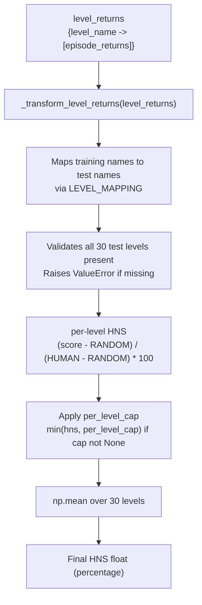
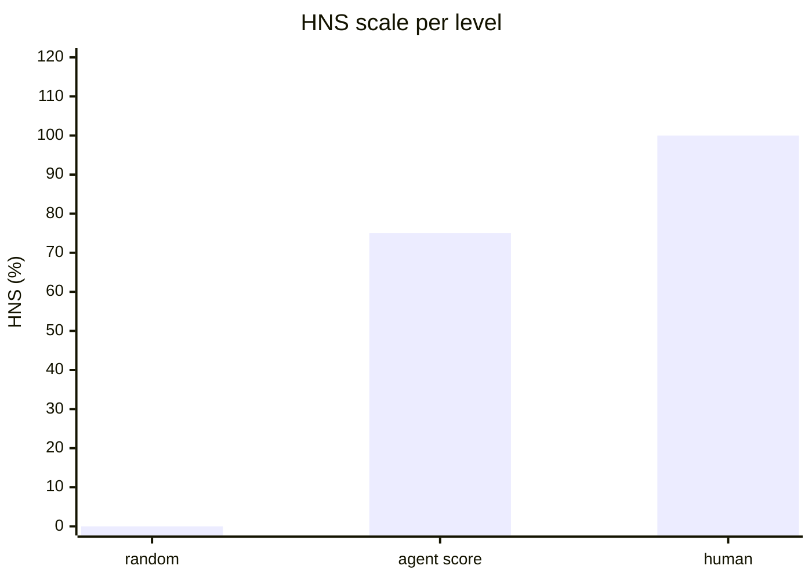
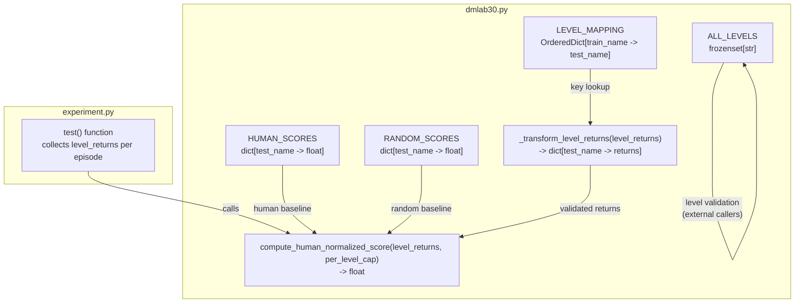

<!-- source: DeepWiki mcp.deepwiki.com · repo google-deepmind/scalable_agent · page 6 DMLab-30 Benchmark · fetched 2026-10-26 -->

# DMLab-30 Benchmark

<details>
<summary>Relevant source files</summary>

The following files were used as context for generating this wiki page:

- [README.md](README.md)
- [dmlab30.py](dmlab30.py)

</details>


## Purpose and Scope

This page documents the evaluation utilities in `dmlab30.py`. It covers the level registry (`LEVEL_MAPPING`, `ALL_LEVELS`), the human and random baseline score tables (`HUMAN_SCORES`, `RANDOM_SCORES`), and the `compute_human_normalized_score` function that reduces per-level episode returns into a single comparable percentage metric.

This page is about *scoring and benchmarking*. For information about how the environment itself is initialized and wrapped for training, see [Environment Infrastructure](#5).

---

## Overview

DMLab-30 is a standard benchmark suite of 30 DeepMind Lab tasks spanning navigation, language understanding, laser tag, and psychophysics tasks. The codebase provides utilities to:

- Map training-variant level names to their canonical test-variant names.
- Store the human and random-agent baseline scores needed for normalization.
- Compute a single human-normalized score (HNS) from a dictionary of per-level episode returns.

The benchmark is referenced from `experiment.py` when `--level_name=dmlab30` is set, and the score is computed during test mode. See [Configuration and Flags](#2.4) for the relevant flags.

Sources: [dmlab30.py:1-30]()

---

## Level Registry

### `LEVEL_MAPPING`

[dmlab30.py:27-61]()

`LEVEL_MAPPING` is a `collections.OrderedDict` with 30 entries. Each key is a **training-variant** level name; each value is the corresponding **test-variant** level name. For most levels the two names are identical, but two levels have distinct train/test variants:

| Training Level | Test Level |
|---|---|
| `rooms_collect_good_objects_train` | `rooms_collect_good_objects_test` |
| `rooms_exploit_deferred_effects_train` | `rooms_exploit_deferred_effects_test` |
| `rooms_select_nonmatching_object` | `rooms_select_nonmatching_object` |
| `rooms_watermaze` | `rooms_watermaze` |
| `rooms_keys_doors_puzzle` | `rooms_keys_doors_puzzle` |
| `language_select_described_object` | `language_select_described_object` |
| `language_select_located_object` | `language_select_located_object` |
| `language_execute_random_task` | `language_execute_random_task` |
| `language_answer_quantitative_question` | `language_answer_quantitative_question` |
| `lasertag_one_opponent_small` | `lasertag_one_opponent_small` |
| `lasertag_three_opponents_small` | `lasertag_three_opponents_small` |
| `lasertag_one_opponent_large` | `lasertag_one_opponent_large` |
| `lasertag_three_opponents_large` | `lasertag_three_opponents_large` |
| `natlab_fixed_large_map` | `natlab_fixed_large_map` |
| `natlab_varying_map_regrowth` | `natlab_varying_map_regrowth` |
| `natlab_varying_map_randomized` | `natlab_varying_map_randomized` |
| `skymaze_irreversible_path_hard` | `skymaze_irreversible_path_hard` |
| `skymaze_irreversible_path_varied` | `skymaze_irreversible_path_varied` |
| `psychlab_arbitrary_visuomotor_mapping` | `psychlab_arbitrary_visuomotor_mapping` |
| `psychlab_continuous_recognition` | `psychlab_continuous_recognition` |
| `psychlab_sequential_comparison` | `psychlab_sequential_comparison` |
| `psychlab_visual_search` | `psychlab_visual_search` |
| `explore_object_locations_small` | `explore_object_locations_small` |
| `explore_object_locations_large` | `explore_object_locations_large` |
| `explore_obstructed_goals_small` | `explore_obstructed_goals_small` |
| `explore_obstructed_goals_large` | `explore_obstructed_goals_large` |
| `explore_goal_locations_small` | `explore_goal_locations_small` |
| `explore_goal_locations_large` | `explore_goal_locations_large` |
| `explore_object_rewards_few` | `explore_object_rewards_few` |
| `explore_object_rewards_many` | `explore_object_rewards_many` |

The ordering is significant: `LEVEL_MAPPING.values()` defines the canonical **test set** that must be fully covered when computing scores.

Sources: [dmlab30.py:27-61]()

---

### `ALL_LEVELS`

[dmlab30.py:129-162]()

`ALL_LEVELS` is a `frozenset` containing all 32 level name strings — both training variants and test variants. It includes names that appear only as training-side keys in `LEVEL_MAPPING` (`rooms_collect_good_objects_train`, `rooms_exploit_deferred_effects_train`) as well as all test-side names.

This set is used to validate that a level name is recognized by the benchmark before attempting to use it. Any level not in `ALL_LEVELS` will be unknown to the scoring utilities.

Sources: [dmlab30.py:129-162]()

---

## Baseline Score Tables

Two dictionaries, keyed by **test-variant** level name, provide the baselines for normalization.

### `HUMAN_SCORES`

[dmlab30.py:63-94]()

Expert human scores for all 30 test levels. Measured in episode return units native to each level. Selected reference values:

| Level | Human Score |
|---|---|
| `rooms_collect_good_objects_test` | 10 |
| `rooms_exploit_deferred_effects_test` | 85.65 |
| `skymaze_irreversible_path_hard` | 100 |
| `language_select_described_object` | 389.5 |
| `explore_goal_locations_small` | 267.5 |
| `lasertag_one_opponent_small` | 12.65 |

### `RANDOM_SCORES`

[dmlab30.py:96-127]()

Random-policy baseline scores for all 30 test levels. Some values are negative (e.g., `language_execute_random_task`: -5.913), reflecting that a random agent can incur penalties.

| Level | Random Score |
|---|---|
| `rooms_collect_good_objects_test` | 0.073 |
| `language_execute_random_task` | -5.913 |
| `lasertag_one_opponent_small` | -0.224 |
| `explore_goal_locations_small` | 7.66 |

Sources: [dmlab30.py:63-127]()

---

## Score Computation

### Data Flow Diagram

**`compute_human_normalized_score` data flow**



Sources: [dmlab30.py:165-218]()

---

### `_transform_level_returns`

[dmlab30.py:165-183]()

Internal helper. Accepts a `level_returns` dict (keys may be training-variant names) and returns a new dict with keys remapped to test-variant names via `LEVEL_MAPPING`. It then validates:

- Every level in `set(LEVEL_MAPPING.values())` (all 30 test levels) must be present in the remapped dict.
- Every test-level entry must have a non-empty list of returns.

Any key not found in `LEVEL_MAPPING` is passed through unchanged, and a `tf.logging.info` message is emitted for it. Unknown levels do not cause an error — they are silently ignored by the scorer.

Sources: [dmlab30.py:165-183]()

---

### `compute_human_normalized_score`

[dmlab30.py:186-218]()

**Signature:**

```
compute_human_normalized_score(level_returns, per_level_cap)
```

**Arguments:**

| Argument | Type | Description |
|---|---|---|
| `level_returns` | `dict[str, list[float]]` | Map from level name to list of episode returns. Training-variant names are accepted and remapped automatically. |
| `per_level_cap` | `float or None` | If not `None`, each per-level HNS is clamped to this value before averaging. The published IMPALA results use `100.0` (capped HNS). |

**Normalization formula (per level):**

```
hns = (mean(returns) - RANDOM_SCORES[level]) / (HUMAN_SCORES[level] - RANDOM_SCORES[level]) * 100
```

If `per_level_cap` is set:

```
hns = min(hns, per_level_cap)
```

**Return value:** `float` — the mean HNS across all 30 test levels, expressed as a percentage.

**Raises:** `ValueError` if any of the 30 test levels is absent from `level_returns` or has an empty returns list.

Sources: [dmlab30.py:186-218]()

---

### Normalization Illustrated

The formula places the agent score on a scale where 0% = random-policy performance and 100% = human performance. Scores above 100% are possible if the agent exceeds the human baseline; `per_level_cap` prevents outlier levels from dominating the mean.



*The cap (e.g. 100%) is applied before averaging, so a superhuman level does not inflate the aggregate metric.*

Sources: [dmlab30.py:206-218]()

---

## Code Entity Map

**Relationship between `dmlab30.py` symbols and their roles**



Sources: [dmlab30.py:27-218](), [README.md:74-79]()

---

## Usage in `experiment.py`

When `--mode=test` and `--level_name=dmlab30` are passed to `experiment.py`, the test runner collects episode returns indexed by level name, then calls `compute_human_normalized_score` with `per_level_cap=100` to produce the reported benchmark number.

The README notes that across 10 runs with identical hyperparameters, the training capped HNS falls between 45 and 50, with test scores approximately 2% lower in absolute terms.

Sources: [README.md:49-79]()

---

