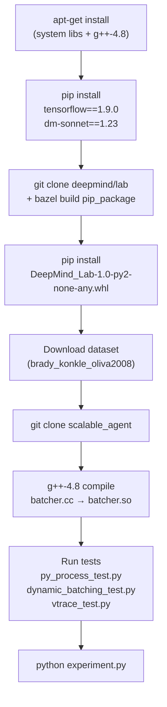
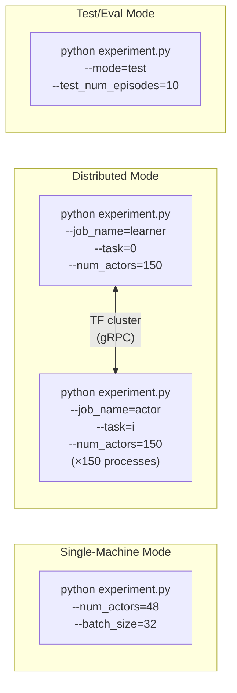

<!-- source: DeepWiki mcp.deepwiki.com · repo google-deepmind/scalable_agent · page 7 Setup and Deployment · fetched 2026-10-26 -->

# Setup and Deployment

<details>
<summary>Relevant source files</summary>

The following files were used as context for generating this wiki page:

- [Dockerfile](Dockerfile)
- [README.md](README.md)

</details>


This page covers the concrete steps required to build, configure, and run the scalable_agent system: installing dependencies, compiling the `batcher.so` custom TensorFlow op, preparing datasets, and invoking `experiment.py` for single-machine or distributed training and evaluation.

For information about the command-line flags accepted by `experiment.py`, see [Configuration and Flags](#2.4). For details on the DMLab-30 benchmark levels and scoring, see [DMLab-30 Benchmark](#6).

---

## Environment Overview

The system requires a specific combination of system libraries, Python packages, and compiled artifacts. The canonical reference for all dependencies is the provided `Dockerfile`.

**Dependency summary:**

| Component | Required Version | Notes |
|---|---|---|
| Base OS | Ubuntu 18.04 | Reference platform |
| Python | 2.x | `python` / `python-pip` |
| TensorFlow | 1.9.0 | Pinned; dev build ≥ `1.9.0-dev20180530` also works |
| dm-sonnet | 1.23 | Neural network module library |
| DeepMind Lab | 1.0 | Built and installed as a pip package |
| g++ | 4.8 | **Not** 5.4 — see note below |
| Bazel | latest stable | Used to build DeepMind Lab |
| Lua 5.1 | system package | Required by DeepMind Lab |

> **g++ version constraint:** g++ 5.4 does not work due to a known TensorFlow issue ([Dockerfile:4-5]()). The build explicitly installs `g++-4.8`.

Sources: [Dockerfile:1-28]()

---

## Docker Build

The `Dockerfile` encodes the complete reproducible environment. It is the recommended starting point.

**Docker commands (from `Dockerfile` comments):**

```sh
# Remove any existing container
docker rm scalable_agent -v

# Build the image
docker build -t scalable_agent .

# Run the container
docker run --name scalable_agent scalable_agent
```

The default `CMD` runs a short training job followed by a test evaluation [Dockerfile:78]().

Sources: [Dockerfile:80-84]()

---

## Step-by-Step Build Process

The following diagram maps each build stage to the files and commands that execute it.

**Diagram: Build pipeline from OS to runnable experiment**



Sources: [Dockerfile:1-78]()

### 1. System Packages

[Dockerfile:5-28]() installs the required system libraries. Key packages:

| Package | Purpose |
|---|---|
| `g++-4.8` | Compiles `batcher.cc` |
| `lua5.1` / `liblua5.1-0-dev` | DeepMind Lab runtime |
| `libosmesa6-dev` | Offscreen OpenGL rendering |
| `libsdl2-dev` | SDL display (Lab) |
| `python-pip` | Python package manager |
| `libjpeg-dev` | Image decoding |
| `bazel` | Build system for DeepMind Lab |

### 2. Python Packages

[Dockerfile:38]():
```sh
pip install tensorflow==1.9.0 dm-sonnet==1.23
```

### 3. DeepMind Lab

[Dockerfile:43-51]() clones and builds Lab from source using Bazel, then installs the resulting wheel. The NumPy include path must be injected into `python.BUILD` before building:

```sh
NP_INC="$(python -c 'import numpy as np; print(np.get_include())[5:]')"
git clone https://github.com/deepmind/lab.git
cd lab
# patch python.BUILD with NP_INC ...
bazel build -c opt python/pip_package:build_pip_package
pip install wheel
./bazel-bin/python/pip_package/build_pip_package /tmp/dmlab_pkg
pip install /tmp/dmlab_pkg/DeepMind_Lab-1.0-py2-none-any.whl --force-reinstall
```

### 4. Dataset

[Dockerfile:53-61]() downloads the `brady_konkle_oliva2008` image dataset, which is required for texture-rich DMLab levels. It reads the shell commands from the dataset's `README.md` and executes them. The dataset is placed in `../dataset` relative to the working directory (i.e., the parent of `scalable_agent/`).

`Pillow` is installed as a prerequisite:
```sh
pip install Pillow
```

### 5. Compiling `batcher.so`

[Dockerfile:68-70]() compiles the C++ TensorFlow custom op:

```sh
TF_INC="$(python -c 'import tensorflow as tf; print(tf.sysconfig.get_include())')"
TF_LIB="$(python -c 'import tensorflow as tf; print(tf.sysconfig.get_lib())')"
g++-4.8 -std=c++11 -shared batcher.cc -o batcher.so -fPIC \
    -I $TF_INC -O2 -D_GLIBCXX_USE_CXX11_ABI=0 \
    -L$TF_LIB -ltensorflow_framework
```

The output `batcher.so` is loaded at import time by `dynamic_batching.py`. For details on what this library implements, see [C++ Backend](#4.2).

**Compiler flags explained:**

| Flag | Meaning |
|---|---|
| `-std=c++11` | C++11 standard required by TF custom ops |
| `-shared` | Produce a shared library |
| `-fPIC` | Position-independent code (required for `.so`) |
| `-D_GLIBCXX_USE_CXX11_ABI=0` | Matches TensorFlow's ABI; avoids linker errors |
| `-ltensorflow_framework` | Links against TensorFlow's framework library |

Sources: [Dockerfile:67-70]()

---

## Running Tests

Three test scripts validate the core components before running the experiment:

```sh
python py_process_test.py
python dynamic_batching_test.py
python vtrace_test.py
```

These correspond to the test modules shown in the repository component map and must all pass before `experiment.py` is reliable. `batcher.so` must be compiled before `dynamic_batching_test.py` can run.

Sources: [Dockerfile:72-75]()

---

## Running the Experiment

All training and evaluation is driven through `experiment.py`. The following sections show the canonical invocations.

**Diagram: experiment.py invocation modes and key flags**



Sources: [README.md:37-78]()

### Single-Machine Training

Trains on the default level (`explore_goal_locations_small`):

```sh
python experiment.py --num_actors=48 --batch_size=32
```

- Expected outcome: average episode return ~200–250 after 1B frames.
- Each actor (including the embedded DeepMind Lab environment) consumes a few hundred MB of RAM.
- Tune `--num_actors` and `--batch_size` to fit available memory.

Sources: [README.md:37-44]()

### Distributed Training on DMLab-30

Trains across all 30 DMLab levels simultaneously. Requires 150 actor processes and one learner process, typically spread across multiple machines using a TensorFlow cluster.

**Learner process:**

```sh
python experiment.py --job_name=learner --task=0 --num_actors=150 \
    --level_name=dmlab30 --batch_size=32 \
    --entropy_cost=0.0033391318945337044 \
    --learning_rate=0.00031866995608948655 \
    --total_environment_frames=10000000000 \
    --reward_clipping=soft_asymmetric
```

**Actor processes (150 total):**

```sh
for i in $(seq 0 149); do
  python experiment.py --job_name=actor --task=$i \
      --num_actors=150 --level_name=dmlab30 --dataset_path=[...] &
done
wait
```

- `--dataset_path` must point to the downloaded `brady_konkle_oliva2008` dataset directory.
- Each actor identifies itself by `--task=$i` (0-indexed) so the TF cluster routing is correct.
- Across 10 seeds with identical hyperparameters, training capped human-normalized scores of 45–50 are observed.

Sources: [README.md:49-71]()

### Test Score Evaluation

After training, evaluate the saved policy:

```sh
python experiment.py --mode=test --level_name=dmlab30 \
    --dataset_path=[...] --test_num_episodes=10
```

Test scores are typically ~2% absolute lower than training scores on DMLab-30.

Sources: [README.md:73-79]()

---

## Key Flag Reference for Deployment

The full flag list is documented in [Configuration and Flags](#2.4). The flags most relevant to deployment are:

| Flag | Default | Meaning |
|---|---|---|
| `--job_name` | `""` (single process) | `learner` or `actor` for distributed mode |
| `--task` | `0` | Worker index within the job |
| `--num_actors` | varies | Total number of actor processes |
| `--batch_size` | `32` | Trajectory batch size for the learner |
| `--level_name` | `explore_goal_locations_small` | Single level name or `dmlab30` |
| `--dataset_path` | `""` | Path to image dataset (required for some levels) |
| `--total_environment_frames` | `10^9` | Training budget in environment frames |
| `--reward_clipping` | `abs_one` | `abs_one` or `soft_asymmetric` |
| `--mode` | `train` | `train` or `test` |
| `--test_num_episodes` | `10` | Episodes per level during test evaluation |

Sources: [README.md:37-79]()

---

