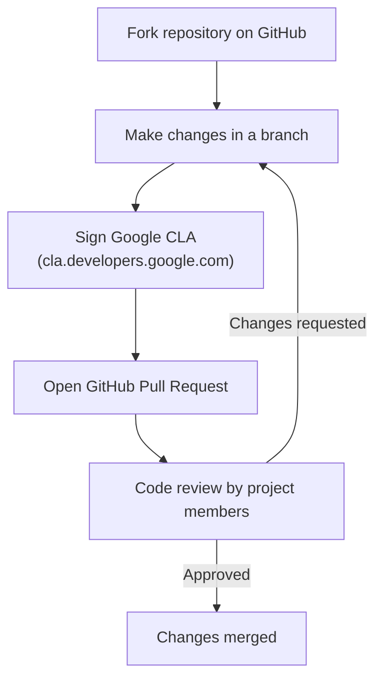
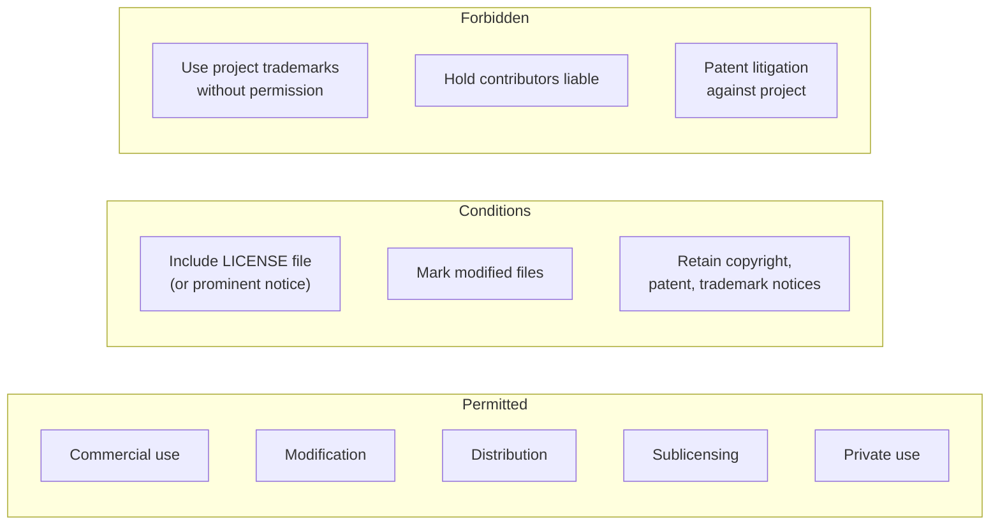

<!-- source: DeepWiki mcp.deepwiki.com · repo google-deepmind/scalable_agent · page 8 Contributing and License · fetched 2026-10-26 -->

# Contributing and License

<details>
<summary>Relevant source files</summary>

The following files were used as context for generating this wiki page:

- [CONTRIBUTING.md](CONTRIBUTING.md)
- [LICENSE](LICENSE)

</details>


This page covers the legal and procedural requirements for contributing to the `scalable_agent` codebase, and summarizes the terms of the Apache 2.0 license under which the code is distributed. For information about building and running the system, see [Setup and Deployment](#7).

---

## Contributing

The contribution process is defined in [CONTRIBUTING.md:1-29]().

### Workflow Overview

**Contribution process diagram**



Sources: [CONTRIBUTING.md:1-29]()

### Contributor License Agreement (CLA)

All contributions must be accompanied by a signed Contributor License Agreement (CLA). The CLA grants the project permission to use and redistribute your contribution, while you (or your employer) retain the copyright.

| Scenario | Action required |
|---|---|
| First-time contributor | Sign a CLA at `cla.developers.google.com` |
| Already signed for another Google project | No action needed; the existing CLA applies |
| Employer holds copyright | Employer must sign a corporate CLA |

The CLA is a one-time requirement per contributor, not per pull request. See [CONTRIBUTING.md:6-13]().

### Code Review

All submissions — including those from project members — require review before merging. Review is conducted via GitHub pull requests. See [CONTRIBUTING.md:18-23]().

### Community Guidelines

This project follows Google's Open Source Community Guidelines ([CONTRIBUTING.md:25-28]()). The guidelines govern conduct in all project spaces including issues, pull requests, and discussions.

---

## License

The codebase is released under the **Apache License, Version 2.0**. The full license text is in [LICENSE:1-202]().

### Key Terms Summary

| Section | Summary |
|---|---|
| Grant of Copyright License ([LICENSE:67-71]()) | Perpetual, worldwide, royalty-free right to reproduce, modify, publicly display, sublicense, and distribute the Work. |
| Grant of Patent License ([LICENSE:72-88]()) | Royalty-free patent license for claims necessarily infringed by the contribution. Terminates if you initiate patent litigation against the project. |
| Redistribution ([LICENSE:90-129]()) | You may redistribute in any medium, with or without modifications, provided you include the license text, mark modified files, and retain attribution notices. |
| Submission of Contributions ([LICENSE:131-137]()) | Unless explicitly stated, contributions submitted for inclusion are licensed under Apache 2.0 without additional terms. |
| Trademarks ([LICENSE:139-142]()) | No right to use Google/DeepMind trade names or product names is granted. |
| Disclaimer of Warranty ([LICENSE:144-152]()) | The Work is provided "AS IS", without warranty of any kind. |
| Limitation of Liability ([LICENSE:153-164]()) | Contributors are not liable for any direct, indirect, incidental, or consequential damages. |

### What Apache 2.0 Permits and Requires

**Apache 2.0 permissions and conditions diagram**



Sources: [LICENSE:67-176]()

### Applying the License to Derivative Works

If you create derivative works based on `scalable_agent`, the Apache 2.0 boilerplate ([LICENSE:179-202]()) specifies that you should attach the following notice to each file, replacing `[yyyy]` and `[name of copyright owner]` with appropriate values:

```
Copyright [yyyy] [name of copyright owner]

Licensed under the Apache License, Version 2.0 (the "License");
you may not use this file except in compliance with the License.
You may obtain a copy of the License at

    http://www.apache.org/licenses/LICENSE-2.0
```

Sources: [LICENSE:179-202]()