# Page: Overview

# Overview

<details>
<summary>Relevant source files</summary>

The following files were used as context for generating this wiki page:

- [README.md](README.md)
- [experiment.py](experiment.py)

</details>


This page introduces the `scalable_agent` repository, explains the IMPALA distributed reinforcement learning algorithm it implements, and maps every major source file to its role in the system. It is a starting point for navigating the codebase — for deeper coverage of any component, follow the links to the dedicated wiki pages listed throughout.

---

## What This Repository Implements

`scalable_agent` is a TensorFlow 1.x implementation of **IMPALA** (Importance Weighted Actor-Learner Architectures), described in the paper *"IMPALA: Scalable Distributed Deep-RL with Importance Weighted Actor-Learner Architectures"* (Espeholt et al., ICML 2018).

The core design separates **environment interaction** (actors) from **gradient computation** (learner). Because actors run a potentially stale copy of the policy, the learner applies **V-trace** importance-weighted off-policy correction before computing gradients. This separation allows the number of actors — and therefore environment throughput — to scale independently of the learner.

The implementation targets **DeepMind Lab** environments, specifically the DMLab-30 benchmark suite, but the architecture has been applied to other domains (Atari, Street View navigation, image generation) according to the paper.

---

## Repository File Map

The table below lists every significant source file, its language, and its responsibility.

| File | Language | Responsibility |
|---|---|---|
| `experiment.py` | Python | Top-level entry point. Defines `Agent`, `build_actor`, `build_learner`, `train()`, `test()`. |
| `vtrace.py` | Python | V-trace off-policy return computation. |
| `environments.py` | Python | `PyProcessDmLab` and `FlowEnvironment` wrappers for DeepMind Lab. |
| `py_process.py` | Python | Subprocess isolation via `multiprocessing.Pipe`; `PyProcess` and `PyProcessHook`. |
| `dynamic_batching.py` | Python | `@batch_fn` decorator API for batching actor inference calls. |
| `batcher.cc` | C++ | TensorFlow custom ops backing `dynamic_batching.py`; compiled to `batcher.so`. |
| `dmlab30.py` | Python | DMLab-30 level lists, human/random score tables, `compute_human_normalized_score`. |
| `vtrace_test.py` | Python | Unit tests for `vtrace.py`. |
| `dynamic_batching_test.py` | Python | Unit tests for `dynamic_batching.py`. |
| `py_process_test.py` | Python | Unit tests for `py_process.py`. |
| `Dockerfile` | Docker | Reference build environment (TF 1.9, dm-sonnet 1.23, DeepMind Lab). |

Sources: [experiment.py:1-40](), [README.md:1-88]()

---

## Component Dependency Graph

**Diagram: Module dependency relationships (experiment.py at center)**

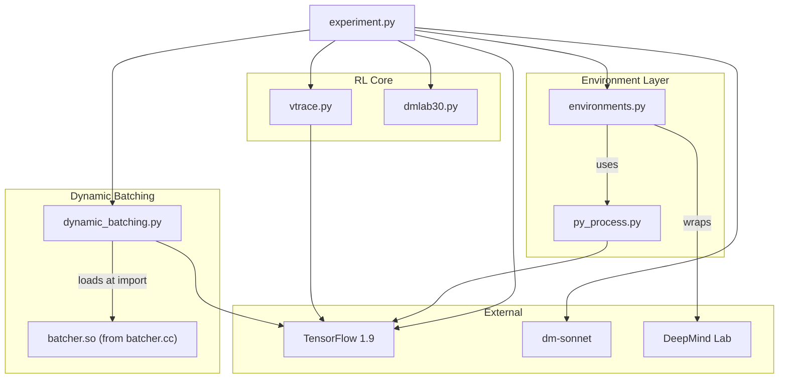

Sources: [experiment.py:27-38](), [README.md:25-30]()

---

## The IMPALA Algorithm: Actors and Learner

IMPALA's key insight is that **actors and the learner run concurrently and asynchronously**. Each actor maintains its own copy of the environment and a local (potentially stale) copy of the policy weights. Actors produce **trajectories** — sequences of observations, actions, and rewards — and push them into a shared queue. The learner dequeues batches of trajectories, re-evaluates them under the **current** policy, and applies V-trace correction to account for the policy lag before computing gradients.

**Diagram: IMPALA actor-learner data flow (code entities)**

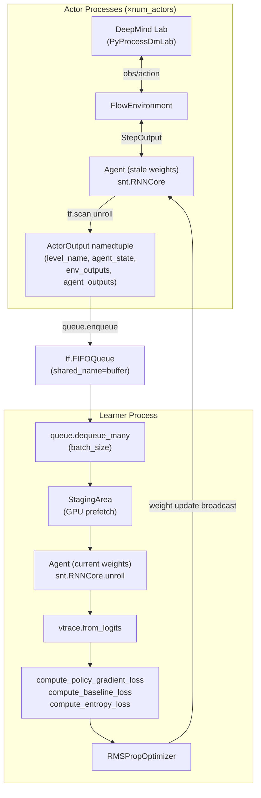

Sources: [experiment.py:459-643](), [experiment.py:334-415](), [experiment.py:94-97]()

---

## Key Data Structures

Two named tuples are defined in `experiment.py` and flow through the entire system:

**`ActorOutput`** — produced by `build_actor`, enqueued by actors, dequeued by the learner:

```
ActorOutput(level_name, agent_state, env_outputs, agent_outputs)
```

[experiment.py:94-95]()

**`AgentOutput`** — produced by `Agent._head` at every timestep during actor unrolls and learner re-evaluation:

```
AgentOutput(action, policy_logits, baseline)
```

[experiment.py:96-97]()

These structures are passed through `tf.FIFOQueue` by flattening with `nest.flatten` and reconstructed with `nest.pack_sequence_as`. See [page 2](#2) for the full data flow description.

---

## Training Modes

The `main()` function in [experiment.py:682-700]() dispatches to one of two top-level functions based on `--mode`:

| Mode | Function | Description |
|---|---|---|
| `train` | `train(action_set, level_names)` | Runs the full actor-learner training loop. Supports single-machine (`--task=-1`) and distributed (`--job_name=learner\|actor`) setups. |
| `test` | `test(action_set, level_names)` | Loads a checkpoint, runs actors for `--test_num_episodes` episodes per level, reports mean return and optionally human-normalized score. |

**Single-machine mode** (`--task=-1`): actors run as `QueueRunner` threads in the same process; dynamic batching is enabled if `batcher.so` is available to improve GPU utilization.

**Distributed mode**: each process is either a learner (`--job_name=learner --task=0`) or one actor (`--job_name=actor --task=i`). The `tf.train.ClusterSpec` assigns actors to ports `8001+i` and the learner to port `8000`.

Sources: [experiment.py:459-500](), [experiment.py:682-700](), [README.md:37-79]()

---

## Quick-Start Commands

Single-machine training (default level `explore_goal_locations_small`):

```sh
python experiment.py --num_actors=48 --batch_size=32
```

Distributed learner:

```sh
python experiment.py --job_name=learner --task=0 --num_actors=150 \
    --level_name=dmlab30 --batch_size=32 --reward_clipping=soft_asymmetric
```

Distributed actors (one per task id):

```sh
python experiment.py --job_name=actor --task=$i \
    --num_actors=150 --level_name=dmlab30
```

Evaluation:

```sh
python experiment.py --mode=test --level_name=dmlab30 --test_num_episodes=10
```

Sources: [README.md:37-79]()

---

## Where to Go Next

| Topic | Wiki Page |
|---|---|
| Full training loop, `train()`, `test()`, `ActorOutput` lifecycle | [IMPALA Training System](#2) |
| `Agent` class, convolutional torso, LSTM, `_build`/`unroll` | [Agent Architecture](#2.1) |
| `build_actor`, `tf.scan` unroll, `FlowEnvironment` wiring | [Actors](#2.2) |
| `build_learner`, loss functions, RMSProp optimizer | [Learner and Loss Computation](#2.3) |
| All `--flag` definitions and their effects | [Configuration and Flags](#2.4) |
| V-trace algorithm and `vtrace.py` API | [V-trace Algorithm](#3) |
| Dynamic batching system end-to-end | [Dynamic Batching](#4) |
| `PyProcessDmLab`, `FlowEnvironment`, `DEFAULT_ACTION_SET` | [DeepMind Lab Integration](#5.1) |
| `PyProcess`, `_TFProxy`, `PyProcessHook` | [Python Process Management](#5.2) |
| DMLab-30 levels, `compute_human_normalized_score` | [DMLab-30 Benchmark](#6) |
| Docker build, `batcher.so` compilation, deployment | [Setup and Deployment](#7) |

---

# Page: IMPALA Training System

# IMPALA Training System

<details>
<summary>Relevant source files</summary>

The following files were used as context for generating this wiki page:

- [README.md](README.md)
- [experiment.py](experiment.py)

</details>


This page describes the distributed training architecture of the IMPALA implementation: how actors and the learner are organized, what data flows between them, and how `train()` and `test()` in [experiment.py]() wire everything together. For the neural network architecture of the agent itself, see [Agent Architecture](#2.1). For actor internals, see [Actors](#2.2). For learner loss computation details, see [Learner and Loss Computation](#2.3). For V-trace off-policy correction, see [V-trace Algorithm](#3).

---

## Overview

IMPALA separates **experience generation** from **learning**. Multiple actor processes run the environment and a stale copy of the policy to generate trajectories. A single learner consumes those trajectories from a shared queue, computes importance-weighted V-trace returns, and updates the policy. Because actors generate data with weights that may lag behind the learner, V-trace off-policy correction is applied on every batch.

All orchestration lives in `experiment.py`. The two top-level entry points are `train()` and `test()`.

Sources: [experiment.py:459-700]()

---

## Core Data Structures

Two namedtuples form the contract between actors and the learner.

| Namedtuple | Fields | Defined at |
|---|---|---|
| `ActorOutput` | `level_name`, `agent_state`, `env_outputs`, `agent_outputs` | [experiment.py:94-95]() |
| `AgentOutput` | `action`, `policy_logits`, `baseline` | [experiment.py:96-97]() |

`ActorOutput` is what each actor enqueues. The learner dequeues a batch of these and reconstructs the full training inputs from them.

- `env_outputs` is a `StepOutput` namedtuple from `environments.py` with fields `reward`, `info`, `done`, and `observation`. Its time dimension is `T+1` (unroll length plus the bootstrapped initial step).
- `agent_outputs` is an `AgentOutput` with the same `T+1` time dimension, recording what the **actor's stale policy** produced at each step.
- `agent_state` is the initial LSTM hidden state at the start of the unroll, used on the learner to replay the trajectory through the **current** policy.

Sources: [experiment.py:94-97](), [experiment.py:300-309]()

---

## Deployment Modes

The `train()` function supports two topologies, selected via the `--task` flag.

**Figure: Deployment Mode Selection**

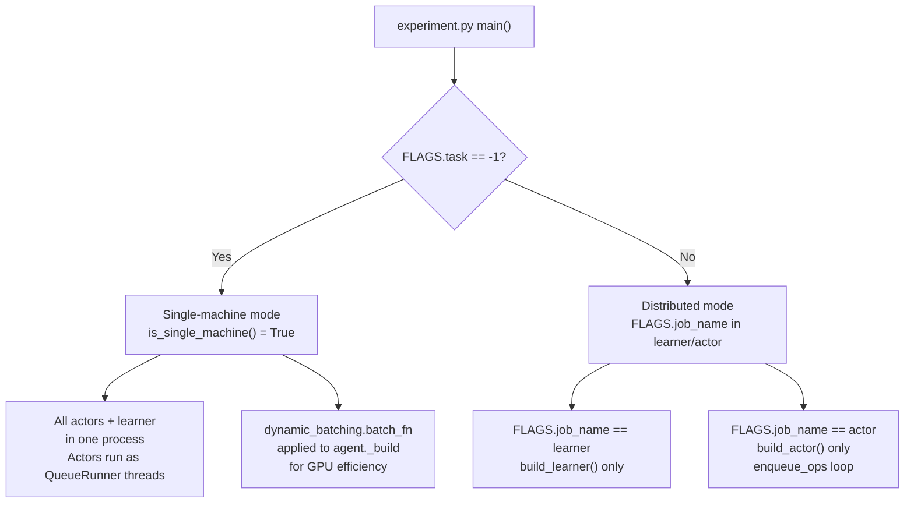

Sources: [experiment.py:459-487](), [experiment.py:506-518](), [experiment.py:533-534](), [experiment.py:640-643]()

| Flag | Single-machine value | Distributed value |
|---|---|---|
| `local_job_device` | `''` | `/job:<name>/task:<id>` |
| `shared_job_device` | `''` | `/job:learner/task:0` |
| `global_variable_device` | `/gpu` | `shared_job_device + '/cpu'` |
| Actor scheduling | `QueueRunner` threads | Separate processes, explicit `session.run(enqueue_ops)` |

In distributed mode, global variables are pinned to the learner's CPU via `pin_global_variables()` [experiment.py:442-456]() so that pulling weights from the learner to actors does not require repeated GPU memory copies.

Sources: [experiment.py:459-487](), [experiment.py:442-456]()

---

## Actor–Learner Data Flow

**Figure: Runtime Data Flow (`train()` function)**

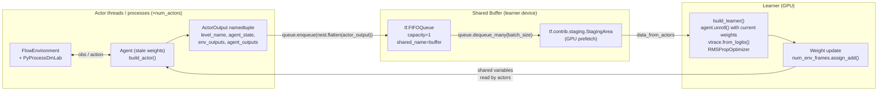

Sources: [experiment.py:502-503](), [experiment.py:527-529](), [experiment.py:533-534](), [experiment.py:547-574](), [experiment.py:560-574]()

The queue has **capacity 1** [experiment.py:503](). This provides minimal buffering — actors can run one unroll ahead of the learner — preventing runaway staleness without starving the learner.

The `StagingArea` [experiment.py:563-568]() holds one pre-staged batch on the GPU, allowing data transfer and the training step to overlap. This adds at most one step of policy lag.

---

## `train()` Execution Sequence

**Figure: `train()` Graph Construction and Session Loop**

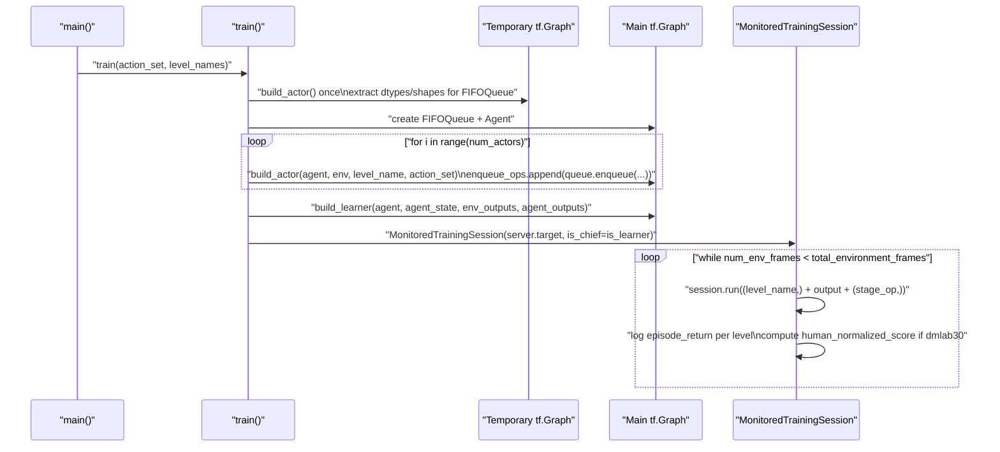

Sources: [experiment.py:459-643]()

### Batch Reconstruction

When the learner dequeues a batch, it goes through two transformations:

1. **Unflattening**: `nest.pack_sequence_as(structure, dequeued)` [experiment.py:549]() reconstructs the `ActorOutput` structure from the flat list of tensors that the queue stores.
2. **Time-major transpose**: `make_time_major()` [experiment.py:551-553]() transposes `env_outputs` and `agent_outputs` from `[batch, time, ...]` to `[time, batch, ...]` because `agent.unroll()` and `vtrace.from_logits()` expect time as the leading dimension.

Sources: [experiment.py:547-557]()

---

## `test()` Function

The `test()` function is structurally simpler than `train()`. It builds a single graph with one actor per level (no learner, no queue), loads a checkpoint via `SingularMonitoredSession`, and runs each level until `test_num_episodes` complete episodes are collected.

```
test(action_set, level_names)
  └── for each level_name:
        env = create_environment(level_name, seed=1, is_test=True)
        outputs[level_name] = build_actor(agent, env, level_name, action_set)
  └── SingularMonitoredSession(checkpoint_dir=FLAGS.logdir)
        └── session.run(env_outputs.done, env_outputs.info)  [repeated]
        └── collect episode_return when done[1:] is True
  └── if dmlab30: compute_human_normalized_score(level_returns)
```

Test mode uses `is_test=True` in `create_environment()` [experiment.py:433](), which sets `allowHoldOutLevels=true` and a fixed `mixerSeed=0x600D5EED` for reproducible evaluation.

Sources: [experiment.py:646-679]()

---

## `create_environment()`

`create_environment()` [experiment.py:418-439]() is the factory used by both `train()` and `test()` to assemble the two-layer environment stack:

```
create_environment(level_name, seed, is_test=False)
  └── py_process.PyProcess(environments.PyProcessDmLab, level_name, config, num_action_repeats, seed)
        └── environments.FlowEnvironment(p.proxy)
```

The resulting `FlowEnvironment` is the object passed as `env` to `build_actor()`. For details on this stack, see [Environment Infrastructure](#5).

Sources: [experiment.py:418-439]()

---

## Key Relationships Between Code Entities

**Figure: Code Entity Dependency Map for `experiment.py`**

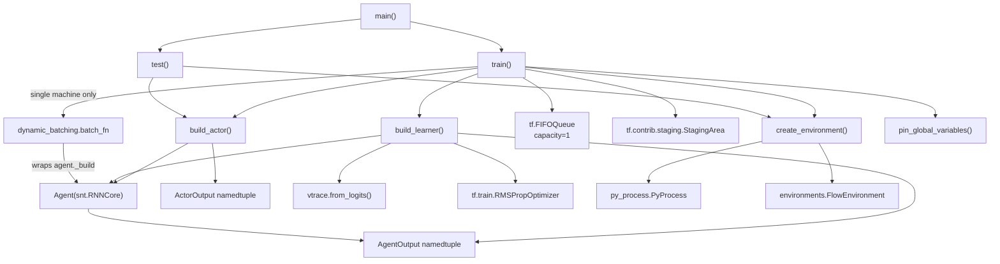

Sources: [experiment.py:459-700]()

---

## Loss Functions

Three loss component functions are defined at module level and called from `build_learner()`:

| Function | Formula summary | Source |
|---|---|---|
| `compute_policy_gradient_loss()` | `sum(cross_entropy(logits, actions) * stop_gradient(advantages))` | [experiment.py:326-331]() |
| `compute_baseline_loss()` | `0.5 * sum((vs - baseline)²)` | [experiment.py:312-316]() |
| `compute_entropy_loss()` | `-sum(policy * log_policy)` | [experiment.py:319-323]() |

The total loss is:

```
total_loss = policy_gradient_loss
           + baseline_cost  * baseline_loss
           + entropy_cost   * entropy_loss
```

where `baseline_cost` defaults to `0.5` and `entropy_cost` defaults to `0.00025`. See [Learner and Loss Computation](#2.3) for how `vtrace_returns.pg_advantages` and `vtrace_returns.vs` are derived.

Sources: [experiment.py:312-331](), [experiment.py:389-395]()

---

## Learning Rate Schedule

The learner uses a polynomial decay schedule that linearly anneals the learning rate from `FLAGS.learning_rate` to `0` over `FLAGS.total_environment_frames` steps, using the global step counter `num_environment_frames` as the clock:

```python
learning_rate = tf.train.polynomial_decay(
    FLAGS.learning_rate, num_env_frames,
    FLAGS.total_environment_frames, 0)
optimizer = tf.train.RMSPropOptimizer(learning_rate, FLAGS.decay,
                                      FLAGS.momentum, FLAGS.epsilon)
```

[experiment.py:399-402]()

The global step is incremented by `batch_size × unroll_length × num_action_repeats` per training step [experiment.py:407-408](), so it tracks **environment frames** (not gradient steps).

Sources: [experiment.py:398-408]()

---

## Summary of Responsibilities

| Component | Role | Primary code location |
|---|---|---|
| `train()` | Builds the full TF graph; runs the session loop; logs summaries | [experiment.py:459-643]() |
| `test()` | Loads checkpoint; runs actors; collects episode returns | [experiment.py:646-679]() |
| `build_actor()` | Constructs the `tf.scan`-based unroll loop; produces `ActorOutput` | [experiment.py:228-309]() |
| `build_learner()` | Unrolls agent with current weights; computes losses; applies gradients | [experiment.py:334-415]() |
| `create_environment()` | Assembles `PyProcess` + `FlowEnvironment` stack | [experiment.py:418-439]() |
| `pin_global_variables()` | Context manager pinning global vars to a specific device | [experiment.py:442-456]() |
| `ActorOutput` | Namedtuple carrying trajectory data from actor to learner | [experiment.py:94-95]() |
| `AgentOutput` | Namedtuple carrying per-step agent outputs | [experiment.py:96-97]() |
| `Agent` | `snt.RNNCore` implementing the policy and value function | [experiment.py:104-225]() |

---

# Page: Agent Architecture

# Agent Architecture

<details>
<summary>Relevant source files</summary>

The following files were used as context for generating this wiki page:

- [experiment.py](experiment.py)

</details>


This page documents the `Agent` class defined in [experiment.py:104-225](), which is the neural network at the center of the IMPALA system. It covers the class structure, each sub-network component, the data flow through the forward pass, and how the agent produces `AgentOutput` values.

For how actors use an `Agent` instance to generate experience trajectories, see [Actors](#2.2). For how the learner re-runs the agent to compute losses, see [Learner and Loss Computation](#2.3).

---

## Overview

`Agent` is a Sonnet `RNNCore` module. It wraps a 256-unit LSTM and exposes the standard Sonnet recurrent interface: `initial_state` to create a zero state and `_build` / `unroll` to step or unroll through a sequence.

Both actors (inference) and the learner (training) use the same `Agent` object with the same weights. Actors call `agent(...)` — which dispatches to `_build` — for single-step inference. The learner calls `agent.unroll(...)` to re-process entire trajectories for gradient computation.

**Key named tuples:**

| Named tuple | Defined at | Fields |
|---|---|---|
| `AgentOutput` | [experiment.py:96-97]() | `action`, `policy_logits`, `baseline` |
| `ActorOutput` | [experiment.py:94-95]() | `level_name`, `agent_state`, `env_outputs`, `agent_outputs` |

---

## Class Structure

**Agent class diagram:**

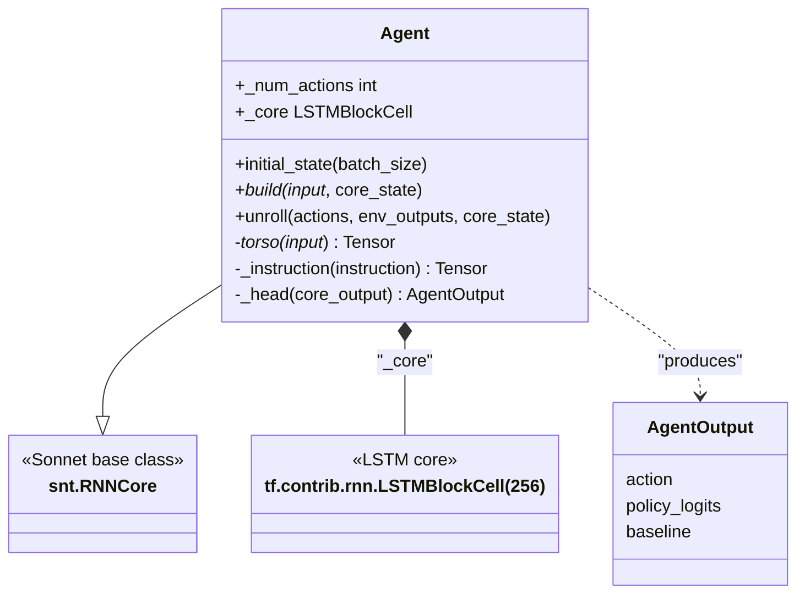

Sources: [experiment.py:104-116]()

---

## Sub-Networks

The forward pass is decomposed into three private methods: `_torso`, `_instruction`, and `_head`. The diagram below shows how these compose:

**Forward pass data flow:**

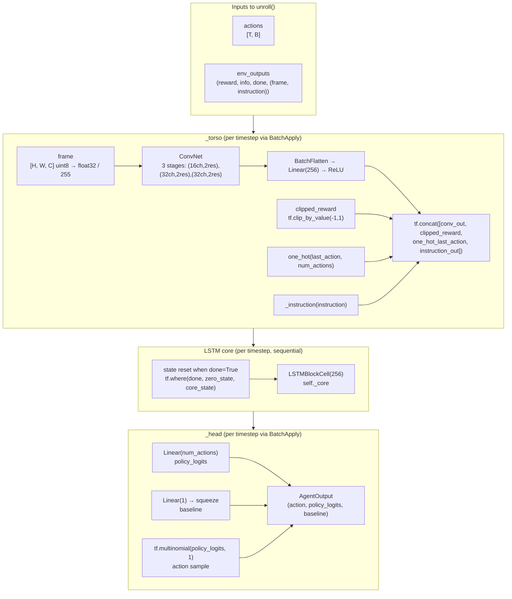

Sources: [experiment.py:143-225]()

---

### Convolutional Torso (`_torso`)

Defined at [experiment.py:143-186]().

The torso processes one frame at a time (applied across all timesteps via `snt.BatchApply`). It takes a `(last_action, env_output)` tuple and returns a flat feature vector.

**Convolutional stages:**

| Stage | Channels | Residual blocks | Downscale |
|---|---|---|---|
| 0 | 16 | 2 | MaxPool 3×3, stride 2 |
| 1 | 32 | 2 | MaxPool 3×3, stride 2 |
| 2 | 32 | 2 | MaxPool 3×3, stride 2 |

Each residual block at stage `i`, block `j` (variable scope `residual_i_j`) computes:

```
block_input = conv_out
conv_out = ReLU(conv_out)
conv_out = Conv2D(num_ch, 3, SAME)(conv_out)
conv_out = ReLU(conv_out)
conv_out = Conv2D(num_ch, 3, SAME)(conv_out)
conv_out += block_input
```

After all conv stages: `ReLU → BatchFlatten → Linear(256) → ReLU`.

The torso concatenates four components into the final output:

| Component | Source | Notes |
|---|---|---|
| `conv_out` | Convolutional output | 256-dimensional |
| `clipped_reward` | `reward` from `env_output` | Clipped to `[-1, 1]`, shape `[B, 1]` |
| `one_hot_last_action` | `last_action` | Shape `[B, num_actions]` |
| `instruction_out` | `_instruction(instruction)` | 64-dimensional |

Sources: [experiment.py:143-186]()

---

### Instruction Embedding (`_instruction`)

Defined at [experiment.py:118-141]().

This sub-network converts a variable-length string instruction into a fixed-size 64-dimensional vector.

**Pipeline:**

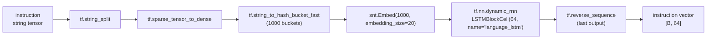

- Words are hashed into 1000 buckets (small collision risk; a vocabulary lookup is an alternative).
- Embedding size is 20.
- A separate `LSTMBlockCell(64)` named `language_lstm` processes the embedded sequence.
- `tf.reverse_sequence` is used to extract the last valid output per sequence.

Sources: [experiment.py:118-141]()

---

### Head (`_head`)

Defined at [experiment.py:188-198]().

The head takes the 256-dimensional LSTM output and produces the `AgentOutput` tuple.

| Output field | Computation | Shape |
|---|---|---|
| `policy_logits` | `Linear(num_actions)(core_output)` | `[B, num_actions]` |
| `baseline` | `squeeze(Linear(1)(core_output))` | `[B]` |
| `action` | `tf.multinomial(policy_logits, 1)` | `[B]` |

`policy_logits` are raw (un-normalized) and are used by the learner for V-trace importance weight computation. `baseline` is the value function estimate used as a bootstrap target.

Sources: [experiment.py:188-198]()

---

## LSTM Core and State Management

The LSTM is a `tf.contrib.rnn.LSTMBlockCell(256)` instantiated as `self._core` inside `Agent.__init__` [experiment.py:107-113]().

**State reset on episode boundary:**

The `unroll` method iterates over timesteps manually rather than using `tf.nn.dynamic_rnn`. This is necessary because the LSTM state must be reset to zeros at episode boundaries (when `done=True`), which `dynamic_rnn` does not support directly.

```
for input_, d in zip(tf.unstack(torso_outputs), tf.unstack(done)):
    core_state = nest.map_structure(
        functools.partial(tf.where, d),
        initial_core_state, core_state)
    core_output, core_state = self._core(input_, core_state)
```

[experiment.py:218-223]()

When `done` is `True` for a batch element, `tf.where` selects `initial_core_state` (zeros) for that element before the next LSTM step.

> **Note:** This manual loop prevents using CuDNN-backed RNNs. The code comments that XLA compilation is a potential workaround, requiring a change from `LSTMBlockCell` to `snt.LSTMCell` [experiment.py:214-215]().

**`initial_state`:**

[experiment.py:115-116]() returns `self._core.zero_state(batch_size, tf.float32)`, a standard Sonnet/TF LSTM state tuple of zeros.

Sources: [experiment.py:107-116](), [experiment.py:207-225]()

---

## `_build` vs `unroll`

Both methods produce `AgentOutput`, but they differ in how they handle the time dimension.

| Method | Caller | Time dimension handling |
|---|---|---|
| `_build(input_, core_state)` | Actors (single step inference via `agent(...)`) | Adds a time dimension of 1 via `tf.expand_dims`, calls `unroll`, then removes it via `tf.squeeze` |
| `unroll(actions, env_outputs, core_state)` | Learner (`build_learner`) and internally by `_build` | Processes a full `[T, B, ...]` sequence; decorated with `@snt.reuse_variables` to share weights |

`_build` is a thin wrapper:

```
actions, env_outputs = nest.map_structure(
    lambda t: tf.expand_dims(t, 0), (action, env_output))
outputs, core_state = self.unroll(actions, env_outputs, core_state)
return nest.map_structure(lambda t: tf.squeeze(t, 0), outputs), core_state
```

[experiment.py:200-205]()

The `@snt.reuse_variables` decorator on `unroll` [experiment.py:207]() ensures the same variable scope (and thus the same weights) is used for all calls, whether from actors or the learner.

**Dynamic batching integration:**

In single-machine mode, `agent._build` is replaced at runtime with a `@dynamic_batching.batch_fn`-decorated version [experiment.py:513-517](). This batches concurrent `_build` calls from multiple actor threads into a single GPU kernel call, improving utilization. The dynamic batching layer is described in detail in [Dynamic Batching](#4).

Sources: [experiment.py:200-225](), [experiment.py:506-517]()

---

## Complete Data Flow Through Agent

**Full agent forward pass with code entity names:**

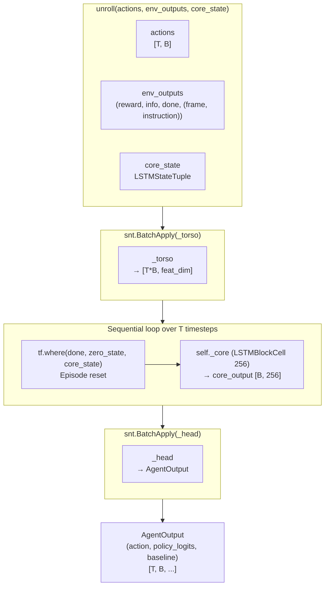

Sources: [experiment.py:207-225]()

---

# Page: Actors

# Actors

<details>
<summary>Relevant source files</summary>

The following files were used as context for generating this wiki page:

- [environments.py](environments.py)
- [experiment.py](experiment.py)
- [py_process.py](py_process.py)

</details>


This page covers the actor side of IMPALA training: the `build_actor` function, the `tf.scan`-based unroll loop, how `ActorOutput` is produced, and how `PyProcess` and `FlowEnvironment` are composed to provide an environment interface to each actor.

For the learner that consumes actor output, see [2.3](#2.3). For the environment infrastructure (`FlowEnvironment`, `PyProcessDmLab`) in depth, see [5.1](#5.1) and [5.2](#5.2). For the agent neural network that actors invoke, see [2.1](#2.1).

---

## Role of an Actor

Each actor runs an interaction loop: it steps its own environment copy using a **stale** version of the agent's weights, collects a fixed-length trajectory (an *unroll*), and pushes the resulting `ActorOutput` to a shared queue consumed by the learner.

Because actor weights may lag behind learner weights, the learner applies V-trace importance-weighted corrections. This is described in [3](#3).

---

## Data Structures

Two namedtuples define the data that actors produce.

[experiment.py:94-97]()

| Namedtuple | Fields | Shape / Description |
|---|---|---|
| `ActorOutput` | `level_name` | String scalar: which level this unroll is from |
| | `agent_state` | LSTM state at the **start** of the unroll |
| | `env_outputs` | `StepOutput` of shape `[T+1, ...]` |
| | `agent_outputs` | `AgentOutput` of shape `[T+1, ...]` |
| `AgentOutput` | `action` | Sampled discrete action index |
| | `policy_logits` | Logits over the action set |
| | `baseline` | Scalar value estimate |

The `+1` in `[T+1, ...]` arises because the first timestep's values (carried over from the previous unroll) are prepended to the scan outputs before packing — see [Unroll Assembly](#unroll-assembly) below.

**Sources:** [experiment.py:94-97]()

---

## Environment Wiring

Before examining the actor loop itself, it is useful to understand what `env` is.

**Actor diagram: Environment stack per actor**

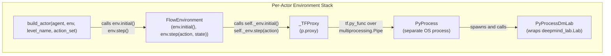

`create_environment` [experiment.py:418-439]() assembles this stack:

1. Instantiates `PyProcess(environments.PyProcessDmLab, level_name, config, num_action_repeats, seed)` — this spawns a subprocess running the lab simulator.
2. Passes `p.proxy` to `FlowEnvironment` — the proxy intercepts attribute access and generates `tf.py_func` ops that communicate over a `multiprocessing.Pipe`.
3. Returns the `FlowEnvironment` instance, which is what `build_actor` receives as `env`.

`FlowEnvironment` introduces a sequential `flow` integer token threaded through `tf.control_dependencies` to ensure environment steps execute in order within the TensorFlow graph. Its two callable methods used by actors are:

| Method | Returns |
|---|---|
| `env.initial()` | `(StepOutput, env_state)` — initial observation with zeroed reward/info |
| `env.step(raw_action, env_state)` | `(StepOutput, new_env_state)` |

`StepOutput` is a namedtuple with fields `(reward, info, done, observation)`, where `info` is a `StepOutputInfo(episode_return, episode_step)`.

**Sources:** [experiment.py:418-439](), [environments.py:134-218](), [py_process.py:61-105](), [py_process.py:161-183]()

---

## build_actor

`build_actor` [experiment.py:228-309]() is the function that constructs the entire actor TensorFlow subgraph. It takes four arguments:

| Argument | Type | Description |
|---|---|---|
| `agent` | `Agent` (snt.RNNCore) | Shared agent instance (same weights as the learner in single-machine mode) |
| `env` | `FlowEnvironment` | Environment for this actor |
| `level_name` | `str` | Level identifier, included in `ActorOutput` |
| `action_set` | tuple | Mapping from action index to native action vectors |

### Initialization Phase

[experiment.py:231-251]()

The function first establishes the initial values needed to start the loop:

1. `env.initial()` → `(initial_env_output, initial_env_state)`
2. `agent.initial_state(1)` → `initial_agent_state` (LSTM zeros, batch size 1)
3. A dummy agent forward pass produces `dummy_agent_output`, from which `initial_agent_output` is constructed as **all-zeros tensors** of the correct shapes.

These initial values are then stored into **local TF variables** (not global) using `tf.get_local_variable`. This is the `persistent_state`:

```
persistent_state = (env_state_var, env_output_var, agent_state_var, agent_output_var)
```

Local variables are explicitly excluded from parameter servers in distributed training, ensuring that per-actor carry-state is never synchronized across machines.

**Sources:** [experiment.py:231-251]()

### The step Function

[experiment.py:253-269]()

`step(input_, unused_i)` is the body passed to `tf.scan`. Each call performs one agent–environment interaction:

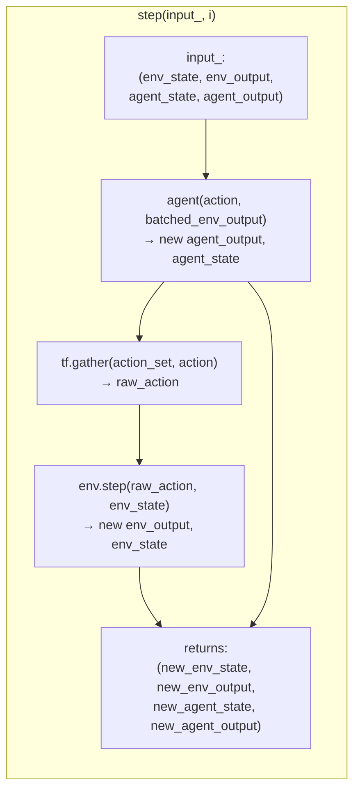

Key details:
- The **previous** agent output's action (`agent_output[0]`) is fed back as the action input for the current agent call.
- The env output is wrapped with `tf.expand_dims` along axis 0 to add a batch dimension before the agent call, since the agent expects `[batch, ...]` shaped inputs.
- `tf.gather(action_set, action)` translates the discrete action index to a 7-element native action vector from `DEFAULT_ACTION_SET`.

**Sources:** [experiment.py:253-269](), [environments.py:53-63]()

### The tf.scan Loop

[experiment.py:272-285]()

```python
first_values = nest.map_structure(lambda v: v.read_value(), persistent_state)
output = tf.scan(step, tf.range(FLAGS.unroll_length), first_values)
```

- `persistent_state` is read via `.read_value()` to capture a consistent snapshot at graph construction time.
- `tf.scan` applies `step` exactly `FLAGS.unroll_length` times (default: 100), threading the output of each call as the input to the next.
- The `elems` argument `tf.range(FLAGS.unroll_length)` is unused inside `step` but required to specify the number of iterations.
- `output` is a nested structure where each leaf tensor has a leading dimension of `unroll_length`, representing the stacked results across all steps.

**Sources:** [experiment.py:272-285]()

### Persistent State Update

[experiment.py:287-298]()

After the scan, the **last** value of each state variable is written back to `persistent_state`:

```python
assign_ops = nest.map_structure(lambda v, t: v.assign(t[-1]),
                                persistent_state, output)
```

This is what allows the next call to `build_actor`'s output op to continue from where the previous unroll ended, rather than restarting from initial values.

**Sources:** [experiment.py:287-298]()

### Unroll Assembly

[experiment.py:290-309]()

Inside a `tf.control_dependencies(assign_ops)` block (guaranteeing state is persisted before the output is used):

1. The **first** values (from `persistent_state` before the scan) are stripped of their batch dimension.
2. The scan `output` values are also reshaped: the batch dimension (always 1 for actors) is removed with `t[:, 0]`.
3. The first value and the scan output are concatenated along time dimension to produce `full_agent_outputs` and `full_env_outputs`, each of length `T+1`.

Finally, `ActorOutput` is assembled and all tensors have `tf.stop_gradient` applied — no backpropagation happens on the actor side.

**Unroll assembly diagram**

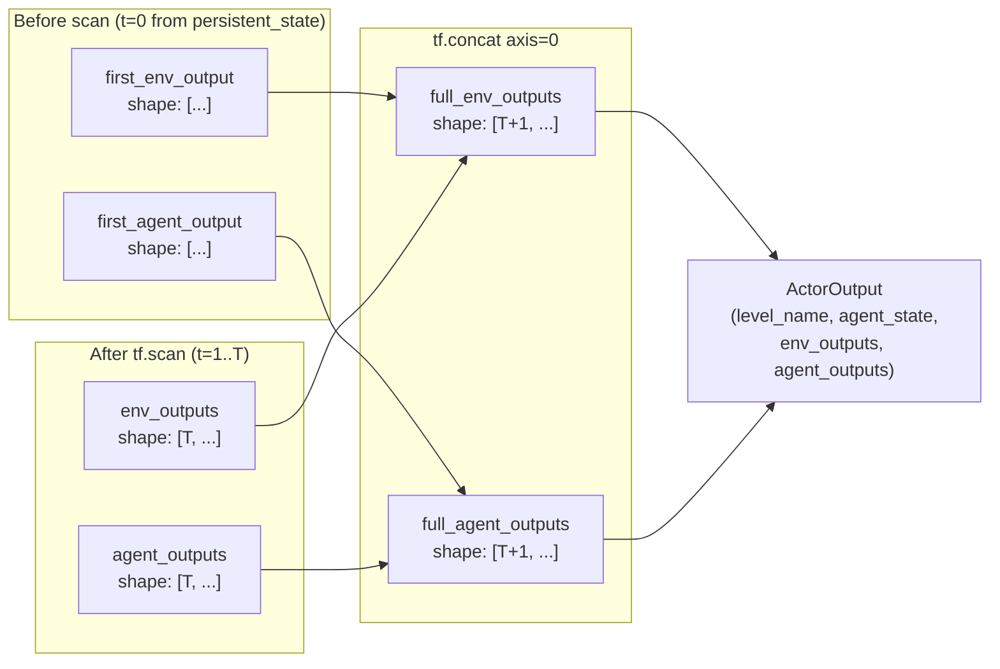

**Sources:** [experiment.py:290-309]()

---

## Complete build_actor Data Flow

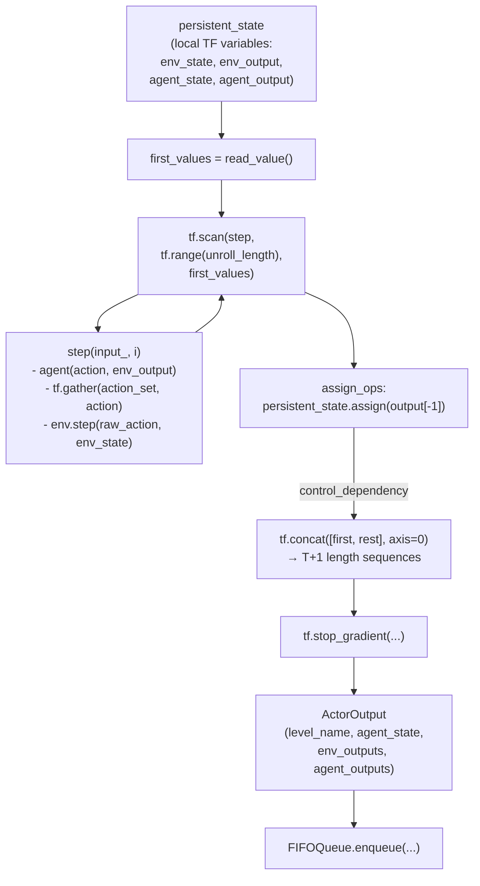

**Sources:** [experiment.py:228-309](), [experiment.py:520-529]()

---

## Actor Execution Model

### Single-Machine Mode

[experiment.py:462-534]()

In single-machine mode (`FLAGS.task == -1`):

- All `num_actors` actors are built into the **same TF graph** as the learner.
- Each actor's `enqueue_ops` is registered with a `tf.train.QueueRunner`, which runs each enqueue op in a separate **thread**.
- If `dynamic_batching` is available, the agent's `_build` method is wrapped with `@dynamic_batching.batch_fn` so that inference calls from multiple actors are batched together on the GPU. See [4.1](#4.1) for the batching API.

### Distributed Mode

[experiment.py:470-485]()

In distributed mode:

- Each actor process runs independently with `FLAGS.job_name == 'actor'` and a unique `FLAGS.task` id.
- The actor builds only its own subgraph (the `if is_actor_fn(i)` guard).
- Actors push directly to the shared `FIFOQueue` on the learner (`shared_job_device`).
- The learner process runs the dequeue and learning loop.
- Global variables (agent weights) are pinned to `shared_job_device + '/cpu'` via `pin_global_variables` [experiment.py:442-456]() to reduce copy cost.

| Mode | Actor execution | Agent weights | Queue |
|---|---|---|---|
| Single-machine | Threads via `QueueRunner` | GPU (shared in-graph) | In-process `FIFOQueue` |
| Distributed | Separate processes | CPU on learner machine | Remote `FIFOQueue` via gRPC |

**Sources:** [experiment.py:459-534](), [experiment.py:442-456]()

---

## Level Assignment

When training on the full DMLab-30 suite (`FLAGS.level_name == 'dmlab30'`), levels are assigned to actors **round-robin**:

[experiment.py:522-527]()

```
level_name = level_names[i % len(level_names)]
```

Each actor is therefore permanently assigned to a single level for the duration of training. The `level_name` string is included in every `ActorOutput` so the learner can associate episode returns with the correct level when computing per-level metrics.

**Sources:** [experiment.py:521-527](), [experiment.py:600-638]()

---

## Test Mode

The `test` function [experiment.py:646-679]() reuses `build_actor` directly: one actor graph is built per level, and the session is run until `FLAGS.test_num_episodes` episode completions are observed per level. No learner or queue is involved — the actor output is inspected directly by reading `env_outputs.done` and `env_outputs.info`.

**Sources:** [experiment.py:646-679]()

---

# Page: Learner and Loss Computation

# Learner and Loss Computation

<details>
<summary>Relevant source files</summary>

The following files were used as context for generating this wiki page:

- [experiment.py](experiment.py)
- [vtrace.py](vtrace.py)

</details>


This page documents the learner side of IMPALA training: the `build_learner` function, the three loss components, V-trace off-policy correction, the RMSProp optimizer, and how gradients flow back into the shared agent weights. For how actors produce the data that the learner consumes, see [Actors](#2.2). For a full treatment of the V-trace algorithm itself, see [V-trace Algorithm](#3).

---

## Role in the Training System

The learner is the sole gradient-computing entity in the system. Actors run a possibly-stale copy of the agent policy and stream trajectory data into a shared FIFO queue. The learner continuously dequeues batches of those trajectories, re-evaluates the agent under current weights, applies V-trace importance weighting to correct for the policy lag, computes a composite loss, and updates the shared agent variables via RMSProp.

**Data flow into the learner:**

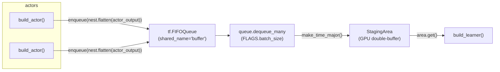

Sources: [experiment.py:502-574]()

---

## Inputs and Outputs of `build_learner`

`build_learner` is defined at [experiment.py:334-415](). It accepts four arguments:

| Argument | Type | Shape | Description |
|---|---|---|---|
| `agent` | `Agent` (snt.RNNCore) | — | The shared agent module |
| `agent_state` | LSTM state tuple | `[B, ...]` | Initial LSTM state for each sequence in the batch |
| `env_outputs` | `StepOutput` namedtuple | `[T+1, B, ...]` | Time-major environment outputs from actors |
| `agent_outputs` | `AgentOutput` namedtuple | `[T+1, B, ...]` | Time-major actor-side policy outputs (stale) |

It returns a tuple `(done, infos, num_env_frames_and_train)`. Evaluating `num_env_frames_and_train` in a session causes a training step and increments the global frame counter.

---

## Internal Computation Steps

**Learner and Loss Computation — step-by-step:**

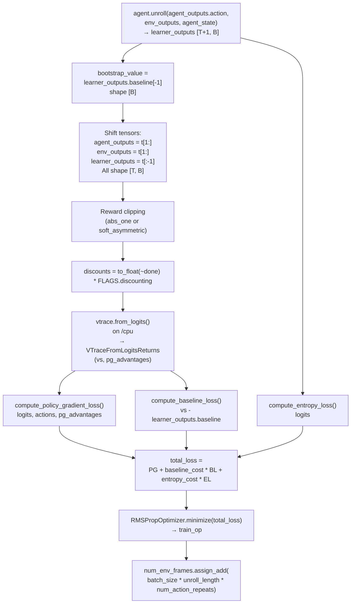

Sources: [experiment.py:334-415]()

---

### Step 1 — Re-evaluating the Agent (Learner Forward Pass)

[experiment.py:350-351]()

```
learner_outputs, _ = agent.unroll(agent_outputs.action, env_outputs, agent_state)
```

`agent.unroll` is called with the **actor's recorded actions** and the original environment observations. This re-runs the agent under **current (learner) weights**, producing fresh `policy_logits` and `baseline` values for the same trajectory the actor executed. The result has shape `[T+1, B]`.

---

### Step 2 — Index Alignment

[experiment.py:354-363]()

The IMPALA convention is that `env_outputs[t]` is the observation that caused `agent_outputs[t]`. After the unroll there is an off-by-one: the last learner baseline is used as the bootstrap, and everything is trimmed to length `T`:

| Tensor | Operation | Resulting shape |
|---|---|---|
| `bootstrap_value` | `learner_outputs.baseline[-1]` | `[B]` |
| `agent_outputs` | `t[1:]` | `[T, B]` |
| `rewards, infos, done` from `env_outputs` | `t[1:]` | `[T, B]` |
| `learner_outputs` | `t[:-1]` | `[T, B]` |

---

### Step 3 — Reward Clipping

[experiment.py:365-370]()

Two modes are supported via `FLAGS.reward_clipping`:

| Mode | Formula |
|---|---|
| `abs_one` | `clip(r, -1, 1)` |
| `soft_asymmetric` | `tanh(r/5) * 5`, negative rewards additionally scaled by `0.3` |

---

### Step 4 — Discounts

[experiment.py:372]()

```python
discounts = tf.to_float(~done) * FLAGS.discounting
```

When a terminal step is encountered (`done=True`), the discount is zeroed, preventing value estimates from bootstrapping across episode boundaries.

---

### Step 5 — V-trace Off-Policy Correction

[experiment.py:374-385]()

```python
vtrace_returns = vtrace.from_logits(
    behaviour_policy_logits=agent_outputs.policy_logits,  # from actor (stale)
    target_policy_logits=learner_outputs.policy_logits,   # from learner (current)
    actions=agent_outputs.action,
    discounts=discounts,
    rewards=clipped_rewards,
    values=learner_outputs.baseline,
    bootstrap_value=bootstrap_value)
```

This is placed explicitly on `/cpu` because the sequential backward scan in V-trace runs faster there. The call returns a `VTraceFromLogitsReturns` namedtuple; the learner uses two fields:

| Field | Shape | Used for |
|---|---|---|
| `vs` | `[T, B]` | Baseline regression target |
| `pg_advantages` | `[T, B]` | Policy gradient weighting |

For full algorithm details see [V-trace Algorithm](#3).

---

### Step 6 — Loss Computation

Three standalone helper functions build the loss components:

#### Policy Gradient Loss

[experiment.py:326-331]()

```python
def compute_policy_gradient_loss(logits, actions, advantages):
    cross_entropy = tf.nn.sparse_softmax_cross_entropy_with_logits(
        labels=actions, logits=logits)
    advantages = tf.stop_gradient(advantages)
    policy_gradient_loss_per_timestep = cross_entropy * advantages
    return tf.reduce_sum(policy_gradient_loss_per_timestep)
```

`advantages` receives `tf.stop_gradient` so gradients flow only through the log-policy term. The result is summed over both the time and batch dimensions.

#### Baseline Loss

[experiment.py:312-316]()

```python
def compute_baseline_loss(advantages):
    return .5 * tf.reduce_sum(tf.square(advantages))
```

Called with `vtrace_returns.vs - learner_outputs.baseline` (the TD error). The `0.5` factor ensures `d(loss)/d(baseline) = advantage`, matching the standard squared-error value regression update.

#### Entropy Regularization Loss

[experiment.py:319-323]()

```python
def compute_entropy_loss(logits):
    policy = tf.nn.softmax(logits)
    log_policy = tf.nn.log_softmax(logits)
    entropy_per_timestep = tf.reduce_sum(-policy * log_policy, axis=-1)
    return -tf.reduce_sum(entropy_per_timestep)
```

The negated entropy is added to the loss, so minimizing the loss maximizes entropy — encouraging exploration.

#### Combined Loss

[experiment.py:388-395]()

```
total_loss = PG_loss
           + FLAGS.baseline_cost × baseline_loss
           + FLAGS.entropy_cost  × entropy_loss
```

Default coefficient values: `baseline_cost = 0.5`, `entropy_cost = 0.00025`.

---

### Step 7 — Optimization

[experiment.py:397-408]()

The learning rate follows a linear decay schedule from `FLAGS.learning_rate` to `0` over `FLAGS.total_environment_frames` steps:

```python
learning_rate = tf.train.polynomial_decay(
    FLAGS.learning_rate, num_env_frames,
    FLAGS.total_environment_frames, 0)
optimizer = tf.train.RMSPropOptimizer(learning_rate, FLAGS.decay,
                                      FLAGS.momentum, FLAGS.epsilon)
train_op = optimizer.minimize(total_loss)
```

Default optimizer settings:

| Parameter | Flag | Default |
|---|---|---|
| Initial learning rate | `--learning_rate` | `0.00048` |
| Decay (ρ) | `--decay` | `0.99` |
| Momentum | `--momentum` | `0.0` |
| Epsilon (ε) | `--epsilon` | `0.1` |

After `train_op`, the global step counter `num_environment_frames` is incremented by `batch_size × unroll_length × num_action_repeats` inside a `tf.control_dependencies` block:

[experiment.py:405-408]()

```python
with tf.control_dependencies([train_op]):
    num_env_frames_and_train = num_env_frames.assign_add(
        FLAGS.batch_size * FLAGS.unroll_length * FLAGS.num_action_repeats)
```

Evaluating `num_env_frames_and_train` guarantees the weight update has occurred before the frame count advances.

---

## Weight Synchronization to Actors

There is no explicit weight-copy operation. Instead, actors and the learner share the same `Agent` module and its underlying TF variables, placed on `global_variable_device`.

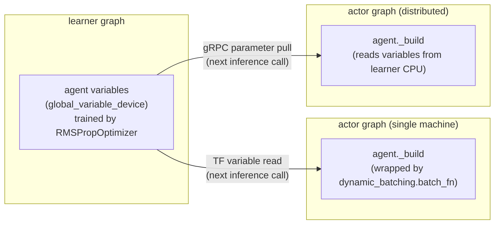

- **Single machine:** All actors run in threads within the same process. They read the latest variable values on the next inference call, incurring up to 1 training step of policy lag due to the `StagingArea` double-buffer.
- **Distributed:** Global variables are pinned to `shared_job_device + '/cpu'` [experiment.py:478](). Actor workers pull updated values via gRPC before each `agent._build` call.

Sources: [experiment.py:459-534]()

---

## TF Summaries Emitted

[experiment.py:411-413]()

| Summary | Type | Description |
|---|---|---|
| `learning_rate` | scalar | Current decayed learning rate |
| `total_loss` | scalar | Combined weighted loss value |
| `action` | histogram | Distribution of actions taken by actors |

---

## How `build_learner` Fits into `train()`

[experiment.py:536-574]()

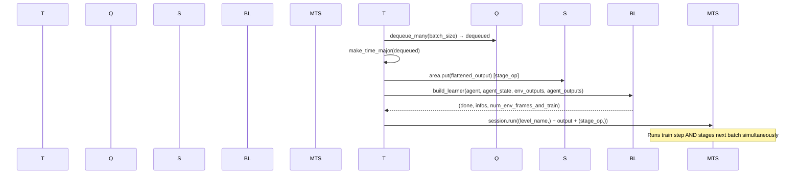

Each call to `session.run` in the main training loop executes both the current training step (`output`) and the staging of the next batch (`stage_op`) atomically, hiding data-transfer latency behind compute.

Sources: [experiment.py:559-602]()

---

# Page: Configuration and Flags

# Configuration and Flags

<details>
<summary>Relevant source files</summary>

The following files were used as context for generating this wiki page:

- [README.md](README.md)
- [experiment.py](experiment.py)

</details>


This page is a reference for all command-line flags accepted by `experiment.py`. It covers their types, defaults, and the code locations that consume each flag. For explanation of the functions these flags control, see:
- Actors and the actor loop: [2.2](#2.2)
- Learner, loss computation, and the optimizer: [2.3](#2.3)
- Environment construction: [5.1](#5.1)
- DMLab-30 level sets: [6](#6)

All flags are declared using `tf.app.flags` at [experiment.py:45-90]().

---

## Complete Flag Reference

### General / Mode

| Flag | Type | Default | Description |
|---|---|---|---|
| `--logdir` | string | `/tmp/agent` | Directory for TensorFlow checkpoints and summaries. |
| `--mode` | enum | `train` | `train` or `test`. Selects the top-level execution path in `main()`. |
| `--test_num_episodes` | integer | `10` | Episodes per level to collect before reporting test score. Only used in `test()`. |

### Distributed Setup

| Flag | Type | Default | Description |
|---|---|---|---|
| `--task` | integer | `-1` | Process task index. `-1` triggers single-machine mode via `is_single_machine()`. For distributed runs, set to the actor or learner index. |
| `--job_name` | enum | `learner` | `learner` or `actor`. Determines this process's role in a distributed cluster. Ignored when `--task=-1`. |

### Training

| Flag | Type | Default | Description |
|---|---|---|---|
| `--total_environment_frames` | integer | `1,000,000,000` | Training terminates when this many environment frames have been processed. Also controls learning-rate decay. |
| `--num_actors` | integer | `4` | Number of actor processes/threads. In distributed mode, determines the size of the `actor` job in the `ClusterSpec`. |
| `--batch_size` | integer | `2` | Number of actor trajectories dequeued per learning step via `queue.dequeue_many(FLAGS.batch_size)`. |
| `--unroll_length` | integer | `100` | Steps in each actor trajectory. Controls the `tf.scan` range in `build_actor()`. |
| `--num_action_repeats` | integer | `4` | How many environment steps each agent action is held for. Applied inside `PyProcessDmLab`. |
| `--seed` | integer | `1` | Random seed passed to `tf.set_random_seed()` to make weight initialization deterministic. |

### Loss Settings

| Flag | Type | Default | Description |
|---|---|---|---|
| `--entropy_cost` | float | `0.00025` | Multiplier on the entropy regularization term in the total loss. |
| `--baseline_cost` | float | `0.5` | Multiplier on the baseline (value function) loss term. |
| `--discounting` | float | `0.99` | Reward discount factor γ. Used to construct the V-trace discount tensor. |
| `--reward_clipping` | enum | `abs_one` | `abs_one` clips rewards to \[-1, 1\]. `soft_asymmetric` applies a tanh-based asymmetric clip. |

### Environment Settings

| Flag | Type | Default | Description |
|---|---|---|---|
| `--level_name` | string | `explore_goal_locations_small` | DeepMind Lab level name. Use `dmlab30` to run the full DMLab-30 benchmark suite. |
| `--width` | integer | `96` | Pixel width of the observation passed to the environment config. |
| `--height` | integer | `72` | Pixel height of the observation passed to the environment config. |
| `--dataset_path` | string | `''` | Path to the Brady–Konkle–Oliva 2008 image dataset, required for `psychlab_*` levels. |

### Optimizer Settings

| Flag | Type | Default | Description |
|---|---|---|---|
| `--learning_rate` | float | `0.00048` | Initial learning rate. Decays linearly to 0 over `--total_environment_frames` steps. |
| `--decay` | float | `0.99` | RMSProp moving-average decay factor. |
| `--momentum` | float | `0.0` | RMSProp momentum. |
| `--epsilon` | float | `0.1` | RMSProp epsilon (numerical stability denominator). |

Sources: [experiment.py:45-90]()

---

## Flag-to-Function Consumption Map

The following diagram shows which flag groups are read by which functions in `experiment.py`.

**Diagram: Flags → Functions**

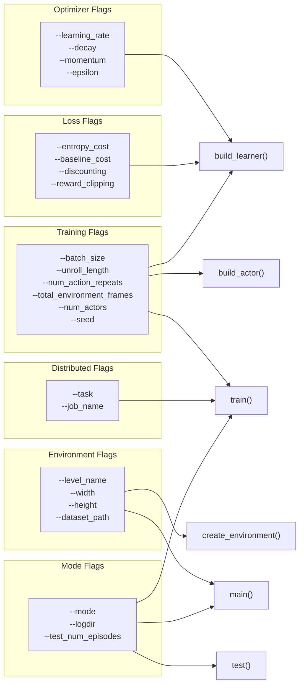

Sources: [experiment.py:284](), [experiment.py:334-415](), [experiment.py:418-439](), [experiment.py:459-643](), [experiment.py:646-679](), [experiment.py:682-696]()

---

## Distributed Setup Flags in Detail

The `--task` and `--job_name` flags determine whether the process runs in single-machine or distributed mode. The function `is_single_machine()` at [experiment.py:100-101]() simply checks `FLAGS.task == -1`.

**Diagram: Single-Machine vs. Distributed Topology**

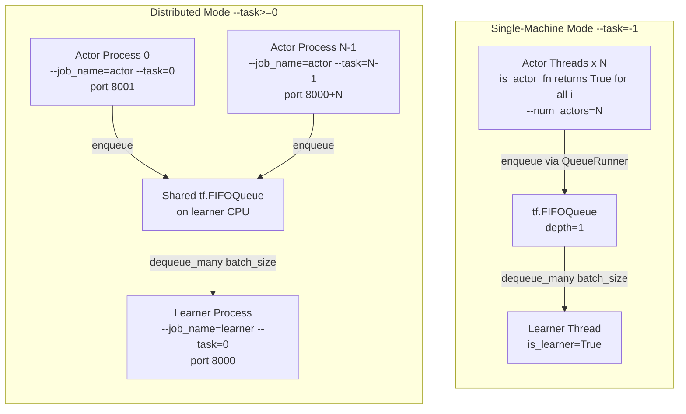

Sources: [experiment.py:100-101](), [experiment.py:462-485](), [experiment.py:521-534]()

### Cluster port assignment

In distributed mode, `train()` builds a `ClusterSpec` at [experiment.py:479-484]() with these conventions:

- Learner: `localhost:8000`
- Actor `i`: `localhost:8001 + i`

Actor task index `i` maps to level `level_names[i % len(level_names)]`, enabling round-robin level assignment across actors when `--level_name=dmlab30`.

---

## Loss and Optimizer Flags in Detail

### `--reward_clipping`

Consumed at [experiment.py:365-370]() in `build_learner()`. The two modes are:

| Value | Behaviour |
|---|---|
| `abs_one` | `tf.clip_by_value(rewards, -1, 1)` |
| `soft_asymmetric` | `tanh(r/5)` scaled by 5; negative rewards additionally multiplied by 0.3 |

`soft_asymmetric` is the setting used for distributed DMLab-30 training (see the README example below).

### `--total_environment_frames` and learning-rate decay

The learning rate does not stay constant. `build_learner()` at [experiment.py:398-400]() constructs:

```
tf.train.polynomial_decay(
    FLAGS.learning_rate,
    num_env_frames,           # global step = environment frames processed
    FLAGS.total_environment_frames,
    end_learning_rate=0
)
```

The global step is incremented by `batch_size × unroll_length × num_action_repeats` per training step at [experiment.py:407-408]().

### `--entropy_cost` and `--baseline_cost`

Both are scalar multipliers applied to their respective loss components before summation at [experiment.py:389-395]():

- **Policy gradient loss**: no multiplier (weight 1.0)
- **Baseline loss**: `FLAGS.baseline_cost * compute_baseline_loss(...)`
- **Entropy loss**: `FLAGS.entropy_cost * compute_entropy_loss(...)`

Sources: [experiment.py:365-402]()

---

## `--level_name` Special Value: `dmlab30`

When `--level_name=dmlab30`, `main()` at [experiment.py:686-691]() selects level sets from `dmlab30.LEVEL_MAPPING`:

| Mode | Level list used |
|---|---|
| `train` | `dmlab30.LEVEL_MAPPING.keys()` (training levels) |
| `test` | `dmlab30.LEVEL_MAPPING.values()` (held-out test levels) |
| any other `--level_name` | `[FLAGS.level_name]` (single level) |

See page [6](#6) for the full `LEVEL_MAPPING` table and human-normalized score computation.

Sources: [experiment.py:682-696]()

---

## Example Invocations

These examples are drawn directly from the README.

**Single-machine training (single level):**
```
python experiment.py --num_actors=48 --batch_size=32
```

**Distributed DMLab-30 — learner:**
```
python experiment.py --job_name=learner --task=0 --num_actors=150 \
    --level_name=dmlab30 --batch_size=32 \
    --entropy_cost=0.0033391318945337044 \
    --learning_rate=0.00031866995608948655 \
    --total_environment_frames=10000000000 \
    --reward_clipping=soft_asymmetric
```

**Distributed DMLab-30 — actors (0 through 149):**
```
python experiment.py --job_name=actor --task=$i \
    --num_actors=150 --level_name=dmlab30 --dataset_path=[...]
```

**Test score evaluation:**
```
python experiment.py --mode=test --level_name=dmlab30 \
    --dataset_path=[...] --test_num_episodes=10
```

Sources: [README.md:41-79]()

---

# Page: V-trace Algorithm

# V-trace Algorithm

<details>
<summary>Relevant source files</summary>

The following files were used as context for generating this wiki page:

- [vtrace.py](vtrace.py)
- [vtrace_test.py](vtrace_test.py)

</details>


This page covers the V-trace off-policy correction algorithm as implemented in `vtrace.py`: its mathematical basis, the public API (functions and return types), the clipping thresholds, the internal computation graph, and how `vtrace_test.py` validates the implementation against a NumPy reference. For how the learner consumes these outputs to build loss terms, see [Learner and Loss Computation](#2.3).

---

## Background

IMPALA actors run a *stale* copy of the policy weights and send experience trajectories to a central learner. By the time the learner processes a trajectory, the target policy (the one being trained) has diverged from the behaviour policy (the one that collected the data). V-trace corrects for this distributional shift using per-step importance weights, producing stable off-policy value targets without requiring on-policy data.

The algorithm is described in full in *"IMPALA: Scalable Distributed Deep-RL with Importance Weighted Actor-Learner Architectures"* (Espeholt, Soyer, Munos et al., arXiv:1802.01561).

---

## Core Notation

| Symbol | Meaning | Tensor shape |
|---|---|---|
| `T` | Trajectory (time) length | — |
| `B` | Batch size (number of parallel actors) | — |
| `ρ_t` | Importance weight: `π(a_t\|x_t) / μ(a_t\|x_t)` | `[T, B]` |
| `c_t` | Trace coefficient: `min(1, ρ_t)` | `[T, B]` |
| `ρ̄` | `clip_rho_threshold` — clips `ρ_t` in value target | scalar |
| `ρ̄_pg` | `clip_pg_rho_threshold` — clips `ρ_t` in policy gradient advantage | scalar |
| `v_s` | V-trace target at step `s` | `[T, B]` |
| `δ_t` | TD-error: `clip(ρ_t) * (r_t + γ V(x_{t+1}) - V(x_t))` | `[T, B]` |

---

## Mathematical Definition

The V-trace target at step `s` for a trajectory of length `T` is:

```
v_s = V(x_s)
    + Σ_{t=s}^{T-1}  γ^{t-s} * (Π_{i=s}^{t-1} c_i) * δ_t
```

where:
- `δ_t = min(ρ̄, ρ_t) * (r_t + γ * V(x_{t+1}) - V(x_t))`
- `c_i = min(1, ρ_i)`

The policy gradient advantage at step `s` uses a separate clipping threshold:

```
A_s = min(ρ̄_pg, ρ_s) * (r_s + γ * v_{s+1} - V(x_s))
```

Note that `v_{s+1}` (not `V(x_{s+1})`) is used in the advantage, so the advantage already incorporates the multi-step correction.

The two clipping thresholds serve different roles:

| Parameter | Paper symbol | Default | Effect |
|---|---|---|---|
| `clip_rho_threshold` | `ρ̄` | `1.0` | Controls how aggressively multi-step return targets are corrected |
| `clip_pg_rho_threshold` | `ρ̄_pg` | `1.0` | Controls the policy gradient step size from off-policy data |

Both can be set to `None` to disable clipping entirely (used in some tests).

---

## Public API

### Return Types

[vtrace.py:37-42]()

Two named tuples carry results out of the module:

**`VTraceReturns`** — returned by `from_importance_weights`:

| Field | Shape | Description |
|---|---|---|
| `vs` | `[T, B]` | V-trace value targets (stop-gradient applied) |
| `pg_advantages` | `[T, B]` | Policy gradient advantages (stop-gradient applied) |

**`VTraceFromLogitsReturns`** — returned by `from_logits` (superset of above):

| Field | Shape | Description |
|---|---|---|
| `vs` | `[T, B]` | Same as above |
| `pg_advantages` | `[T, B]` | Same as above |
| `log_rhos` | `[T, B]` | Log importance weights per step |
| `behaviour_action_log_probs` | `[T, B]` | `log μ(a_t)` from behaviour policy |
| `target_action_log_probs` | `[T, B]` | `log π(a_t)` from target policy |

---

### `log_probs_from_logits_and_actions`

[vtrace.py:45-68]()

Converts raw policy logits and sampled actions into per-step log-probabilities.

**Inputs:**

| Argument | Type | Shape |
|---|---|---|
| `policy_logits` | `float32` | `[T, B, NUM_ACTIONS]` |
| `actions` | `int32` | `[T, B]` |

**Returns:** `float32` tensor of shape `[T, B]` — the log-probability of the chosen action at each step under the given policy.

Implemented as the negation of `tf.nn.sparse_softmax_cross_entropy_with_logits`, which is numerically stable.

---

### `from_logits`

[vtrace.py:71-161]()

The primary entry point when raw logits are available from both the behaviour and target policies.

**Inputs:**

| Argument | Type | Shape | Description |
|---|---|---|---|
| `behaviour_policy_logits` | `float32` | `[T, B, NUM_ACTIONS]` | Logits from the actor's policy (μ) |
| `target_policy_logits` | `float32` | `[T, B, NUM_ACTIONS]` | Logits from the learner's current policy (π) |
| `actions` | `int32` | `[T, B]` | Actions sampled under behaviour policy |
| `discounts` | `float32` | `[T, B]` | Per-step discount factors |
| `rewards` | `float32` | `[T, B]` | Per-step rewards |
| `values` | `float32` | `[T, B]` | Baseline value estimates under target policy |
| `bootstrap_value` | `float32` | `[B]` | Value estimate at the end of the trajectory |
| `clip_rho_threshold` | `float32` scalar | — | Default `1.0`; pass `None` to disable |
| `clip_pg_rho_threshold` | `float32` scalar | — | Default `1.0`; pass `None` to disable |

**Returns:** `VTraceFromLogitsReturns`

Internally this function:
1. Calls `log_probs_from_logits_and_actions` for both policy logits.
2. Computes `log_rhos = target_action_log_probs - behaviour_action_log_probs`.
3. Delegates to `from_importance_weights`.

---

### `from_importance_weights`

[vtrace.py:164-280]()

The lower-level entry point when log importance weights are already computed.

**Inputs:**

| Argument | Type | Shape |
|---|---|---|
| `log_rhos` | `float32` | `[T, B]` (or `[T, B, C]`) |
| `discounts` | `float32` | `[T, B]` |
| `rewards` | `float32` | `[T, B]` |
| `values` | `float32` | `[T, B]` |
| `bootstrap_value` | `float32` | `[B]` |
| `clip_rho_threshold` | scalar or `None` | — |
| `clip_pg_rho_threshold` | scalar or `None` | — |

Supports higher-rank inputs: if all tensors have an extra trailing dimension `C`, the same computation is broadcast over it (e.g., `rewards` as `[T, B, C]`).

**Returns:** `VTraceReturns`

---

## Computation Graph

The following diagram maps the mathematical steps to the TensorFlow operations inside `from_importance_weights`.

**V-trace computation graph inside `from_importance_weights`**

```mermaid
flowchart TD
    LR["log_rhos\n[T, B]"] --> EXP["tf.exp → rhos"]
    EXP --> CLIPRHO["tf.minimum(clip_rho_threshold, rhos)\n→ clipped_rhos"]
    EXP --> CS["tf.minimum(1.0, rhos)\n→ cs"]

    VALUES["values\n[T, B]"] --> VTP1["values_t_plus_1 = concat(\nvalues[1:], bootstrap_value\n)"]
    BOOT["bootstrap_value\n[B]"] --> VTP1

    REWARDS["rewards\n[T, B]"] --> DELTA
    DISC["discounts\n[T, B]"] --> DELTA
    VTP1 --> DELTA["deltas = clipped_rhos *\n(rewards + discounts * values_t_plus_1 - values)"]
    CLIPRHO --> DELTA
    VALUES --> DELTA

    DELTA --> SCAN
    CS --> SCAN
    DISC --> SCAN
    SCAN["tf.scan reverse\nscanfunc: delta_t + discount_t * c_t * acc\n→ vs_minus_v_xs"]

    SCAN --> VSADD["tf.add(vs_minus_v_xs, values)\n→ vs"]
    VALUES --> VSADD

    VSADD --> VPLUS1["vs_t_plus_1 = concat(\nvs[1:], bootstrap_value\n)"]
    BOOT --> VPLUS1
    EXP --> PGCLIP["tf.minimum(clip_pg_rho_threshold, rhos)\n→ clipped_pg_rhos"]
    PGCLIP --> PGA["pg_advantages = clipped_pg_rhos *\n(rewards + discounts * vs_t_plus_1 - values)"]
    VPLUS1 --> PGA
    REWARDS --> PGA
    DISC --> PGA
    VALUES --> PGA

    VSADD --> STOPVS["tf.stop_gradient → vs (output)"]
    PGA --> STOPPG["tf.stop_gradient → pg_advantages (output)"]
```

Sources: [vtrace.py:233-280]()

The reverse `tf.scan` is the key operation. It computes the recurrence from the end of the trajectory backward:

```
acc_{t} = delta_t + discount_t * c_t * acc_{t+1}
```

starting from `acc_T = 0` (zero tensor of the same shape as `bootstrap_value`). The `back_prop=False` and `parallel_iterations=1` flags ensure correct sequential backward evaluation [vtrace.py:255-262]().

Both `vs` and `pg_advantages` have `tf.stop_gradient` applied before being returned, preventing gradients from flowing through the targets.

---

## API Call Flow

The following diagram shows how `from_logits` relates to the lower-level primitives, and how the learner uses the outputs.

**V-trace API call hierarchy**

```mermaid
flowchart LR
    subgraph "experiment.py (build_learner)"
        BL["build_learner()"]
    end

    subgraph "vtrace.py"
        FL["from_logits()"]
        LPA["log_probs_from_logits_and_actions()"]
        FIW["from_importance_weights()"]
        VTR["VTraceReturns\n(vs, pg_advantages)"]
        VTLR["VTraceFromLogitsReturns\n(vs, pg_advantages,\nlog_rhos,\nbehaviour_action_log_probs,\ntarget_action_log_probs)"]
    end

    BL -->|"behaviour_policy_logits,\ntarget_policy_logits,\nactions, discounts,\nrewards, values,\nbootstrap_value"| FL
    FL --> LPA
    LPA -->|"target_action_log_probs\nbehaviour_action_log_probs"| FL
    FL -->|"log_rhos"| FIW
    FIW --> VTR
    VTR --> VTLR
    FL --> VTLR
    VTLR -->|"vs → baseline loss\npg_advantages → policy loss"| BL
```

Sources: [vtrace.py:71-161](), [vtrace.py:164-280]()

---

## Clipping Thresholds in Detail

Both thresholds default to `1.0` in the function signatures [vtrace.py:74](), matching the IMPALA paper's recommendation.

| Threshold | Role | Effect when increased | Effect of `None` |
|---|---|---|---|
| `clip_rho_threshold` | Clips `ρ_t` when computing `δ_t` for `v_s` | More off-policy correction allowed in value targets | No clipping; full IS weight used |
| `clip_pg_rho_threshold` | Clips `ρ_t` in `pg_advantages` | Larger policy gradient steps from off-policy data | No clipping; full IS weight used |

Setting both to a large value (or `None`) brings the estimator closer to a full importance-sampled return but increases variance. Setting both to `1.0` gives the strongest variance reduction at the cost of some bias.

---

## Test Suite

`vtrace_test.py` validates the implementation with three test classes.

### `LogProbsFromLogitsAndActionsTest`

[vtrace_test.py:86-115]()

Compares `log_probs_from_logits_and_actions` against a NumPy reference that manually applies softmax and indexes by action. Parameterized over batch sizes 1 and 2.

### `VtraceTest`

[vtrace_test.py:118-272]()

Contains four test methods:

| Test method | What it checks |
|---|---|
| `test_vtrace` | `from_importance_weights` vs `_ground_truth_calculation` (NumPy) |
| `test_vtrace_from_logits` | `from_logits` agrees with `from_importance_weights` when fed the same derived log-rhos |
| `test_higher_rank_inputs_for_importance_weights` | Accepts `[T, B, C]` shaped inputs; output has correct trailing dimension |
| `test_inconsistent_rank_inputs_for_importance_weights` | Raises `ValueError` when `bootstrap_value` rank is wrong |

#### NumPy Ground Truth

`_ground_truth_calculation` [vtrace_test.py:44-83]() implements the V-trace formula directly as a double loop over `s` and `t`, making it easy to verify against the paper's equations but intentionally inefficient. It returns a `VTraceReturns` namedtuple so it can be compared field-by-field against the TensorFlow output.

The test uses log-rhos spanning approximately `[-2.5, 2.5)` so that `ρ_t` ranges from near-zero to ~12, covering the sub-threshold, at-threshold, and over-threshold regions of the clipping function [vtrace_test.py:126-129]().

**Test validation flow**

```mermaid
flowchart TD
    NP["_ground_truth_calculation()\nNumPy double loop\n(vtrace_test.py:44-83)"]
    TF["vtrace.from_importance_weights()\nTensorFlow scan\n(vtrace.py:164-280)"]
    CMP["assertAllClose()\nfield-by-field comparison"]

    NP -->|"VTraceReturns\nvs, pg_advantages"| CMP
    TF -->|"VTraceReturns\nvs, pg_advantages"| CMP

    LOG["vtrace.from_logits()\n(vtrace.py:71-161)"] -->|"VTraceFromLogitsReturns"| CMP2["assertAllClose()\nvs, pg_advantages,\nbehaviour_action_log_probs,\ntarget_action_log_probs,\nlog_rhos"]
    TF2["vtrace.from_importance_weights()\nwith derived log_rhos"] -->|"VTraceReturns"| CMP2
```

Sources: [vtrace_test.py:118-156](), [vtrace_test.py:158-247]()

---

# Page: Dynamic Batching

# Dynamic Batching

<details>
<summary>Relevant source files</summary>

The following files were used as context for generating this wiki page:

- [batcher.cc](batcher.cc)
- [dynamic_batching.py](dynamic_batching.py)
- [dynamic_batching_test.py](dynamic_batching_test.py)

</details>


This page explains the purpose, design, and end-to-end operation of the dynamic batching system. It covers the motivation for batching, the overall architecture, and how the Python and C++ layers cooperate at runtime. For the detailed Python API reference see [Python API](#4.1), and for the detailed C++ op implementation see [C++ Backend](#4.2).

---

## Motivation

In IMPALA, many actor processes each run their own copy of the policy network to generate experience. When actors run on the same machine as the learner (or share a GPU), each actor's forward pass is a tiny, independent tensor operation — typically a single-sample inference through the LSTM/conv network. Running these one at a time is inefficient: modern hardware (CPU and GPU) achieves far higher throughput when operations are batched together.

Dynamic batching solves this by transparently collecting the individual per-actor inference requests that arrive concurrently, grouping them into a single batched operation, executing that operation once, and then distributing the results back to each caller — all without the callers being aware that batching happened.

The key constraint is that actors produce inputs with **batch size 1** at unpredictable times. The batcher must therefore decide dynamically when a batch is "large enough" to dispatch, using configurable size limits and a timeout.

---

## Architecture Overview

The system has three layers:

| Layer | Files | Role |
|---|---|---|
| User-facing Python API | `dynamic_batching.py` | Decorator that wires TF graph nodes |
| TF graph structure | `dynamic_batching.py` | `_Batcher`, `QueueRunner`, shape inference |
| C++ custom ops | `batcher.cc` → `batcher.so` | Blocking queues, batching, condition variables |

**Architecture: Layers and Code Entities**

```mermaid
graph TD
    subgraph "User Code"
        UC["decorated function call\n e.g. agent_output = f(obs)"]
    end

    subgraph "dynamic_batching.py"
        WRP["wrapper() in batch_fn_with_options"]
        BATCHER_PY["_Batcher object"]
        QR["tf.train.QueueRunner\n(drives set_op loop)"]
    end

    subgraph "batcher.so (batcher.cc)"
        OP_COMPUTE["BatcherCompute op\n(ComputeOp)"]
        OP_GETINPUTS["BatcherGetInputs op\n(GetInputsOp)"]
        OP_SETOUTPUTS["BatcherSetOutputs op\n(SetOutputsOp)"]
        OP_BATCHER["Batcher op\n(BatcherHandleOp) → resource handle"]
        BATCHER_RES["Batcher C++ resource\n(inputs_ deque, being_computed_ map)"]
    end

    UC -->|"calls"| WRP
    WRP -->|"issues batcher_compute"| OP_COMPUTE
    WRP -->|"creates _Batcher"| BATCHER_PY
    BATCHER_PY -->|"wraps handle"| OP_BATCHER
    OP_BATCHER --> BATCHER_RES
    OP_COMPUTE -->|"enqueues input, blocks"| BATCHER_RES
    QR -->|"loops: get_inputs → f() → set_outputs"| OP_GETINPUTS
    QR -->|""| OP_SETOUTPUTS
    OP_GETINPUTS -->|"dequeues batch"| BATCHER_RES
    OP_SETOUTPUTS -->|"unblocks callers"| BATCHER_RES
```

Sources: [dynamic_batching.py:25-163](), [batcher.cc:35-90]()

---

## End-to-End Data Flow

When `batch_fn` or `batch_fn_with_options` is applied to a function `f`, the decorator builds a fixed TF graph once on the first call, then reuses it. There are **two concurrent execution paths** sharing the same `Batcher` resource:

1. **Caller path** — each actor thread runs `BatcherCompute`, which enqueues its input and blocks.
2. **Runner path** — a `QueueRunner` thread loops: runs `BatcherGetInputs` (blocks until batch ready), calls `f` on the batch, then runs `BatcherSetOutputs` (unblocks all callers in that batch).

**Sequence: Single Batched Computation**

```mermaid
sequenceDiagram
    participant "Actor 1\n(compute thread)" as A1
    participant "Actor 2\n(compute thread)" as A2
    participant "Batcher C++ resource\n(inputs_ deque)" as BQ
    participant "QueueRunner thread\n(set_op loop)" as QR

    A1 ->> BQ: "BatcherCompute(input1)\n[enqueue, block]"
    A2 ->> BQ: "BatcherCompute(input2)\n[enqueue, block]"
    Note over BQ: "inputs_.size() >= minimum_batch_size\n→ notify condition variable"
    QR ->> BQ: "BatcherGetInputs()\n[was blocking on cond_var]"
    BQ -->> QR: "batched_input [input1; input2], computation_id=N"
    Note over QR: "runs user function f(batched_input)"
    QR ->> BQ: "BatcherSetOutputs(batched_output, computation_id=N)"
    BQ -->> A1: "output slice [0]"
    BQ -->> A2: "output slice [1]"
```

Sources: [batcher.cc:206-391](), [dynamic_batching.py:104-158]()

---

## TF Graph Construction

When the decorated wrapper is first called, it constructs the following subgraph inside a `tf.control_dependencies(None)` block (to avoid inheriting dependencies from surrounding graph context):

```
_Batcher handle
    │
    ├── BatcherGetInputs ──→ inputs (shape: [batch_size, ...]) + computation_id
    │                               │
    │                               └── f(inputs)  ← user function called here
    │                                       │
    └── BatcherSetOutputs ←──────────────── result
              │
              └── registered as QueueRunner enqueue op
```

The `set_op` (output of `BatcherSetOutputs`) is passed to `tf.train.QueueRunner`, which calls `tf.train.start_queue_runners()` to launch the runner thread. This is why tests and the main training loop must call `tf.train.start_queue_runners()` before any session runs will complete.

On every subsequent call to the wrapper, only a `BatcherCompute` op is added to the graph — one per caller site.

**Graph Structure: Python Objects to TF Ops**

```mermaid
graph LR
    subgraph "batch_fn_with_options decorator (dynamic_batching.py)"
        DEC["decorator(f)"]
        WRP["wrapper(*args)  ← called per actor"]
        B0["batcher[0] = _Batcher(...)  ← created once"]
        BO["batched_output[0]  ← result of f, stored once"]
    end

    subgraph "TF Graph Nodes (created once, inside control_dependencies None)"
        GI["batcher_get_inputs\n(BatcherGetInputs op)"]
        FN["f(inputs)  → user function graph"]
        SO["batcher_set_outputs\n(BatcherSetOutputs op)"]
        QR2["QueueRunner(batcher[0], [set_op])"]
    end

    subgraph "TF Graph Nodes (created per call site)"
        BC["batcher_compute\n(BatcherCompute op)"]
    end

    DEC --> WRP
    WRP --> B0
    B0 --> GI
    GI --> FN
    FN --> SO
    SO --> QR2
    WRP --> BC
    BC --> B0
```

Sources: [dynamic_batching.py:104-158]()

---

## Batching Parameters

Three parameters control when and how the batcher groups inputs into a batch:

| Parameter | Default | Effect |
|---|---|---|
| `minimum_batch_size` | `1` | Runner blocks in `BatcherGetInputs` until at least this many inputs are queued, or until `timeout_ms` elapses |
| `maximum_batch_size` | `1024` | Even if more inputs are queued, at most this many are taken per computation |
| `timeout_ms` | `100` | If fewer than `minimum_batch_size` inputs arrive within this window, the runner proceeds with whatever is available. Set to `None` to disable the timeout. |

**Static shape optimization**: If `minimum_batch_size == maximum_batch_size` and `timeout_ms=None`, the batch dimension is statically known and `set_shape` can use a concrete integer. Otherwise it is set to `None` (dynamic). This is reflected in [dynamic_batching.py:125-134]().

**Timeout behavior** (from `test_minimum_batch_size` in `dynamic_batching_test.py`): when only one input is queued and `minimum_batch_size=2, timeout_ms=1000`, the call completes after approximately 1 second — the timeout fires and the batcher proceeds with the undersized batch.

Sources: [dynamic_batching.py:65-102](), [batcher.cc:228-270](), [dynamic_batching_test.py:242-275]()

---

## Input and Output Constraints

The C++ backend enforces several structural constraints:

- **Each caller's input tensors must have batch dimension 1** on the first axis. The `GetInputsInternal` method checks `dim_size(0) == 1` before stacking [batcher.cc:282-285]().
- **All inputs in a batch must have the same shape**. Mismatched shapes raise `InvalidArgument: Shapes of inputs much be equal` [batcher.cc:297-303]().
- **Each output tensor must have a batch dimension** (i.e., `dims() > 0`) [batcher.cc:352-357]().
- **The output batch dimension must equal the input batch size** for that computation [batcher.cc:358-363]().

When any of these checks fail, the batcher calls `CancelAndClose`, which cancels all pending `BatcherCompute` ops with `CancelledError` and marks the batcher permanently closed.

Sources: [batcher.cc:273-391](), [dynamic_batching_test.py:101-200]()

---

## Shutdown and Error Handling

The `_Batcher` class mimics the TF queue interface (it has a `close()` method and a `name` property) so that it can be used directly with `tf.train.QueueRunner` [dynamic_batching.py:30-57](). When the `tf.train.Coordinator` requests a stop, it calls `close()` on queue-like objects, which invokes `BatcherClose`.

`BatcherClose` calls `CancelAndClose` under the mutex, then broadcasts on `full_batch_or_cancelled_cond_var_` to wake any blocked `GetInputs` operations. All pending `Compute` ops receive `CancelledError` [batcher.cc:393-431]().

Once `is_closed_` is set to `true`, any new `Compute` call immediately returns `Cancelled("Batcher is closed")`.

Sources: [batcher.cc:393-431](), [dynamic_batching.py:55-57](), [dynamic_batching_test.py:202-239]()

---

## Usage in IMPALA

In `experiment.py`, `batch_fn` is applied to the agent's inference function so that all concurrent actor threads share a single batched forward pass through the neural network, rather than each issuing a separate (and much smaller) computation. This is the primary mechanism by which the system achieves efficient hardware utilization at inference time across many parallel actors.

For details on how actors are structured around this, see [Actors](#2.2). For the Python API specifics see [Python API](#4.1). For the C++ op internals see [C++ Backend](#4.2).

---

# Page: Python API

# Python API

<details>
<summary>Relevant source files</summary>

The following files were used as context for generating this wiki page:

- [dynamic_batching.py](dynamic_batching.py)
- [dynamic_batching_test.py](dynamic_batching_test.py)

</details>


This page documents the user-facing Python interface in `dynamic_batching.py`: the `batch_fn` and `batch_fn_with_options` decorators, and the lower-level `_Batcher` class that wraps the C++ TensorFlow ops. It covers decorator usage, parameter semantics, graph-construction behavior, and input/output constraints.

For the C++ ops that implement the batching queue (`BatcherCompute`, `BatcherGetInputs`, `BatcherSetOutputs`, `BatcherClose`), see [C++ Backend](#4.2). For context on why dynamic batching is used in the training system, see [Dynamic Batching](#4).

---

## Public Decorators

The module exposes two decorators. Both transform a TF-graph-building function so that concurrent callers are transparently batched together at runtime.

| Decorator | Signature | Description |
|---|---|---|
| `batch_fn` | `batch_fn(f)` | Decorator with default options (`min=1`, `max=1024`, `timeout_ms=100`) |
| `batch_fn_with_options` | `batch_fn_with_options(minimum_batch_size, maximum_batch_size, timeout_ms)` | Parameterized decorator factory |

`batch_fn` is a thin wrapper that calls `batch_fn_with_options` with its defaults [dynamic_batching.py:60-62]().

---

## `batch_fn_with_options`

[dynamic_batching.py:65-162]()

### Parameters

| Parameter | Type | Default | Behavior |
|---|---|---|---|
| `minimum_batch_size` | `int` | `1` | Processing will not begin until this many inputs have accumulated, unless `timeout_ms` elapses first |
| `maximum_batch_size` | `int` | `1024` | The batcher will not combine more than this many inputs into one batch |
| `timeout_ms` | `int` or `None` | `100` | If set, a batch smaller than `minimum_batch_size` is released after this many milliseconds. If `None`, no timeout; the batcher waits indefinitely |

### Static Shape Inference

The batch dimension of inputs passed into the decorated function is set statically only when `minimum_batch_size == maximum_batch_size` **and** `timeout_ms is None`. In all other cases it is `None` (unknown at graph construction time), because a timeout can cause a batch smaller than `minimum_batch_size` to be released [dynamic_batching.py:125-128]().

### Input Constraints

- Each tensor argument must have its first (batch) dimension equal to `1`. The batcher concatenates these unit inputs to form a larger batch.
- All inputs across concurrent calls must have the same shape (excluding the batch dimension). Mismatched shapes raise `InvalidArgumentError: Shapes of inputs much be equal`.

### Output Constraints

- The decorated function must return tensors whose first dimension matches the batch size. Scalars raise `InvalidArgumentError: Output shape must have a batch dimension`.
- The batch dimension of each output must equal the input batch size. A mismatch raises `InvalidArgumentError: Output shape must have the same batch dimension as the input batch size`.

---

## Graph Construction Behavior

When the decorated wrapper is called for the **first time**, it builds the following subgraph (inside `tf.control_dependencies(None)` to avoid inheriting outer control edges):

**Title: Graph construction on first call to a `batch_fn`-decorated function**

```mermaid
flowchart TD
    subgraph "First call (graph build)"
        A["wrapper(*args)"] -->|"creates"| B["_Batcher\n(minimum_batch_size, maximum_batch_size, timeout_ms)"]
        B -->|"get_inputs(input_dtypes)"| C["inputs, computation_id\ntensors"]
        C -->|"set shapes"| D["nest.map_structure\n(set_shape)"]
        D -->|"call user function f"| E["result = f(*inputs)"]
        E -->|"nest.flatten"| F["flat_result"]
        F -->|"set_outputs(flat_result, computation_id)"| G["set_op"]
        G -->|"register"| H["tf.train.QueueRunner\n(batcher, [set_op])"]
    end
    subgraph "Every call (including first)"
        I["batcher.compute(flat_args, output_dtypes)"] -->|"returns"| J["flat_result tensors"]
        J -->|"nest.pack_sequence_as + set_shape"| K["structured output"]
    end
```

Sources: [dynamic_batching.py:104-162]()

On every call (including the first), `batcher.compute(flat_args, output_dtypes)` is invoked to enqueue the caller's inputs and block until the result is available [dynamic_batching.py:147-157]().

The `QueueRunner` registered via `tf.train.add_queue_runner` must be started with `tf.train.start_queue_runners()` before any `session.run` call that touches a batched output. Without it, all `compute` calls block indefinitely.

---

## `_Batcher` Class

[dynamic_batching.py:30-57]()

`_Batcher` is a lower-level class that maps directly onto the five C++ ops in `batcher.so`. It implements a subset of the TF queue interface (specifically `name` and `close`) so it can be passed as the queue argument to `tf.train.QueueRunner`.

**Title: `_Batcher` methods and the C++ ops they invoke**

```mermaid
graph LR
    subgraph "_Batcher (dynamic_batching.py)"
        init["__init__\n(min, max, timeout_ms)"]
        gi["get_inputs\n(input_dtypes)"]
        so["set_outputs\n(flat_result, computation_id)"]
        co["compute\n(flat_args, output_dtypes)"]
        cl["close\n(cancel_pending_enqueues, name)"]
    end
    subgraph "batcher_ops (batcher.so)"
        BOP["batcher_ops.batcher"]
        BGOP["batcher_ops.batcher_get_inputs"]
        BSOP["batcher_ops.batcher_set_outputs"]
        BCOP["batcher_ops.batcher_compute"]
        BCLOP["batcher_ops.batcher_close"]
    end
    init -->|"creates handle"| BOP
    gi --> BGOP
    so --> BSOP
    co --> BCOP
    cl --> BCLOP
```

Sources: [dynamic_batching.py:30-57]()

### Method Reference

| Method | Arguments | Returns | Role |
|---|---|---|---|
| `__init__` | `minimum_batch_size`, `maximum_batch_size`, `timeout_ms` | — | Creates the C++ `Batcher` resource; `timeout_ms=None` is converted to `-1` |
| `get_inputs` | `input_dtypes: list[dtype]` | `(inputs: list[Tensor], computation_id: Tensor)` | Dequeues one batch of inputs and a scalar ID for the in-progress computation |
| `set_outputs` | `flat_result: list[Tensor]`, `computation_id: Tensor` | `op` | Pushes computed outputs back, keyed by `computation_id`, releasing waiting callers |
| `compute` | `flat_args: list[Tensor]`, `output_dtypes: list[dtype]` | `list[Tensor]` | Enqueues one unit of input; blocks until the corresponding outputs are set |
| `close` | `cancel_pending_enqueues=False`, `name=None` | `op` | Signals the batcher to stop; used by `QueueRunner` on coordinator stop |

The `_Batcher` class is technically private (prefixed `_`) but is directly accessible and used in tests for out-of-order execution scenarios [dynamic_batching_test.py:334-402]().

---

## `compute` / `get_inputs` / `set_outputs` Protocol

The three ops implement a rendezvous pattern. The following diagram shows how the caller thread (via `compute`) and the `QueueRunner` thread (via `get_inputs` + `set_outputs`) interact at runtime.

**Title: Runtime rendezvous between `compute` and `get_inputs`/`set_outputs`**

```mermaid
sequenceDiagram
    participant "Actor thread (compute)" as ACTOR
    participant "C++ Batcher resource" as BATCHER
    participant "QueueRunner thread (get_inputs/set_outputs)" as QR

    ACTOR->>BATCHER: "batcher_compute(flat_args)"
    Note over BATCHER: "Enqueues inputs; blocks on result"
    QR->>BATCHER: "batcher_get_inputs(input_dtypes)"
    Note over BATCHER: "Returns accumulated batch + computation_id"
    QR->>QR: "Runs user function f(inputs)"
    QR->>BATCHER: "batcher_set_outputs(flat_result, computation_id)"
    Note over BATCHER: "Signals waiting compute calls"
    BATCHER-->>ACTOR: "Returns slice of flat_result"
```

Sources: [dynamic_batching.py:130-144](), [dynamic_batching_test.py:334-375]()

Out-of-order execution is supported: `set_outputs` can be called with `computation_id` values in any order. Each `compute` call is unblocked only when its own `computation_id` is satisfied [dynamic_batching_test.py:355-375]().

---

## Behavioral Semantics of Batching Parameters

### `minimum_batch_size` and `timeout_ms` interaction

```
minimum_batch_size=2, timeout_ms=1000
```

If only one input is queued, the batcher waits up to 1000 ms before releasing a batch of size 1. This is validated in `test_minimum_batch_size` [dynamic_batching_test.py:242-275](): a single-input call takes ~1 second; two concurrent calls complete immediately with `batch_size=2`.

### `maximum_batch_size`

Caps the number of inputs combined into one call to the decorated function. When more than `maximum_batch_size` inputs are queued simultaneously, they are split across multiple sequential invocations. `test_maximum_batch_size` [dynamic_batching_test.py:277-298]() verifies that with `maximum_batch_size=2`, each reported batch size is ≤ 2.

### `timeout_ms=None`

Disables the timeout entirely. Combined with `minimum_batch_size == maximum_batch_size`, this allows TensorFlow to set the batch dimension statically at graph construction time. This is the only configuration that produces a statically known input shape inside the decorated function [dynamic_batching_test.py:319-331]().

---

## Error Conditions

| Condition | Exception |
|---|---|
| Input first dimension ≠ 1 | `InvalidArgumentError: requires batch size 1` |
| Mismatched input shapes across concurrent calls | `InvalidArgumentError: Shapes of inputs much be equal` |
| Output has no batch dimension | `InvalidArgumentError: Output shape must have a batch dimension` |
| Output batch size ≠ input batch size | `InvalidArgumentError: Output shape must have the same batch dimension as the input batch size` |
| Invalid `computation_id` passed to `set_outputs` | `InvalidArgumentError: Invalid computation id` |
| Session closed while `get_inputs` is waiting | `CancelledError: GetInputs operation was cancelled` |
| Any error during batch processing | Pending `compute` calls raise `CancelledError` |

Sources: [dynamic_batching_test.py:101-201](), [dynamic_batching_test.py:377-401]()

After any error, all subsequent `session.run` calls on affected outputs raise `CancelledError` [dynamic_batching_test.py:119-135]().

---

# Page: C++ Backend

# C++ Backend

<details>
<summary>Relevant source files</summary>

The following files were used as context for generating this wiki page:

- [Dockerfile](Dockerfile)
- [batcher.cc](batcher.cc)

</details>


This page documents the C++ implementation of the dynamic batching system in [batcher.cc](). It covers the five TensorFlow custom ops registered in `batcher.so`, the `Batcher` resource class that manages the shared state, and the compilation process that produces the shared library.

For the Python-side decorator API that loads and calls these ops, see [4.1](#4.1). For the overall purpose and design rationale of the dynamic batching system, see [4](#4).

---

## Overview

`batcher.cc` compiles into `batcher.so`, a TensorFlow custom op shared library. It registers five TensorFlow ops that together implement the producer/consumer protocol underlying dynamic batching:

| Op name | Role |
|---|---|
| `Batcher` | Creates and returns a resource handle to a `Batcher` instance |
| `BatcherCompute` | Called by actors; enqueues one input and blocks until output is ready |
| `BatcherGetInputs` | Called by the compute loop; blocks until a batch is ready, returns it |
| `BatcherSetOutputs` | Called by the compute loop; delivers results back to all blocked `BatcherCompute` callers |
| `BatcherClose` | Cancels all pending ops and marks the batcher closed |

All five ops are CPU-only. [batcher.cc:537-547]()

---

## The `Batcher` Resource Class

`Batcher` extends TensorFlow's `ResourceBase` [batcher.cc:91-204](). A single instance lives in the TF resource manager and is shared among all op kernels that hold its resource handle.

### Internal State

| Field | Type | Purpose |
|---|---|---|
| `inputs_` | `std::deque<Input>` | Queue of pending inputs from `BatcherCompute` calls |
| `being_computed_` | `gtl::FlatMap<int64, std::vector<Input>>` | In-flight batches indexed by `computation_id` |
| `curr_computation_id_` | `int64` | Monotonically increasing counter for assigning batch IDs |
| `is_closed_` | `bool` | Set on error or close; causes future ops to return `Cancelled` |
| `minimum_batch_size_` | `const int32` | Minimum number of inputs before `GetInputs` returns |
| `maximum_batch_size_` | `const int32` | Cap on batch size per `GetInputs` call |
| `timeout_` | `optional<chrono::milliseconds>` | If set, `GetInputs` returns a partial batch after this interval |
| `mu_` | `mutex` | Guards all mutable state above |
| `full_batch_or_cancelled_cond_var_` | `condition_variable` | Signals `GetInputs` when the queue has enough entries |

[batcher.cc:182-203]()

### The `Input` Inner Class

`Input` [batcher.cc:120-168]() is a move-only wrapper that binds together three things for a single actor's pending request:

- `context_` — the `OpKernelContext*` for the blocked `BatcherCompute` op
- `input_list_` — the actor's input tensors
- `callback_` — the `DoneCallback` that unblocks the async op when called via `Done()`

When `SetOutputs` finishes writing results into `context_` and calls `input.Done()` [batcher.cc:382](), the `BatcherCompute` op returns to the actor.

---

## Data Flow Through the Five Ops

**Diagram: Op interaction sequence**

```mermaid
sequenceDiagram
    participant A as "Actor thread\n(BatcherCompute)"
    participant Q as "inputs_ deque"
    participant L as "Compute loop\n(BatcherGetInputs)"
    participant M as "being_computed_ map"
    participant R as "Compute loop\n(BatcherSetOutputs)"

    A->>Q: "Batcher::Compute() — push Input, notify cond_var if size >= min_batch_size"
    L->>Q: "Batcher::GetInputs() — wait on cond_var until size >= min_batch_size (or timeout)"
    Q-->>L: "pop up to max_batch_size Inputs, concatenate into batch tensors"
    L->>M: "move batch into being_computed_[new_computation_id]"
    L-->>A: "returns batched tensors + computation_id"
    Note over A: "actor waits (callback not yet called)"
    R->>M: "Batcher::SetOutputs() — find batch by computation_id"
    M-->>R: "vector<Input> for this batch"
    R-->>A: "scatter output slices back into each Input.context_, call input.Done()"
    Note over A: "BatcherCompute returns to actor"
```

Sources: [batcher.cc:206-391]()

---

## Op-by-Op Reference

### `Batcher` / `BatcherHandleOp`

[batcher.cc:35-46](), [batcher.cc:433-459]()

`BatcherHandleOp` extends `ResourceOpKernel<Batcher>`. Its `CreateResource` method [batcher.cc:445-452]() instantiates a `Batcher` with the three attributes read from the op definition: `minimum_batch_size`, `maximum_batch_size`, and `timeout_ms`. A `timeout_ms` of `-1` maps to `optional<milliseconds>` with no value, disabling the timeout.

### `BatcherCompute` / `ComputeOp`

[batcher.cc:48-57](), [batcher.cc:461-478]()

Implemented as an `AsyncOpKernel`. `ComputeAsync` [batcher.cc:465-474]() looks up the `Batcher` resource, reads the actor's `input_list`, and calls `Batcher::Compute()`. The callback passed in is not invoked until `SetOutputs` calls `input.Done()`, so the actor thread is effectively parked until the batch has been processed.

### `BatcherGetInputs` / `GetInputsOp`

[batcher.cc:59-72](), [batcher.cc:480-497]()

A synchronous `OpKernel`. `Compute` [batcher.cc:484-492]() calls `Batcher::GetInputs`, which blocks on `full_batch_or_cancelled_cond_var_` [batcher.cc:241-258]() until:

- `inputs_.size() >= minimum_batch_size_`, **or**
- `timeout_` has elapsed and `inputs_` is non-empty, **or**
- `is_closed_` is set, **or**
- the TF session cancellation manager fires.

Once unblocked, `GetInputsInternal` [batcher.cc:273-328]() allocates output tensors of shape `[batch_size, ...]`, copies each `Input`'s tensors into the appropriate slice using `batch_util::CopyElementToSlice`, assigns a new `computation_id`, moves the batch into `being_computed_`, and returns the batched tensors plus the `computation_id` scalar.

Tensor copying is parallelised across TF's CPU worker threads using `Shard` [batcher.cc:311-313]().

### `BatcherSetOutputs` / `SetOutputsOp`

[batcher.cc:74-83](), [batcher.cc:499-519]()

`SetOutputsInternal` [batcher.cc:339-391]() looks up the `computation_id` in `being_computed_`, validates that the output batch dimension matches, and then in parallel:

1. Allocates an output tensor in each blocked actor's `OpKernelContext`.
2. Copies the actor's slice from the batched output into that tensor using `batch_util::CopySliceToElement`.
3. Calls `input.Done()` to invoke the async callback and unblock the actor.

After all actors in the batch are unblocked, the entry is erased from `being_computed_`.

### `BatcherClose` / `CloseOp`

[batcher.cc:84-89](), [batcher.cc:521-535]()

Calls `Batcher::Close` [batcher.cc:393-401](), which acquires the mutex, calls `CancelAndClose` [batcher.cc:414-431]() to cancel every pending `Input` in both `inputs_` and `being_computed_`, sets `is_closed_ = true`, then broadcasts on `full_batch_or_cancelled_cond_var_` to wake any blocked `GetInputs` calls.

`CancelInput` [batcher.cc:403-412]() marks each `Input`'s context with a `Cancelled` status and calls `Done()` so the actor unblocks with an error.

---

## Concurrency Model

**Diagram: Mutex and condition variable usage**

```mermaid
flowchart TD
    subgraph "Actor threads (N concurrent)"
        CO["ComputeOp::ComputeAsync\ncalls Batcher::Compute()"]
    end

    subgraph "Compute loop thread"
        GI["GetInputsOp::Compute\ncalls Batcher::GetInputs()"]
        SO["SetOutputsOp::Compute\ncalls Batcher::SetOutputs()"]
    end

    subgraph "Batcher state (mu_ guards all)"
        IQ["inputs_\nstd::deque<Input>"]
        BC["being_computed_\nFlatMap<int64, vector<Input>>"]
        CV["full_batch_or_cancelled_cond_var_"]
        CL["is_closed_"]
    end

    CO -->|"lock mu_, push to inputs_,\nnotify_one if size >= min"| IQ
    IQ -->|"wait_for on cond_var"| CV
    CV -->|"wake when notified or timeout"| GI
    GI -->|"move batch from inputs_ to being_computed_"| BC
    SO -->|"scatter outputs, call input.Done()"| BC
    SO -->|"erase computation_id"| BC
    CL -->|"checked in Compute, GetInputs, SetOutputs"| CO
    CL -->|"checked in Compute, GetInputs, SetOutputs"| GI
```

Sources: [batcher.cc:182-204](), [batcher.cc:206-401]()

All mutable state (`inputs_`, `being_computed_`, `curr_computation_id_`, `is_closed_`) is guarded by `mu_`. The condition variable `full_batch_or_cancelled_cond_var_` is used only to signal `GetInputs`; `SetOutputs` wakes actors directly through `DoneCallback`s rather than through the condition variable.

---

## Error Propagation and Cleanup

Any error in `GetInputs` or `SetOutputs` calls `CancelAndClose` [batcher.cc:414-431]() while holding `mu_`. This:

1. Iterates over all entries in `inputs_` and `being_computed_`, calling `CancelInput` on each.
2. Sets `is_closed_ = true`.

After the lock is released, `Close` broadcasts on the condition variable so any concurrently waiting `GetInputs` thread wakes up and sees `is_closed_`. Future `BatcherCompute` calls return immediately with `Cancelled`.

---

## Compilation

`batcher.cc` is compiled into `batcher.so` as a TF custom op shared library. The Dockerfile shows the exact command used [Dockerfile:68-70]():

```
g++-4.8 -std=c++11 -shared batcher.cc -o batcher.so -fPIC \
  -I $TF_INC -O2 -D_GLIBCXX_USE_CXX11_ABI=0 \
  -L $TF_LIB -ltensorflow_framework
```

Key points:

| Flag | Reason |
|---|---|
| `g++-4.8` | Required; g++ 5.4 has a known incompatibility with TF 1.9 ([Dockerfile:4-5]()) |
| `-D_GLIBCXX_USE_CXX11_ABI=0` | Matches TF 1.9's ABI; without this, linking fails at runtime |
| `-ltensorflow_framework` | Provides TF op, kernel, and resource infrastructure |
| `-fPIC` | Required for shared library output |

`dynamic_batching.py` loads the resulting file at import time via `tf.load_op_library`. See [4.1](#4.1) for details of that call.

Sources: [Dockerfile:67-70](), [batcher.cc:1-31]()

---

# Page: Environment Infrastructure

# Environment Infrastructure

<details>
<summary>Relevant source files</summary>

The following files were used as context for generating this wiki page:

- [environments.py](environments.py)
- [py_process.py](py_process.py)

</details>


This page describes the two-layer wrapper stack that connects DeepMind Lab to the TensorFlow training graph. The stack has two concerns: **subprocess isolation** (handled by `py_process.py`) and **TF-graph-compatible sequential execution** (handled by `environments.py`). For detailed API documentation of each layer, see [DeepMind Lab Integration](#5.1) and [Python Process Management](#5.2).

---

## Why a Two-Layer Stack?

Running DeepMind Lab inside a TensorFlow graph creates two problems:

1. **GIL contention**: DeepMind Lab is a Python C extension. Running multiple environments in threads inside the same process serializes execution under the Python GIL.
2. **Graph ordering**: TensorFlow's dataflow graph does not guarantee that ops execute in the order they are written. An environment requires strict sequential ordering — each `step` must complete before the next begins.

The two-layer stack solves each problem independently:

| Problem | Solution | Location |
|---|---|---|
| GIL contention | Run each environment in its own subprocess | `py_process.py` → `PyProcess` |
| Graph ordering | Thread a "flow counter" through `tf.control_dependencies` | `environments.py` → `FlowEnvironment` |

---

## Stack Architecture

**Diagram: Environment Infrastructure Layer Stack**

```mermaid
flowchart TB
    subgraph actor["Actor TF Graph"]
        SCAN["tf.scan unroll loop"]
        FE_INIT["FlowEnvironment.initial()"]
        FE_STEP["FlowEnvironment.step(action, state)"]
        SCAN --> FE_INIT
        SCAN --> FE_STEP
    end

    subgraph layer2["Layer 2 — environments.py"]
        FE["FlowEnvironment"]
        SO["StepOutput namedtuple\n(reward, info, done, observation)"]
        SOI["StepOutputInfo namedtuple\n(episode_return, episode_step)"]
        FE --> SO
        SO --> SOI
    end

    subgraph layer1["Layer 1 — py_process.py"]
        PP["PyProcess"]
        PROXY["_TFProxy\n(tf.py_func bridge)"]
        PIPE["multiprocessing.Pipe"]
        PP --> PROXY
        PROXY --> PIPE
    end

    subgraph subprocess["Subprocess — environments.py"]
        PPDL["PyProcessDmLab\n(action repeats, obs spec)"]
        LLC["LocalLevelCache"]
        DML["deepmind_lab.Lab"]
        PPDL --> LLC
        PPDL --> DML
    end

    FE_INIT -->|"calls proxy.initial()"| FE
    FE_STEP -->|"calls proxy.step()"| FE
    FE -->|"delegates to"| PP
    PROXY -->|"IPC via Pipe"| PPDL
```

Sources: [environments.py:66-218](), [py_process.py:61-204]()

---

## Layer 1: Subprocess Isolation via `PyProcess`

`PyProcess` in `py_process.py` manages the full lifecycle of a Python object running in a separate OS process. It exposes a `proxy` attribute whose method calls are transparently forwarded to the subprocess via a `multiprocessing.Pipe`.

**Diagram: `PyProcess` IPC mechanism**

```mermaid
sequenceDiagram
    participant TFGraph as "TF Graph (actor thread)"
    participant TFProxy as "_TFProxy.py_call()"
    participant Pipe as "multiprocessing.Pipe"
    participant Worker as "_worker_fn() (subprocess)"
    participant DmLab as "PyProcessDmLab"

    TFGraph->>TFProxy: "session.run() triggers tf.py_func"
    TFProxy->>Pipe: "_out.send((method_name, *args))"
    Pipe->>Worker: "in_.recv()"
    Worker->>DmLab: "getattr(o, method_name)(*inputs)"
    DmLab-->>Worker: "result"
    Worker->>Pipe: "in_.send(nest.flatten(result))"
    Pipe-->>TFProxy: "_out.recv()"
    TFProxy-->>TFGraph: "flat tensors → pack_sequence_as(specs, result)"
```

Sources: [py_process.py:82-104](), [py_process.py:126-158]()

The `_TFProxy.__getattr__` method [py_process.py:69-105]() intercepts any attribute access and returns a `call` function. When invoked, it:

1. Looks up output shapes and dtypes by calling the user class's static `_tensor_specs(method_name, kwargs, constructor_kwargs)` method.
2. Wraps the IPC send/receive in a `tf.py_func`, producing typed tensors with known static shapes.
3. Reconstructs the original nested output structure with `nest.pack_sequence_as`.

The lifecycle is managed by `PyProcessHook`, a `tf.train.SessionRunHook` [py_process.py:186-203]() that calls `start()` on all registered `PyProcess` instances in `begin()` and `close()` in `end()`.

---

## Layer 2: TF Graph Ordering via `FlowEnvironment`

`FlowEnvironment` in `environments.py` wraps any object exposing `initial()` and `step(action)` methods (typically a `_TFProxy`) and makes it safe to use inside a `tf.scan` loop by enforcing strict sequential execution.

The mechanism is a monotonically increasing integer called the **flow counter**, threaded through every call as part of the environment state.

**Diagram: Flow counter control dependency chain**

```mermaid
flowchart LR
    I["FlowEnvironment.initial()\nflow = tf.constant(0)"]
    S1["FlowEnvironment.step() call 1\ntf.control_dependencies([flow=0])\nnew_flow = flow + 1"]
    S2["FlowEnvironment.step() call 2\ntf.control_dependencies([flow=1])\nnew_flow = flow + 1"]
    S3["FlowEnvironment.step() call N\n..."]

    I -->|"flow=0 in state"| S1
    S1 -->|"flow=1 in state"| S2
    S2 -->|"flow=2 in state"| S3
```

Sources: [environments.py:155-218]()

### `initial()` [environments.py:155-181]()

Returns a `(StepOutput, state)` pair with:
- `reward = 0.0`, `done = True`, `info = StepOutputInfo(0.0, 0)`, and the first real observation from `env.initial()`.
- `initial_flow = tf.constant(0, dtype=tf.int64)` inside a `tf.control_dependencies` block that waits for all output tensors to be consumed before the flow scalar is created.

### `step(action, state)` [environments.py:183-218]()

1. Unpacks `(flow, info)` from `state`.
2. Wraps the actual `env.step(action)` call inside `tf.control_dependencies([flow])`, forcing it to wait for the previous step's flow counter.
3. After receiving the observation, increments `new_flow = tf.add(flow, 1)` inside another `tf.control_dependencies` on the observation tensors.
4. Accumulates episode statistics in `new_info` by adding `reward` and `1` to `info.episode_return` and `info.episode_step`.
5. Resets the running totals on episode end using `tf.where(done, zero_info, new_info)`.

---

## DeepMind Lab Wrapper: `PyProcessDmLab`

`PyProcessDmLab` [environments.py:66-126]() is the concrete environment class that runs inside the subprocess. It satisfies the `PyProcess` user-class contract.

### Constructor parameters

| Parameter | Type | Role |
|---|---|---|
| `level` | `str` | DMLab level name |
| `config` | `dict` | DMLab configuration (width, height, etc.) |
| `num_action_repeats` | `int` | Frames per `step()` call |
| `seed` | `int` | Seeds a `np.random.RandomState` for episode resets |
| `runfiles_path` | `str \| None` | Path passed to `deepmind_lab.set_runfiles_path()` |
| `level_cache` | `object \| None` | Optional `LocalLevelCache` instance |

### Observation spec

Two observations are requested from DMLab [environments.py:76-82]():
- `RGB_INTERLEAVED` → `uint8` tensor of shape `[height, width, 3]`
- `INSTR` → `string` scalar (the current instruction text)

### `_tensor_specs` contract [environments.py:107-125]()

This static method is called by `_TFProxy` before any `tf.py_func` is created. It returns a nest of `tf.contrib.framework.TensorSpec` objects that define the dtype and shape of the method's outputs. Without this, the proxy cannot set static shapes on the output tensors.

| Method | Return spec |
|---|---|
| `initial` | `[TensorSpec([H,W,3], uint8), TensorSpec([], string)]` |
| `step` | `(TensorSpec([], float32), TensorSpec([], bool), [TensorSpec([H,W,3], uint8), TensorSpec([], string)])` |

### Action repeats

`step()` [environments.py:95-102]() calls `self._env.step(action, num_steps=self._num_action_repeats)`, accumulating reward over `num_action_repeats` simulator frames before returning. On episode end (`not self._env.is_running()`), it immediately calls `_reset()` and returns the first observation of the new episode.

### `LocalLevelCache` [environments.py:33-50]()

An optional file-system cache for compiled DMLab level `.pk3` files. It implements `fetch(key, pk3_path)` and `write(key, pk3_path)` using `tf.gfile` operations. Passed directly to `deepmind_lab.Lab(level_cache=...)`.

---

## `DEFAULT_ACTION_SET`

[environments.py:53-63]()

A tuple of nine discrete actions mapping to 7-dimensional DMLab action vectors `(look_left_right_pixels_per_frame, look_down_up_pixels_per_frame, strafe_left_right, move_back_forward, fire, jump, crouch)`:

| Index | Name | Vector |
|---|---|---|
| 0 | Forward | `(0, 0, 0, 1, 0, 0, 0)` |
| 1 | Backward | `(0, 0, 0, -1, 0, 0, 0)` |
| 2 | Strafe Left | `(0, 0, -1, 0, 0, 0, 0)` |
| 3 | Strafe Right | `(0, 0, 1, 0, 0, 0, 0)` |
| 4 | Look Left | `(-20, 0, 0, 0, 0, 0, 0)` |
| 5 | Look Right | `(20, 0, 0, 0, 0, 0, 0)` |
| 6 | Look Left + Forward | `(-20, 0, 0, 1, 0, 0, 0)` |
| 7 | Look Right + Forward | `(20, 0, 0, 1, 0, 0, 0)` |
| 8 | Fire | `(0, 0, 0, 0, 1, 0, 0)` |

---

## Data Structures

**Diagram: Named tuples and their field sources**

```mermaid
flowchart LR
    subgraph namedtuples["environments.py namedtuples"]
        SO["StepOutput\n- reward: float32\n- info: StepOutputInfo\n- done: bool\n- observation: list"]
        SOI["StepOutputInfo\n- episode_return: float32\n- episode_step: int32"]
        SO --> SOI
    end

    subgraph source["Source per field"]
        R["reward ← env.step() return value"]
        D["done ← not env.is_running()"]
        OBS["observation ← env.observations()"]
        ER["episode_return ← cumsum of reward (reset on done)"]
        ES["episode_step ← step count (reset on done)"]
    end

    SO -.->|"reward"| R
    SO -.->|"done"| D
    SO -.->|"observation"| OBS
    SOI -.->|"episode_return"| ER
    SOI -.->|"episode_step"| ES
```

Sources: [environments.py:128-131](), [environments.py:197-217]()

`StepOutputInfo` is part of the `state` tuple passed between `step()` calls. It accumulates across the episode. When `done` is `True`, `new_info` (the final accumulated values) is placed in the output, but `new_state` resets to zeros so the next episode starts fresh [environments.py:209-215]().

---

## Wiring Diagram: Actor Construction

**Diagram: How the layers are composed inside an actor**

```mermaid
flowchart TD
    A["experiment.py: build_actor()"]
    PP["PyProcess(PyProcessDmLab, level, config, ...)"]
    PROXY["PyProcess.proxy  →  _TFProxy"]
    FE["FlowEnvironment(proxy)"]
    INIT["FlowEnvironment.initial()"]
    STEP["FlowEnvironment.step(action, state)"]
    OUT["ActorOutput namedtuple\n(env_outputs: StepOutput, ...)"]

    A --> PP
    PP --> PROXY
    PROXY --> FE
    FE --> INIT
    FE --> STEP
    STEP --> OUT
```

Sources: [environments.py:134-218](), [py_process.py:161-183]()

In `experiment.py`, for each actor, a `PyProcess` is constructed around `PyProcessDmLab`, then its `.proxy` is wrapped in a `FlowEnvironment`. The actor's `tf.scan` loop calls `FlowEnvironment.step()` on each timestep. The `StepOutput` produced at each step becomes part of the `ActorOutput` trajectory that is enqueued for the learner. For more detail on the actor loop, see [Actors](#2.2).

---

# Page: DeepMind Lab Integration

# DeepMind Lab Integration

<details>
<summary>Relevant source files</summary>

The following files were used as context for generating this wiki page:

- [environments.py](environments.py)
- [py_process_test.py](py_process_test.py)

</details>


## Purpose and Scope

This page documents `environments.py`, which contains the two classes that bridge DeepMind Lab to the IMPALA training graph: `PyProcessDmLab` and `FlowEnvironment`. It also documents the `DEFAULT_ACTION_SET`, `LocalLevelCache`, and the `StepOutput`/`StepOutputInfo` named tuples.

- For how `PyProcessDmLab` is isolated into a subprocess and exposed as TensorFlow ops, see the Python Process Management page ([5.2](#5.2)).
- For how `FlowEnvironment` is wired into the actor unroll loop, see the Actors page ([2.2](#2.2)).
- For the broader two-layer design rationale, see the Environment Infrastructure overview ([5](#5)).

---

## Component Map

**Figure: `environments.py` component relationships**

```mermaid
graph TD
    subgraph environments_py["environments.py"]
        LLC["LocalLevelCache"]
        PPLAB["PyProcessDmLab"]
        FLOWENV["FlowEnvironment"]
        DEFAULT_AS["DEFAULT_ACTION_SET"]
        SO["StepOutput"]
        SOI["StepOutputInfo"]
    end

    DML["deepmind_lab.Lab"]
    PYPROC["py_process.PyProcess"]
    TFGRAPH["TensorFlow Graph (actor unroll)"]

    LLC -->|"level_cache arg"| PPLAB
    DEFAULT_AS -->|"action index lookup"| PPLAB
    PPLAB -->|"wraps"| DML
    PYPROC -->|"hosts in subprocess"| PPLAB
    FLOWENV -->|"wraps proxy of"| PYPROC
    SO -->|"returned by"| FLOWENV
    SOI -->|"field of"| SO
    FLOWENV -->|"outputs consumed by"| TFGRAPH
```

Sources: [environments.py:33-218]()

---

## `DEFAULT_ACTION_SET`

The agent selects a discrete action index; `DEFAULT_ACTION_SET` maps each index to a 7-element tuple consumed by `deepmind_lab.Lab.step`.

[environments.py:53-63]()

| Index | Tuple | Description |
|-------|-------|-------------|
| 0 | `(0, 0, 0, 1, 0, 0, 0)` | Forward |
| 1 | `(0, 0, 0, -1, 0, 0, 0)` | Backward |
| 2 | `(0, 0, -1, 0, 0, 0, 0)` | Strafe Left |
| 3 | `(0, 0, 1, 0, 0, 0, 0)` | Strafe Right |
| 4 | `(-20, 0, 0, 0, 0, 0, 0)` | Look Left |
| 5 | `(20, 0, 0, 0, 0, 0, 0)` | Look Right |
| 6 | `(-20, 0, 0, 1, 0, 0, 0)` | Look Left + Forward |
| 7 | `(20, 0, 0, 1, 0, 0, 0)` | Look Right + Forward |
| 8 | `(0, 0, 0, 0, 1, 0, 0)` | Fire |

The tuple fields map to the DeepMind Lab action specification: `(LOOK_LEFT_RIGHT_PIXELS_PER_FRAME, LOOK_DOWN_UP_PIXELS_PER_FRAME, STRAFE_LEFT_RIGHT, MOVE_BACK_FORWARD, FIRE, JUMP, CROUCH)`.

Sources: [environments.py:53-63]()

---

## `LocalLevelCache`

`LocalLevelCache` implements the level cache interface expected by `deepmind_lab.Lab`. DeepMind Lab can compile procedurally generated levels and cache the compiled `.pk3` files to avoid recompilation on repeated runs.

[environments.py:33-51]()

| Method | Behavior |
|--------|----------|
| `__init__(cache_dir)` | Creates `cache_dir` (default `/tmp/level_cache`) via `tf.gfile.MakeDirs`. |
| `fetch(key, pk3_path)` | If `key` exists in the cache directory, copies it to `pk3_path` and returns `True`. Otherwise returns `False`. |
| `write(key, pk3_path)` | If `key` is not yet cached, copies `pk3_path` into the cache directory. |

An instance of `LocalLevelCache` is passed as the `level_cache` argument to `PyProcessDmLab` and forwarded directly to `deepmind_lab.Lab`.

Sources: [environments.py:33-51]()

---

## `PyProcessDmLab`

`PyProcessDmLab` is the class that `py_process.PyProcess` runs inside a subprocess. It owns the live `deepmind_lab.Lab` instance and exposes three methods to the TensorFlow graph: `initial`, `step`, and `close`.

### Constructor

[environments.py:69-82]()

| Parameter | Type | Purpose |
|-----------|------|---------|
| `level` | `str` | DeepMind Lab level name (e.g. `"nav_maze_random_goal_01"`) |
| `config` | `dict` | Passed to `deepmind_lab.Lab` as string-valued key/value pairs |
| `num_action_repeats` | `int` | How many simulator steps each `step()` call executes |
| `seed` | `int` | Seeds `np.random.RandomState` for reproducible episode resets |
| `runfiles_path` | `str\|None` | If set, calls `deepmind_lab.set_runfiles_path` before creating the Lab instance |
| `level_cache` | `LocalLevelCache\|None` | Passed to `deepmind_lab.Lab` for compiled level caching |

The observation spec is hardcoded to `['RGB_INTERLEAVED', 'INSTR']` — a pixel buffer and an instruction string.

### Methods

[environments.py:84-125]()

| Method | Arguments | Returns | Notes |
|--------|-----------|---------|-------|
| `_reset()` | — | — | Calls `self._env.reset` with a random seed drawn from `self._random_state` |
| `_observation()` | — | `list` | Reads `RGB_INTERLEAVED` and `INSTR` from the lab's observation dict |
| `initial()` | — | `[rgb, instr]` | Resets the environment and returns the first observation |
| `step(action)` | `action` (7-element array) | `(reward, done, [rgb, instr])` | Runs `num_action_repeats` simulator steps; if `done`, resets immediately and returns the first observation of the next episode |
| `close()` | — | — | Calls `self._env.close()` |

**Action repeat detail:** `self._env.step(action, num_steps=self._num_action_repeats)` accumulates reward over all repeated steps and returns the scalar sum. [environments.py:96-96]()

**Auto-reset on done:** When `not self._env.is_running()`, the environment resets before returning the observation, so the caller always receives a valid observation. [environments.py:98-100]()

### `_tensor_specs` Contract

`py_process.PyProcess` calls `_tensor_specs` at graph construction time to determine output shapes and dtypes without running the subprocess. `PyProcessDmLab._tensor_specs` is a `@staticmethod` and receives `method_name`, `unused_kwargs`, and `constructor_kwargs`.

[environments.py:107-125]()

```
method_name='initial'  →  [TensorSpec([H,W,3], uint8), TensorSpec([], string)]
method_name='step'     →  (TensorSpec([], float32),
                            TensorSpec([], bool),
                            [TensorSpec([H,W,3], uint8), TensorSpec([], string)])
```

Width and height default to `320` and `240` respectively, but are read from `constructor_kwargs['config']` if present, allowing the graph to be built correctly for any resolution.

---

## `FlowEnvironment`

`FlowEnvironment` wraps an environment (typically the `_TFProxy` of a `PyProcessDmLab` subprocess) and adds:

1. **Sequential ordering** — `tf.control_dependencies` prevent the TF runtime from reordering environment steps.
2. **Episode accounting** — Accumulates `episode_return` and `episode_step` across steps, resetting them at episode boundaries.
3. **Standard interface** — Returns `StepOutput`/`StepOutputInfo` named tuples that the actor unroll loop consumes.

### Named Tuples

[environments.py:128-131]()

```python
StepOutputInfo = namedtuple('StepOutputInfo', 'episode_return episode_step')
StepOutput     = namedtuple('StepOutput', 'reward info done observation')
```

| Field | Type | Description |
|-------|------|-------------|
| `StepOutput.reward` | `float32` scalar | Reward for the most recent step |
| `StepOutput.info` | `StepOutputInfo` | Accumulated episode return and step count up to and including this step |
| `StepOutput.done` | `bool` scalar | Whether this step ended the episode |
| `StepOutput.observation` | `[uint8 tensor, string tensor]` | Pixel frame and instruction string |

### `initial()`

[environments.py:155-181]()

Returns `(StepOutput, state)`.

- `reward` is `0.0`, `done` is `True`, `info` is `StepOutputInfo(0.0, 0)`.
- Calls `self._env.initial()` to get the first observation.
- Places a `tf.control_dependencies` on all tensors in `initial_output` before constructing `initial_flow = tf.constant(0, dtype=tf.int64)`. This ensures the next `step()` cannot execute until the initial observation has been read.
- `state` is `(initial_flow, initial_info)`.

### `step(action, state)`

[environments.py:183-218]()

Returns `(StepOutput, new_state)`.

**Figure: `FlowEnvironment.step` data flow**

```mermaid
flowchart TD
    S["state = (flow, info)"]
    CD1["tf.control_dependencies([flow])\nblocks until previous step done"]
    ENV_STEP["self._env.step(action)\n→ reward, done, observation"]
    CD2["tf.control_dependencies(flatten(observation))\nblocks new_flow increment"]
    NEW_FLOW["new_flow = flow + 1"]
    NEW_INFO["new_info = StepOutputInfo(\n  info.episode_return + reward,\n  info.episode_step + 1\n)"]
    RESET_STATE["new_state.info = tf.where(done,\n  StepOutputInfo(0., 0),\n  new_info\n)"]
    OUTPUT["StepOutput(reward, new_info, done, observation)"]

    S --> CD1
    CD1 --> ENV_STEP
    ENV_STEP --> CD2
    CD2 --> NEW_FLOW
    ENV_STEP --> NEW_INFO
    NEW_INFO --> RESET_STATE
    NEW_FLOW --> RESET_STATE
    NEW_INFO --> OUTPUT
    ENV_STEP --> OUTPUT
    RESET_STATE -->|"new_state passed to next step()"| CD1
```

Key points:

- **Sequential ordering:** `tf.control_dependencies([flow])` ensures each `step()` call waits for the previous one to complete before issuing any environment call. [environments.py:202-203]()
- **Episode return accumulation:** `new_info.episode_return = info.episode_return + reward`. The final-step reward is included in the *output* `info` but not in the *state* `info` — the state resets on `done`. [environments.py:210-215]()
- **Episode reset logic:** `tf.where(done, StepOutputInfo(0., 0), new_info)` resets the accumulated counters in `new_state` when `done` is `True`, but the output `StepOutput` still carries the full episode totals for that last step. [environments.py:212-215]()
- **`new_flow`** is incremented only after `observation` tensors are available (`control_dependencies` on the flattened observation). This makes `new_flow` a proxy for "the step is fully complete." [environments.py:205-206]()

Sources: [environments.py:128-218]()

---

## End-to-End Flow

**Figure: Full call chain from actor graph to DeepMind Lab**

```mermaid
sequenceDiagram
    participant ACTOR as "Actor TF Graph"
    participant FLOW as "FlowEnvironment"
    participant PROXY as "PyProcess._TFProxy"
    participant PIPE as "multiprocessing.Pipe"
    participant PPLAB as "PyProcessDmLab (subprocess)"
    participant LAB as "deepmind_lab.Lab"

    ACTOR->>FLOW: "step(action, state)"
    FLOW->>FLOW: "tf.control_dependencies([flow])"
    FLOW->>PROXY: "self._env.step(action)"
    PROXY->>PIPE: "send (method, args)"
    PIPE->>PPLAB: "receive"
    PPLAB->>LAB: "env.step(action, num_steps=N)"
    LAB-->>PPLAB: "reward (sum over N steps)"
    PPLAB-->>PIPE: "send (reward, done, observation)"
    PIPE-->>PROXY: "receive → tf.py_func outputs"
    PROXY-->>FLOW: "reward, done, observation tensors"
    FLOW->>FLOW: "accumulate StepOutputInfo, increment flow"
    FLOW-->>ACTOR: "StepOutput, new_state"
```

Sources: [environments.py:183-218](), [py_process_test.py:33-64]()

---

## Summary of Public API

| Symbol | Kind | Role |
|--------|------|------|
| `DEFAULT_ACTION_SET` | `tuple` of `tuple` | 9-action discrete action space |
| `LocalLevelCache` | class | Filesystem-backed level cache for `deepmind_lab.Lab` |
| `PyProcessDmLab` | class | DeepMind Lab adapter for `py_process.PyProcess` |
| `PyProcessDmLab._tensor_specs` | `@staticmethod` | Graph-time output shape/dtype specification |
| `StepOutputInfo` | `namedtuple` | `(episode_return, episode_step)` |
| `StepOutput` | `namedtuple` | `(reward, info, done, observation)` |
| `FlowEnvironment` | class | TF-graph-safe sequentially-ordered environment wrapper |
| `FlowEnvironment.initial()` | method | Returns initial `StepOutput` and state |
| `FlowEnvironment.step(action, state)` | method | Returns next `StepOutput` and updated state |

Sources: [environments.py:1-218]()

---

# Page: Python Process Management

# Python Process Management

<details>
<summary>Relevant source files</summary>

The following files were used as context for generating this wiki page:

- [py_process.py](py_process.py)
- [py_process_test.py](py_process_test.py)

</details>


This page documents `py_process.py`, which provides a mechanism for running arbitrary Python objects in isolated subprocesses while keeping them callable from within a TensorFlow graph. The module bridges `multiprocessing.Pipe`-based IPC with `tf.py_func` so that subprocess calls appear as ordinary TF operations at graph execution time.

For documentation of how environments use this infrastructure (specifically `PyProcessDmLab`), see the DeepMind Lab Integration page [5.1](#5.1). For the broader environment stack overview, see [5](#5).

---

## Purpose

TensorFlow's `tf.py_func` can call Python functions from within a graph, but all such calls share the GIL with the main TF session process. `py_process.py` works around this by spawning each wrapped object into a **dedicated subprocess** and routing `tf.py_func` calls through a `multiprocessing.Pipe`. This enables true parallelism across multiple environment instances without GIL contention.

---

## Architecture Overview

**Diagram: py_process module component map**

```mermaid
graph TD
    subgraph "TF Graph (main process)"
        A["PyProcess\n(py_process.py:161)"]
        B["_TFProxy\n(py_process.py:61)"]
        C["tf.py_func\n(wraps py_call)"]
        A -->|"exposes .proxy"| B
        B -->|"creates"| C
    end

    subgraph "Subprocess"
        D["_worker_fn\n(py_process.py:126)"]
        E["User object instance\ne.g. PyProcessDmLab"]
    end

    subgraph "Session Lifecycle"
        F["PyProcessHook\n(py_process.py:186)"]
        G["tf.get_collection\n(PyProcess.COLLECTION)"]
        F -->|"begin(): p.start()"| G
        F -->|"end(): p.close(session)"| G
    end

    C <-->|"multiprocessing.Pipe"| D
    D -->|"instantiates & calls methods on"| E
    A -->|"registers in"| G
```

Sources: [py_process.py:1-204]()

---

## Public Classes

| Class | File Location | Role |
|---|---|---|
| `PyProcess` | [py_process.py:161-183]() | Constructs a subprocess-backed wrapper; registers itself in the TF collection |
| `_TFProxy` | [py_process.py:61-158]() | Intercepts attribute access to return TF-graph-compatible callables |
| `PyProcessHook` | [py_process.py:186-203]() | `SessionRunHook` that starts/stops all registered `PyProcess` instances |

---

## The `_tensor_specs` Contract

Any class passed to `PyProcess` must implement a `@staticmethod` named `_tensor_specs`. This is the only interface requirement `py_process.py` imposes on user classes.

**Signature:**

```
_tensor_specs(method_name, kwargs, constructor_kwargs)
```

| Parameter | Type | Description |
|---|---|---|
| `method_name` | `str` | Name of the method being called |
| `kwargs` | `dict` | Keyword arguments the method will receive, as passed at graph-build time |
| `constructor_kwargs` | `dict` | Keyword arguments used to construct the object |

**Return value:**

The method must return one of:
- A `tf.contrib.framework.TensorSpec` (single tensor output)
- A nested structure of `TensorSpec` objects (multiple tensor outputs)
- An empty tuple `()` if the method returns nothing (produces a `tf.Operation`)
- `None` is not acceptable and raises a `ValueError` [py_process.py:75-78]()

**Why it exists:** Because `tf.py_func` requires output dtypes and shapes to be declared statically at graph-construction time, before any subprocess call happens. `_tensor_specs` is queried during `__getattr__` on the proxy [py_process.py:73]() to extract this information.

**Example from tests:**

```
# From py_process_test.py:47-51
@staticmethod
def _tensor_specs(method_name, unused_args, unused_constructor_kwargs):
    if method_name == 'compute':
        return tf.contrib.framework.TensorSpec([], tf.int32)
    elif method_name == 'inc':
        return ()
```

Sources: [py_process.py:61-105](), [py_process_test.py:47-51](), [py_process_test.py:109-113]()

---

## `PyProcess` Class

`PyProcess` [py_process.py:161-183]() is instantiated once per object that needs subprocess isolation.

**Constructor:**

```
PyProcess(type_, *constructor_args, **constructor_kwargs)
```

- `type_` is the class to instantiate in the subprocess.
- Positional `constructor_args` are matched to `__init__` parameter names using `function_utils.fn_args` [py_process.py:167]().
- The resulting `constructor_kwargs` dict is stored and passed to both `_TFProxy` and later to `_worker_fn`.
- The instance registers itself into the TF collection `PyProcess.COLLECTION = 'py_process_processes'` [py_process.py:162](), which `PyProcessHook` uses to locate all processes.

**Key methods:**

| Method | Description |
|---|---|
| `proxy` (property) | Returns the `_TFProxy` instance; used to build TF ops |
| `start()` | Delegates to `_proxy._start()`; spawns the subprocess |
| `close(session)` | Delegates to `_proxy._close(session)`; shuts down subprocess |

Sources: [py_process.py:161-183]()

---

## `_TFProxy`: Attribute Interception

`_TFProxy` [py_process.py:61-158]() makes subprocess method calls look like ordinary attribute accesses on the proxy object.

**Attribute lookup (`__getattr__`):**

When `p.proxy.some_method(arg)` is called:

1. `__getattr__` is triggered with `name = 'some_method'` [py_process.py:69]().
2. A `call` closure is returned. When invoked with `args`, it:
   a. Maps positional args to keyword names using `function_utils.fn_args` [py_process.py:71-72]().
   b. Calls `_tensor_specs` to get output shape/dtype metadata [py_process.py:73]().
   c. Flattens the spec structure to get `flat_dtypes` and `flat_shapes` [py_process.py:79-80]().
   d. Defines `py_call`, a closure that sends a request tuple over the pipe and waits for a response [py_process.py:82-94]().
   e. Registers `py_call` as a `tf.py_func` node in the graph [py_process.py:96]().
   f. Sets static shapes on output tensors, then repacks them into the nested spec structure [py_process.py:102-104]().

**Diagram: _TFProxy attribute call sequence**

```mermaid
sequenceDiagram
    participant "User code" as U
    participant "_TFProxy.__getattr__" as GA
    participant "_tensor_specs" as TS
    participant "tf.py_func (py_call)" as PF
    participant "multiprocessing.Pipe" as PIPE
    participant "_worker_fn (subprocess)" as WF

    U->>GA: "p.proxy.method(arg)"
    GA->>TS: "_tensor_specs('method', kwargs, ctor_kwargs)"
    TS-->>GA: "TensorSpec / nested specs"
    GA->>PF: "tf.py_func(py_call, ('method', arg), flat_dtypes)"
    Note over GA,PF: "Graph construction complete"
    Note over PF,WF: "At session.run() time:"
    PF->>PIPE: "self._out.send(('method', arg))"
    PIPE->>WF: "serialized = in_.recv()"
    WF->>WF: "getattr(o, 'method')(arg)"
    WF->>PIPE: "in_.send(nest.flatten(result))"
    PIPE->>PF: "result = self._out.recv()"
    PF-->>U: "flat tensors, reshaped + repacked"
```

Sources: [py_process.py:61-105]()

---

## IPC Protocol

The subprocess communicates over a `multiprocessing.Pipe` pair: `self._out` (main process end) and `in_` (subprocess end) [py_process.py:108-112]().

**Diagram: IPC message protocol over multiprocessing.Pipe**

```mermaid
flowchart LR
    subgraph "Main process (_TFProxy)"
        SEND["self._out.send\n(method_name, *args)"]
        RECV_R["self._out.recv()\n→ list of arrays or Exception"]
    end

    subgraph "Subprocess (_worker_fn)"
        RECV_REQ["in_.recv()\n→ serialized tuple"]
        DISPATCH["getattr(o, method_name)(*inputs)"]
        SEND_R["in_.send(nest.flatten(results))\nor in_.send(Exception)"]
        CLOSE["o.close() if hasattr\nthen in_.close(); return"]
    end

    SEND -->|"tuple: (name, arg0, ...)"| RECV_REQ
    RECV_REQ --> DISPATCH
    DISPATCH --> SEND_R
    SEND_R -->|"list or Exception"| RECV_R

    SEND -->|"None (shutdown signal)"| CLOSE
```

**Message types:**

| Direction | Content | Meaning |
|---|---|---|
| Main → Sub | `(method_name, arg0, arg1, ...)` | Call method with args |
| Main → Sub | `None` | Shutdown: call `close()` if present, then exit |
| Sub → Main | `[array, ...]` (flat list) | Successful result; may be `None` for void methods |
| Sub → Main (startup) | `None` | Subprocess ready signal sent after successful `__init__` |
| Sub → Main | `Exception` instance | Error from constructor or method call |

Sources: [py_process.py:107-158]()

---

## Subprocess Worker (`_worker_fn`)

`_worker_fn` [py_process.py:126-158]() runs in the child process. Its lifecycle:

1. Instantiate `type_(**constructor_kwargs)`.
2. Send `None` over the pipe to signal readiness [py_process.py:130]().
3. Enter a receive loop:
   - On `None` message: call `o.close()` if the method exists, close the pipe, return.
   - On method-call tuple: extract `method_name` and `inputs`, call the method, flatten the result with `nest.flatten`, send it back.
4. On any uncaught exception: call `o.close()` defensively [py_process.py:153-157](), then send the exception object back over the pipe.

**`close()` convention:** If a user class defines a `close()` method, it will be called by `_worker_fn` on both clean shutdown and on unhandled errors [py_process.py:136-138](), [py_process.py:153-157](). The test in `py_process_test.py:171-189` verifies this behavior.

Sources: [py_process.py:126-158](), [py_process_test.py:171-221]()

---

## `PyProcessHook` Lifecycle

`PyProcessHook` [py_process.py:186-203]() is a `tf.train.SessionRunHook` that manages process startup and teardown around a TF session.

**Diagram: PyProcessHook and PyProcess.COLLECTION lifecycle**

```mermaid
sequenceDiagram
    participant "tf.train.SingularMonitoredSession" as SMS
    participant "PyProcessHook.begin()" as B
    participant "PyProcessHook.end()" as E
    participant "tf.get_collection(COLLECTION)" as COLL
    participant "PyProcess instances" as PP
    participant "Subprocesses" as SUBP

    SMS->>B: "session about to start"
    B->>COLL: "fetch all registered PyProcess objects"
    B->>PP: "ThreadPool.map(p.start())"
    PP->>SUBP: "multiprocessing.Process.start()\nwait for ready signal"
    B-->>SMS: "all subprocesses ready"
    Note over SMS: "session.run() calls execute"
    SMS->>E: "session ending"
    E->>COLL: "fetch all registered PyProcess objects"
    E->>PP: "ThreadPool.map(p.close(session))"
    PP->>SUBP: "send None (shutdown signal)\nprocess.join()"
    E-->>SMS: "all subprocesses stopped"
```

Key details:
- `begin()` uses a `multiprocessing.pool.ThreadPool` to start all subprocesses in parallel [py_process.py:191-194]().
- `end()` similarly closes all subprocesses in parallel [py_process.py:197-202]().
- All `PyProcess` objects register themselves via `tf.add_to_collection(PyProcess.COLLECTION, self)` at construction time [py_process.py:170](), so `PyProcessHook` requires no explicit list of processes.

**Usage pattern:**

```python
# From py_process_test.py:58-64
with tf.train.SingularMonitoredSession(
    hooks=[py_process.PyProcessHook()]) as session:
    session.run(some_op)
```

Sources: [py_process.py:186-203](), [py_process_test.py:58-64]()

---

## Error Handling

| Scenario | Behavior |
|---|---|
| Constructor raises | `_worker_fn` catches it, calls `close()` if possible, sends exception to main; `_start()` re-raises it [py_process.py:113-116]() |
| Method raises | `_worker_fn` catches it, sends exception to main; `py_call` receives it and re-raises, surfacing in `session.run()` [py_process.py:86-88]() |
| Subprocess pipe closed (IOError) | `py_call` converts `IOError` to `StopIteration`, which TF interprets as a clean `OutOfRangeError` [py_process.py:91-93]() |
| Session ends while method running | `_close` sends `None`, closes the pipe; the blocking `recv()` in `py_call` raises `IOError` → `StopIteration` → `OutOfRangeError` [py_process_test.py:86-96]() |
| Error during method call | `o.close()` is **not** called automatically on method errors, only on constructor errors or explicit shutdown |

Sources: [py_process.py:82-94](), [py_process.py:113-116](), [py_process.py:152-158](), [py_process_test.py:124-221]()

---

## Summary: Implementing a Compatible Class

A class usable with `PyProcess` must satisfy this interface:

| Requirement | Notes |
|---|---|
| `__init__(self, **kwargs)` | Called in subprocess; positional args matched by name |
| `_tensor_specs(method_name, kwargs, constructor_kwargs)` (static) | Must return spec(s) or `()` for every method exposed through the proxy |
| `close(self)` (optional) | Called on clean shutdown and on constructor/worker errors |
| Return values | Must be numpy arrays (or `None`); will be passed through `nest.flatten` |

See `PyProcessDmLab` in `environments.py` for the canonical production example of this pattern, documented at [5.1](#5.1).

Sources: [py_process.py:61-158](), [py_process_test.py:35-52](), [py_process_test.py:99-122]()

---

# Page: DMLab-30 Benchmark

# DMLab-30 Benchmark

<details>
<summary>Relevant source files</summary>

The following files were used as context for generating this wiki page:

- [README.md](README.md)
- [dmlab30.py](dmlab30.py)

</details>


## Purpose and Scope

This page documents the evaluation utilities in `dmlab30.py`. It covers the level registry (`LEVEL_MAPPING`, `ALL_LEVELS`), the human and random baseline score tables (`HUMAN_SCORES`, `RANDOM_SCORES`), and the `compute_human_normalized_score` function that reduces per-level episode returns into a single comparable percentage metric.

This page is about *scoring and benchmarking*. For information about how the environment itself is initialized and wrapped for training, see [Environment Infrastructure](#5).

---

## Overview

DMLab-30 is a standard benchmark suite of 30 DeepMind Lab tasks spanning navigation, language understanding, laser tag, and psychophysics tasks. The codebase provides utilities to:

- Map training-variant level names to their canonical test-variant names.
- Store the human and random-agent baseline scores needed for normalization.
- Compute a single human-normalized score (HNS) from a dictionary of per-level episode returns.

The benchmark is referenced from `experiment.py` when `--level_name=dmlab30` is set, and the score is computed during test mode. See [Configuration and Flags](#2.4) for the relevant flags.

Sources: [dmlab30.py:1-30]()

---

## Level Registry

### `LEVEL_MAPPING`

[dmlab30.py:27-61]()

`LEVEL_MAPPING` is a `collections.OrderedDict` with 30 entries. Each key is a **training-variant** level name; each value is the corresponding **test-variant** level name. For most levels the two names are identical, but two levels have distinct train/test variants:

| Training Level | Test Level |
|---|---|
| `rooms_collect_good_objects_train` | `rooms_collect_good_objects_test` |
| `rooms_exploit_deferred_effects_train` | `rooms_exploit_deferred_effects_test` |
| `rooms_select_nonmatching_object` | `rooms_select_nonmatching_object` |
| `rooms_watermaze` | `rooms_watermaze` |
| `rooms_keys_doors_puzzle` | `rooms_keys_doors_puzzle` |
| `language_select_described_object` | `language_select_described_object` |
| `language_select_located_object` | `language_select_located_object` |
| `language_execute_random_task` | `language_execute_random_task` |
| `language_answer_quantitative_question` | `language_answer_quantitative_question` |
| `lasertag_one_opponent_small` | `lasertag_one_opponent_small` |
| `lasertag_three_opponents_small` | `lasertag_three_opponents_small` |
| `lasertag_one_opponent_large` | `lasertag_one_opponent_large` |
| `lasertag_three_opponents_large` | `lasertag_three_opponents_large` |
| `natlab_fixed_large_map` | `natlab_fixed_large_map` |
| `natlab_varying_map_regrowth` | `natlab_varying_map_regrowth` |
| `natlab_varying_map_randomized` | `natlab_varying_map_randomized` |
| `skymaze_irreversible_path_hard` | `skymaze_irreversible_path_hard` |
| `skymaze_irreversible_path_varied` | `skymaze_irreversible_path_varied` |
| `psychlab_arbitrary_visuomotor_mapping` | `psychlab_arbitrary_visuomotor_mapping` |
| `psychlab_continuous_recognition` | `psychlab_continuous_recognition` |
| `psychlab_sequential_comparison` | `psychlab_sequential_comparison` |
| `psychlab_visual_search` | `psychlab_visual_search` |
| `explore_object_locations_small` | `explore_object_locations_small` |
| `explore_object_locations_large` | `explore_object_locations_large` |
| `explore_obstructed_goals_small` | `explore_obstructed_goals_small` |
| `explore_obstructed_goals_large` | `explore_obstructed_goals_large` |
| `explore_goal_locations_small` | `explore_goal_locations_small` |
| `explore_goal_locations_large` | `explore_goal_locations_large` |
| `explore_object_rewards_few` | `explore_object_rewards_few` |
| `explore_object_rewards_many` | `explore_object_rewards_many` |

The ordering is significant: `LEVEL_MAPPING.values()` defines the canonical **test set** that must be fully covered when computing scores.

Sources: [dmlab30.py:27-61]()

---

### `ALL_LEVELS`

[dmlab30.py:129-162]()

`ALL_LEVELS` is a `frozenset` containing all 32 level name strings — both training variants and test variants. It includes names that appear only as training-side keys in `LEVEL_MAPPING` (`rooms_collect_good_objects_train`, `rooms_exploit_deferred_effects_train`) as well as all test-side names.

This set is used to validate that a level name is recognized by the benchmark before attempting to use it. Any level not in `ALL_LEVELS` will be unknown to the scoring utilities.

Sources: [dmlab30.py:129-162]()

---

## Baseline Score Tables

Two dictionaries, keyed by **test-variant** level name, provide the baselines for normalization.

### `HUMAN_SCORES`

[dmlab30.py:63-94]()

Expert human scores for all 30 test levels. Measured in episode return units native to each level. Selected reference values:

| Level | Human Score |
|---|---|
| `rooms_collect_good_objects_test` | 10 |
| `rooms_exploit_deferred_effects_test` | 85.65 |
| `skymaze_irreversible_path_hard` | 100 |
| `language_select_described_object` | 389.5 |
| `explore_goal_locations_small` | 267.5 |
| `lasertag_one_opponent_small` | 12.65 |

### `RANDOM_SCORES`

[dmlab30.py:96-127]()

Random-policy baseline scores for all 30 test levels. Some values are negative (e.g., `language_execute_random_task`: -5.913), reflecting that a random agent can incur penalties.

| Level | Random Score |
|---|---|
| `rooms_collect_good_objects_test` | 0.073 |
| `language_execute_random_task` | -5.913 |
| `lasertag_one_opponent_small` | -0.224 |
| `explore_goal_locations_small` | 7.66 |

Sources: [dmlab30.py:63-127]()

---

## Score Computation

### Data Flow Diagram

**`compute_human_normalized_score` data flow**

```mermaid
flowchart TD
    A["level_returns\n{level_name -> [episode_returns]}"]
    B["_transform_level_returns(level_returns)"]
    C["Maps training names to test names\nvia LEVEL_MAPPING"]
    D["Validates all 30 test levels present\nRaises ValueError if missing"]
    E["per-level HNS\n(score - RANDOM) / (HUMAN - RANDOM) * 100"]
    F["Apply per_level_cap\nmin(hns, per_level_cap) if cap not None"]
    G["np.mean over 30 levels"]
    H["Final HNS float (percentage)"]

    A --> B
    B --> C
    C --> D
    D --> E
    E --> F
    F --> G
    G --> H
```

Sources: [dmlab30.py:165-218]()

---

### `_transform_level_returns`

[dmlab30.py:165-183]()

Internal helper. Accepts a `level_returns` dict (keys may be training-variant names) and returns a new dict with keys remapped to test-variant names via `LEVEL_MAPPING`. It then validates:

- Every level in `set(LEVEL_MAPPING.values())` (all 30 test levels) must be present in the remapped dict.
- Every test-level entry must have a non-empty list of returns.

Any key not found in `LEVEL_MAPPING` is passed through unchanged, and a `tf.logging.info` message is emitted for it. Unknown levels do not cause an error — they are silently ignored by the scorer.

Sources: [dmlab30.py:165-183]()

---

### `compute_human_normalized_score`

[dmlab30.py:186-218]()

**Signature:**

```
compute_human_normalized_score(level_returns, per_level_cap)
```

**Arguments:**

| Argument | Type | Description |
|---|---|---|
| `level_returns` | `dict[str, list[float]]` | Map from level name to list of episode returns. Training-variant names are accepted and remapped automatically. |
| `per_level_cap` | `float or None` | If not `None`, each per-level HNS is clamped to this value before averaging. The published IMPALA results use `100.0` (capped HNS). |

**Normalization formula (per level):**

```
hns = (mean(returns) - RANDOM_SCORES[level]) / (HUMAN_SCORES[level] - RANDOM_SCORES[level]) * 100
```

If `per_level_cap` is set:

```
hns = min(hns, per_level_cap)
```

**Return value:** `float` — the mean HNS across all 30 test levels, expressed as a percentage.

**Raises:** `ValueError` if any of the 30 test levels is absent from `level_returns` or has an empty returns list.

Sources: [dmlab30.py:186-218]()

---

### Normalization Illustrated

The formula places the agent score on a scale where 0% = random-policy performance and 100% = human performance. Scores above 100% are possible if the agent exceeds the human baseline; `per_level_cap` prevents outlier levels from dominating the mean.

```mermaid
xychart-beta
    title "HNS scale per level"
    x-axis ["random", "agent score", "human"]
    y-axis "HNS (%)" 0 --> 120
    bar [0, 75, 100]
```

*The cap (e.g. 100%) is applied before averaging, so a superhuman level does not inflate the aggregate metric.*

Sources: [dmlab30.py:206-218]()

---

## Code Entity Map

**Relationship between `dmlab30.py` symbols and their roles**

```mermaid
graph TD
    subgraph "dmlab30.py"
        LM["LEVEL_MAPPING\nOrderedDict[train_name -> test_name]"]
        HS["HUMAN_SCORES\ndict[test_name -> float]"]
        RS["RANDOM_SCORES\ndict[test_name -> float]"]
        AL["ALL_LEVELS\nfrozenset[str]"]
        TLR["_transform_level_returns(level_returns)\n-> dict[test_name -> returns]"]
        CHS["compute_human_normalized_score(level_returns, per_level_cap)\n-> float"]
    end

    LM -->|"key lookup"| TLR
    TLR -->|"validated returns"| CHS
    HS -->|"human baseline"| CHS
    RS -->|"random baseline"| CHS
    AL -->|"level validation\n(external callers)"| AL

    subgraph "experiment.py"
        TEST["test() function\ncollects level_returns per episode"]
    end

    TEST -->|"calls"| CHS
```

Sources: [dmlab30.py:27-218](), [README.md:74-79]()

---

## Usage in `experiment.py`

When `--mode=test` and `--level_name=dmlab30` are passed to `experiment.py`, the test runner collects episode returns indexed by level name, then calls `compute_human_normalized_score` with `per_level_cap=100` to produce the reported benchmark number.

The README notes that across 10 runs with identical hyperparameters, the training capped HNS falls between 45 and 50, with test scores approximately 2% lower in absolute terms.

Sources: [README.md:49-79]()

---

# Page: Setup and Deployment

# Setup and Deployment

<details>
<summary>Relevant source files</summary>

The following files were used as context for generating this wiki page:

- [Dockerfile](Dockerfile)
- [README.md](README.md)

</details>


This page covers the concrete steps required to build, configure, and run the scalable_agent system: installing dependencies, compiling the `batcher.so` custom TensorFlow op, preparing datasets, and invoking `experiment.py` for single-machine or distributed training and evaluation.

For information about the command-line flags accepted by `experiment.py`, see [Configuration and Flags](#2.4). For details on the DMLab-30 benchmark levels and scoring, see [DMLab-30 Benchmark](#6).

---

## Environment Overview

The system requires a specific combination of system libraries, Python packages, and compiled artifacts. The canonical reference for all dependencies is the provided `Dockerfile`.

**Dependency summary:**

| Component | Required Version | Notes |
|---|---|---|
| Base OS | Ubuntu 18.04 | Reference platform |
| Python | 2.x | `python` / `python-pip` |
| TensorFlow | 1.9.0 | Pinned; dev build ≥ `1.9.0-dev20180530` also works |
| dm-sonnet | 1.23 | Neural network module library |
| DeepMind Lab | 1.0 | Built and installed as a pip package |
| g++ | 4.8 | **Not** 5.4 — see note below |
| Bazel | latest stable | Used to build DeepMind Lab |
| Lua 5.1 | system package | Required by DeepMind Lab |

> **g++ version constraint:** g++ 5.4 does not work due to a known TensorFlow issue ([Dockerfile:4-5]()). The build explicitly installs `g++-4.8`.

Sources: [Dockerfile:1-28]()

---

## Docker Build

The `Dockerfile` encodes the complete reproducible environment. It is the recommended starting point.

**Docker commands (from `Dockerfile` comments):**

```sh
# Remove any existing container
docker rm scalable_agent -v

# Build the image
docker build -t scalable_agent .

# Run the container
docker run --name scalable_agent scalable_agent
```

The default `CMD` runs a short training job followed by a test evaluation [Dockerfile:78]().

Sources: [Dockerfile:80-84]()

---

## Step-by-Step Build Process

The following diagram maps each build stage to the files and commands that execute it.

**Diagram: Build pipeline from OS to runnable experiment**

```mermaid
flowchart TD
    A["apt-get install\n(system libs + g++-4.8)"] --> B["pip install\ntensorflow==1.9.0\ndm-sonnet==1.23"]
    B --> C["git clone deepmind/lab\n+ bazel build pip_package"]
    C --> D["pip install\nDeepMind_Lab-1.0-py2-none-any.whl"]
    D --> E["Download dataset\n(brady_konkle_oliva2008)"]
    E --> F["git clone scalable_agent"]
    F --> G["g++-4.8 compile\nbatcher.cc → batcher.so"]
    G --> H["Run tests\npy_process_test.py\ndynamic_batching_test.py\nvtrace_test.py"]
    H --> I["python experiment.py"]
```

Sources: [Dockerfile:1-78]()

### 1. System Packages

[Dockerfile:5-28]() installs the required system libraries. Key packages:

| Package | Purpose |
|---|---|
| `g++-4.8` | Compiles `batcher.cc` |
| `lua5.1` / `liblua5.1-0-dev` | DeepMind Lab runtime |
| `libosmesa6-dev` | Offscreen OpenGL rendering |
| `libsdl2-dev` | SDL display (Lab) |
| `python-pip` | Python package manager |
| `libjpeg-dev` | Image decoding |
| `bazel` | Build system for DeepMind Lab |

### 2. Python Packages

[Dockerfile:38]():
```sh
pip install tensorflow==1.9.0 dm-sonnet==1.23
```

### 3. DeepMind Lab

[Dockerfile:43-51]() clones and builds Lab from source using Bazel, then installs the resulting wheel. The NumPy include path must be injected into `python.BUILD` before building:

```sh
NP_INC="$(python -c 'import numpy as np; print(np.get_include())[5:]')"
git clone https://github.com/deepmind/lab.git
cd lab
# patch python.BUILD with NP_INC ...
bazel build -c opt python/pip_package:build_pip_package
pip install wheel
./bazel-bin/python/pip_package/build_pip_package /tmp/dmlab_pkg
pip install /tmp/dmlab_pkg/DeepMind_Lab-1.0-py2-none-any.whl --force-reinstall
```

### 4. Dataset

[Dockerfile:53-61]() downloads the `brady_konkle_oliva2008` image dataset, which is required for texture-rich DMLab levels. It reads the shell commands from the dataset's `README.md` and executes them. The dataset is placed in `../dataset` relative to the working directory (i.e., the parent of `scalable_agent/`).

`Pillow` is installed as a prerequisite:
```sh
pip install Pillow
```

### 5. Compiling `batcher.so`

[Dockerfile:68-70]() compiles the C++ TensorFlow custom op:

```sh
TF_INC="$(python -c 'import tensorflow as tf; print(tf.sysconfig.get_include())')"
TF_LIB="$(python -c 'import tensorflow as tf; print(tf.sysconfig.get_lib())')"
g++-4.8 -std=c++11 -shared batcher.cc -o batcher.so -fPIC \
    -I $TF_INC -O2 -D_GLIBCXX_USE_CXX11_ABI=0 \
    -L$TF_LIB -ltensorflow_framework
```

The output `batcher.so` is loaded at import time by `dynamic_batching.py`. For details on what this library implements, see [C++ Backend](#4.2).

**Compiler flags explained:**

| Flag | Meaning |
|---|---|
| `-std=c++11` | C++11 standard required by TF custom ops |
| `-shared` | Produce a shared library |
| `-fPIC` | Position-independent code (required for `.so`) |
| `-D_GLIBCXX_USE_CXX11_ABI=0` | Matches TensorFlow's ABI; avoids linker errors |
| `-ltensorflow_framework` | Links against TensorFlow's framework library |

Sources: [Dockerfile:67-70]()

---

## Running Tests

Three test scripts validate the core components before running the experiment:

```sh
python py_process_test.py
python dynamic_batching_test.py
python vtrace_test.py
```

These correspond to the test modules shown in the repository component map and must all pass before `experiment.py` is reliable. `batcher.so` must be compiled before `dynamic_batching_test.py` can run.

Sources: [Dockerfile:72-75]()

---

## Running the Experiment

All training and evaluation is driven through `experiment.py`. The following sections show the canonical invocations.

**Diagram: experiment.py invocation modes and key flags**

```mermaid
flowchart LR
    subgraph single["Single-Machine Mode"]
        S1["python experiment.py\n--num_actors=48\n--batch_size=32"]
    end

    subgraph distributed["Distributed Mode"]
        D1["python experiment.py\n--job_name=learner\n--task=0\n--num_actors=150"]
        D2["python experiment.py\n--job_name=actor\n--task=i\n--num_actors=150\n(×150 processes)"]
        D1 <-->|"TF cluster\n(gRPC)"| D2
    end

    subgraph test["Test/Eval Mode"]
        T1["python experiment.py\n--mode=test\n--test_num_episodes=10"]
    end
```

Sources: [README.md:37-78]()

### Single-Machine Training

Trains on the default level (`explore_goal_locations_small`):

```sh
python experiment.py --num_actors=48 --batch_size=32
```

- Expected outcome: average episode return ~200–250 after 1B frames.
- Each actor (including the embedded DeepMind Lab environment) consumes a few hundred MB of RAM.
- Tune `--num_actors` and `--batch_size` to fit available memory.

Sources: [README.md:37-44]()

### Distributed Training on DMLab-30

Trains across all 30 DMLab levels simultaneously. Requires 150 actor processes and one learner process, typically spread across multiple machines using a TensorFlow cluster.

**Learner process:**

```sh
python experiment.py --job_name=learner --task=0 --num_actors=150 \
    --level_name=dmlab30 --batch_size=32 \
    --entropy_cost=0.0033391318945337044 \
    --learning_rate=0.00031866995608948655 \
    --total_environment_frames=10000000000 \
    --reward_clipping=soft_asymmetric
```

**Actor processes (150 total):**

```sh
for i in $(seq 0 149); do
  python experiment.py --job_name=actor --task=$i \
      --num_actors=150 --level_name=dmlab30 --dataset_path=[...] &
done
wait
```

- `--dataset_path` must point to the downloaded `brady_konkle_oliva2008` dataset directory.
- Each actor identifies itself by `--task=$i` (0-indexed) so the TF cluster routing is correct.
- Across 10 seeds with identical hyperparameters, training capped human-normalized scores of 45–50 are observed.

Sources: [README.md:49-71]()

### Test Score Evaluation

After training, evaluate the saved policy:

```sh
python experiment.py --mode=test --level_name=dmlab30 \
    --dataset_path=[...] --test_num_episodes=10
```

Test scores are typically ~2% absolute lower than training scores on DMLab-30.

Sources: [README.md:73-79]()

---

## Key Flag Reference for Deployment

The full flag list is documented in [Configuration and Flags](#2.4). The flags most relevant to deployment are:

| Flag | Default | Meaning |
|---|---|---|
| `--job_name` | `""` (single process) | `learner` or `actor` for distributed mode |
| `--task` | `0` | Worker index within the job |
| `--num_actors` | varies | Total number of actor processes |
| `--batch_size` | `32` | Trajectory batch size for the learner |
| `--level_name` | `explore_goal_locations_small` | Single level name or `dmlab30` |
| `--dataset_path` | `""` | Path to image dataset (required for some levels) |
| `--total_environment_frames` | `10^9` | Training budget in environment frames |
| `--reward_clipping` | `abs_one` | `abs_one` or `soft_asymmetric` |
| `--mode` | `train` | `train` or `test` |
| `--test_num_episodes` | `10` | Episodes per level during test evaluation |

Sources: [README.md:37-79]()

---

# Page: Contributing and License

# Contributing and License

<details>
<summary>Relevant source files</summary>

The following files were used as context for generating this wiki page:

- [CONTRIBUTING.md](CONTRIBUTING.md)
- [LICENSE](LICENSE)

</details>


This page covers the legal and procedural requirements for contributing to the `scalable_agent` codebase, and summarizes the terms of the Apache 2.0 license under which the code is distributed. For information about building and running the system, see [Setup and Deployment](#7).

---

## Contributing

The contribution process is defined in [CONTRIBUTING.md:1-29]().

### Workflow Overview

**Contribution process diagram**

```mermaid
flowchart TD
    A["Fork repository on GitHub"]
    B["Make changes in a branch"]
    C["Sign Google CLA\n(cla.developers.google.com)"]
    D["Open GitHub Pull Request"]
    E["Code review by project members"]
    F["Changes merged"]

    A --> B
    B --> C
    C --> D
    D --> E
    E -->|"Approved"| F
    E -->|"Changes requested"| B
```

Sources: [CONTRIBUTING.md:1-29]()

### Contributor License Agreement (CLA)

All contributions must be accompanied by a signed Contributor License Agreement (CLA). The CLA grants the project permission to use and redistribute your contribution, while you (or your employer) retain the copyright.

| Scenario | Action required |
|---|---|
| First-time contributor | Sign a CLA at `cla.developers.google.com` |
| Already signed for another Google project | No action needed; the existing CLA applies |
| Employer holds copyright | Employer must sign a corporate CLA |

The CLA is a one-time requirement per contributor, not per pull request. See [CONTRIBUTING.md:6-13]().

### Code Review

All submissions — including those from project members — require review before merging. Review is conducted via GitHub pull requests. See [CONTRIBUTING.md:18-23]().

### Community Guidelines

This project follows Google's Open Source Community Guidelines ([CONTRIBUTING.md:25-28]()). The guidelines govern conduct in all project spaces including issues, pull requests, and discussions.

---

## License

The codebase is released under the **Apache License, Version 2.0**. The full license text is in [LICENSE:1-202]().

### Key Terms Summary

| Section | Summary |
|---|---|
| Grant of Copyright License ([LICENSE:67-71]()) | Perpetual, worldwide, royalty-free right to reproduce, modify, publicly display, sublicense, and distribute the Work. |
| Grant of Patent License ([LICENSE:72-88]()) | Royalty-free patent license for claims necessarily infringed by the contribution. Terminates if you initiate patent litigation against the project. |
| Redistribution ([LICENSE:90-129]()) | You may redistribute in any medium, with or without modifications, provided you include the license text, mark modified files, and retain attribution notices. |
| Submission of Contributions ([LICENSE:131-137]()) | Unless explicitly stated, contributions submitted for inclusion are licensed under Apache 2.0 without additional terms. |
| Trademarks ([LICENSE:139-142]()) | No right to use Google/DeepMind trade names or product names is granted. |
| Disclaimer of Warranty ([LICENSE:144-152]()) | The Work is provided "AS IS", without warranty of any kind. |
| Limitation of Liability ([LICENSE:153-164]()) | Contributors are not liable for any direct, indirect, incidental, or consequential damages. |

### What Apache 2.0 Permits and Requires

**Apache 2.0 permissions and conditions diagram**

```mermaid
graph LR
    subgraph permitted["Permitted"]
        P1["Commercial use"]
        P2["Modification"]
        P3["Distribution"]
        P4["Sublicensing"]
        P5["Private use"]
    end

    subgraph conditions["Conditions"]
        C1["Include LICENSE file\n(or prominent notice)"]
        C2["Mark modified files"]
        C3["Retain copyright,\npatent, trademark notices"]
    end

    subgraph forbidden["Forbidden"]
        F1["Use project trademarks\nwithout permission"]
        F2["Hold contributors liable"]
        F3["Patent litigation\nagainst project"]
    end
```

Sources: [LICENSE:67-176]()

### Applying the License to Derivative Works

If you create derivative works based on `scalable_agent`, the Apache 2.0 boilerplate ([LICENSE:179-202]()) specifies that you should attach the following notice to each file, replacing `[yyyy]` and `[name of copyright owner]` with appropriate values:

```
Copyright [yyyy] [name of copyright owner]

Licensed under the Apache License, Version 2.0 (the "License");
you may not use this file except in compliance with the License.
You may obtain a copy of the License at

    http://www.apache.org/licenses/LICENSE-2.0
```

Sources: [LICENSE:179-202]()