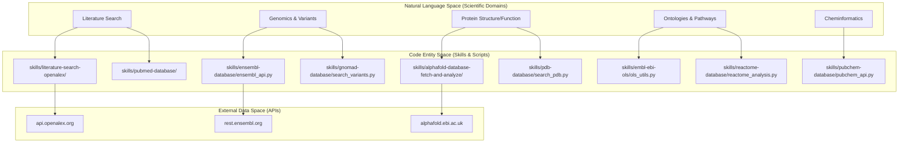
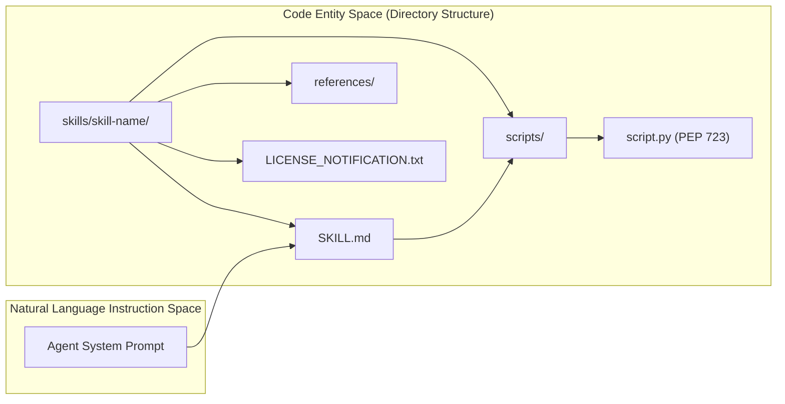

<!-- source: DeepWiki mcp.deepwiki.com · repo google-deepmind/science-skills · page 1 Overview · fetched 2026-10-26 -->

# Overview

Relevant source files

The following files were used as context for generating this wiki page:

- [README.md](README.md)
- [SKILL_LICENSES.md](SKILL_LICENSES.md)
- [plugin.json](plugin.json)

The Science Skills repository is a curated collection of agentic tools designed to extend AI capabilities into specialized scientific domains, including genomics, structural biology, cheminformatics, and literature search [README.md:1-5](). These skills provide structured instructions, executable scripts, and reference materials that allow agents to interact with complex scientific APIs and databases [README.md:6-8]().

The project is structured as a plugin bundle, defined in `plugin.json` [plugin.json:1-10](), primarily integrated with **Google Antigravity**, but accessible via standard CLI tools for broader agentic use [README.md:18-43]().

### Repository Relationship Map

The following diagram illustrates how high-level scientific domains are mapped to specific code entities and external data providers within the repository, bridging natural language spaces to concrete code paths.

**Scientific Domain to Code Entity Mapping**

Sources: [README.md:1-8](), [plugin.json:1-10](), [SKILL_LICENSES.md:1-47]()

---

### Installation and Usage

The Science Skills bundle can be installed via `npx` or integrated directly into the Google Antigravity environment [README.md:18-43]().

*   **Standard Installation**: Use `npx skills add google-deepmind/science-skills/` to add the bundle to your agent's environment [README.md:36-43]().
*   **Google Antigravity**: Users can select the "Science" plugin via `Customizations` > `Build with Google` > `Science` > `Add` in the Antigravity application [README.md:18-27]().
*   **Environment Configuration**: Credentials like `ALPHAGENOME_API_KEY` or `NCBI_API_KEY` are read from `~/.env` [README.md:52-58]().
*   **Runtime Dependencies**: The `uv` package manager handles Python environment isolation and script execution [README.md:47-50]().

For detailed setup instructions, see **[Getting Started](#1.1)**.

Sources: [README.md:18-58]()

---

### Skill Architecture and Meta-Skills

Every skill in the repository follows a standardized directory structure containing instructions, helper scripts, and reference files.

**Standard Skill Component Mapping**

Sources: [README.md:9-17]()

*   **`SKILL.md`**: Contains YAML frontmatter and markdown instructions guiding the agent [README.md:13-14]().
*   **`scripts/`**: Contains executable Python utilities adhering to PEP 723 inline script metadata [README.md:15]().
*   **`references/`**: Contains API schemas and reference guides [README.md:16]().

For details on skill structure, see **[Skill Structure and Conventions](#1.2)**. For creating custom skills using the `workflow-skill-creator` meta-skill, see **[Creating New Skills with the Workflow Skill Creator](#1.3)**.

Sources: [README.md:9-17]()

---

### Navigation Map

| Section | Topic | Description |
| :--- | :--- | :--- |
| **1.1** | **[Getting Started](#1.1)** | Installation, `uv` setup, and API key configuration. |
| **1.2** | **[Skill Structure and Conventions](#1.2)** | Anatomy of `SKILL.md`, `scripts/`, and `references/`. |
| **1.3** | **[Creating New Skills with the Workflow Skill Creator](#1.3)** | Using the `workflow-skill-creator` meta-skill. |
| **2.0** | **[Core Infrastructure]** | Shared `HttpClient`, `uv` integration, credentials, and licenses. |
| **3.0 - 9.0** | **[Domain Skills]** | Deep dives into Literature, Genomics, Proteins, Pathways, Cheminformatics, and Regulatory Genomics. |
| **10.0** | **[Predicting the Past]** | Ancient text analysis inference pipeline. |
| **11.0** | **[Glossary]** | Definitions of technical and biological terms. |

Sources: [README.md:1-103](), [plugin.json:1-10]()

---

