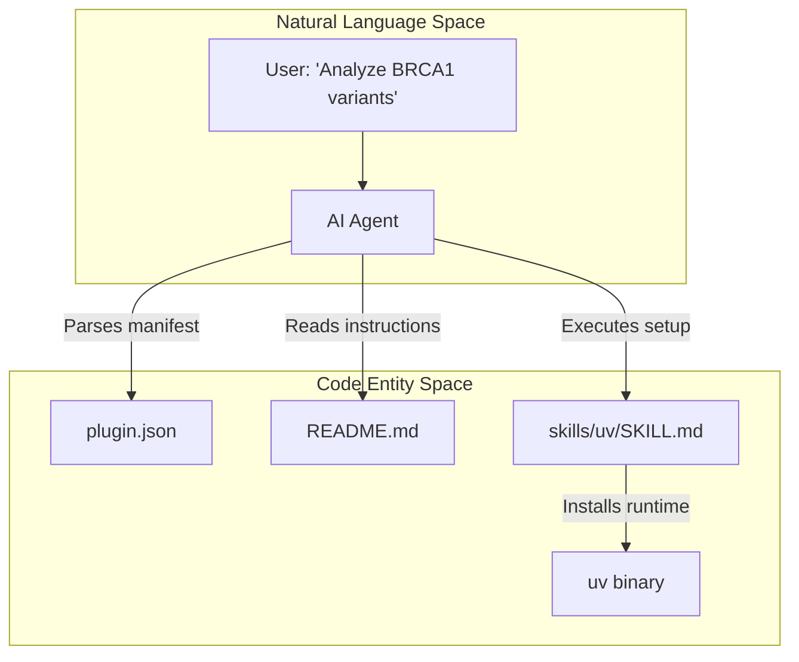
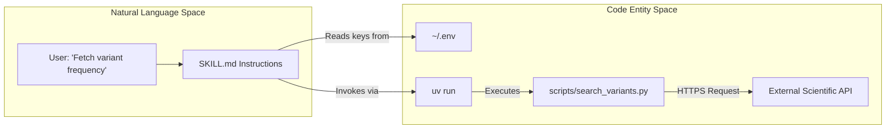

<!-- source: DeepWiki mcp.deepwiki.com · repo google-deepmind/science-skills · page 1.1 Getting Started · fetched 2026-10-26 -->

# Getting Started

<details>
<summary>Relevant source files</summary>

The following files were used as context for generating this wiki page:

- [README.md](README.md)
- [plugin.json](plugin.json)
- [skills/uv/SKILL.md](skills/uv/SKILL.md)

</details>


This page provides a technical guide for initializing the Science Skills environment. It covers the installation of the core skill bundle via `npx`, integration with Google Antigravity, configuration of the `uv` package manager, setup of API keys in `~/.env`, and the execution architecture of individual skills.

## Installation and Bundle Manifest

The Science Skills repository is packaged as a standard agent plugin, defined by the `plugin.json` manifest [plugin.json:1-10](). This manifest declares metadata, versioning (`1.3.0`), and repository sources used by client environments to load the skills bundle [plugin.json:1-10]().

### Installation via npx

For command-line environments and external agent runtimes, the skill bundle is installed using `npx` via the skills CLI [README.md:36-43]():

```bash
npx skills add google-deepmind/science-skills/
```
*Sources: [README.md:36-43](), [plugin.json:1-10]()*

### Google Antigravity Integration

Science Skills are natively optimized for Google Antigravity [README.md:18-21](). 
- **Setup via UI:** In the Antigravity application, navigate to `Customizations` > `Build with Google` > `Science` > `Add` [README.md:25-26]().
- **Onboarding:** The platform automatically registers the bundle defined in `plugin.json` [plugin.json:1-10]() to extend the AI agent's capabilities across scientific domains [README.md:3-7]().

**Data Flow: Initialization and Integration Architecture**

Title: Science Skills Initialization Flow

*Sources: [plugin.json:1-10](), [README.md:1-27](), [skills/uv/SKILL.md:1-16]()*

---

## Setting up the `uv` Package Manager

All Python-based skills within the repository rely on the `uv` package manager to isolate execution environments and resolve PEP 723 inline script dependencies [skills/uv/SKILL.md:9-15]().

### Verification and Installation Protocol

The procedure for bootstrapping `uv` is encoded directly into the `uv` skill instruction set [skills/uv/SKILL.md:17-49]():

1. **Path Check:** The agent checks if `uv --version` is available on the system `PATH` [skills/uv/SKILL.md:19-20]().
2. **Local Binary Check:** If not on `PATH`, the agent checks the default user installation path (`$HOME/.local/bin/uv` on Unix/macOS or `$HOME\.local\bin\uv.exe` on Windows) [skills/uv/SKILL.md:21-25]().
3. **Automated Bootstrap:** If missing entirely, the agent invokes the official installer script [skills/uv/SKILL.md:28-40]():
   - **Unix/macOS:** `curl -LsSf https://astral.sh/uv/install.sh | sh` [skills/uv/SKILL.md:37]()
   - **Windows (PowerShell):** `powershell -ExecutionPolicy ByPass -c "irm https://astral.sh/uv/install.ps1 | iex"` [skills/uv/SKILL.md:38-39]()
4. **Environment Export:** The binary directory is appended to the session `PATH` variable (`export PATH="$HOME/.local/bin:$PATH"`) [skills/uv/SKILL.md:43-48]().

*Sources: [skills/uv/SKILL.md:1-49](), [README.md:47-50]()*

---

## Configuring API Keys in `~/.env`

Certain scientific APIs accessed by skill scripts (such as AlphaGenome or OpenAlex) require explicit API keys for authentication, while others (such as ClinVar or openFDA) accept keys to unlock expanded rate limits [README.md:52-55]().

### Environment Variable Protocol

Skills read configuration variables from a local `~/.env` file [README.md:52-58](). If a required key is missing, the agent prompts the user to obtain one and writes it to the configuration file [README.md:54-56](). 

You can manually provision keys using standard shell redirection:

```bash
echo "ALPHAGENOME_API_KEY=your_actual_api_key" >> ~/.env
echo "NCBI_API_KEY=your_ncbi_key" >> ~/.env
```
*Sources: [README.md:52-58]()*

### Common Credential Matrix

| Environment Variable | Target Domain / Skill | Requirement Level |
| :--- | :--- | :--- |
| `ALPHAGENOME_API_KEY` | AlphaGenome Skills | Mandatory |
| `NCBI_API_KEY` | dbSNP, ClinVar, PubMed, NCBI Fetch | Optional (Unlocks higher rate limits) |
| `FDA_API_KEY` | openFDA Drug Database | Optional (Unlocks higher rate limits) |

*Sources: [README.md:52-58]()*

---

## Running a First Skill and Directory Anatomy

Once `uv` is available and environment variables are populated, the agent executes specialized Python scripts located within individual skill directories [README.md:47-58]().

### Skill Directory Structure

Every skill conforms to a strict structural convention to allow agents to discover instructions and executable utilities:
- **`SKILL.md`**: Contains YAML frontmatter and detailed system instructions for the agent [README.md:13-14]().
- **`scripts/`**: Contains standalone Python CLI scripts equipped with PEP 723 inline dependency metadata [README.md:15]().
- **`references/`**: Contains schemas, documentation, and query templates [README.md:16]().

**Data Flow: Skill Execution Architecture**

Title: Skill Execution Architecture

*Sources: [README.md:10-17](), [README.md:47-58](), [skills/uv/SKILL.md:9-15]()*

---

