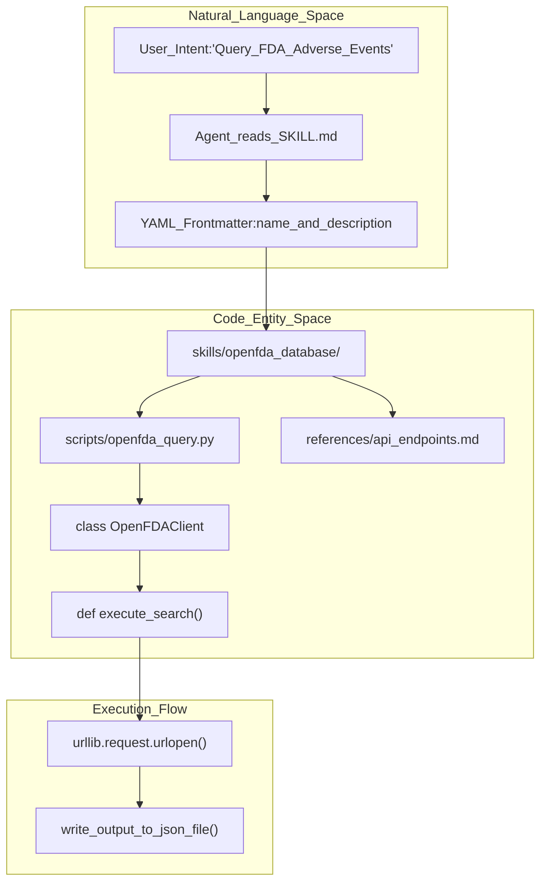
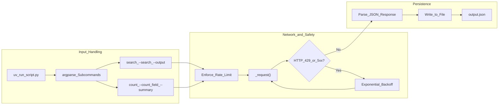

<!-- source: DeepWiki mcp.deepwiki.com · repo google-deepmind/science-skills · page 1.2 Skill Structure and Conventions · fetched 2026-10-26 -->

# Skill Structure and Conventions

Relevant source files

The following files were used as context for generating this wiki page:

- [README.md](README.md)
- [SKILL_LICENSES.md](SKILL_LICENSES.md)
- [skills/openfda_database/SKILL.md](skills/openfda_database/SKILL.md)
- [skills/openfda_database/references/recipes.md](skills/openfda_database/references/recipes.md)

This page details the technical anatomy and architectural standards of skills within the Science Skills repository. Every skill follows a strict directory structure and design philosophy to ensure interoperability, rate-limit compliance, and reliability across different agentic environments.

Sources: [README.md:9-17]()

---

## Anatomy of a Skill Directory

Each skill is contained within its own directory under the `skills/` path. The directory structure is standardized to facilitate automatic discovery and consistent execution by agents.

### Directory Components

| Component | Purpose |
| :--- | :--- |
| `SKILL.md` | The primary entry point containing YAML frontmatter and natural language instructions for the agent. |
| `scripts/` | Contains executable Python scripts. These are the functional execution units of the skill. |
| `references/` | Supporting documentation, API schemas, or static data files used by the agent to understand the domain. |
| `LICENSE_NOTIFICATION.txt` / Sentinel | A sentinel file or workspace notification indicating that the skill may access third-party data subject to specific terms. |

### The SKILL.md Frontmatter
Every `SKILL.md` must begin with a YAML frontmatter block. This block is used by the system to register the skill's identity, metadata, and operational scope.

*   **`name`**: A unique identifier (≤64 characters), using lowercase letters and hyphens [skills/openfda_database/SKILL.md:2-2]().
*   **`description`**: A high-level summary (≤1024 characters) explaining what the skill covers and when the agent should invoke it [skills/openfda_database/SKILL.md:3-8]().

### The Sentinel File and Terms of Use
The presence of a license notification or sentinel file (such as tracking files in workspace `.licenses/`) is a mandatory convention for skills that query external databases [skills/openfda_database/SKILL.md:17-21](). It serves as an audit trail confirming that terms of use—indexed in the root `SKILL_LICENSES.md`—have been presented to and acknowledged by the user [SKILL_LICENSES.md:1-46]().

Sources: [README.md:9-17](), [SKILL_LICENSES.md:1-46](), [skills/openfda_database/SKILL.md:1-29]()

---

## Technical Implementation Standards

Skills are designed to be self-contained yet interoperable across various host environments. This is achieved through strict coding conventions, standardized argument parsing, and reliance on modern packaging tools.

### uv Inline Script Headers and Python Runtime
All Python scripts within a skill's `scripts/` directory utilize the `uv` package manager as the universal execution runtime [README.md:47-50](). Scripts incorporate PEP 723 inline script metadata headers to declare third-party dependencies, guaranteeing that execution environments are isolated and reproducible when invoked via `uv run` [skills/openfda_database/SKILL.md:15-16]().

### File-Output-First Design Principle
A core architectural tenet of the Science Skills repository is the **File-Output-First** design. Because agent context windows are limited and prone to token exhaustion, skills must never dump large volumes of raw API results (such as thousands of records) directly into the interactive chat terminal [skills/openfda_database/SKILL.md:51-53]().

1.  **Mandatory Redirection**: Scripts require an `--output <file>` argument to persist full payloads [skills/openfda_database/SKILL.md:51-53]().
2.  **Structured JSON Format**: Data is serialized into JSON or tabular formats for programmatic post-processing by subsequent steps or downstream code [skills/openfda_database/SKILL.md:68-81]().
3.  **Compact Summary Emission**: Standard output (`stdout`) is reserved for brief, structured summary JSON objects confirming execution success, file path location, and result counts [skills/openfda_database/SKILL.md:77-81]().

### Rate Limiting and Concurrency
To prevent upstream API token revocation and respect rate ceilings, scripts implement robust throttling mechanisms:
*   **Graceful Retries**: Network requests incorporate exponential backoff strategies to handle transient errors and HTTP 429 (Too Many Requests) responses [skills/openfda_database/SKILL.md:37-40]().
*   **Cross-Process Safety**: Where applicable, file-locking primitives coordinate access across concurrent multi-agent executions [skills/openfda_database/SKILL.md:33-40]().

Sources: [README.md:47-50](), [skills/openfda_database/SKILL.md:15-56]()

---

## Data Flow: From Intent to Execution

The following diagrams illustrate how a user's natural language request is mapped onto the underlying file system and executed via standardized Python scripts.

### Mapping Natural Language to Code Entities

This diagram bridges "Natural Language Space" to "Code Entity Space", linking user commands to specific directories, script modules, and client routines.

Title: "Natural Language Space to Code Entity Space"

Sources: [skills/openfda_database/SKILL.md:1-10](), [skills/openfda_database/SKILL.md:60-64]()

### Standard CLI Execution Pattern

Most skill scripts follow an `argparse` subcommand pattern (e.g., `search`, `count`, `download`) as demonstrated in query tools.

Title: "Standard Skill Execution Lifecycle"

Sources: [skills/openfda_database/SKILL.md:60-136]()

---

## Summary of Constraints

| Feature | Requirement / Convention |
| :--- | :--- |
| **Python Runtime** | Managed strictly via `uv run` with PEP 723 metadata [README.md:47-50](). |
| **Dependencies** | Standard library preferred (`urllib`, `json`, `argparse`) [skills/openfda_database/SKILL.md:15-16](). |
| **File Output** | Mandatory `--output <file>` for data serialization [skills/openfda_database/SKILL.md:51-53](). |
| **Rate Limiting** | Respect API thresholds; prompt user for API keys via credentials protocol [skills/openfda_database/SKILL.md:24-29](). |
| **Naming Conventions** | Hyphenated-lowercase for directory names and frontmatter identifiers [skills/openfda_database/SKILL.md:2-2](). |

Sources: [README.md:47-50](), [skills/openfda_database/SKILL.md:15-56]()

---

