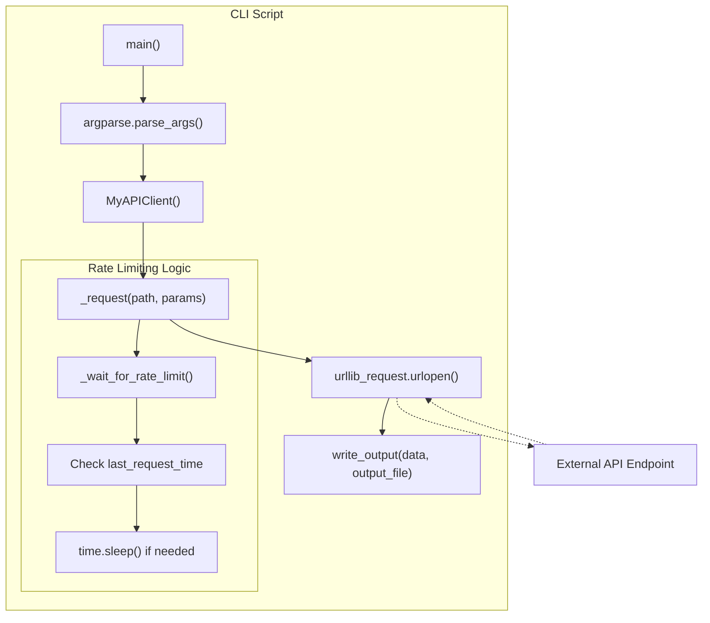
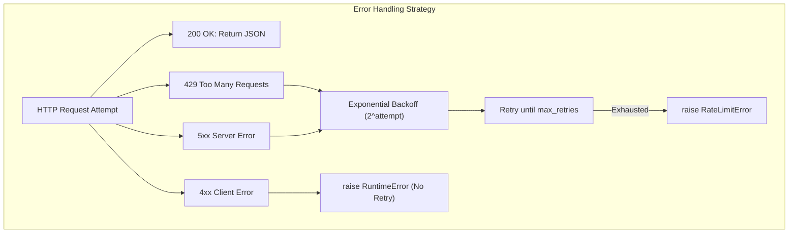

<!-- source: DeepWiki mcp.deepwiki.com · repo google-deepmind/science-skills · page 1.3 Creating New Skills with the Workflow Skill Creator · fetched 2026-10-26 -->

# Creating New Skills with the Workflow Skill Creator

Relevant source files

The following files were used as context for generating this wiki page:

- [skills/workflow_skill_creator/SKILL.md](skills/workflow_skill_creator/SKILL.md)

The `workflow-skill-creator` is a specialized meta-skill designed to distill completed user interactions into reusable agent skills [skills/workflow_skill_creator/SKILL.md:2-7](). Unlike generic skill creators, this tool is strictly for packaging workflows that have **already occurred** in a conversation [skills/workflow_skill_creator/SKILL.md:8-16](). It enforces a rigorous four-phase process to ensure new skills are robust, maintainable, and integrate seamlessly with the existing Science Skills ecosystem.

### The Four-Phase Creation Process

The creation process is divided into distinct phases that transition from natural language requirements to executable code and validation.

#### Phase 1: Brainstorming (Mandatory)
This phase requires an iterative back-and-forth conversation with the user to extract the logic of the workflow [skills/workflow_skill_creator/SKILL.md:23-27](). Developers must not skip this phase, as it prevents the creation of skills that are too rigid or vague [skills/workflow_skill_creator/SKILL.md:18-21]().

| Round | Focus | Key Objectives |
| :--- | :--- | :--- |
| **1. Understand** | Workflow Summary | Confirm inputs, outputs, and recurrence [skills/workflow_skill_creator/SKILL.md:29-36](). |
| **2. Flexibility** | Error Handling | Determine if the skill should fail loudly or try alternatives [skills/workflow_skill_creator/SKILL.md:38-48](). |
| **3. Dependencies** | Reuse | Identify overlapping existing skills that MUST be referenced [skills/workflow_skill_creator/SKILL.md:49-57](). |
| **4. Scope** | Shape | Decide if the skill needs a CLI helper script or just instructions [skills/workflow_skill_creator/SKILL.md:65-90](). |
| **5. Testing** | Validation | Collect sample queries and expected answers [skills/workflow_skill_creator/SKILL.md:92-97](). |

**Sources:** [skills/workflow_skill_creator/SKILL.md:18-113]()

#### Phase 2: Skill Design
Before implementation, a design document (Implementation Plan) must be presented for user approval [skills/workflow_skill_creator/SKILL.md:114-117](). This document serves as the bridge between conceptual brainstorming and code.

**Design Document Requirements:**
*   **YAML Frontmatter:** Name (≤64 chars, lowercase/hyphens) and Description (≤1024 chars) [skills/workflow_skill_creator/SKILL.md:119-120]().
*   **Directory Structure:** A map of all planned files [skills/workflow_skill_creator/SKILL.md:121]().
*   **Rationalization:** Explanation for which existing skills are being reused [skills/workflow_skill_creator/SKILL.md:122]().
*   **Interface:** Proposed CLI subcommands and arguments [skills/workflow_skill_creator/SKILL.md:123]().

**Sources:** [skills/workflow_skill_creator/SKILL.md:114-128]()

#### Phase 3: Implementation
Implementation follows strict technical constraints to ensure portability and reliability across the Science Skills bundle.

**Technical Constraints:**
1.  **Runtime:** Use `uv run`, never direct `python` calls [skills/workflow_skill_creator/SKILL.md:135]().
2.  **Dependencies:** Prefer Python standard library (e.g., `urllib` over `requests`) to minimize installation overhead [skills/workflow_skill_creator/SKILL.md:136-138]().
3.  **Output Management:** Outputs exceeding 500 lines must be redirected to files [skills/workflow_skill_creator/SKILL.md:143-144]().
4.  **Rate Limiting:** Must implement file-lock–based rate limiting for cross-process safety [skills/workflow_skill_creator/SKILL.md:139-142]().

**Sources:** [skills/workflow_skill_creator/SKILL.md:130-145]()

#### Phase 4: Validation
The final phase involves running the sample queries from Phase 1 to ensure the implementation matches the user's expectations.

---

### Implementation Architecture: CLI Script Template

For skills requiring API integration or data processing, the `workflow-skill-creator` provides a standard template: `cli_script_template.py` [skills/workflow_skill_creator/references/cli_script_template.py:15-25]().

#### Data Flow and Component Interaction

The following diagram illustrates how the `MyAPIClient` handles requests, enforcing rate limits before interacting with external endpoints.

API Client Interaction Flow

**Sources:** [skills/workflow_skill_creator/references/cli_script_template.py:27-156]()

### Rate Limiting and Error Handling

New skills must handle API instability and throttling gracefully. The template implements a `RateLimitError` and exponential backoff [skills/workflow_skill_creator/references/cli_script_template.py:36-37]().

Retry and Error Logic

**Key Code Entities:**
*   **`MyAPIClient.REQUESTS_PER_SECOND`**: Defines the throttling threshold [skills/workflow_skill_creator/references/cli_script_template.py:50]().
*   **`_wait_for_rate_limit()`**: Uses `time.monotonic()` to calculate required delays [skills/workflow_skill_creator/references/cli_script_template.py:56-61]().
*   **`_request()`**: Centralizes the `urllib` logic, headers, and retry loops [skills/workflow_skill_creator/references/cli_script_template.py:62-76]().
*   **`write_output()`**: Ensures all data is serialized to JSON for downstream agent processing [skills/workflow_skill_creator/references/cli_script_template.py:143-157]().

**Sources:** [skills/workflow_skill_creator/references/cli_script_template.py:36-157]()

### Skill Reuse Rules
A critical requirement of the `workflow-skill-creator` is the **Rule of Reuse**. If a step in the new workflow can be performed by an existing skill (e.g., searching OpenAlex or fetching PDB structures), the creator **must not** reimplement that logic [skills/workflow_skill_creator/SKILL.md:51-57]().

Instead, the generated `SKILL.md` must:
1.  Reference the existing skill by name [skills/workflow_skill_creator/SKILL.md:149-150]().
2.  Include a "Dependencies" or "Referenced Skills" section explaining why it is used [skills/workflow_skill_creator/SKILL.md:150-151]().

**Sources:** [skills/workflow_skill_creator/SKILL.md:49-59](), [skills/workflow_skill_creator/SKILL.md:147-151]()

---

