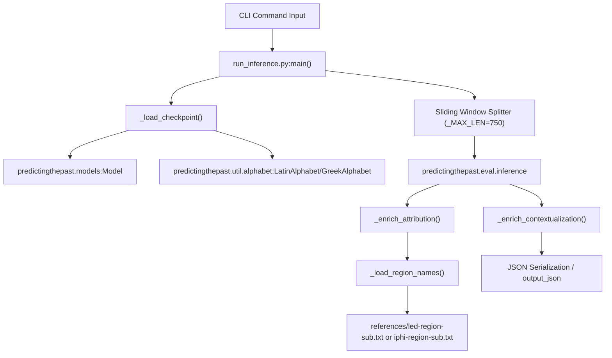
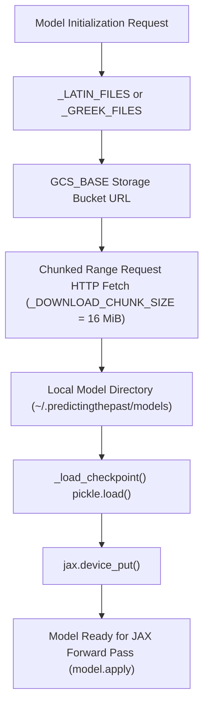

<!-- source: DeepWiki mcp.deepwiki.com · repo google-deepmind/science-skills · page 10.1 Inference Pipeline (run_inference.py) · fetched 2026-10-26 -->

# Inference Pipeline (run_inference.py)

<details>
<summary>Relevant source files</summary>

The following files were used as context for generating this wiki page:

- [skills/predictingthepast/references/output_format.md](skills/predictingthepast/references/output_format.md)
- [skills/predictingthepast/scripts/run_inference.py](skills/predictingthepast/scripts/run_inference.py)

</details>


## Purpose and Scope

This page documents the inference pipeline implemented in `skills/predictingthepast/scripts/run_inference.py` [skills/predictingthepast/scripts/run_inference.py:15-25](). The pipeline powers the `predictingthepast` skill, serving two primary JAX-based machine learning models: **Aeneas** (for Latin inscriptions) and **Ithaca** (for Ancient Greek inscriptions) [skills/predictingthepast/scripts/run_inference.py:17-18](). It executes up to four distinct tasks on preprocessed ancient text: geographical and chronological attribution, missing text restoration, parallel inscription contextualization, and text embedding vector generation [skills/predictingthepast/scripts/run_inference.py:18-21]().

Sources: `skills/predictingthepast/scripts/run_inference.py:15-25`

---

## CLI Flags and Execution Interface

The script exposes a command-line interface via Python's standard `argparse` module [skills/predictingthepast/scripts/run_inference.py:35](). It expects either direct input text via flags or an input file containing preprocessed text [skills/predictingthepast/scripts/run_inference.py:15-18]().

| Flag | Type / Default | Description |
| :--- | :--- | :--- |
| `--model` | `str` (`'latin'` or `'greek'`) | Specifies which model checkpoint and dataset to load (Aeneas vs. Ithaca). |
| `--input_text` | `str` | The preprocessed ancient inscription string to analyze. |
| `--input_file` | `str` | Path to a file containing input text. |
| `--attribute` | boolean flag | Enables chronological and geographical attribution tasks. |
| `--restore` | boolean flag | Enables text restoration (requires `?` or `#` markers in input). |
| `--contextualize`| boolean flag | Enables retrieval of parallel inscriptions. |
| `--embedding` | boolean flag | Generates a 384-dimensional text embedding vector. |
| `--output_json` | `str` | File path to serialize the complete structured JSON results. |

Sources: `skills/predictingthepast/scripts/run_inference.py:15-25`

---

## Model and Asset Management & GCS Chunked Downloads

The inference engine relies on large checkpoint files (`.pkl`), dataset registries (`.json`), and retrieval embedding databases (`.pkl`) stored in Google Cloud Storage (GCS) [skills/predictingthepast/scripts/run_inference.py:53-63,95](). 

Files are downloaded automatically to `~/.predictingthepast/models` (`_MODELS_DIR`) if not present locally [skills/predictingthepast/scripts/run_inference.py:91-93](). To prevent proxy timeouts and memory exhaustion, downloads utilize chunked HTTP range requests [skills/predictingthepast/scripts/run_inference.py:70-73]().

- **Chunk Size (`_DOWNLOAD_CHUNK_SIZE`)**: `16 * 1024 * 1024` (16 MiB) to stay well below proxy limits like Harpoon or Trawler [skills/predictingthepast/scripts/run_inference.py:70-71]().
- **Timeouts**: Configured with a `_DOWNLOAD_TIMEOUT_SECONDS` of `120` seconds and `_DOWNLOAD_PROBE_TIMEOUT_SECONDS` of `60` seconds [skills/predictingthepast/scripts/run_inference.py:72-73]().

Sources: `skills/predictingthepast/scripts/run_inference.py:53-96`

---

## Sliding Window Strategy and Text Processing

Ancient inscriptions vary significantly in length. For inputs exceeding character length thresholds, `run_inference.py` applies a sliding window mechanism [skills/predictingthepast/scripts/run_inference.py:23-24,97-100]().

- **`_MAX_LEN`**: `750` characters [skills/predictingthepast/scripts/run_inference.py:99]().
- **`_MIN_LEN`**: `25` characters [skills/predictingthepast/scripts/run_inference.py:100]().
- **Behavior**: Texts longer than `_MAX_LEN` are split into overlapping windows [skills/predictingthepast/scripts/run_inference.py:97-98](). Any final window shorter than `_MIN_LEN` is discarded [skills/predictingthepast/scripts/run_inference.py:98](). Attribution scores across all valid windows are subsequently aggregated [skills/predictingthepast/scripts/run_inference.py:23-24]().

Sources: `skills/predictingthepast/scripts/run_inference.py:23-24, 97-100`

---

## Inference Tasks: Attribution, Restoration, Contextualization, and Embedding

The pipeline delegates core evaluations to the `predictingthepast.eval.inference` module [skills/predictingthepast/scripts/run_inference.py:48]().

1. **Attribution (`_enrich_attribution`)**: Computes chronological and geographical probability distributions [skills/predictingthepast/scripts/run_inference.py:157-202](). Years are divided into discrete bins [skills/predictingthepast/scripts/run_inference.py:85-89](), and location IDs are mapped to human-readable region titles [skills/predictingthepast/scripts/run_inference.py:196-201]().
2. **Restoration**: Evaluates gaps marked with `?` or `#` characters using beam search predictions.
3. **Contextualization (`_enrich_contextualization`)**: Retrieves top parallel inscriptions via cosine similarity against the embedded reference corpora (`led.json` or `iphi.json`) [skills/predictingthepast/scripts/run_inference.py:55,61]().
4. **Embedding**: Extracts an averaged internal vector representation (384 floats) [skills/predictingthepast/references/output_format.md:141-143]().

Sources: `skills/predictingthepast/scripts/run_inference.py:48, 157-202`, `skills/predictingthepast/references/output_format.md:141-143`

---

## Date-Bin and Region Mapping

Chronological predictions are binned across calendar years from 800 BCE to 800 CE [skills/predictingthepast/scripts/run_inference.py:85-89]().

- **`_DATE_MIN`**: `-800` [skills/predictingthepast/scripts/run_inference.py:87]()
- **`_DATE_MAX`**: `800` [skills/predictingthepast/scripts/run_inference.py:88]()
- **`_DATE_INTERVAL`**: `10` years per bin (yielding 160 bins total) [skills/predictingthepast/scripts/run_inference.py:86,89]()
- **Midpoint Year Conversion (`_year_bin_to_year`)**: Converts bin indices to calendar year midpoints via `_DATE_MIN + bin_idx * _DATE_INTERVAL + _DATE_INTERVAL // 2` [skills/predictingthepast/scripts/run_inference.py:122-124]().
- **Region Names (`_load_region_names`)**: Cached via `@functools.cache` [skills/predictingthepast/scripts/run_inference.py:103-104]() from line-delimited files `led-region-sub.txt` (`_LATIN_REGION_FILE`) and `iphi-region-sub.txt` (`_GREEK_REGION_FILE`) located in references/ [skills/predictingthepast/scripts/run_inference.py:77-83]().

Sources: `skills/predictingthepast/scripts/run_inference.py:77-124`

---

## Score Aggregation and Output Handling

When sliding windows are active, attribution scores and task outputs are aggregated across windows and structured into a unified JSON dictionary [skills/predictingthepast/references/output_format.md:3-14](). 

### Output JSON Schema
```json
{
  "attribution": { ... },
  "restoration": [ ... ],
  "contextualize": [ ... ],
  "embedding": [ ... ],
  "num_windows": 1
}
```[skills/predictingthepast/references/output_format.md:6-14]()

Consuming large outputs directly into LLM context is discouraged; utilities like `jq` should be used to query specific slices (e.g., top locations, year distribution, restoration predictions) [skills/predictingthepast/references/output_format.md:16-43]().

Sources: `skills/predictingthepast/scripts/run_inference.py:15-25`, `skills/predictingthepast/references/output_format.md:3-43`

---

## Architecture Diagrams

### Diagram 1: Natural Language Space to Code Entity Space — Execution Flow


Sources: `skills/predictingthepast/scripts/run_inference.py:35-160`, `skills/predictingthepast/references/output_format.md:3-14`

### Diagram 2: Natural Language Space to Code Entity Space — Asset Management & GCS Retrieval


Sources: `skills/predictingthepast/scripts/run_inference.py:52-96, 127-155`

---

