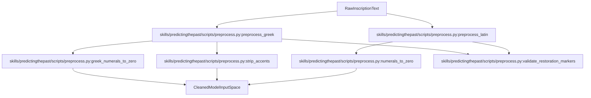
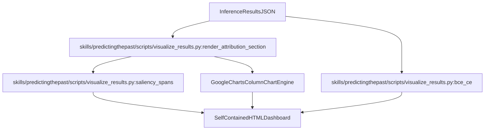

<!-- source: DeepWiki mcp.deepwiki.com · repo google-deepmind/science-skills · page 10.2 Preprocessing, Visualization, and Reference Data · fetched 2026-10-26 -->

# Preprocessing, Visualization, and Reference Data

Relevant source files

The following files were used as context for generating this wiki page:

- [skills/predictingthepast/references/iphi-region-sub-loc.json](skills/predictingthepast/references/iphi-region-sub-loc.json)
- [skills/predictingthepast/references/iphi-region-sub.txt](skills/predictingthepast/references/iphi-region-sub.txt)
- [skills/predictingthepast/references/led-proper-names.txt](skills/predictingthepast/references/led-proper-names.txt)
- [skills/predictingthepast/references/led-region-sub-loc.json](skills/predictingthepast/references/led-region-sub-loc.json)
- [skills/predictingthepast/references/led-region-sub.txt](skills/predictingthepast/references/led-region-sub.txt)
- [skills/predictingthepast/scripts/preprocess.py](skills/predictingthepast/scripts/preprocess.py)
- [skills/predictingthepast/scripts/visualize_results.py](skills/predictingthepast/scripts/visualize_results.py)

## 1. Scope and Purpose
This page details the text normalization routines, result visualization engines, and geographical/lexical reference data supporting ancient inscription analysis in the `predictingthepast` skill. Specifically, it covers script-level text preprocessing in `preprocess.py` for Greek and Latin epigraphic corpora, interactive dashboard rendering in `visualize_results.py`, and the reference files (regional sub-corpora and gazetteers) located in `references/`.

Sources: `skills/predictingthepast/scripts/preprocess.py:15-25`, `skills/predictingthepast/scripts/visualize_results.py:15-28`

---

## 2. Text Preprocessing Pipeline (`preprocess.py`)
Ancient epigraphic texts are frequently fragmented, accented, and burdened with editorial conventions (such as brackets, restorations, and line breaks). The preprocessing script `skills/predictingthepast/scripts/preprocess.py` normalizes raw input text into valid alphabet characters for the Aeneas (Latin) and Ithaca (Greek) JAX models [skills/predictingthepast/scripts/preprocess.py:15-25]().

### Alphabet Specifications and Constants
The pipeline enforces strict character sets tailored to classical vocabulary:
* **Greek Alphabet (`GREEK_ALPHABET`)**: `αβγδεζηθικλμνξοπρςστυφχψωϛ` [skills/predictingthepast/scripts/preprocess.py:36] (lunate sigma `ϲ` is normalized to standard sigma `σ` [skills/predictingthepast/scripts/preprocess.py:197]).
* **Latin Alphabet (`LATIN_ALPHABET`)**: `abcdefghiklmnopqrstuvxyz` [skills/predictingthepast/scripts/preprocess.py:39] (note that `j` and `w` are post-classical and excluded).
* **Special Characters (`SPECIAL_CHARS`)**: Space, hyphen (`-`), underscore (`_`), period (`.`), question mark (`?`), hash (`#`), and zero (`0`) [skills/predictingthepast/scripts/preprocess.py:41].
* **Minimum Length (`MIN_LEN`)**: Epigraphic fragments must contain at least 25 characters to be processed [skills/predictingthepast/scripts/preprocess.py:43].

### Preprocessing Architecture

Sources: `skills/predictingthepast/scripts/preprocess.py:31-127`

### Key Functions
* `strip_accents(text: str) -> str`: Normalizes Greek strings using Unicode NFD decomposition and strips combining diacritical marks (`category != 'Mn'`) [skills/predictingthepast/scripts/preprocess.py:46-62].
* `numerals_to_zero(text: str) -> str`: Converts Arabic digit sequences and Roman numerals into the placeholder token `'0'` for Latin texts [skills/predictingthepast/scripts/preprocess.py:65-84].
* `preprocess_latin(text: str) -> str`: Lowercases text, maps line breaks to spaces, strips punctuation (`!`, `;`, middle dot `·`), removes editorial brackets (`[...]`, `(...)`, `<...>`) while retaining inner contents, filters against valid Latin characters, and collapses whitespace [skills/predictingthepast/scripts/preprocess.py:130-163].
* `preprocess_greek(text: str) -> str`: Lowercases text, strips Greek accents, normalizes lunate sigmas, replaces double brackets, strips editorial braces `{...}`, converts dashes to hyphens, and filters against the Greek alphabet [skills/predictingthepast/scripts/preprocess.py:166-218].
* `validate_restoration_markers(text: str) -> list[str]`: Ensures restoration markers conform to architectural constraints (disallows consecutive `##` or adjacent mixed markers like `?#` or `#?`) [skills/predictingthepast/scripts/preprocess.py:103-127].

Sources: `skills/predictingthepast/scripts/preprocess.py:46-218`

---

## 3. Results Visualization and Dashboard Generation (`visualize_results.py`)
To inspect inference outputs from `run_inference.py`, the script `skills/predictingthepast/scripts/visualize_results.py` compiles the resulting JSON data into a single, self-contained interactive HTML dashboard [skills/predictingthepast/scripts/visualize_results.py:15-28].

### Visualization Data Pipeline

Sources: `skills/predictingthepast/scripts/visualize_results.py:34-191`

### Key Rendering Helpers
* `bce_ce(year: int | None) -> str`: Formats integer years into historical eras (negative values to `BCE`, positive to `CE`) [skills/predictingthepast/scripts/visualize_results.py:41-48].
* `saliency_spans(text: str, saliency: list[float], color: str) -> str`: Generates HTML `` elements with dynamic RGBA background opacities reflecting character-level model saliency scores [skills/predictingthepast/scripts/visualize_results.py:51-62].
* `render_attribution_section(attr: dict) -> str`: Builds HTML tables for top-10 geographical regions, processes probability distributions, and embeds Google Charts JavaScript for chronological column charts [skills/predictingthepast/scripts/visualize_results.py:65-190].

Sources: `skills/predictingthepast/scripts/visualize_results.py:41-190`

---

## 4. Reference Corpora and Gazetteers
The `predictingthepast` skill relies on structured regional reference lists and lexical indices stored under `references/`. These files map regions to spatial coordinates and validate entity names during inference and geolocation mapping.

### Regional Corpora Files
* **iPhi (Greek Epigraphy)**:
  * `iphi-region-sub.txt`: Line-delimited list of valid Greek geographical regions (e.g., `Achaia`, `Attica`, `Crete`) [skills/predictingthepast/references/iphi-region-sub.txt:1-83].
  * `iphi-region-sub-loc.json`: JSON array mapping each region name to its centroid latitude and longitude [skills/predictingthepast/references/iphi-region-sub-loc.json:1-354].
* **LED (Latin Epigraphy Database)**:
  * `led-region-sub.txt`: Line-delimited list of Latin administrative and regional units (e.g., `Aegyptus`, `Baetica`, `Britannia`) [skills/predictingthepast/references/led-region-sub.txt:1-63].
  * `led-region-sub-loc.json`: JSON array linking Latin regions to corresponding geospatial coordinates [skills/predictingthepast/references/led-region-sub-loc.json:1-312].

### Lexical Reference
* `led-proper-names.txt`: A massive list of proper nouns and lexical inflections (38,197 lines) used in Latin text validation and restoration pipelines [skills/predictingthepast/references/led-proper-names.txt:1-507].

| Reference File | Format | Record Count / Scope | Purpose |
| :--- | :--- | ~83 regions | Greek geographical attribution and centroid mapping [skills/predictingthepast/references/iphi-region-sub.txt:1-82]() |
| `iphi-region-sub-loc.json` | JSON Array | ~83 entries | Spatial bounding and mapping for Greek regions [skills/predictingthepast/references/iphi-region-sub-loc.json:1-354]() |
| `led-region-sub.txt` | Plain Text | ~62 regions | Latin administrative region definitions [skills/predictingthepast/references/led-region-sub.txt:1-62]() |
| `led-region-sub-loc.json` | JSON Array | ~62 entries | Spatial coordinate lookup for Roman provinces [skills/predictingthepast/references/led-region-sub-loc.json:1-312]() |
| `led-proper-names.txt` | Plain Text | 38,197 words | Latin proper name vocabulary check [skills/predictingthepast/references/led-proper-names.txt:1-507]() |

Sources: `skills/predictingthepast/references/iphi-region-sub.txt:1-83`, `skills/predictingthepast/references/iphi-region-sub-loc.json:1-354`, `skills/predictingthepast/references/led-region-sub.txt:1-63`, `skills/predictingthepast/references/led-region-sub-loc.json:1-312`, `skills/predictingthepast/references/led-proper-names.txt:1-507`

---

