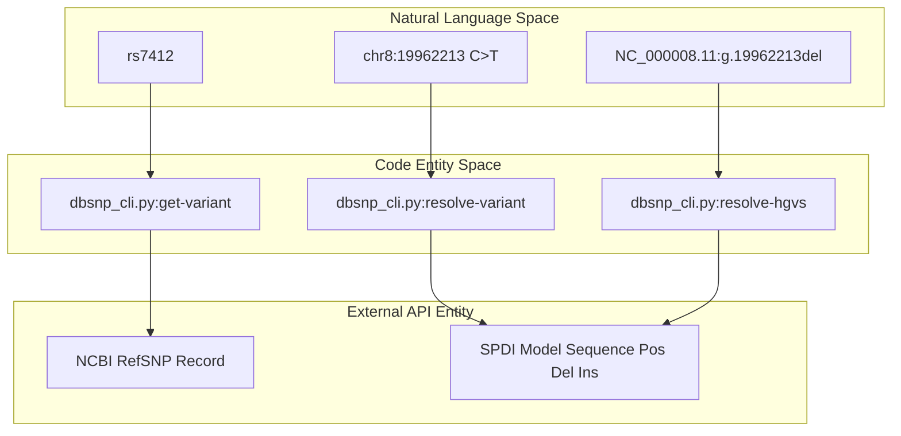
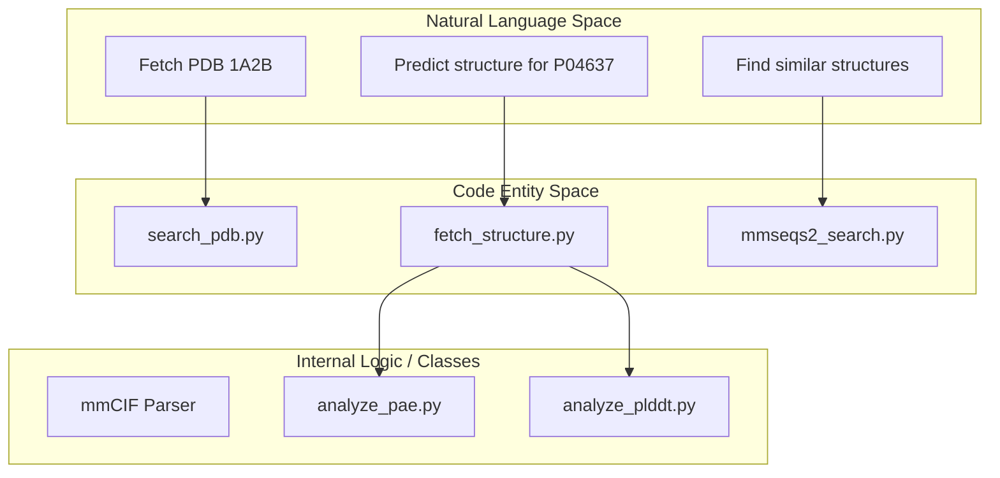

<!-- source: DeepWiki mcp.deepwiki.com · repo google-deepmind/science-skills · page 11 Glossary · fetched 2026-10-26 -->

# Glossary

Relevant source files

The following files were used as context for generating this wiki page:

- [README.md](README.md)
- [SKILL_LICENSES.md](SKILL_LICENSES.md)
- [skills/alphagenome_variant_impact_score/scripts/alphagenome_atlas_avi.py](skills/alphagenome_variant_impact_score/scripts/alphagenome_atlas_avi.py)
- [skills/predictingthepast/scripts/run_inference.py](skills/predictingthepast/scripts/run_inference.py)

This page provides definitions for codebase-specific terminology, biological concepts, API-specific jargon, and abbreviations used throughout the Science Skills repository. It serves as a technical reference for mapping scientific inquiries to repository implementation logic.

## Core Infrastructure Terms

| Term | Definition | Code Pointer |
| :--- | :--- | :--- |
| **HttpClient** | The base shared HTTP client class used for all API requests, providing rate limiting, exponential backoff, and error management. | [skills/science_skills_common/http_client.py:32-45]() |
| **uv** | The universal Python package manager and script execution runtime used to handle isolated dependencies for all skills. | [skills/predictingthepast/scripts/run_inference.py:27-33]() |
| **QPS / QPM** | Queries Per Second / Queries Per Minute. Rate-limiting metrics enforced by the `HttpClient` to prevent API blocks. | [skills/science_skills_common/http_client.py:44-50]() |
| **PEP 723** | The Python standard for inline script metadata, used in skill scripts to specify dependencies and runtime configuration. | [skills/predictingthepast/scripts/run_inference.py:27-33]() |

Sources: [skills/science_skills_common/http_client.py:32-50](), [skills/predictingthepast/scripts/run_inference.py:27-33]()

---

## Genomic and Variant Analysis

### Natural Language to Code Entity Mapping

The following diagram demonstrates how natural language variant representations map to concrete script execution commands and API models in variant-focused skills.

**Variant Resolution Flow**

Sources: [skills/alphagenome_variant_impact_score/scripts/alphagenome_atlas_avi.py:15-41]()

### Key Definitions

*   **MANE Select**: The consensus primary transcript for a human gene agreed upon by Ensembl and NCBI. Implementation prioritizes this in coordinate resolution.
    *   *Code:* [skills/alphagenome_variant_impact_score/scripts/alphagenome_atlas_avi.py:24-27]()
*   **Canonical Transcript**: Ensembl's representative transcript used as a structural fallback.
    *   *Code:* [skills/alphagenome_variant_impact_score/scripts/alphagenome_atlas_avi.py:24-27]()
*   **VEP (Variant Effect Predictor)**: Ensembl tool for analyzing and annotating variant functional consequences.
    *   *Code:* [skills/alphagenome_variant_impact_score/scripts/alphagenome_atlas_avi.py:18-20]()
*   **AVI (AlphaGenome Variant Impact)**: A scoring framework and CLI tool (`alphagenome_atlas_avi.py`) for predicting functional impacts across 18 modalities.
    *   *Code:* [skills/alphagenome_variant_impact_score/scripts/alphagenome_atlas_avi.py:15-22]()
*   **ScoreId**: A precise string token constructed using GENCODE v46 splice junction and exon coordinates to query Atlas track predictions.
    *   *Code:* [skills/alphagenome_variant_impact_score/scripts/alphagenome_atlas_avi.py:24-27]()
*   **LOEUF**: Loss-of-function Observed/Expected Upper bound Fraction, used as a gene constraint metric.
    *   *Code:* [skills/alphagenome_variant_impact_score/scripts/alphagenome_atlas_avi.py:24-27]()

Sources: [skills/alphagenome_variant_impact_score/scripts/alphagenome_atlas_avi.py:15-41]()

---

## Protein and Structural Biology

### Structural Data Flow

This diagram maps structural and protein analysis requests to their respective backend scripts and parsing utilities.

**Protein Structure Retrieval Pipeline**

Sources: [skills/alphagenome_variant_impact_score/scripts/alphagenome_atlas_avi.py:68-94]()

### Key Definitions

*   **pLDDT**: Predicted Local Distance Difference Test. A per-residue confidence score (0-100) assigned by AlphaFold models.
    *   *Code:* [skills/alphagenome_variant_impact_score/scripts/alphagenome_atlas_avi.py:68-94]()
*   **PAE**: Predicted Aligned Error. A matrix metric representing expected distance errors between residue pairs.
    *   *Code:* [skills/alphagenome_variant_impact_score/scripts/alphagenome_atlas_avi.py:68-94]()
*   **UniProt Accession**: A stable database identifier for protein records (e.g., `P04637`).
    *   *Code:* [skills/alphagenome_variant_impact_score/scripts/alphagenome_atlas_avi.py:68-94]()
*   **TrackAttribution**: A data structure holding detailed provenance for assay tracks driving feature maxima in AlphaGenome evaluations.
    *   *Code:* [skills/alphagenome_variant_impact_score/scripts/alphagenome_atlas_avi.py:69-94]()
*   **VariantRecord**: A subclass of `genome.Variant` that stores AVI scores, feature importances, and track attributions.
    *   *Code:* [skills/alphagenome_variant_impact_score/scripts/alphagenome_atlas_avi.py:96-128]()

Sources: [skills/alphagenome_variant_impact_score/scripts/alphagenome_atlas_avi.py:68-128]()

---

## Ontology, Pathways, and Specialized Models

*   **GO (Gene Ontology)**: A standardized vocabulary for biological processes, cellular components, and molecular functions.
    *   *Code:* [skills/predictingthepast/scripts/run_inference.py:15-25]()
*   **ECO (Evidence & Conclusion Ontology)**: Terms describing the type of evidence supporting biological annotations.
    *   *Code:* [skills/predictingthepast/scripts/run_inference.py:15-25]()
*   **Reactome Token**: A unique string identifier returned by the Reactome Analysis Service for retrieving enrichment results asynchronously.
    *   *Code:* [skills/predictingthepast/scripts/run_inference.py:15-25]()
*   **Aeneas and Ithaca**: JAX-based deep learning models used for attribution, text restoration, and contextualization of Latin and Ancient Greek inscriptions.
    *   *Code:* [skills/predictingthepast/scripts/run_inference.py:15-25]()

Sources: [skills/predictingthepast/scripts/run_inference.py:15-51]()

---

## Literature and Metadata

*   **OpenAlex Work**: A distinct scholarly document record (article, book, dataset) within the OpenAlex bibliographic graph.
    *   *Code:* [SKILL_LICENSES.md:28-32]()
*   **DOI (Digital Object Identifier)**: A persistent URI providing resolvable identification for academic documents.
    *   *Code:* [SKILL_LICENSES.md:28-32]()
*   **PMID / PMCID**: PubMed Identifier and PubMed Central Identifier used for literature tracking.
    *   *Code:* [SKILL_LICENSES.md:28-32]()

Sources: [SKILL_LICENSES.md:28-32]()