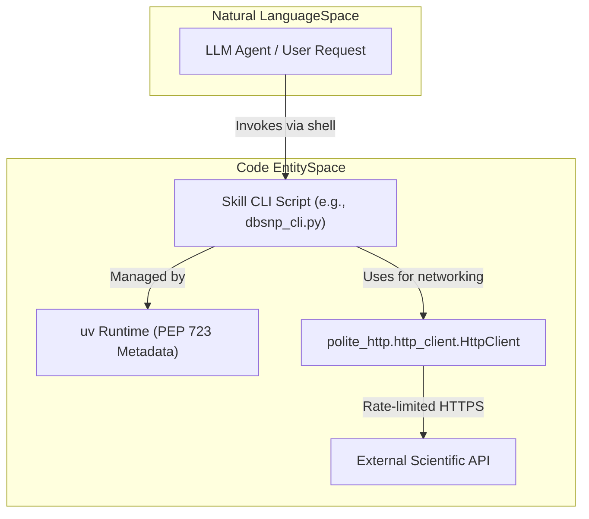
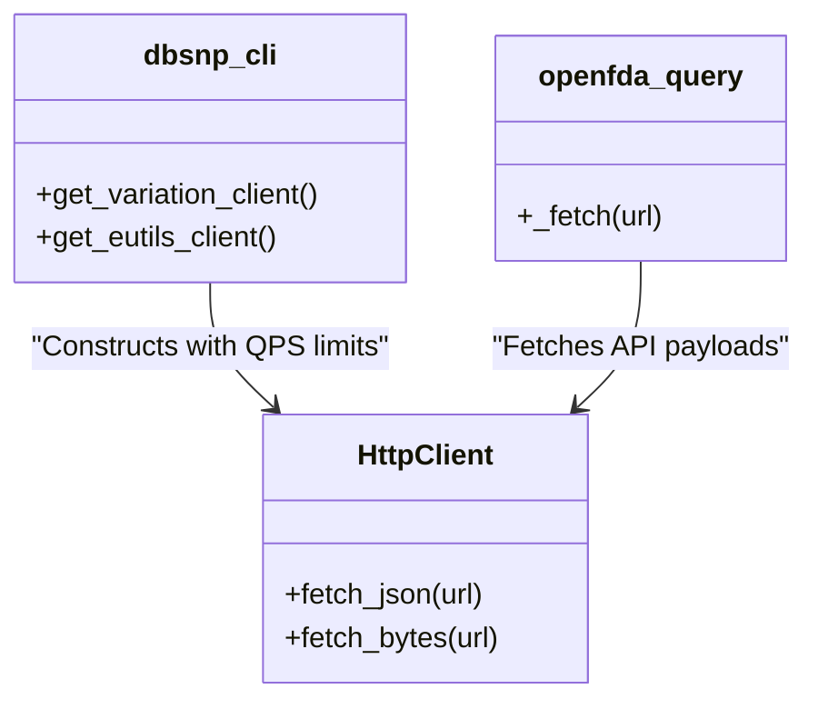

<!-- source: DeepWiki mcp.deepwiki.com · repo google-deepmind/science-skills · page 2 Core Infrastructure · fetched 2026-10-26 -->

# Core Infrastructure

Relevant source files

The following files were used as context for generating this wiki page:

- [skills/dbsnp_database/scripts/dbsnp_cli.py](skills/dbsnp_database/scripts/dbsnp_cli.py)
- [skills/openfda_database/scripts/openfda_query.py](skills/openfda_database/scripts/openfda_query.py)
- [skills/uv/SKILL.md](skills/uv/SKILL.md)

The **Science Skills** repository relies on a shared technical foundation to ensure consistency, reliability, and efficient resource management across dozens of specialized scientific tools. This infrastructure provides a unified networking layer, a standardized runtime environment, secure credential handling, and clear licensing compliance, allowing skill developers to focus on domain-specific logic rather than boilerplate networking or environment management.

The core infrastructure is primarily composed of four foundational pillars:
1.  **`polite-http` Client Library**: Provides rate-limiting, exponential backoff, and retry logic for all API interactions [skills/dbsnp_database/scripts/dbsnp_cli.py:53-78]().
2.  **`uv` Package Manager**: Used as the universal Python runtime and dependency isolator for all skills [skills/uv/SKILL.md:9-12]().
3.  **Credentials and API Key Protocol**: Securely verifies keys against `~.env` using `grep -sq` without leaking values [skills/openfda_database/scripts/openfda_query.py:81-89]().
4.  **Licensing and Terms of Use**: Upstream data source registries and license-notification patterns.

### High-Level Architecture

The following diagram illustrates how the core infrastructure bridges the gap between the natural language requirements of an LLM agent and the execution of code entities across the foundational layers.

**Infrastructure Execution Flow**

Sources: [skills/dbsnp_database/scripts/dbsnp_cli.py:33-78](), [skills/uv/SKILL.md:9-15]()

---

## 2.1. polite-http HttpClient and Rate Limiting

The shared HTTP layer is used by every skill script to communicate with external scientific databases (e.g., NCBI, openFDA). It abstracts away transient network failures and strict rate limits. Key features include:
*   **Client Construction**: `HttpClient` instances configured with specific queries-per-second (`qps`) limits [skills/dbsnp_database/scripts/dbsnp_cli.py:59-63](), [skills/openfda_database/scripts/openfda_query.py:43]().
*   **Resilient Error Handling**: Automatic retries on status codes like `429`, `502`, `503`, and `504` [skills/dbsnp_database/scripts/dbsnp_cli.py:62]().
*   **Specialized CLI Integration**: Pattern implementations in tools like `dbsnp_cli.py` and `openfda_query.py` that handle rate-limit exceptions (`RateLimitError`) and guide the user on API key configuration [skills/dbsnp_database/scripts/dbsnp_cli.py:123-131](), [skills/openfda_database/scripts/openfda_query.py:195-205]().

For details, see [polite-http HttpClient and Rate Limiting](#2.1).

**Networking Component Model**

Sources: [skills/dbsnp_database/scripts/dbsnp_cli.py:53-78](), [skills/openfda_database/scripts/openfda_query.py:40-44]()

---

## 2.2. uv Package Manager Integration

All skills utilize `uv` as their universal Python runtime [skills/uv/SKILL.md:9-12](). `uv` is chosen for extreme speed and dependency isolation via PEP 723 inline script metadata.
*   **Inline Metadata**: Dependencies like `polite-http` and `python-dotenv` are declared directly in script headers [skills/dbsnp_database/scripts/dbsnp_cli.py:25-31](), [skills/openfda_database/scripts/openfda_query.py:22-28]().
*   **Automated Setup**: The repository provides clear fallback paths to detect, install, and add `uv` to the system `PATH` [skills/uv/SKILL.md:21-48]().

For details, see [uv Package Manager Integration](#2.2).

Sources: [skills/uv/SKILL.md:1-49](), [skills/dbsnp_database/scripts/dbsnp_cli.py:25-31]()

---

## 2.3. Credentials and API Key Protocol

Many scientific APIs require authentication (or grant higher rate limits with API keys). The credentials protocol handles keys securely:
*   **Safe Verification**: Uses `grep -sq` against local configuration files such as `~.env` to check for keys without exposing them.
*   **Environment Injection**: Keys are read into environment variables like `NCBI_API_KEY` [skills/dbsnp_database/scripts/dbsnp_cli.py:57]() and `FDA_API_KEY` [skills/openfda_database/scripts/openfda_query.py:82]() at runtime.
*   **Prompting**: Prompts users interactively when mandatory keys are missing, preventing silent execution failures.

For details, see [Credentials and API Key Protocol](#2.3).

Sources: [skills/dbsnp_database/scripts/dbsnp_cli.py:57-58](), [skills/openfda_database/scripts/openfda_query.py:81-89]()

---

## 2.4. Licensing and Terms of Use

Upstream biomedical and chemical databases impose specific terms of use, attribution requirements, and licensing constraints.
*   **Registry & Dual License**: Maintained via `SKILL_LICENSES.md` tracking Apache 2.0 and CC-BY attributions.
*   **License Notifications**: Output generators automatically inject license notices into exported JSON payloads to ensure downstream compliance [skills/openfda_database/scripts/openfda_query.py:97-101]().

For details, see [Licensing and Terms of Use](#2.4).

Sources: [skills/openfda_database/scripts/openfda_query.py:97-101]()

---

