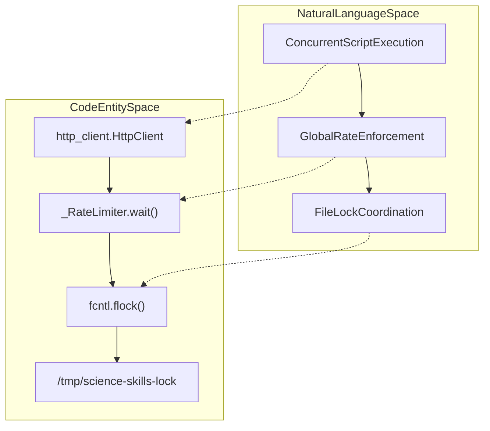
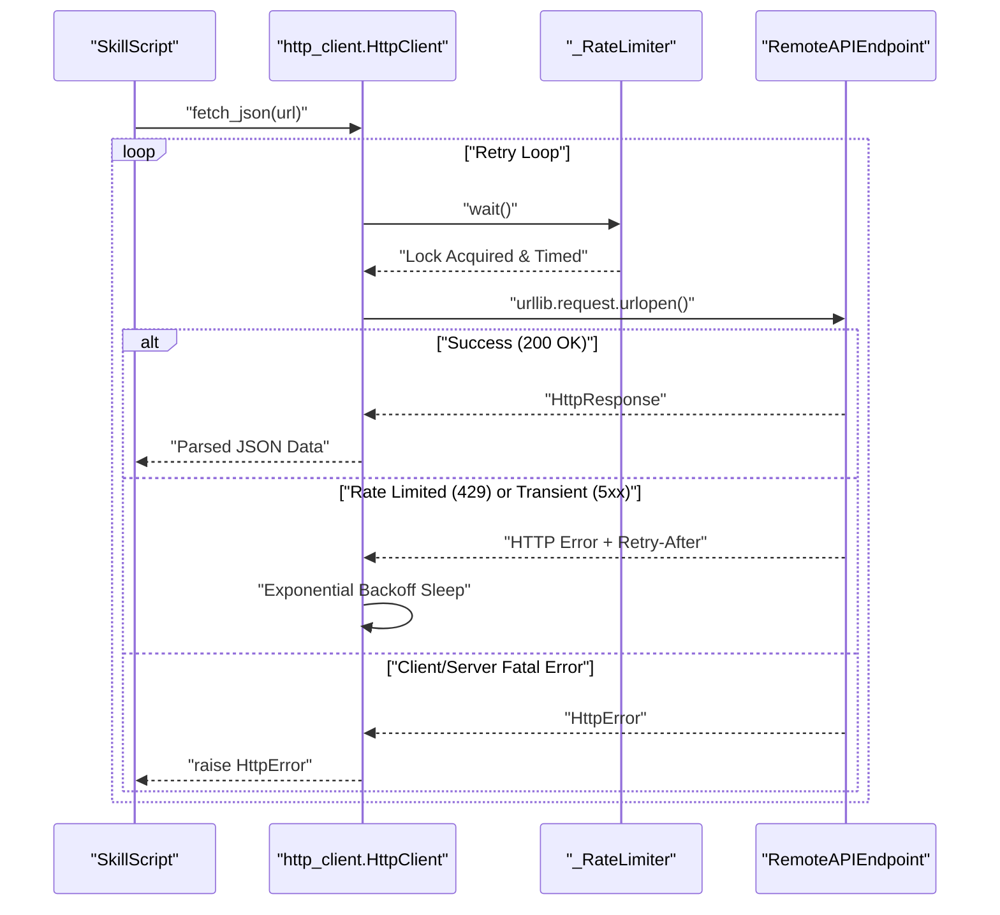

<!-- source: DeepWiki mcp.deepwiki.com · repo google-deepmind/science-skills · page 2.1 polite-http HttpClient and Rate Limiting · fetched 2026-10-26 -->

# polite-http HttpClient and Rate Limiting

Relevant source files

The following files were used as context for generating this wiki page:

- [skills/dbsnp_database/scripts/dbsnp_cli.py](skills/dbsnp_database/scripts/dbsnp_cli.py)
- [skills/human_protein_atlas_database/SKILL.md](skills/human_protein_atlas_database/SKILL.md)
- [skills/human_protein_atlas_database/scripts/hpa_cli.py](skills/human_protein_atlas_database/scripts/hpa_cli.py)
- [skills/ncbi_sequence_fetch/scripts/ncbi_fetch.py](skills/ncbi_sequence_fetch/scripts/ncbi_fetch.py)
- [skills/openfda_database/scripts/openfda_query.py](skills/openfda_database/scripts/openfda_query.py)
- [skills/reactome_database/scripts/reactome_analysis.py](skills/reactome_database/scripts/reactome_analysis.py)

## Purpose and Scope
This page provides a deep dive into the shared `polite-http` library used as the unified networking foundation across all skill scripts in the Science Skills repository. It covers `HttpClient` construction with Quality Per Second (QPS) limits, cross-process rate-limiting synchronization, exponential backoff, `Retry-After` header parsing, helper methods (`fetch_json`, `fetch_bytes`), and practical error handling patterns implemented in scripts like `dbsnp_cli.py`, `openfda_query.py`, `ncbi_fetch.py`, and `hpa_cli.py`.

---

## HttpClient Construction and QPS Configuration

Every skill script that interacts with external bioinformatics APIs initializes an instance of `http_client.HttpClient` [skills/human_protein_atlas_database/scripts/hpa_cli.py:33-36](). The client encapsulates connection pooling, backpressure management, and polite request spacing. Depending on whether an API key is available (such as `NCBI_API_KEY` or `FDA_API_KEY`), the QPS limits are dynamically adjusted [skills/dbsnp_database/scripts/dbsnp_cli.py:57-63](), [skills/ncbi_sequence_fetch/scripts/ncbi_fetch.py:125-127]().

For example:
- **Human Protein Atlas (`hpa_cli.py`)**: Initializes with a static QPS limit of `2.0` [skills/human_protein_atlas_database/scripts/hpa_cli.py:33-36]().
- **Reactome Analysis (`reactome_analysis.py`)**: Initializes with a QPS limit of `1` [skills/reactome_database/scripts/reactome_analysis.py:39-43]().
- **openFDA (`openfda_query.py`)**: Initializes with a QPS limit of `4.0` [skills/openfda_database/scripts/openfda_query.py:40-43]().
- **NCBI dbSNP (`dbsnp_cli.py`)**: Scales its QPS from `3` (anonymous) to `10` (with `NCBI_API_KEY`) [skills/dbsnp_database/scripts/dbsnp_cli.py:57-63]().

Sources: [skills/human_protein_atlas_database/scripts/hpa_cli.py:33-36](), [skills/reactome_database/scripts/reactome_analysis.py:39-43](), [skills/openfda_database/scripts/openfda_query.py:40-43](), [skills/dbsnp_database/scripts/dbsnp_cli.py:57-63]()

---

## Cross-Process Rate Limiting Architecture

Because multiple isolated Python skill scripts may execute concurrently via process runners or `uv run`, rate limits must be enforced globally across the local host environment rather than purely in-memory. The `polite_http` library uses a file-system locking mechanism via `fcntl` to coordinate execution timestamps.

### Diagram: Rate Limiter Code Mapping
The following diagram maps the natural language concept of cross-process synchronization to the specific classes and functions in the `polite_http` codebase.

Sources: [skills/dbsnp_database/scripts/dbsnp_cli.py:57-63](), [skills/ncbi_sequence_fetch/scripts/ncbi_fetch.py:125-127]()

Sources: [skills/dbsnp_database/scripts/dbsnp_cli.py:57-63](), [skills/ncbi_sequence_fetch/scripts/ncbi_fetch.py:125-127]()

---

## Request Execution Flow and Backoff

When a skill script calls methods like `fetch_json()` or `fetch_bytes()`, the request passes through an execution loop that manages retries for transient errors (such as HTTP status codes `429`, `502`, `503`, and `504`) [skills/dbsnp_database/scripts/dbsnp_cli.py:59-63]().

### Diagram: Request Execution Data Flow
The sequence below illustrates how requests flow through the client, invoking rate limiters and handling server errors with exponential backoff.

Sources: [skills/dbsnp_database/scripts/dbsnp_cli.py:120-131](), [skills/openfda_database/scripts/openfda_query.py:183-220]()

Sources: [skills/dbsnp_database/scripts/dbsnp_cli.py:120-131](), [skills/openfda_database/scripts/openfda_query.py:183-220]()

---

## Helper Methods and Response Handling

The `HttpClient` provides specialized helper functions designed to simplify data ingestion across different payload types:
- **`fetch_json`**: Executes an HTTP request and automatically decodes the JSON response body into Python dictionaries or lists [skills/dbsnp_database/scripts/dbsnp_cli.py:121-121]().
- **`fetch_bytes`**: Retrieves raw binary payloads, commonly used for downloading XML entries, PDB coordinate files, or compressed archives [skills/human_protein_atlas_database/scripts/hpa_cli.py:46-46](), [skills/human_protein_atlas_database/scripts/hpa_cli.py:55-55]().
- **Compression Handling**: Automatically detects gzip magic headers (`\x1f\x8b`) and decompresses streams even when content-encoding headers are omitted or stripped by intermediate proxies [skills/ncbi_sequence_fetch/scripts/ncbi_fetch.py:156-160](), [skills/openfda_database/scripts/openfda_query.py:191-192]().

Sources: [skills/dbsnp_database/scripts/dbsnp_cli.py:121-121](), [skills/human_protein_atlas_database/scripts/hpa_cli.py:46-46](), [skills/ncbi_sequence_fetch/scripts/ncbi_fetch.py:156-160](), [skills/openfda_database/scripts/openfda_query.py:191-192]()

---

## Error Handling Patterns in Skill Scripts

When the `HttpClient` exhausts all retry attempts or encounters non-recoverable error codes, it raises `http_client.HttpError`. Skill CLIs implement robust exception wrappers around these errors to provide actionable diagnostic messages to agents and users.

### 1. NCBI dbSNP and E-utilities (`dbsnp_cli.py`)
`dbsnp_cli.py` catches `http_client.HttpError` to handle specific HTTP status codes:
- **HTTP 429**: Raises `RateLimitError` and instructs the agent to prompt the user for an `NCBI_API_KEY` [skills/dbsnp_database/scripts/dbsnp_cli.py:122-131]().
- **HTTP 500 (Reference Mismatch)**: Detects allele mismatch errors (`not equal to variant's asserted reference`) and prevents mechanical retries, advising coordinate verification between assemblies (GRCh38 vs GRCh37) [skills/dbsnp_database/scripts/dbsnp_cli.py:141-155]().

### 2. openFDA Query CLI (`openfda_query.py`)
`openfda_query.py` wraps `CLIENT.fetch()` to intercept `http_client.HttpError`, parsing error payloads and returning structured JSON error dictionaries with daily limit documentation when HTTP 429 occurs [skills/openfda_database/scripts/openfda_query.py:183-205]().

Sources: [skills/dbsnp_database/scripts/dbsnp_cli.py:122-155](), [skills/openfda_database/scripts/openfda_query.py:183-205]()

---

