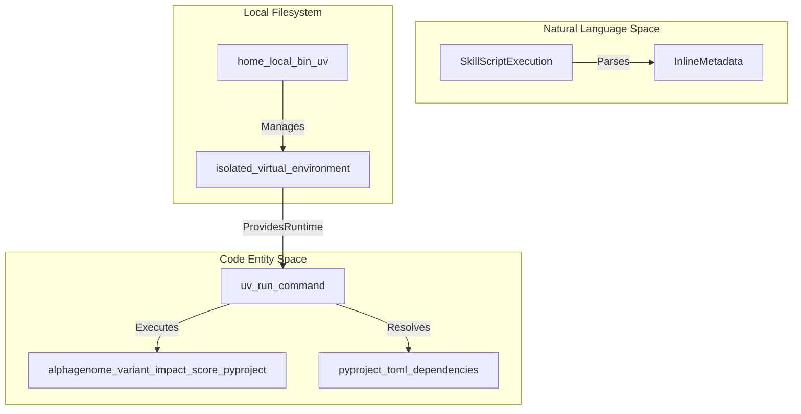
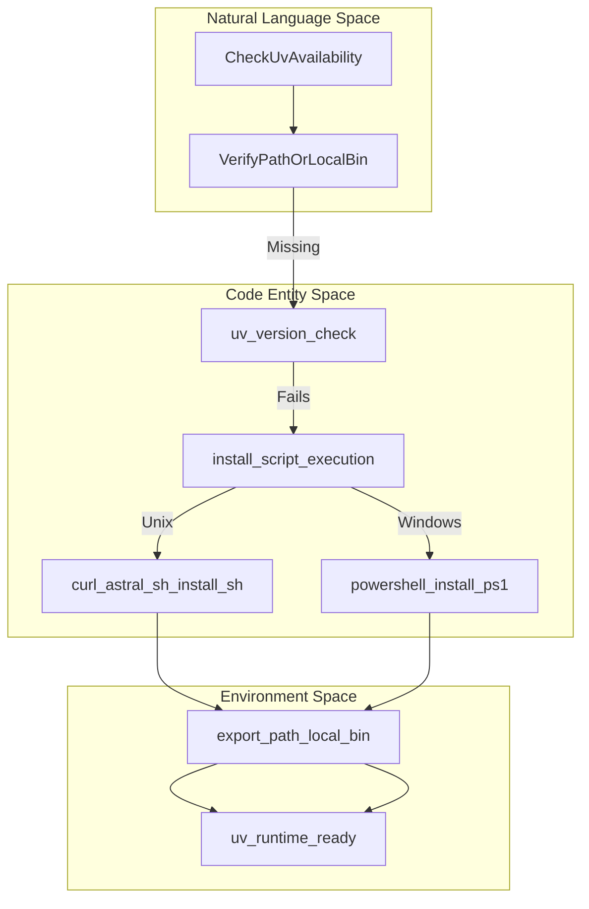

<!-- source: DeepWiki mcp.deepwiki.com · repo google-deepmind/science-skills · page 2.2 uv Package Manager Integration · fetched 2026-10-26 -->

# uv Package Manager Integration

Relevant source files

The following files were used as context for generating this wiki page:

- [skills/alphagenome_atlas_website_links/pyproject.toml](skills/alphagenome_atlas_website_links/pyproject.toml)
- [skills/alphagenome_variant_impact_score/pyproject.toml](skills/alphagenome_variant_impact_score/pyproject.toml)
- [skills/uv/SKILL.md](skills/uv/SKILL.md)

## Purpose and Scope
This page details how `uv` is utilized as the universal Python runtime and package manager across all Science Skills. It covers PEP 723 inline script metadata, per-skill `pyproject.toml` configurations, dependency isolation, installation protocols, and PATH setup.

Sources: [skills/uv/SKILL.md:1-49]()

## Overview of uv Usage
In this ecosystem, `uv` serves as the execution engine for all Python-based skills. It leverages PEP 723 (Inline Script Metadata) to allow single-file Python scripts to declare their own dependencies. When a skill is executed, `uv` automatically handles dependency resolution, environment isolation, and cross-platform consistency.

### Dependency Flow and Code Entities

**Runtime Dependency Resolution Flow**

Sources: [skills/uv/SKILL.md:11-49](), [skills/alphagenome_variant_impact_score/pyproject.toml:1-16]()

## PEP 723 Inline Script Metadata and Per-Skill pyproject.toml
Every Python skill or package uses either PEP 723 inline script metadata or a dedicated `pyproject.toml` file to declare runtime dependencies. For example, complex skills like `alphagenome-variant-impact-score` and `alphagenome-atlas-website-links` specify their requirements in per-skill configuration files.

| Configuration File | Dependencies Declared | Requires Python | Sources |
| :--- | :--- | :--- | :--- |
| `skills/alphagenome_variant_impact_score/pyproject.toml` | `absl-py`, `alphagenome`, `anndata`, `numpy`, `pandas`, `polars`, `pyarrow`, `pysam`, `python-dotenv`, `tabulate` [skills/alphagenome_variant_impact_score/pyproject.toml:5-16]() | `>=3.14` [skills/alphagenome_variant_impact_score/pyproject.toml:4-4]() | [skills/alphagenome_variant_impact_score/pyproject.toml:1-16]() |
| `skills/alphagenome_atlas_website_links/pyproject.toml` | `alphagenome`, `numpy`, `pandas`, `pyarrow`, `python-dotenv` [skills/alphagenome_atlas_website_links/pyproject.toml:5-11]() | `>=3.14` [skills/alphagenome_atlas_website_links/pyproject.toml:4-4]() | [skills/alphagenome_atlas_website_links/pyproject.toml:1-11]() |

Sources: [skills/alphagenome_variant_impact_score/pyproject.toml:1-16](), [skills/alphagenome_atlas_website_links/pyproject.toml:1-11]()

## Installation and PATH Setup
The `uv` skill (`skills/uv/SKILL.md`) governs the installation, verification, and PATH configuration of the `uv` executable across Unix/macOS and Windows environments.

### Verification and Installation Workflow

**uv Installation Protocol**

Sources: [skills/uv/SKILL.md:17-49]()

### Step-by-Step Installation Rules
1. **Version Check**: Check if `uv` is available on the system PATH using `uv --version` [skills/uv/SKILL.md:19-20]().
2. **Local Binary Check**: Check default fallback locations such as `"$HOME/.local/bin/uv" --version` on Unix/macOS or `& "$HOME\.local\bin\uv.exe" --version` on Windows PowerShell [skills/uv/SKILL.md:21-25]().
3. **Automated Installation**: If missing, download and execute the installation script:
   - Unix/macOS: `curl -LsSf https://astral.sh/uv/install.sh | sh` [skills/uv/SKILL.md:37-37]()
   - Windows (PowerShell): `powershell -ExecutionPolicy ByPass -c "irm https://astral.sh/uv/install.ps1 | iex"` [skills/uv/SKILL.md:38-40]()
4. **PATH Export**: Add the local binary directory to the session PATH variable:
   - Unix/macOS: `export PATH="$HOME/.local/bin:$PATH" && uv --version` [skills/uv/SKILL.md:45-45]()
   - Windows (PowerShell): `$env:PATH = "$HOME\.local\bin;" + $env:PATH; uv --version` [skills/uv/SKILL.md:46-48]()

Sources: [skills/uv/SKILL.md:17-49]()

---

