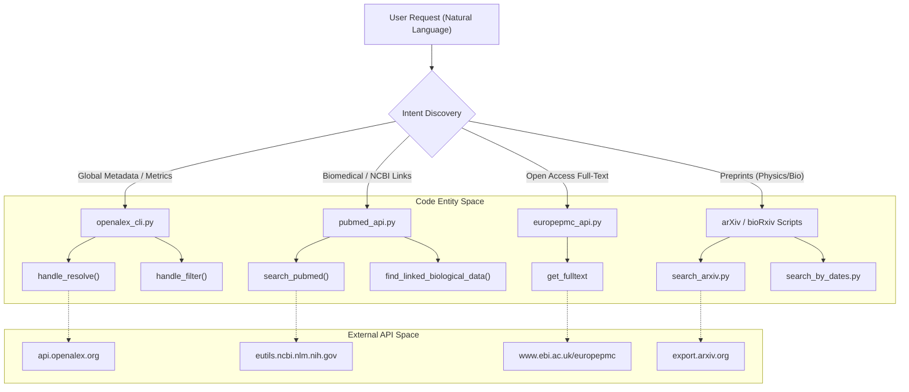
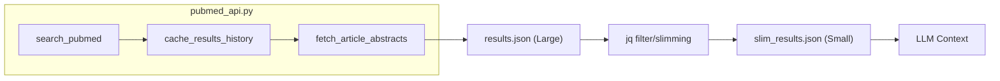

<!-- source: DeepWiki mcp.deepwiki.com · repo google-deepmind/science-skills · page 3 Literature Search Skills · fetched 2026-10-26 -->

# Literature Search Skills

Relevant source files

The following files were used as context for generating this wiki page:

- [skills/literature_search_openalex/scripts/openalex_cli.py](skills/literature_search_openalex/scripts/openalex_cli.py)
- [skills/pubmed_database/scripts/pubmed_api.py](skills/pubmed_database/scripts/pubmed_api.py)

This section provides an overview of the skills available for discovering, retrieving, and analyzing scientific publications across major databases including OpenAlex, Europe PMC, PubMed, arXiv, and bioRxiv. These tools allow for high-level bibliometric analysis, full-text retrieval, and cross-database linking between papers and biological entities.

## Overview of Services

The repository organizes literature search into four primary skill directories, each targeting specific database ecosystems:

| Skill | Primary Use Case | Key Script |
| :--- | :--- | :--- |
| **OpenAlex** | Global scholarly graph, bibliometrics, and DOI resolution. | `openalex_cli.py` [skills/literature_search_openalex/scripts/openalex_cli.py:15-19]() |
| **Europe PMC** | Open-access full-text (XML/PDF) and citation networks. | `europepmc_api.py` |
| **PubMed** | Biomedical literature and linking to NCBI biological databases. | `pubmed_api.py` [skills/pubmed_database/scripts/pubmed_api.py:15-19]() |
| **arXiv / bioRxiv** | Physical and life science preprints and LaTeX source. | `search_arxiv.py`, `search_by_dates.py` |

### System Architecture: Natural Language to Code Entity Space

The following diagram illustrates how natural language requests for literature are routed to specific code entities and external APIs.

**Literature Discovery Routing**

Sources: [skills/literature_search_openalex/scripts/openalex_cli.py:205-233](), [skills/pubmed_database/scripts/pubmed_api.py:135-171](), [skills/literature_search_europepmc/SKILL.md:47-69](), [skills/literature_search_arxiv/scripts/search_arxiv.py:85-110]()

## 3.1. OpenAlex Literature Search
OpenAlex is the primary tool for broad scholarly discovery and bibliometric analysis. It treats the world of research as a graph of interconnected entities: Works, Authors, Sources, Institutions, Topics, Publishers, and Funders [skills/literature_search_openalex/scripts/openalex_cli.py:68-89]().

*   **Capabilities**: Resolve names to IDs, filter works by citation count, and perform random sampling of the literature via `openalex_cli.py` [skills/literature_search_openalex/scripts/openalex_cli.py:15-19]().
*   **Workflow**: Always use `resolve` to find the correct internal ID before applying a filter or query [skills/literature_search_openalex/SKILL.md:47-48]().

For details, see [OpenAlex Literature Search](#3.1).

Sources: [skills/literature_search_openalex/scripts/openalex_cli.py:15-89](), [skills/literature_search_openalex/SKILL.md:47-48]()

## 3.2. Europe PMC and PubMed
These skills focus on the biomedical domain and deep content retrieval.

*   **Europe PMC**: Optimized for retrieving Open Access full-text content. It provides subcommands for `get_fulltext` (XML/JATS) and `download_pdf` [skills/literature_search_europepmc/SKILL.md:102-140]().
*   **PubMed**: Beyond search (`search_pubmed`), this skill enables discovery by linking PMIDs to other NCBI databases via `pubmed_api.py` [skills/pubmed_database/scripts/pubmed_api.py:15-19, 135-153]().

### Data Flow: Retrieval and Slimming
The PubMed and Europe PMC skills emphasize the "File-Output-First" principle to manage large contexts.

**PubMed/PMC Retrieval Pipeline**

Sources: [skills/pubmed_database/scripts/pubmed_api.py:135-199](), [skills/pubmed_database/SKILL.md:119-123]()

For details, see [Europe PMC and PubMed](#3.2).

Sources: [skills/pubmed_database/scripts/pubmed_api.py:135-199](), [skills/literature_search_europepmc/SKILL.md:102-140]()

## 3.3. arXiv and bioRxiv Preprint Search
These skills provide access to the latest research before formal peer review.

*   **arXiv**: Supports advanced query syntax and allows downloading LaTeX source code via `download_paper_source.py` [skills/literature_search_arxiv/SKILL.md:38-40, 86-93]().
*   **bioRxiv/medRxiv**: The bioRxiv API does not support server-side keyword search. Filtering is performed locally by `search_by_dates.py`, requiring narrow date ranges (1-4 weeks) to prevent timeouts [skills/literature_search_biorxiv/SKILL.md:49-54]().

For details, see [arXiv and bioRxiv Preprint Search](#3.3).

Sources: [skills/literature_search_arxiv/SKILL.md:38-93](), [skills/literature_search_biorxiv/SKILL.md:49-54]()

## Core Usage Conventions

Across all literature skills, several technical constraints apply:
1.  **Rate Limiting**: All scripts utilize the shared `HttpClient` which enforces per-service rate limits (e.g., 1 request/3 seconds for arXiv, configured QPS limits in `openalex_cli.py` and `pubmed_api.py`) [skills/literature_search_arxiv/scripts/search_arxiv.py:40](), [skills/literature_search_openalex/scripts/openalex_cli.py:48-57](), [skills/pubmed_database/scripts/pubmed_api.py:54-69]().
2.  **Environment Variables**: API keys for OpenAlex (`OPENALEX_API_KEY`) and NCBI (`NCBI_API_KEY`) should be stored in a `~/.env` file to increase rate limit tiers [skills/literature_search_openalex/SKILL.md:25-30](), [skills/pubmed_database/SKILL.md:26-30]().
3.  **Source Attribution**: Any output generated using these skills must list the URLs of the papers retrieved [skills/literature_search_biorxiv/SKILL.md:63-65]().

**Sources:**
- [skills/literature_search_openalex/scripts/openalex_cli.py:15-89]()
- [skills/pubmed_database/scripts/pubmed_api.py:15-69]()
- [skills/literature_search_openalex/SKILL.md]()
- [skills/literature_search_europepmc/SKILL.md]()
- [skills/pubmed_database/SKILL.md]()
- [skills/literature_search_arxiv/SKILL.md]()
- [skills/literature_search_biorxiv/SKILL.md]()

---

