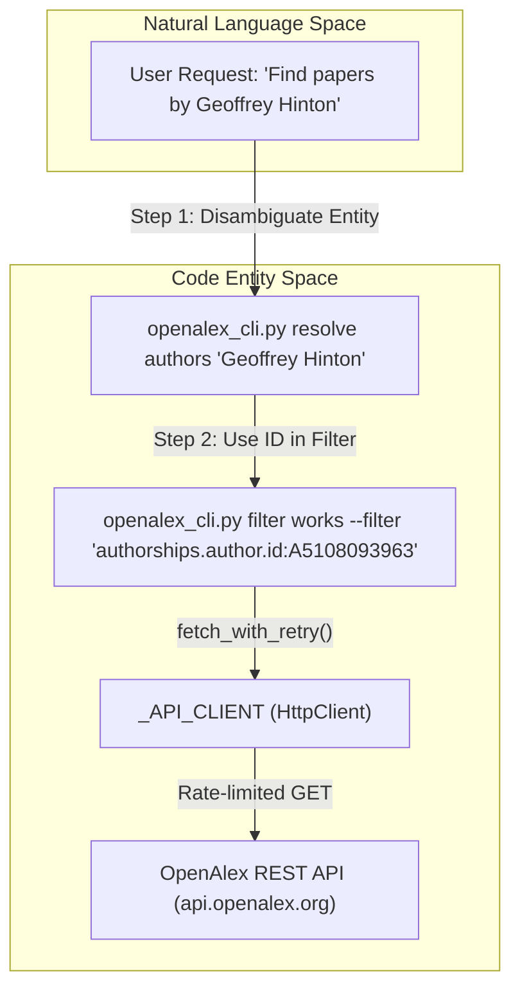
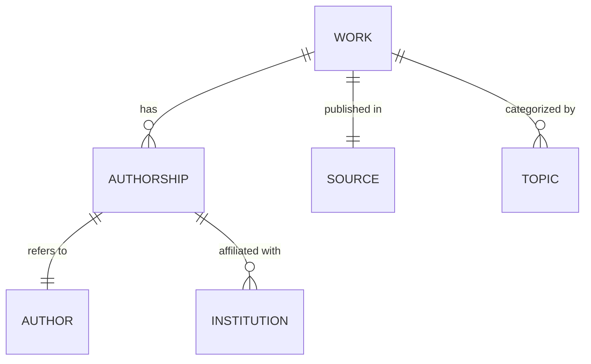

<!-- source: DeepWiki mcp.deepwiki.com · repo google-deepmind/science-skills · page 3.1 OpenAlex Literature Search · fetched 2026-10-26 -->

# OpenAlex Literature Search

Relevant source files

The following files were used as context for generating this wiki page:

- [skills/literature_search_openalex/scripts/openalex_cli.py](skills/literature_search_openalex/scripts/openalex_cli.py)

The `literature-search-openalex` skill provides a comprehensive CLI interface to the OpenAlex scholarly database via `openalex_cli.py`. It enables technical users and agents to query research papers, authors, institutions, and research taxonomies, while managing API complexities like rate limiting, pagination, and ID resolution.

## Overview and Architecture

The skill is centered around `openalex_cli.py`, a robust Python script that interfaces with the OpenAlex REST API [skills/literature_search_openalex/scripts/openalex_cli.py:15-19](). It utilizes the `science-skills-common` `HttpClient` for managed requests, initializing an API client at `qps=10.0` and a PDF client at `qps=1.0` [skills/literature_search_openalex/scripts/openalex_cli.py:48-57]().

### Data Flow and System Components

The following diagram illustrates the flow from a Natural Language request to the execution of the `openalex_cli.py` script and the subsequent API interaction.

**Natural Language to Code Execution Flow**

Sources: [skills/literature_search_openalex/scripts/openalex_cli.py:48-57](), [skills/literature_search_openalex/scripts/openalex_cli.py:112-152]()

## Entity Model and Schema

OpenAlex organizes scholarly data into distinct entity types. The CLI script defines a comprehensive list of supported entity types in `ENTITY_TYPES` [skills/literature_search_openalex/scripts/openalex_cli.py:68-89]().

### Primary Entities
*   `works`: Scholarly documents (articles, books, datasets).
*   `authors`: Individuals who create works.
*   `sources`: Hosting venues (journals, repositories, conferences).
*   `institutions`: Organizations (universities, research centers).

### Taxonomy and Metadata Entities
*   **Topics and Taxonomy:** `topics`, `domains`, `fields`, and `subfields` representing research areas.
*   **Geography and Language:** `countries`, `continents`, and `languages`.
*   **Publishing and Funding:** `publishers`, `funders`, `awards`, `keywords`, `licenses`, `work-types`, `source-types`, and `institution-types`.

**Entity Relationship and Schema Mapping**

Sources: [skills/literature_search_openalex/scripts/openalex_cli.py:68-89]()

## Command Reference

The `openalex_cli.py` script supports multiple subcommands for interacting with the API endpoints.

### 1. resolve
Used to convert a natural language name into a list of OpenAlex ID candidates.
*   **Implementation:** Handled by `handle_resolve`, which queries the respective entity endpoint with a search parameter and retrieves candidate matches [skills/literature_search_openalex/scripts/openalex_cli.py:206-223]().

### 2. get
Retrieves full metadata for a specific entity using its ID (short IDs, full OpenAlex URLs, or DOI URLs).

### 3. filter
Performs filtered searches and aggregations using field-value expressions, supporting `--group-by` parameters for bibliometric summaries.

### 4. download-pdf
Downloads the primary open-access PDF for a given Work ID using `_PDF_CLIENT`.

Sources: [skills/literature_search_openalex/scripts/openalex_cli.py:48-57](), [skills/literature_search_openalex/scripts/openalex_cli.py:206-223]()

## Filter, Sort, and Group-by Fields

Each entity supports a specific set of fields for filtering, sorting, and grouping. 

### Works and Authors Filtering
*   **Works:** Supports filtering, sorting, and grouping on fields such as `cited_by_count`, `publication_year`, `authorships.author.id`, `doi`, and `is_oa`.
*   **Authors:** Supports metrics like `works_count`, `h_index` (via `summary_stats`), and `last_known_institutions.id`.

Sources: [skills/literature_search_openalex/scripts/openalex_cli.py:68-89]()

## Implementation Details

### Rate Limiting and Authentication
The skill uses `fetch_with_retry` to manage requests across `_API_CLIENT` and `_PDF_CLIENT` [skills/literature_search_openalex/scripts/openalex_cli.py:112-152](). It appends API keys safely via `_build_url_with_api_key` to prevent credential leakage in logs [skills/literature_search_openalex/scripts/openalex_cli.py:92-110](). If a `429 Too Many Requests` error occurs without an API key, a warning is logged advising the user to provide an API key [skills/literature_search_openalex/scripts/openalex_cli.py:152-158]().

### Output Management
To prevent flooding the LLM context, `print_json` checks if output is directed to a TTY and truncates lines if they exceed `TRUNCATE_LINE_LIMIT` (500 lines), outputting a warning with the remaining count [skills/literature_search_openalex/scripts/openalex_cli.py:66](), [skills/literature_search_openalex/scripts/openalex_cli.py:174-201]().

Sources: [skills/literature_search_openalex/scripts/openalex_cli.py:66](), [skills/literature_search_openalex/scripts/openalex_cli.py:92-201]()

---

