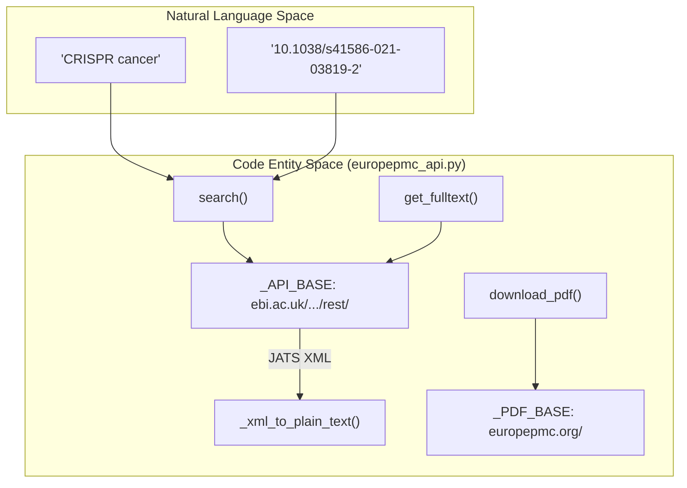
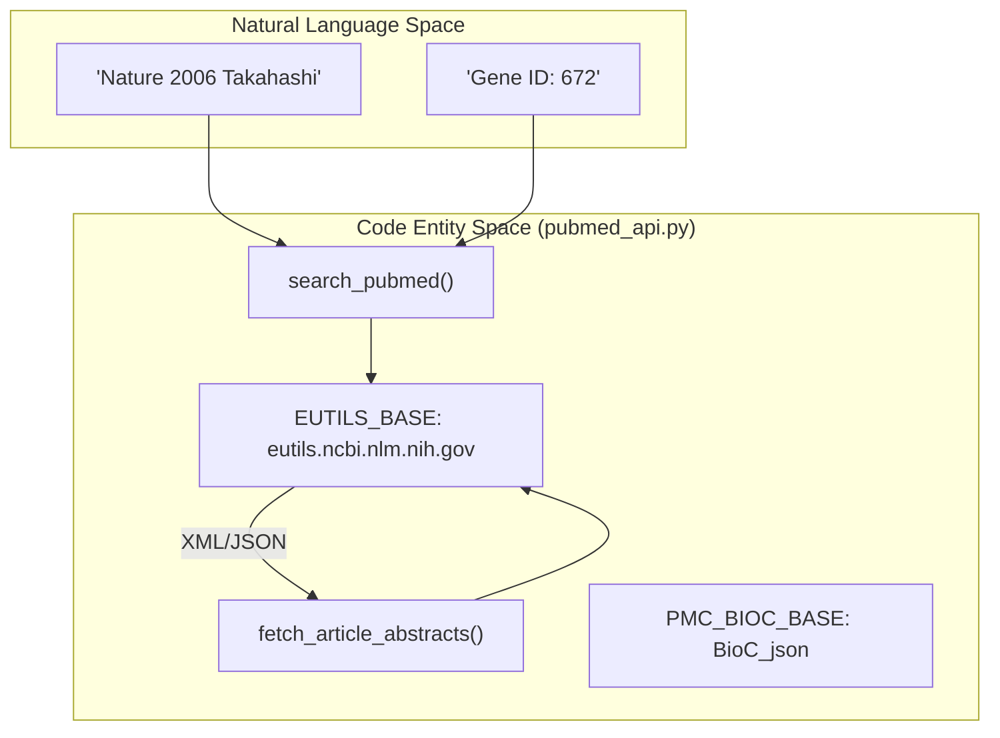

<!-- source: DeepWiki mcp.deepwiki.com · repo google-deepmind/science-skills · page 3.2 Europe PMC and PubMed · fetched 2026-10-26 -->

# Europe PMC and PubMed

Relevant source files

The following files were used as context for generating this wiki page:

- [skills/literature_search_europepmc/scripts/europepmc_api.py](skills/literature_search_europepmc/scripts/europepmc_api.py)
- [skills/pubmed_database/scripts/pubmed_api.py](skills/pubmed_database/scripts/pubmed_api.py)

This page documents the integration with Europe PMC and PubMed, the primary gateways to life-science literature. These skills provide programmatic access to over 40 million abstracts and millions of full-text articles through `europepmc_api.py` and `pubmed_api.py`.

## 1. Europe PMC

The Europe PMC skill provides access to the EBI Europe PMC REST API. It is designed for searching open-access literature, downloading PDFs, and retrieving structured full-text XML (JATS) or plain text.

### Implementation and Data Flow

The `europepmc_api.py` script uses two distinct `HttpClient` instances: one for the REST API (`_API_CLIENT`) and one for PDF downloads (`_PDF_CLIENT`) [skills/literature_search_europepmc/scripts/europepmc_api.py:44-53](). It enforces an **Open Access Only** policy by automatically appending `OPEN_ACCESS:y` to all search queries [skills/literature_search_europepmc/scripts/europepmc_api.py:140-142]().

**Entity Mapping: Europe PMC API**

Sources: [skills/literature_search_europepmc/scripts/europepmc_api.py:41-53](), [skills/literature_search_europepmc/scripts/europepmc_api.py:89-130](), [skills/literature_search_europepmc/scripts/europepmc_api.py:138-164]()

### Key Functions

| Function | Purpose | Key Details |
| :--- | :--- | :--- |
| `search` | Metadata search | Supports Europe PMC syntax; returns `hitCount` and `nextCursorMark` for pagination [skills/literature_search_europepmc/scripts/europepmc_api.py:138-164](). |
| `get_fulltext` | Retrieve article body | Fetches `/fullTextXML`. Can return raw JATS XML or parsed plain text [skills/literature_search_europepmc/scripts/europepmc_api.py:190-200](). |
| `download_pdf` | Binary download | Downloads PDF via `articles/{pmcid}?pdf=render` [skills/literature_search_europepmc/scripts/europepmc_api.py:167-188](). |
| `get_citations` | Forward citations | Retrieves articles citing the target paper [skills/literature_search_europepmc/scripts/europepmc_api.py:202-214](). |
| `_xml_to_plain_text` | XML Processing | Parses JATS XML tags (`article-title`, `abstract`, `body`, `p`) into formatted text [skills/literature_search_europepmc/scripts/europepmc_api.py:89-130](). |

Sources: [skills/literature_search_europepmc/scripts/europepmc_api.py:89-214]()

---

## 2. PubMed (NCBI E-Utilities)

The PubMed skill interfaces with NCBI E-Utilities (ESearch, EFetch, ELink, ESummary, EInfo, EPost) and the PMC BioC API. It supports complex biological database linking and bulk processing via the NCBI History Server.

### System Architecture

The `pubmed_api.py` script manages two clients: `_EUTILS_CLIENT` for standard metadata and `_PMC_CLIENT` for BioC full-text [skills/pubmed_database/scripts/pubmed_api.py:50-69](). It supports authenticated requests via `NCBI_API_KEY`, which increases the rate limit from 3 to 10 QPS [skills/pubmed_database/scripts/pubmed_api.py:54-69]().

**Entity Mapping: PubMed/NCBI E-Utilities**

Sources: [skills/pubmed_database/scripts/pubmed_api.py:45-70](), [skills/pubmed_database/scripts/pubmed_api.py:135-224]()

### Core Capabilities

#### Cross-Database Linking (ELink)
The E-utilities infrastructure allows traversing relationships between PubMed and other NCBI databases via ELink.
*   **Common Targets**: `gene`, `protein`, `pccompound` (PubChem), `nuccore` (GenBank), and `pubmed` (citations).
*   **Workflow**: Querying linked identifiers allows seamless pivoting from literature references to underlying biological entities.

#### Citation Matching and Bulk Workflows
*   **Citation Matching**: Resolves free-text references into PMIDs.
*   **Bulk Workflows and History Server**: For large batches of identifiers, the skill leverages the NCBI History Server (`WebEnv` and `query_key`) to avoid URL length constraints and optimize query execution.

### Data Slimming with jq
Because PubMed metadata can be extremely verbose, filtering results via `jq` before passing them to downstream tasks helps prevent context overflow.

| Strategy | Command Example |
| :--- | :--- |
| **Slim Fields** | `jq '[.[] \| {pmid, title, snippet: (.abstract // "")[:500]}]'` |
| **Filter** | `jq '[.[] \| select((.title // "") \| contains("Review"))]'` |
| **Join IDs** | `jq -r 'join(",")'` |

Sources: [skills/pubmed_database/scripts/pubmed_api.py:45-224]()

---

