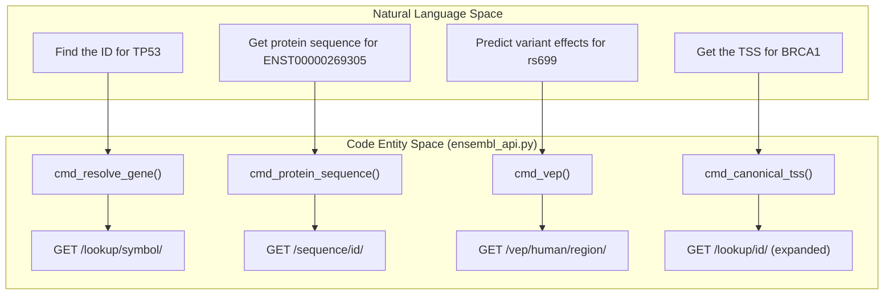
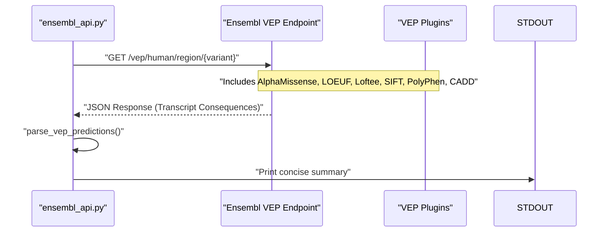

<!-- source: DeepWiki mcp.deepwiki.com · repo google-deepmind/science-skills · page 4.1 Ensembl REST API · fetched 2026-10-26 -->

# Ensembl REST API

Relevant source files

The following files were used as context for generating this wiki page:

- [skills/ensembl_database/scripts/ensembl_api.py](skills/ensembl_database/scripts/ensembl_api.py)

The Ensembl REST API skill provides a comprehensive interface for genome annotation, ID resolution, and variant effect prediction. It serves as the primary tool for mapping biological identifiers (e.g., symbols, RefSeq, UniProt) to Ensembl stable IDs (`ENSG`, `ENST`, `ENSP`), retrieving genomic and protein sequences, and analyzing the molecular consequences of genetic variants through the Variant Effect Predictor (VEP).

Sources: [skills/ensembl_database/scripts/ensembl_api.py:15-21]()

## Architecture and Data Flow

The implementation centers around `ensembl_api.py`, which wraps the Ensembl REST API endpoints. It utilizes a dual-client architecture to support both the current GRCh38 assembly and the legacy GRCh37 assembly.

### System Mapping: Natural Language to Code

The following diagram illustrates how natural language requests are mapped to specific CLI commands and internal function implementations within the `ensembl_api.py` script.

**Command Mapping Overview**

Sources: [skills/ensembl_database/scripts/ensembl_api.py:126-169](), [skills/ensembl_database/scripts/ensembl_api.py:383-421](), [skills/ensembl_database/scripts/ensembl_api.py:479-562](), [skills/ensembl_database/scripts/ensembl_api.py:302-343]()

## Core Functionality

### ID Resolution and Mapping
The skill handles ambiguous gene symbols by first attempting a direct lookup via `/lookup/symbol/` [skills/ensembl_database/references/ensembl_rest_api_reference.md:51-56](). If this fails, it employs a fallback mechanism using `_try_fallback` which queries cross-references (`/xrefs/symbol/`) to resolve synonyms [skills/ensembl_database/scripts/ensembl_api.py:85-123]().

### Dual-Assembly Support
The script maintains two instances of `http_client.HttpClient` [skills/ensembl_database/scripts/ensembl_api.py:47-48]():
1.  `_CLIENT_REGULAR`: Points to `https://rest.ensembl.org` (GRCh38).
2.  `_CLIENT_GRCH37`: Points to `https://grch37.rest.ensembl.org` (GRCh37).

The `_get_client` function selects the appropriate instance based on the `--assembly` flag [skills/ensembl_database/scripts/ensembl_api.py:51-58]().

### Transcript and Protein Analysis
The skill provides specialized logic for identifying primary transcripts:
*   **MANE Select**: The preferred transcript for human genes [skills/ensembl_database/SKILL.md:37-38]().
*   **Canonical**: The representative transcript used when MANE is unavailable [skills/ensembl_database/SKILL.md:39-40]().

The `cmd_transcripts` function can filter for these specifically using `--only-mane` or `--only-canonical` [skills/ensembl_database/scripts/ensembl_api.py:245-300]().

Sources: [skills/ensembl_database/scripts/ensembl_api.py:47-123](), [skills/ensembl_database/SKILL.md:37-40]()

## Sequence and Structure Retrieval

The API allows fetching sequences at various levels (genomic, cDNA, CDS, protein) and detailed transcript architectures.

| Command | Endpoint | Purpose |
| :--- | :--- | :--- |
| `get-sequence` | `/sequence/region/` | Raw DNA for a coordinate window [skills/ensembl_database/scripts/ensembl_api.py:198-228]() |
| `transcript-structure` | `/lookup/id/` | Exon coordinates and UTR boundaries [skills/ensembl_database/scripts/ensembl_api.py:345-381]() |
| `protein-sequence` | `/sequence/id/` | Amino acid FASTA for ENST or ENSP [skills/ensembl_database/scripts/ensembl_api.py:423-477]() |
| `canonical-tss` | `/lookup/id/` | Single coordinate of the Transcription Start Site [skills/ensembl_database/scripts/ensembl_api.py:302-343]() |

Sources: [skills/ensembl_database/references/ensembl_rest_api_reference.md:84-110](), [skills/ensembl_database/scripts/ensembl_api.py:198-477]()

## Variant Effect Predictor (VEP)

The `vep` command integrates multiple open-licensed plugins to provide deep functional insights into variants.

**VEP Execution Flow**

Sources: [skills/ensembl_database/scripts/ensembl_api.py:479-562](), [skills/ensembl_database/scripts/ensembl_api.py:43-47]()

### Supported VEP Plugins
The implementation explicitly enables the following plugins via query parameters [skills/ensembl_database/scripts/ensembl_api.py:41-45]():
*   **AlphaMissense**: Pathogenicity scores and classes.
*   **LOEUF**: Loss-of-function observed/expected upper bound fraction.
*   **Loftee (LoF)**: Identification of high-confidence loss-of-function variants.
*   **Conservation**: Conservation scores (e.g., GERP).
*   **Additional**: DosageSensitivity, IntAct, MaveDB, OpenTargets, NMD, UTRAnnotator, mutfunc.

Sources: [skills/ensembl_database/scripts/ensembl_api.py:41-47]()

## Implementation Details

### Rate Limiting
The Ensembl REST API imposes a limit of 15 requests per second [skills/ensembl_database/references/ensembl_rest_api_reference.md:17-18](). This is enforced by initializing `HttpClient` with `qps=15`, which uses a cross-process file lock to ensure compliance across multiple script executions [skills/ensembl_database/scripts/ensembl_api.py:47-48]().

### Coordinate Handling
The `get-sequence` command performs normalization on coordinate strings, converting formats like `chr17:7661779-7687550` or `17:7661779..7687550` into the standard Ensembl `CHR:START..END` format [skills/ensembl_database/scripts/ensembl_api.py:204-208]().

### Canonical TSS Calculation
The `cmd_canonical_tss` function implements strand-aware logic to identify the Transcription Start Site [skills/ensembl_database/scripts/ensembl_api.py:302-343]():
*   **Positive Strand (+1)**: TSS is the `start` coordinate of the transcript [skills/ensembl_database/scripts/ensembl_api.py:330-333]().
*   **Negative Strand (-1)**: TSS is the `end` coordinate of the transcript [skills/ensembl_database/scripts/ensembl_api.py:330-333]().

Sources: [skills/ensembl_database/scripts/ensembl_api.py:330-333](), [skills/ensembl_database/scripts/ensembl_api.py:47-48](), [skills/ensembl_database/references/ensembl_rest_api_reference.md:17-18]()

---

