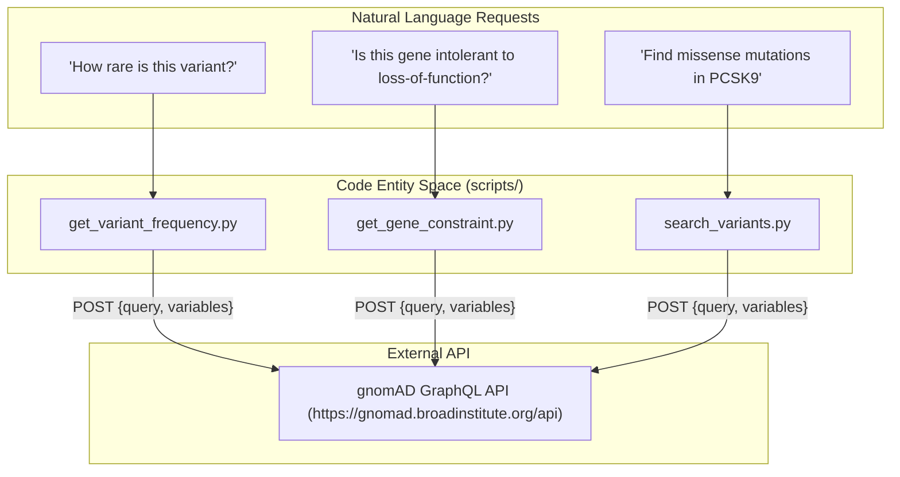
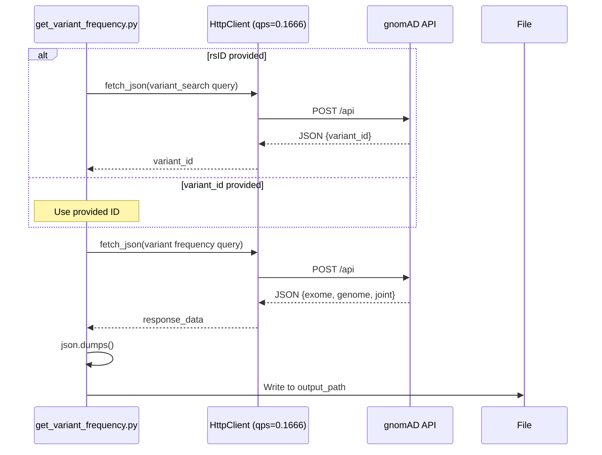

<!-- source: DeepWiki mcp.deepwiki.com · repo google-deepmind/science-skills · page 4.2 gnomAD Population Variant Database · fetched 2026-10-26 -->

# gnomAD Population Variant Database

Relevant source files

The following files were used as context for generating this wiki page:

- [skills/gnomad_database/scripts/get_gene_constraint.py](skills/gnomad_database/scripts/get_gene_constraint.py)
- [skills/gnomad_database/scripts/get_variant_frequency.py](skills/gnomad_database/scripts/get_variant_frequency.py)
- [skills/gnomad_database/scripts/search_variants.py](skills/gnomad_database/scripts/search_variants.py)

The gnomAD skill provides a programmatic interface to the Genome Aggregation Database (gnomAD) via its GraphQL API. It is designed to retrieve variant allele frequencies, genomic region annotations, and gene-level constraint metrics (such as `pLI` and `LOEUF`). The skill enforces strict rate limits to comply with the Broad Institute's API policy.

## Architecture and Data Flow

The skill consists of three primary entry points that interface with the gnomAD GraphQL endpoint: `search_variants.py`, `get_variant_frequency.py`, and `get_gene_constraint.py`. All requests are routed through a shared `HttpClient` configured with a specific rate limit to prevent IP blocking.

### System Overview Diagram
This diagram illustrates the transition from Natural Language requests to the execution of specific Python scripts and their interaction with the gnomAD API.

"Natural Language Space to Code Entity Space"

Sources: [skills/gnomad_database/scripts/get_variant_frequency.py:15-33](), [skills/gnomad_database/scripts/get_gene_constraint.py:15-37](), [skills/gnomad_database/scripts/search_variants.py:15-33]()

## Implementation Details

### Rate Limiting
The gnomAD API requires users to limit traffic to 10 queries per minute (QPM). This is implemented across all scripts using the `polite_http.http_client.HttpClient` with a `qps` (queries per second) parameter set to `0.1666` [skills/gnomad_database/scripts/get_variant_frequency.py:31-33](), [skills/gnomad_database/scripts/get_gene_constraint.py:35-37](), [skills/gnomad_database/scripts/search_variants.py:31-33]().

### Variant Identification
Variants are identified using two formats:
1.  **Variant ID**: A hyphen-separated string in the format `chrom-pos-ref-alt` (e.g., `1-55516888-G-GA`) [skills/gnomad_database/scripts/get_variant_frequency.py:163-165]().
2.  **rsID**: Reference SNP cluster ID (e.g., `rs1800562`). The script `get_variant_frequency.py` includes a `resolve_rsid` function that uses the `variant_search` GraphQL query to map rsIDs to gnomAD variant IDs before fetching frequency data [skills/gnomad_database/scripts/get_variant_frequency.py:35-59]().

### Key Metrics and Schema
The skill retrieves several critical population genetics metrics:

| Metric | Description | GraphQL Field |
| :--- | :--- | :--- |
| **AC** | Allele Count | `ac` |
| **AN** | Allele Number | `an` |
| **AF** | Allele Frequency | `af` |
| **faf95 / faf99** | Filtering Allele Frequency (95%/99% confidence lower bound) | `faf95`, `faf99` |
| **popmax** | The maximum frequency observed across any genetic ancestry group | `popmax` |
| **pLI** | Probability of Loss-of-function Intolerance | `pli` |
| **LOEUF** | Loss-of-function observed/expected upper bound fraction | `oe_lof_upper` |

Sources: [skills/gnomad_database/scripts/get_variant_frequency.py:79-144](), [skills/gnomad_database/scripts/get_gene_constraint.py:45-61]()

## Functional Components

### 1. Variant Frequency (`get_variant_frequency.py`)
This script fetches data for a specific variant across different datasets (defaulting to `gnomad_r4`). It retrieves separate metrics for `exome`, `genome`, and `joint` (combined) callsets [skills/gnomad_database/scripts/get_variant_frequency.py:79-144](). It also breaks down counts by ancestry in the `populations` block [skills/gnomad_database/scripts/get_variant_frequency.py:98-105]().

### 2. Gene Constraint (`get_gene_constraint.py`)
Queries the `gnomad_constraint` object for a specific gene symbol. It focuses on the `oe` (observed/expected) ratios for loss-of-function (`lof`) and missense (`mis`) variants along with `pli` [skills/gnomad_database/scripts/get_gene_constraint.py:45-61]().

### 3. Variant Searching (`search_variants.py`)
Provides two modes of discovery:
*   **Gene Search**: Returns all variants associated with a gene symbol via `search_variants_gene`, with an optional filter for `consequence` (e.g., "pLoF", "missense") [skills/gnomad_database/scripts/search_variants.py:35-108]().
*   **Region Search**: Returns all variants within specific chromosomal coordinates via `search_variants_region` [skills/gnomad_database/scripts/search_variants.py:110-176]().

### Data Flow Diagram
The following diagram details the internal logic of `get_variant_frequency.py`, including the rsID resolution step.

"Variant Frequency Data Flow"

Sources: [skills/gnomad_database/scripts/get_variant_frequency.py:35-156]()

## Usage and Configuration

### Dataset Versions
The scripts default to `gnomad_r4` [skills/gnomad_database/scripts/get_variant_frequency.py:171](), [skills/gnomad_database/scripts/search_variants.py:189](). Users can override this using the `--dataset` flag to query older versions.

### Reference Genomes
The skill is hardcoded to use `GRCh38` for coordinates in gene and region searches [skills/gnomad_database/scripts/search_variants.py:86](), [skills/gnomad_database/scripts/search_variants.py:164](), [skills/gnomad_database/scripts/get_gene_constraint.py:63]().

Sources: [skills/gnomad_database/scripts/search_variants.py:177-207](), [skills/gnomad_database/scripts/get_variant_frequency.py:158-181](), [skills/gnomad_database/scripts/get_gene_constraint.py:77-90]()

---

