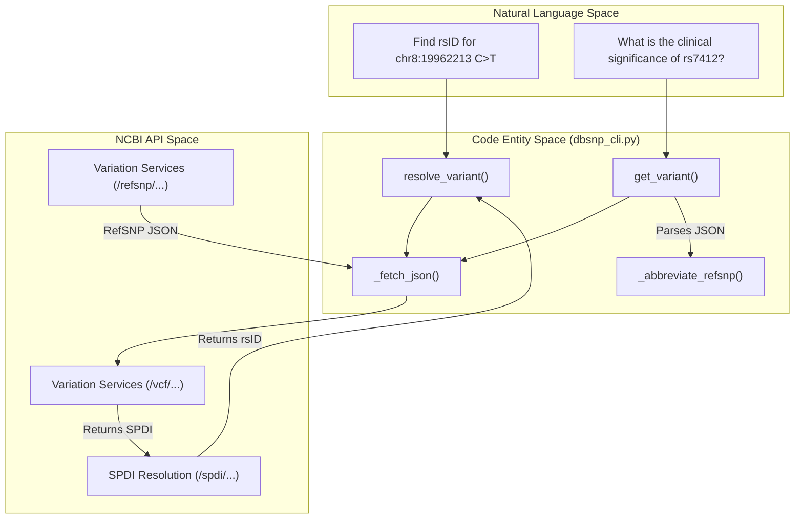
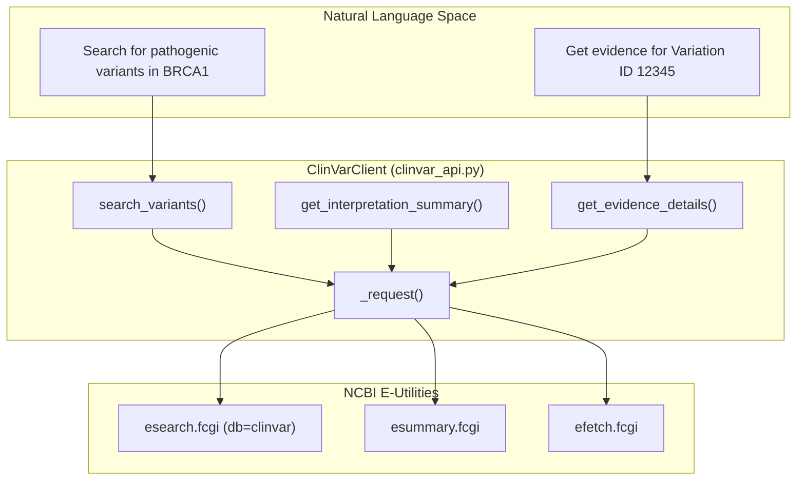

<!-- source: DeepWiki mcp.deepwiki.com · repo google-deepmind/science-skills · page 4.3 dbSNP and ClinVar Variant Databases · fetched 2026-10-26 -->

# dbSNP and ClinVar Variant Databases

Relevant source files

The following files were used as context for generating this wiki page:

- [skills/clinvar_database/scripts/clinvar_api.py](skills/clinvar_database/scripts/clinvar_api.py)
- [skills/dbsnp_database/scripts/dbsnp_cli.py](skills/dbsnp_database/scripts/dbsnp_cli.py)
- [skills/openfda_database/scripts/openfda_query.py](skills/openfda_database/scripts/openfda_query.py)

This section documents the skills for interacting with NCBI's primary variant databases: **dbSNP** (short genetic variations) and **ClinVar** (clinical interpretations of variations). These skills provide tools for resolving variant identifiers, mapping coordinates across assemblies, and retrieving clinical evidence.

## dbSNP: Variant Lookup and Mapping

The `dbsnp_cli.py` script provides a command-line interface to NCBI's dbSNP database via Variation Services and E-utilities [skills/dbsnp_database/scripts/dbsnp_cli.py:15-17](). It is designed to handle rsID lookups, coordinate-to-rsID resolution, and regional searches.

### Core Data Model: SPDI
The skill relies heavily on the **SPDI** (Sequence-Position-Deletion-Insertion) model, which is NCBI's canonical representation for defining variants [skills/dbsnp_database/references/api-notes.md:59-62]().
*   **Sequence**: RefSeq accession (e.g., `NC_000008.11`) [skills/dbsnp_database/references/api-notes.md:64]().
*   **Position**: 0-based inter-residue coordinate [skills/dbsnp_database/references/api-notes.md:65]().
*   **Deletion**: Number of deleted bases or the deleted sequence [skills/dbsnp_database/references/api-notes.md:66]().
*   **Insertion**: The inserted sequence [skills/dbsnp_database/references/api-notes.md:67]().

### Key Functions and Implementation
The CLI manages several complex workflows, such as the two-step resolution of VCF coordinates to rsIDs (VCF → SPDI → rsID) [skills/dbsnp_database/references/api-notes.md:31-32]().

| Function | Role |
| :--- | :--- |
| `get_variant` | Fetches a RefSNP record. Supports abbreviated output (type, gene, clinical sig, MAF) or `--full` JSON [skills/dbsnp_database/scripts/dbsnp_cli.py:321-365](). |
| `resolve_variant` | Converts `chrom pos ref alt` to rsID. It attempts lookup on GRCh38 first, falling back to GRCh37 if a reference mismatch occurs [skills/dbsnp_database/scripts/dbsnp_cli.py:421-469](). |
| `resolve_hgvs` | Resolves an HGVS string to its component SPDI and then to an rsID [skills/dbsnp_database/scripts/dbsnp_cli.py:472-511](). |
| `search_region` | Uses Entrez `esearch` to find all variants within a chromosomal range [skills/dbsnp_database/scripts/dbsnp_cli.py:539-583](). |

Sources: [skills/dbsnp_database/scripts/dbsnp_cli.py:15-17](), [skills/dbsnp_database/scripts/dbsnp_cli.py:321-365](), [skills/dbsnp_database/scripts/dbsnp_cli.py:421-511](), [skills/dbsnp_database/scripts/dbsnp_cli.py:539-583](), [skills/dbsnp_database/references/api-notes.md:31-67]()

### GRCh38/GRCh37 Fallback Logic
When using `resolve-variant`, the script handles assembly mismatches automatically. If a query against GRCh38 (`GCF_000001405.40`) returns an HTTP 500 with a "reference mismatch" error, the script catches `ReferenceMismatchError` and retries the query using GRCh37 (`GCF_000001405.25`) [skills/dbsnp_database/scripts/dbsnp_cli.py:440-469]().

Sources: [skills/dbsnp_database/scripts/dbsnp_cli.py:440-469](), [skills/dbsnp_database/scripts/dbsnp_cli.py:45-48]()

### dbSNP System Flow
This diagram shows how natural language requests for variant resolution are mapped to specific API workflows and code entities.

**Variant Resolution Flow**

Sources: [skills/dbsnp_database/scripts/dbsnp_cli.py:421-469](), [skills/dbsnp_database/scripts/dbsnp_cli.py:321-365](), [skills/dbsnp_database/references/api-notes.md:10-32]()

---

## ClinVar: Clinical Significance and Evidence

The `clinvar_api.py` script provides access to the ClinVar database, which aggregates assertions regarding the relationships between human variations and phenotypes [skills/clinvar_database/scripts/clinvar_api.py:15]().

### Implementation: ClinVarClient
The `ClinVarClient` class manages interactions with NCBI E-utilities (`esearch`, `esummary`, `efetch`) [skills/clinvar_database/scripts/clinvar_api.py:52-60]().

*   **Triangulation Strategy**: To find variants, the skill often uses a two-step process: `search_variants` to get Variation IDs, followed by `get_interpretation_summary` or `get_evidence_details` to retrieve specific data for those IDs [skills/clinvar_database/scripts/clinvar_api.py:133-204](), [skills/clinvar_database/scripts/clinvar_api.py:206-258]().
*   **Pagination**: `search_variants` automatically paginates through results using `retstart` and `retmax` to ensure complete retrieval of large datasets (e.g., all pathogenic variants in a large gene) [skills/clinvar_database/scripts/clinvar_api.py:166-198]().

Sources: [skills/clinvar_database/scripts/clinvar_api.py:15](), [skills/clinvar_database/scripts/clinvar_api.py:52-60](), [skills/clinvar_database/scripts/clinvar_api.py:133-258]()

### Key Commands and Metrics
| Command | Code Entity | Description |
| :--- | :--- | :--- |
| `count` | `count_variants` | Returns total match count for a query without fetching records [skills/clinvar_database/scripts/clinvar_api.py:140-163](). |
| `summary` | `get_interpretation_summary` | Returns `clinical_significance`, `review_status` (star ratings), and `phenotypes` [skills/clinvar_database/scripts/clinvar_api.py:206-258](). |
| `evidence` | `get_evidence_details` | Parses complex XML to extract `Assertion`, `Observations`, and `Submitter` comments [skills/clinvar_database/scripts/clinvar_api.py:260-316](). |

Sources: [skills/clinvar_database/scripts/clinvar_api.py:140-163](), [skills/clinvar_database/scripts/clinvar_api.py:206-316]()

### ClinVar Search and Summary Flow
This diagram maps user queries to the internal `ClinVarClient` methods and the underlying NCBI E-utility endpoints.

**ClinVar Query Pipeline**

Sources: [skills/clinvar_database/scripts/clinvar_api.py:133-157](), [skills/clinvar_database/scripts/clinvar_api.py:206-216](), [skills/clinvar_database/scripts/clinvar_api.py:260-267](), [skills/clinvar_database/scripts/clinvar_api.py:69-82]()

---

## Shared Infrastructure: NCBI Rate Limiting

Both skills utilize the `polite_http` `HttpClient` and implement a shared rate-limiting strategy to comply with NCBI's policies [skills/dbsnp_database/scripts/dbsnp_cli.py:53-64](), [skills/clinvar_database/scripts/clinvar_api.py:61-69]().

*   **API Key Tiers**: The rate limit is dynamically adjusted based on the presence of the `NCBI_API_KEY` environment variable.
    *   **No Key**: 3 requests per second [skills/dbsnp_database/scripts/dbsnp_cli.py:58](), [skills/clinvar_database/scripts/clinvar_api.py:68]().
    *   **With Key**: 10 requests per second [skills/dbsnp_database/scripts/dbsnp_cli.py:58](), [skills/clinvar_database/scripts/clinvar_api.py:68]().
*   **Error Handling**: If a `429 Too Many Requests` status is received, both scripts raise a rate limit error with specific instructions for the user to provide an API key via their environment [skills/dbsnp_database/scripts/dbsnp_cli.py:123-131](), [skills/clinvar_database/scripts/clinvar_api.py:100-108]().
*   **HttpClient Integration**: The scripts use the `qps` parameter in `HttpClient` to enforce these limits across processes [skills/dbsnp_database/scripts/dbsnp_cli.py:59-63](), [skills/clinvar_database/scripts/clinvar_api.py:69]().

Sources: [skills/dbsnp_database/scripts/dbsnp_cli.py:53-64](), [skills/clinvar_database/scripts/clinvar_api.py:61-69](), [skills/dbsnp_database/scripts/dbsnp_cli.py:123-131](), [skills/clinvar_database/scripts/clinvar_api.py:100-108](), [skills/dbsnp_database/references/api-notes.md:76-88]()

---

