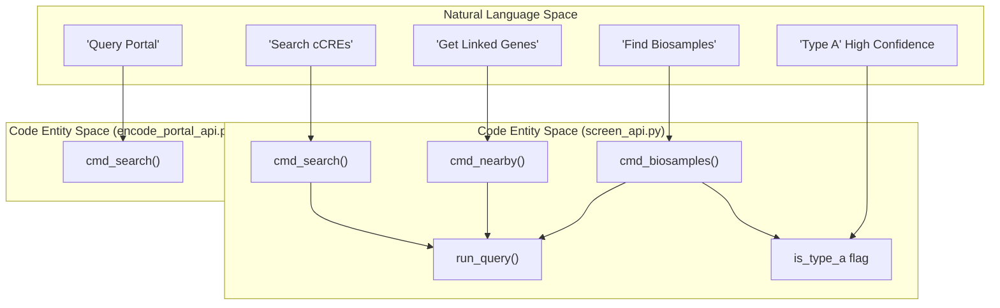
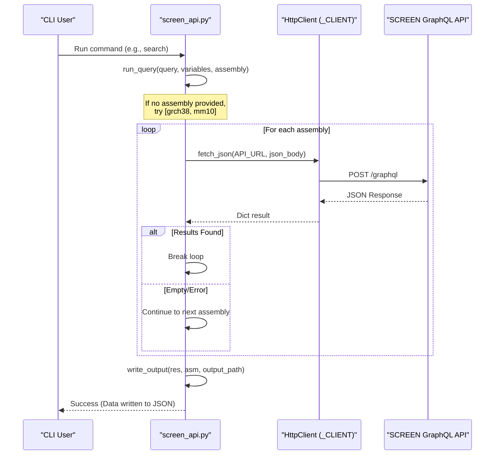

<!-- source: DeepWiki mcp.deepwiki.com · repo google-deepmind/science-skills · page 4.4 ENCODE cCREs Database · fetched 2026-10-26 -->

# ENCODE cCREs Database

Relevant source files

The following files were used as context for generating this wiki page:

- [skills/encode_ccres_database/scripts/encode_portal_api.py](skills/encode_ccres_database/scripts/encode_portal_api.py)
- [skills/encode_ccres_database/scripts/screen_api.py](skills/encode_ccres_database/scripts/screen_api.py)

The ENCODE cCREs Database skill provides programmatic access to the Registry of candidate cis-Regulatory Elements (cCREs) and the broader ENCODE Portal. It is primarily used to identify and characterize functional non-coding DNA elements—such as Promoters, Enhancers, and Insulators—across human and mouse cell types [skills/encode_ccres_database/SKILL.md:12-15]().

The skill interfaces with two primary backends:
1.  **SCREEN GraphQL API**: Used for querying the Registry of cCREs, which integrates biochemical signatures like DNase-seq, H3K4me3, H3K27ac, and CTCF ChIP-seq [skills/encode_ccres_database/scripts/screen_api.py:17-20]().
2.  **ENCODE Portal REST API**: Used for direct access to raw experimental data, ChIP-seq peaks, and file metadata [skills/encode_ccres_database/scripts/encode_portal_api.py:15-15]().

## Implementation and Data Flow

The system is implemented as a set of CLI wrappers that enforce rate limits and handle assembly fallbacks. Data is retrieved as JSON and must be processed using tools like `jq` to avoid overwhelming the LLM context [skills/encode_ccres_database/SKILL.md:70-73]().

### Command-to-Code Mapping
This diagram maps the natural language commands and concepts to their specific implementation entities in the codebase.

**Natural Language to Code Entity Space**

Sources: [skills/encode_ccres_database/scripts/screen_api.py:120-174](), [skills/encode_ccres_database/scripts/screen_api.py:176-194](), [skills/encode_ccres_database/scripts/screen_api.py:196-225](), [skills/encode_ccres_database/scripts/encode_portal_api.py:33-58]()

### Data Retrieval Lifecycle
The following diagram illustrates the flow of a GraphQL request through the `screen_api.py` logic, including the automatic assembly fallback mechanism.

**SCREEN API Data Flow**

Sources: [skills/encode_ccres_database/scripts/screen_api.py:46-98](), [skills/encode_ccres_database/scripts/screen_api.py:36-43]()

## SCREEN GraphQL API (`screen_api.py`)

The `screen_api.py` script is the primary tool for interacting with the Registry of cCREs. It uses a shared `HttpClient` configured for 10 QPS [skills/encode_ccres_database/scripts/screen_api.py:36-43]().

### Key Commands and Functions

| Command | Function | GraphQL Query / Description |
| :--- | :--- | :--- |
| `search` | `cmd_search` | Queries `cCRESCREENSearch` by coordinates, accessions, or Z-score ranges [skills/encode_ccres_database/scripts/screen_api.py:120-174](). |
| `biosamples` | `cmd_biosamples` | Lists biosample metadata and identifies "Type A" high-confidence samples [skills/encode_ccres_database/scripts/screen_api.py:196-225](). |
| `nearby-genes` | `cmd_nearby` | Retrieves genes closest to a cCRE based on linear distance [skills/encode_ccres_database/scripts/screen_api.py:176-194](). |

### cCRE Categories and Z-Scores
The registry classifies elements into categories based on Z-scores for DNase, H3K4me3, H3K27ac, and CTCF:
*   **PLS**: Promoter-like signature.
*   **pELS**: Proximal Enhancer-like signature.
*   **dELS**: Distal Enhancer-like signature.
*   **CTCF-only**: Elements with high CTCF signal but low enhancer/promoter marks.

### "Type A" Biosamples
A biosample is flagged as `is_type_a = True` if it has valid experiment accessions for all four core assays: DNase, H3K4me3, H3K27ac, and CTCF [skills/encode_ccres_database/scripts/screen_api.py:216-223](). This indicates the highest level of annotation confidence.

Sources: [skills/encode_ccres_database/scripts/screen_api.py:120-225]()

## ENCODE Portal API (`encode_portal_api.py`)

This script provides a direct interface to the ENCODE Portal's REST API [skills/encode_portal_api.py:15-15](). It is used when users need raw metadata or files not summarized in the SCREEN registry.

### Search Implementation
The `cmd_search` function accepts standard ENCODE query strings (e.g., `type=Experiment&target.label=ZNF549`). It automatically appends `format=json` and handles the request via `_CLIENT.fetch_json` [skills/encode_portal_api.py:33-51]().

Sources: [skills/encode_portal_api.py:33-58]()

## JSON Output and Parsing

All scripts write results to disk in JSON format. Due to the potentially massive size of these responses, reading the entire file into the LLM context is restricted [skills/encode_ccres_database/SKILL.md:70-73]().

### Common Output Paths
*   **Search Results**: Output via `write_output` to specified paths or defaults [skills/encode_ccres_database/scripts/screen_api.py:100-118]().
*   **Portal Search Results**: Saved to `encode_search_output.json` by default [skills/encode_portal_api.py:54-57]().

Sources: [skills/encode_ccres_database/scripts/screen_api.py:100-118](), [skills/encode_portal_api.py:53-58]()

---

