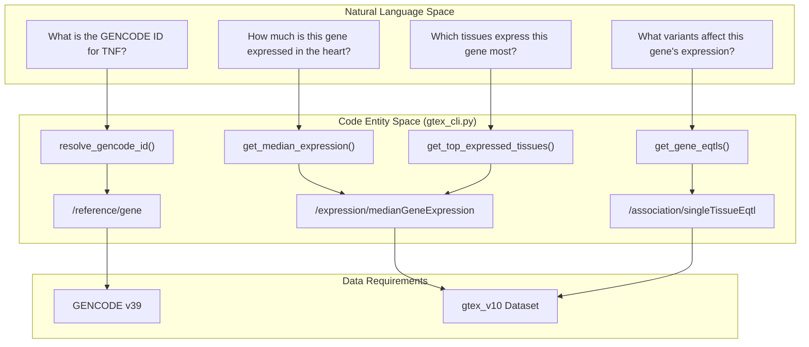
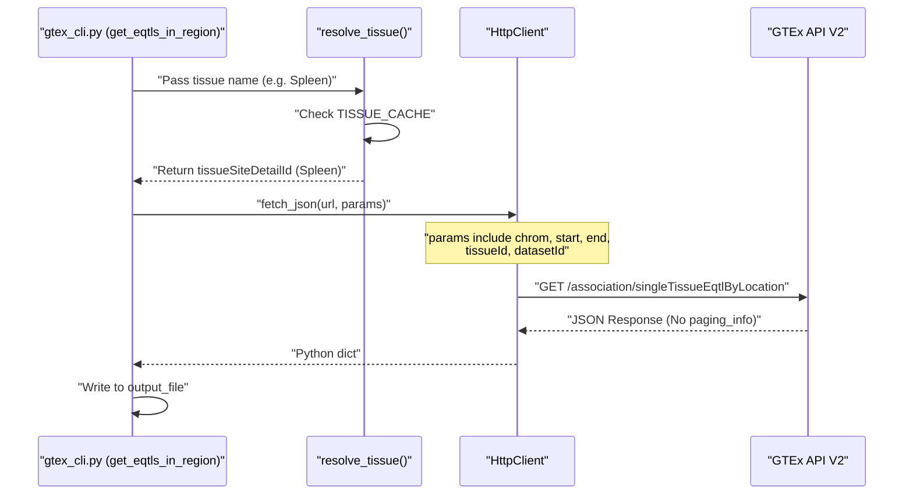

<!-- source: DeepWiki mcp.deepwiki.com · repo google-deepmind/science-skills · page 4.5 GTEx Gene Expression and eQTLs · fetched 2026-10-26 -->

# GTEx Gene Expression and eQTLs

Relevant source files

The following files were used as context for generating this wiki page:

- [skills/gtex_database/scripts/gtex_cli.py](skills/gtex_database/scripts/gtex_cli.py)

The GTEx skill provides a technical interface to the **Genotype-Tissue Expression (GTEx) Project** via the GTEx Portal API V2 [skills/gtex_database/scripts/gtex_cli.py:15-19](). It enables retrieval of baseline RNA expression levels (median TPM) and significant expression Quantitative Trait Loci (eQTLs) across a reference atlas of 54 non-diseased human tissue sites.

## System Overview and Data Flow

The skill is implemented as a CLI wrapper, `gtex_cli.py`, which utilizes the shared `HttpClient` for rate-limited requests (1.0 QPS) to the GTEx V2 endpoints [skills/gtex_database/scripts/gtex_cli.py:33-39]().

### Natural Language to Code Entity Mapping

The following diagram illustrates how high-level genomic queries are mapped to specific functions and API endpoints within the `gtex_cli.py` script.

**GTEx Query Mapping**

Sources: [skills/gtex_database/scripts/gtex_cli.py:35-39](), [skills/gtex_database/scripts/gtex_cli.py:122-127](), [skills/gtex_database/scripts/gtex_cli.py:152-156](), [skills/gtex_database/scripts/gtex_cli.py:183-187]().

## Core Implementation Details

### Versioning and Datasets
The implementation is pinned to specific reference versions to ensure consistency:
*   **Dataset ID**: `gtex_v10` [skills/gtex_database/scripts/gtex_cli.py:36]().
*   **GENCODE Version**: `v39` [skills/gtex_database/scripts/gtex_cli.py:37]().
*   **API Base**: `https://gtexportal.org/api/v2` [skills/gtex_database/scripts/gtex_cli.py:35]().

### Request Handling and Pagination
The script implements a robust fetching logic to handle the GTEx API's structure:
*   `_fetch(url, params)`: Filters `None` values and encodes query parameters, including support for `doseq=True` to handle lists (e.g., multiple tissue IDs) [skills/gtex_database/scripts/gtex_cli.py:44-55]().
*   `_fetch_paginated(url, params)`: Automatically traverses pages by monitoring the `paging_info` object and incrementing the `page` parameter until `numberOfPages` is reached [skills/gtex_database/scripts/gtex_cli.py:57-83]().

### Tissue Resolution
GTEx uses specific `tissueSiteDetailId` strings (e.g., `Esophagus_Muscularis`). The `resolve_tissue` function provides fuzzy matching to allow user-friendly inputs like "Esophagus - Muscularis" or "Whole Blood" [skills/gtex_database/scripts/gtex_cli.py:109-120](). It uses a `TISSUE_CACHE` populated by `get_tissue_mapping()` to minimize API calls to the `/dataset/tissueSiteDetail` endpoint [skills/gtex_database/scripts/gtex_cli.py:85-107]().

## Function Reference

| Function | Command | Description |
| :--- | :--- | :--- |
| `resolve_gencode_id` | `resolve-gencode-id` | Maps a gene symbol to a versioned GENCODE ID (e.g., `ENSG00000232810.2`). This ID is mandatory for most other calls [skills/gtex_database/scripts/gtex_cli.py:122-150](). |
| `get_median_expression` | `get-median-expression` | Retrieves median TPM for a gene. Can be filtered by a comma-separated list of tissues [skills/gtex_database/scripts/gtex_cli.py:152-168](). |
| `get_top_expressed_tissues` | `get-top-expressed-tissues` | Fetches median expression for all tissues, sorts them descending, and returns the top `n` results [skills/gtex_database/scripts/gtex_cli.py:170-181](). |
| `get_gene_eqtls` | `get-gene-eqtls` | Retrieves all significant eQTL associations for a specific gene across tissues [skills/gtex_database/scripts/gtex_cli.py:183-197](). |
| `get_eqtls_in_region` | `get-eqtls-in-region` | Queries eQTLs by chromosomal location [skills/gtex_database/scripts/gtex_cli.py:199-217](). |

## Logic Flow: Regional eQTL Retrieval

The following diagram details the internal logic when querying eQTLs within a specific genomic region.

**Regional eQTL Request Flow**

Sources: [skills/gtex_database/scripts/gtex_cli.py:199-217](), [skills/gtex_database/scripts/gtex_cli.py:109-120]().

## Usage Constraints
*   **Non-Diseased Only**: GTEx data is derived from healthy, non-diseased adult tissues.
*   **Transcriptomics Only**: The data reflects mRNA abundance (TPM); it does not provide protein-level expression or PTM data.
*   **Versioned IDs**: Most endpoints require the versioned GENCODE ID (e.g., `ENSG... .2`) rather than the base ID.

Sources:
- `skills/gtex_database/scripts/gtex_cli.py`

---

