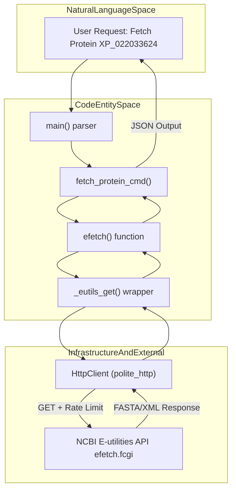
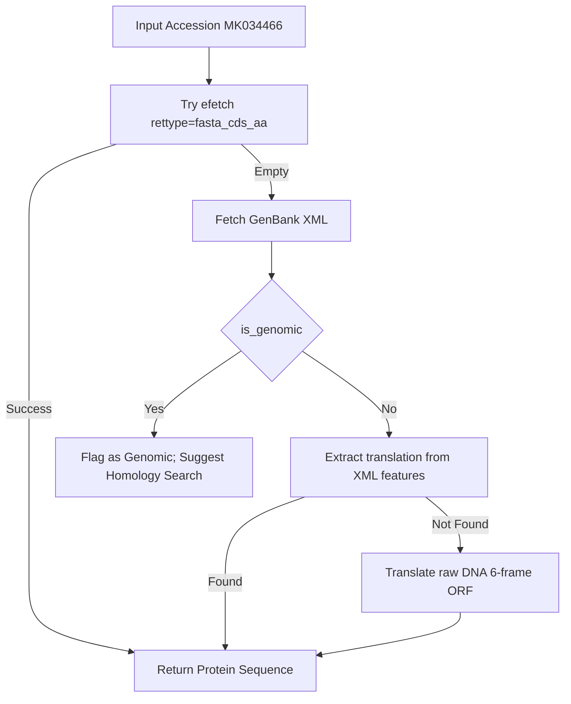

<!-- source: DeepWiki mcp.deepwiki.com · repo google-deepmind/science-skills · page 4.6 NCBI Sequence Fetch · fetched 2026-10-26 -->

# NCBI Sequence Fetch

Relevant source files

The following files were used as context for generating this wiki page:

- [skills/ncbi_sequence_fetch/scripts/ncbi_fetch.py](skills/ncbi_sequence_fetch/scripts/ncbi_fetch.py)

## Purpose and Scope

The NCBI Sequence Fetch skill provides a robust interface for retrieving biological sequences (nucleotide and protein) from NCBI databases such as GenBank and RefSeq. It leverages NCBI's Entrez E-utilities (`efetch`, `esearch`, `elink`, `esummary`) while managing rate limits and providing high-level workflows for complex tasks like CDS translation and patent sequence extraction.

Sources: [skills/ncbi_sequence_fetch/SKILL.md:4-8](), [skills/ncbi_sequence_fetch/scripts/ncbi_fetch.py:15-22]()

## Implementation Overview

The skill is implemented as a single CLI tool, `ncbi_fetch.py`, which wraps the Entrez E-utilities API. It utilizes the shared `polite-http` library to handle HTTP communication, ensuring compliance with NCBI's strict rate-limiting policies.

### Core Logic and Rate Limiting

The script uses a lazily initialized `HttpClient` from the common library. It automatically adjusts its Queries Per Second (QPS) based on the presence of an `NCBI_API_KEY`:
*   **Without API Key:** 3.0 requests/second.
*   **With API Key:** 10.0 requests/second.

The `get_api_client()` function manages this initialization [skills/ncbi_sequence_fetch/scripts/ncbi_fetch.py:121-128]().

Sources: [skills/ncbi_sequence_fetch/scripts/ncbi_fetch.py:121-128]()

### Data Flow: Sequence Retrieval

The following diagram illustrates the flow from a user command to the NCBI API and back, bridging Natural Language Space to Code Entity Space.

**NCBI Fetch Request Pipeline**

Sources: [skills/ncbi_sequence_fetch/scripts/ncbi_fetch.py:121-186](), [skills/ncbi_sequence_fetch/scripts/ncbi_fetch.py:1015-1040]()

## Key Functions and Classes

### Entrez Wrapper Functions
These functions map directly to NCBI E-utility endpoints:
*   `efetch(db, db_id, retmode, rettype)`: Retrieves records in specified formats (FASTA, XML, etc.) [skills/ncbi_sequence_fetch/scripts/ncbi_fetch.py:168-193]().
*   `esearch(db, term, retmax)`: Performs free-text searches and returns a list of UIDs [skills/ncbi_sequence_fetch/scripts/ncbi_fetch.py:196-228]().
*   `elink(dbfrom, db, link_id)`: Navigates relationships between databases (e.g., PubMed to Protein) [skills/ncbi_sequence_fetch/scripts/ncbi_fetch.py:230-260]().
*   `esummary(db, ids)`: Retrieves document summaries for a set of UIDs [skills/ncbi_sequence_fetch/scripts/ncbi_fetch.py:263-267]().

### Sequence Processing
*   `_CODON_TABLE`: Standard genetic code lookup table mapping codon triplets to amino acids [skills/ncbi_sequence_fetch/scripts/ncbi_fetch.py:48-113]().

### Complex Workflows
The script implements several multi-step workflows to ensure high-quality sequence retrieval:

| Function / Workflow | Strategy |
| :--- | :--- |
| `cds_translate` | Tries: 1. `fasta_cds_aa` (NCBI pre-translated), 2. GenBank XML CDS extraction, 3. Raw 6-frame ORF finding [skills/ncbi_sequence_fetch/scripts/ncbi_fetch.py:326-407](). |
| `pubmed_proteins` | Links PubMed IDs to Protein IDs via `elink`, then fetches sequences or extracts from linked Nucleotide records. |
| `patent_search` | Searches for sequences associated with patent numbers or keywords using the `patent[Properties]` filter. |

Sources: [skills/ncbi_sequence_fetch/scripts/ncbi_fetch.py:48-267](), [skills/ncbi_sequence_fetch/scripts/ncbi_fetch.py:326-407]()

## Advanced CDS Translation Logic

The `cds_translate` workflow handles different types of NCBI records (mRNA vs. Genomic).

**CDS Translation Decision Tree**

Sources: [skills/ncbi_sequence_fetch/scripts/ncbi_fetch.py:326-407]()

## Command Line Interface

The script uses `argparse` to provide multiple subcommands. Each subcommand follows the convention of outputting structured data.

### Example Subcommands

| Subcommand | Purpose | Example |
| :--- | :--- | :--- |
| `fetch-protein` | Direct accession lookup | `uv run scripts/ncbi_fetch.py fetch-protein XP_022033624` |
| `search` | Entrez query syntax search | `uv run scripts/ncbi_fetch.py search "WRR4B[Gene] AND Arabidopsis[Org]"` |
| `locus-protein` | Search by locus tag | `uv run scripts/ncbi_fetch.py locus-protein At1g56540` |
| `organism-length` | Search by organism and AA length | `uv run scripts/ncbi_fetch.py organism-length "Oryza sativa" 1043` |

Sources: [skills/ncbi_sequence_fetch/SKILL.md:78-185](), [skills/ncbi_sequence_fetch/scripts/ncbi_fetch.py:121-167]()

## Usage Requirements

1.  **Environment Variables**: `NCBI_API_KEY` should be placed in the `~/.env` file to increase rate limits [skills/ncbi_sequence_fetch/SKILL.md:22-40]().
2.  **Notification**: Users must be notified of NCBI's data usage policies. The skill checks for a `LICENSE_NOTIFICATION.txt` file as a sentinel [skills/ncbi_sequence_fetch/SKILL.md:17-21]().
3.  **Output**: Use the `--output` flag to save structured results; otherwise, results are printed to stdout [skills/ncbi_sequence_fetch/SKILL.md:74-76]().

Sources: [skills/ncbi_sequence_fetch/SKILL.md:13-52]()

---

