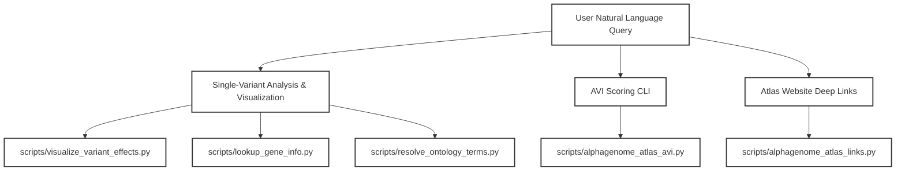
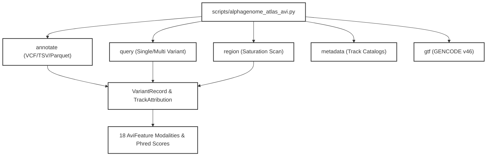

<!-- source: DeepWiki mcp.deepwiki.com · repo google-deepmind/science-skills · page 5 AlphaGenome Skills · fetched 2026-10-26 -->

# AlphaGenome Skills

Relevant source files

The following files were used as context for generating this wiki page:

- [skills/alphagenome_atlas_website_links/SKILL.md](skills/alphagenome_atlas_website_links/SKILL.md)
- [skills/alphagenome_single_variant_analysis/SKILL.md](skills/alphagenome_single_variant_analysis/SKILL.md)
- [skills/alphagenome_variant_impact_score/SKILL.md](skills/alphagenome_variant_impact_score/SKILL.md)

This page provides an overview of the AlphaGenome skill suite within the Science Skills repository. The AlphaGenome tools enable researchers to analyze non-coding and coding genetic variant effects on gene expression, chromatin accessibility, histone modifications, and transcription factor binding using Google DeepMind's AlphaGenome API and the AlphaGenome Atlas web platform. 

For full technical details, implementation specifics, and complete command-line arguments, refer to the child pages linked throughout this overview.

---

## Architecture and Overview of AlphaGenome Skills

The AlphaGenome suite is partitioned into three core operational pillars: single-variant exploration and visualization, high-throughput variant impact scoring via the AVI CLI, and interactive web deep-linking for the AlphaGenome Atlas application.

*Figure 1: Mapping natural language analysis requests to underlying AlphaGenome Python script modules.*

Sources: [skills/alphagenome_single_variant_analysis/SKILL.md:1-136](), [skills/alphagenome_variant_impact_score/SKILL.md:1-150](), [skills/alphagenome_atlas_website_links/SKILL.md:1-152]()

---

## 5.1. AlphaGenome Single-Variant Analysis

The single-variant analysis skill focuses on predicting and visualizing the molecular consequences of individual genetic variants. It leverages core client libraries (`dna_client`, `score_variant`, `predict_variant`) to examine RNA-seq expression changes, chromatin accessibility (DNASE), histone marks, and transcription factor alterations. 

Key capabilities include automated discovery scans, local gene and transcript resolution using cached GENCODE GTF Feather files via `lookup_gene_info.py`, tissue/cell-type ontology resolution (UBERON, CL, EFO) via `resolve_ontology_terms.py`, and customizable visualization scripts (`visualize_variant_effects.py`) that generate Ref/Alt comparison plots and splice junction sashimi plots. Standardized reporting templates are provided under `docs/report-templates.md`.

For complete API key setup, environment variables (`ALPHAGENOME_API_KEY`, `ALPHAGENOME_GTF_PATH`), troubleshooting guidelines, and script parameters, see [AlphaGenome Single-Variant Analysis](#5.1).

Sources: [skills/alphagenome_single_variant_analysis/SKILL.md:1-136]()

---

## 5.2. AlphaGenome Variant Impact Score (AVI)

The AlphaGenome Variant Impact Score (AVI) skill provides a high-throughput command-line interface (`scripts/alphagenome_atlas_avi.py`) to score, annotate, and prioritize genetic variants. Operating via precomputed gRPC endpoints and local models, it supports single-variant queries, VCF/tabular callset annotation, saturation mutagenesis window scans (`region`), and metadata catalog dumps.

The tool structures its outputs around `VariantRecord` and `TrackAttribution` data models, evaluating across 18 distinct `AviFeature` modalities. Phred-scaled impact scores are dynamically derived from empirical score quantiles. Gene model queries and coordinate resolution utilize the built-in GENCODE v46 GTF subcommand to ensure strict alignment with the AlphaGenome Atlas web application.

*Figure 2: Subcommand dispatch and data model hierarchy within `alphagenome_atlas_avi.py`.*

For detailed command options, performance scaling characteristics, and dependency profiles, see [AlphaGenome Variant Impact Score (AVI)](#5.2).

Sources: [skills/alphagenome_variant_impact_score/SKILL.md:1-150]()

---

## 5.3. AlphaGenome Atlas Website Deep Links

The AlphaGenome Atlas website deep-linking skill (`scripts/alphagenome_atlas_links.py`) automates the construction of validated URLs targeting the AlphaGenome Atlas web application (`https://deepmind.google.com/science/alphagenome/atlas`). 

This skill provides subcommands for variant exploration (`variant`), genomic locus intervals (`locus`), candidate table formatting (`table`), and Ref vs. Alt track comparison views (`track-predictions`). It enforces the repository's mandatory deep-linking policy, ensuring that all discussed genetic variants link directly to interactive Atlas visualizations. It manages complex URL query parameters (`q`, `m`, `i`, `f`, `lItems`, `scores`, `md`) and handles multi-modality filter groupings (Biosample, Assay, and Gene) alongside assay group rules for RNA-seq and DNase tracks.

For URL schema details, layout configurations, and candidate table formatting rules, see [AlphaGenome Atlas Website Deep Links](#5.3).

Sources: [skills/alphagenome_atlas_website_links/SKILL.md:1-152]()

---

