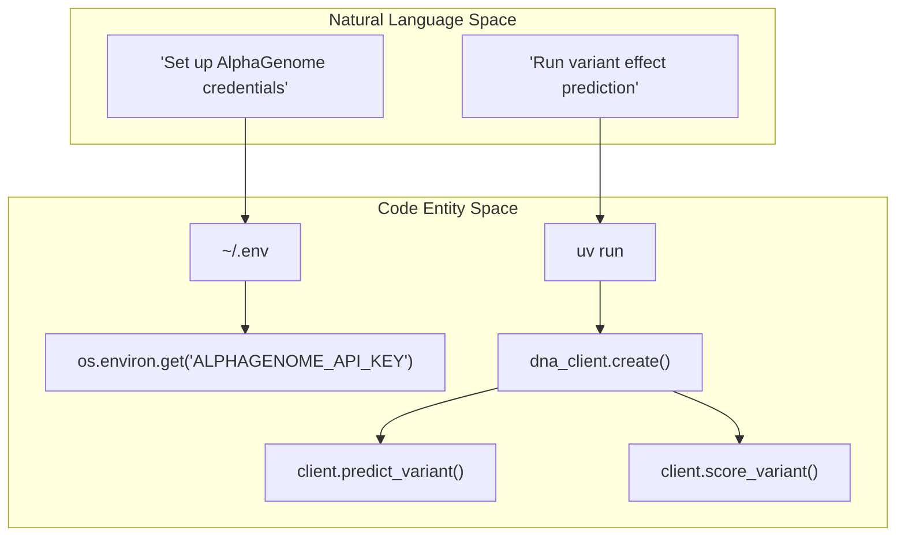
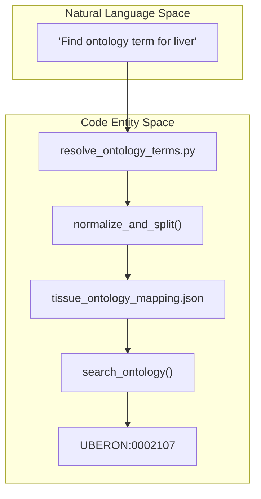

<!-- source: DeepWiki mcp.deepwiki.com · repo google-deepmind/science-skills · page 5.1 AlphaGenome Single-Variant Analysis · fetched 2026-10-26 -->

# AlphaGenome Single-Variant Analysis

<details>
<summary>Relevant source files</summary>

The following files were used as context for generating this wiki page:

- [skills/alphagenome_single_variant_analysis/SKILL.md](skills/alphagenome_single_variant_analysis/SKILL.md)
- [skills/alphagenome_single_variant_analysis/scripts/lookup_gene_info.py](skills/alphagenome_single_variant_analysis/scripts/lookup_gene_info.py)
- [skills/alphagenome_single_variant_analysis/scripts/resolve_ontology_terms.py](skills/alphagenome_single_variant_analysis/scripts/resolve_ontology_terms.py)
- [skills/alphagenome_single_variant_analysis/scripts/visualize_genome_tracks.py](skills/alphagenome_single_variant_analysis/scripts/visualize_genome_tracks.py)
- [skills/alphagenome_single_variant_analysis/scripts/visualize_variant_effects.py](skills/alphagenome_single_variant_analysis/scripts/visualize_variant_effects.py)

</details>


## Purpose and Scope

The AlphaGenome single-variant analysis skill provides a robust technical framework for evaluating the functional and molecular consequences of genetic variants (such as non-coding regulatory variants, promoter/enhancer mutations, and splicing alterations) using the AlphaGenome deep learning API. This page details the API key setup, runtime execution conventions via `uv`, client interaction (`dna_client`, `score_variant`, `predict_variant`), the discovery scan workflow, ontology resolution via `resolve_ontology_terms.py`, local GTF Feather annotation via `lookup_gene_info.py`, visualization mechanics (`visualize_variant_effects.py`, `visualize_genome_tracks.py`), and reporting standards.

---

## 1. API Key Setup, Runtime, and Core Infrastructure

AlphaGenome skills require an isolated execution environment managed by `uv` and an authenticated API key stored in the user environment. 

### Prerequisites and Configuration
1. **Runtime Isolation**: Bare `python` or `python3` commands must never be executed directly; all scripts must run via `uv run` to leverage PEP 723 inline script metadata and isolated dependency environments [skills/alphagenome_single_variant_analysis/SKILL.md:42-46]().
2. **API Credentials**: `ALPHAGENOME_API_KEY` must be configured in `~/.env` [skills/alphagenome_single_variant_analysis/SKILL.md:25-31]().
3. **Local GTF Feather Path**: To bypass remote GCS downloads and speed up transcript indexing, `ALPHAGENOME_ALPHAGENOME_GTF_PATH` (or `ALPHAGENOME_GTF_PATH`) can point to a local GENCODE v46 feather file [skills/alphagenome_single_variant_analysis/SKILL.md:32-38]().


Sources: [skills/alphagenome_single_variant_analysis/SKILL.md:25-46](), [skills/alphagenome_single_variant_analysis/scripts/visualize_genome_tracks.py:73-82]()

---

## 2. Discovery Scan Workflow and Ontology Resolution

The discovery scan workflow determines which tissues, cell types, and molecular assays exhibit significant disruption from a given variant. 

### Ontology Resolution (`resolve_ontology_terms.py`)
Because AlphaGenome tracks are indexed using ontology CURIEs (such as UBERON for anatomy, CL for cell types, and EFO for experimental factors), user queries must be resolved prior to prediction or scoring. The script `resolve_ontology_terms.py` loads `tissue_ontology_mapping.json` and performs word-overlap and fuzzy sequence matching (`difflib.SequenceMatcher`) to map human terms to valid ontology identifiers [skills/alphagenome_single_variant_analysis/scripts/resolve_ontology_terms.py:56-121]().

```python
def search_ontology(
    query: str, mapping: dict[str, Any], limit: int = 10
) -> list[dict[str, Any]]:
  """Search for tissues matching the query words."""
  query_words = normalize_and_split(query)
  ...
```
*(See implementation at [skills/alphagenome_single_variant_analysis/scripts/resolve_ontology_terms.py:69-121]())*


Sources: [skills/alphagenome_single_variant_analysis/scripts/resolve_ontology_terms.py:56-121]()

---

## 3. Local GTF Feather Gene Lookup (`lookup_gene_info.py`)

To ensure reliability and offline functionality, gene, coordinate, and transcript lookups query a local GENCODE v46 feather file rather than external web services [skills/alphagenome_single_variant_analysis/SKILL.md:47-49]().

### Key Functions and Modes
* `load_gtf()`: Loads the feather file from `ALPHAGENOME_ALPHAGENOME_GTF_PATH` or the default GCS URL using `pd.read_feather()` [skills/alphagenome_single_variant_analysis/scripts/lookup_gene_info.py:55-59]().
* `run_gene_lookup()`: Accepts gene symbols or genomic coordinates, parsing inputs via `classify_queries()` and filtering the DataFrame on `gene_name` or overlapping coordinates [skills/alphagenome_single_variant_analysis/scripts/lookup_gene_info.py:95-131]().
* `run_coord_search()`: Identifies genes residing within a specified window around a coordinate point [skills/alphagenome_single_variant_analysis/scripts/lookup_gene_info.py:135-195]().
* `run_transcript_lookup()`: Filters transcripts by MANE Select status, protein-coding biotype, or length [skills/alphagenome_single_variant_analysis/scripts/lookup_gene_info.py:198-240]().

Sources: [skills/alphagenome_single_variant_analysis/scripts/lookup_gene_info.py:55-240]()

---

## 4. Visualization Scripts

Visualizing regional predictions and variant allele comparisons is handled by specialized scripts utilizing custom plotting classes.

### Genome Tracks (`visualize_genome_tracks.py`)
`visualize_genome_tracks.py` builds broad regional overview plots across 1MB prediction intervals for outputs like `RNA_SEQ`, `ATAC`, `DNASE`, `CHIP_HISTONE`, `CHIP_TF`, and `CONTACT_MAPS` [skills/alphagenome_single_variant_analysis/scripts/visualize_genome_tracks.py:150-186](). It includes `safe_filter_tracks()` and `filter_tracks_by_ontology()` to align tracks with target ontology CURIEs [skills/alphagenome_single_variant_analysis/scripts/visualize_genome_tracks.py:84-112]().

### Variant Effects and Splicing (`visualize_variant_effects.py`)
`visualize_variant_effects.py` compares reference and alternative alleles. It implements `ColoredSashimi`, inheriting from `plot_components.Sashimi`, to draw custom-colored arc overlays for splice junction changes (using blue for REF and red for ALT) [skills/alphagenome_single_variant_analysis/scripts/visualize_variant_effects.py:86-205]().

Sources: [skills/alphagenome_single_variant_analysis/scripts/visualize_genome_tracks.py:84-186](), [skills/alphagenome_single_variant_analysis/scripts/visualize_variant_effects.py:86-205]()

---

## 5. Report Templates and Interpretation Guide

Analyses generated by the skill must be compiled into standardized reports using templates located in `docs/` [skills/alphagenome_single_variant_analysis/SKILL.md:54-56](). Reports summarize molecular phenotypes, capture discovery scan ranking tables, and embed high-resolution visual plots.

Sources: [skills/alphagenome_single_variant_analysis/SKILL.md:54-56]()

---

