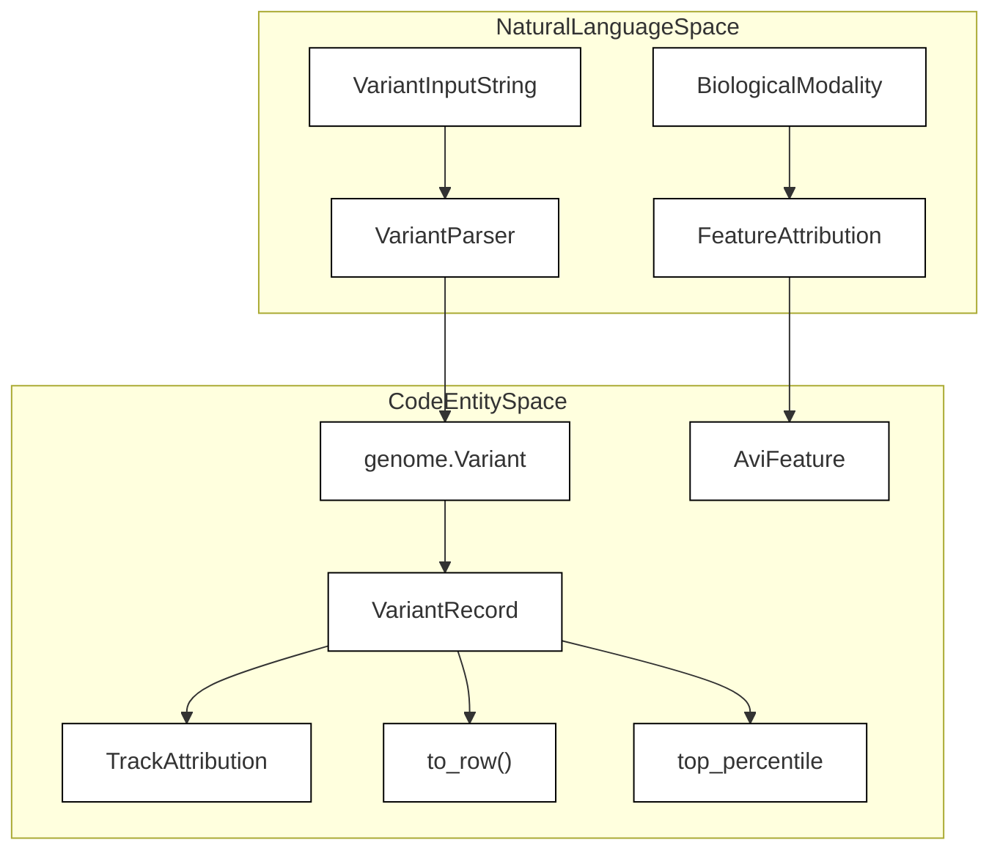
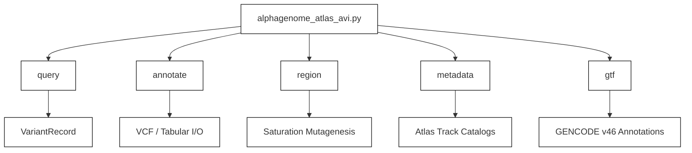

<!-- source: DeepWiki mcp.deepwiki.com · repo google-deepmind/science-skills · page 5.2 AlphaGenome Variant Impact Score (AVI) · fetched 2026-10-26 -->

# AlphaGenome Variant Impact Score (AVI)

<details>
<summary>Relevant source files</summary>

The following files were used as context for generating this wiki page:

- [skills/alphagenome_variant_impact_score/SKILL.md](skills/alphagenome_variant_impact_score/SKILL.md)
- [skills/alphagenome_variant_impact_score/pyproject.toml](skills/alphagenome_variant_impact_score/pyproject.toml)
- [skills/alphagenome_variant_impact_score/scripts/alphagenome_atlas_avi.py](skills/alphagenome_variant_impact_score/scripts/alphagenome_atlas_avi.py)

</details>


This section provides full technical documentation for the AlphaGenome Variant Impact Score (AVI) skill, powered by `skills/alphagenome_variant_impact_score/scripts/alphagenome_atlas_avi.py` and the AlphaGenome Atlas API [skills/alphagenome_variant_impact_score/scripts/alphagenome_atlas_avi.py:15-41](). The AVI skill enables scoring, annotation, saturation mutagenesis window scanning, GENCODE v46 GTF feature extraction, and metadata inspection for genetic variants in 1-based `chr:pos:ref>alt` format [skills/alphagenome_variant_impact_score/SKILL.md:1-8]().

## pyproject.toml Dependency Set and Runtime Environment

The AVI skill is declared as a modern Python package requiring Python `>=3.14` [skills/alphagenome_variant_impact_score/pyproject.toml:1-4](). Its execution environment relies on specific data processing, tabular I/O, and genomics libraries [skills/alphagenome_variant_impact_score/pyproject.toml:5-16](). 

The declared dependencies include:
* Core calculation and CLI tools: `absl-py`, `python-dotenv`, `tabulate` [skills/alphagenome_variant_impact_score/pyproject.toml:6,14,15]()
* AlphaGenome models and Atlas client: `alphagenome>=0.9.0` [skills/alphagenome_variant_impact_score/pyproject.toml:7]()
* Matrix and tabular data engines: `numpy >= 2.0`, `pandas<3.0`, `polars`, `pyarrow`, `anndata` [skills/alphagenome_variant_impact_score/pyproject.toml:8-12]()
* Platform-conditional bioinformatics I/O: `pysam; sys_platform != 'win32'` [skills/alphagenome_variant_impact_score/pyproject.toml:13]()

Sources: `skills/alphagenome_variant_impact_score/pyproject.toml:1-16`

## Core Data Models: TrackAttribution and VariantRecord

The core python script defines two primary dataclasses to structure variant impact metrics, feature attributions, and track-level provenance: `TrackAttribution` and `VariantRecord` [skills/alphagenome_variant_impact_score/scripts/alphagenome_atlas_avi.py:68-128]().

### TrackAttribution
`TrackAttribution` captures detailed provenance for an assay track driving a feature maximum [skills/alphagenome_variant_impact_score/scripts/alphagenome_atlas_avi.py:69-83](). Its attributes include:
* `scorer`: Identifier of the scorer modality [skills/alphagenome_variant_impact_score/scripts/alphagenome_atlas_avi.py:73]()
* `track_index` and `track_name`: Index and description of the assay track [skills/alphagenome_variant_impact_score/scripts/alphagenome_atlas_avi.py:74-75]()
* `biosample_name` and `ontology_curie`: Biosample identifier and ontology CURIE (e.g., UBERON or CL term) [skills/alphagenome_variant_impact_score/scripts/alphagenome_atlas_avi.py:76-77]()
* `raw_score`: Raw attribution score or effect size [skills/alphagenome_variant_impact_score/scripts/alphagenome_atlas_avi.py:78]()
* `gene_name` and `gene_id`: Optional HGNC gene symbol and Ensembl gene ID [skills/alphagenome_variant_impact_score/scripts/alphagenome_atlas_avi.py:79-80]()
* `details`: Summary string of maximum signal details [skills/alphagenome_variant_impact_score/scripts/alphagenome_atlas_avi.py:81-82]()

### VariantRecord
`VariantRecord` subclasses `genome.Variant` to extend chromosome, position, reference bases, and alternate bases with AVI-specific score metrics and feature vectors [skills/alphagenome_variant_impact_score/scripts/alphagenome_atlas_avi.py:96-128]().
* `raw_score`, `phred_score`, `quantile`: Primary impact metrics [skills/alphagenome_variant_impact_score/scripts/alphagenome_atlas_avi.py:104-112]()
* `top_feature_name` and `top_feature_value`: Dominant biological modality driving the impact [skills/alphagenome_variant_impact_score/scripts/alphagenome_atlas_avi.py:113-118]()
* `feature_importances`: Dictionary mapping feature names to importance weights [skills/alphagenome_variant_impact_score/scripts/alphagenome_atlas_avi.py:119-121]()
* `track_attributions`: Dictionary mapping features to `TrackAttribution` instances [skills/alphagenome_variant_impact_score/scripts/alphagenome_atlas_avi.py:122-124]()



Sources: `skills/alphagenome_variant_impact_score/scripts/alphagenome_atlas_avi.py:68-128`

## The 18 Biological Feature Modalities (AviFeature)

The `AviFeature` enumeration groups raw assay tracks into 18 interpretable biological feature modalities [skills/alphagenome_variant_impact_score/scripts/alphagenome_atlas_avi.py:180-190](). These modalities span splicing behavior, transcription, chromatin accessibility, histone modifications, and transcription factor binding. Examples include:
* `MERGED_SPLICING`: Aggregating `SPLICE_SITES`, `SPLICE_SITE_USAGE`, and `SPLICE_JUNCTIONS` [skills/alphagenome_variant_impact_score/scripts/alphagenome_atlas_avi.py:183-187]()
* `MAX_ABS_RNA_SEQ`: Transcription / RNA-seq quantification [skills/alphagenome_variant_impact_score/scripts/alphagenome_atlas_avi.py:188]()
* `MAX_ABS_ATAC` and `MAX_ABS_DNASE`: Chromatin accessibility assays [skills/alphagenome_variant_impact_score/scripts/alphagenome_atlas_avi.py:189-190]()

Sources: `skills/alphagenome_variant_impact_score/scripts/alphagenome_atlas_avi.py:180-190`

## Subcommand Architecture and Data Flow

The CLI script `alphagenome_atlas_avi.py` exposes five primary subcommands for users and agent workflows: `annotate`, `query`, `region`, `metadata`, and `gtf` [skills/alphagenome_variant_impact_score/scripts/alphagenome_atlas_avi.py:15-41]().



* `query`: Evaluates one or more variant strings to calculate scores, the 18-modality feature importances, and optional track attributions [skills/alphagenome_variant_impact_score/scripts/alphagenome_atlas_avi.py:20-21]().
* `annotate`: Processes input VCF or tabular variant callsets, annotating them in Ensembl VEP `CSQ` format and ranking hits [skills/alphagenome_variant_impact_score/scripts/alphagenome_atlas_avi.py:18-19]().
* `region`: Executes in silico saturation mutagenesis across a closed genomic window (`chr:start-end`) to identify functional hotspots [skills/alphagenome_variant_impact_score/scripts/alphagenome_atlas_avi.py:22-23]().
* `metadata`: Inspects registered scorers, the 18 biological feature definitions, or experimental track catalogs [skills/alphagenome_variant_impact_score/SKILL.md:130-147]().
* `gtf`: Queries GENCODE v46 gene annotations to extract exons, CDS, UTRs, and splice junction coordinates for constructing exact Atlas `ScoreId` tokens [skills/alphagenome_variant_impact_score/scripts/alphagenome_atlas_avi.py:24-27]().

Sources: `skills/alphagenome_variant_impact_score/scripts/alphagenome_atlas_avi.py:15-41`, `skills/alphagenome_variant_impact_score/SKILL.md:130-147`

## Phred Score Derivation and Quantile Conversions

`VariantRecord` computes top percentiles and Phred-scaled impact scores from quantiles [skills/alphagenome_variant_impact_score/scripts/alphagenome_atlas_avi.py:135-141](). The relationship between top percentile and quantile or Phred score is implemented as:

```python
  @property
  def top_percentile(self) -> float | None:
    if self.quantile is not None:
      return self.quantile * 100.0
    if self.phred_score is not None:
      return (10.0 ** (-self.phred_score / 10.0)) * 100.0
    return None
```
[skills/alphagenome_variant_impact_score/scripts/alphagenome_atlas_avi.py:135-141]()

Sources: `skills/alphagenome_variant_impact_score/scripts/alphagenome_atlas_avi.py:135-141`

---

