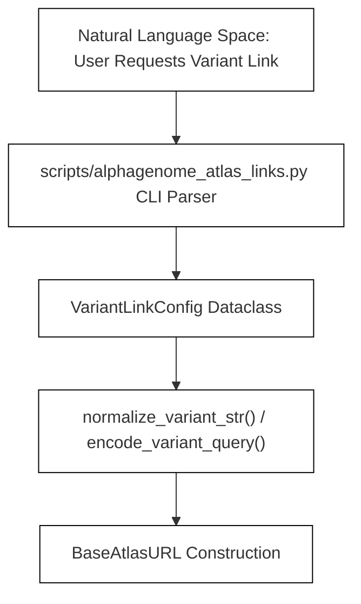
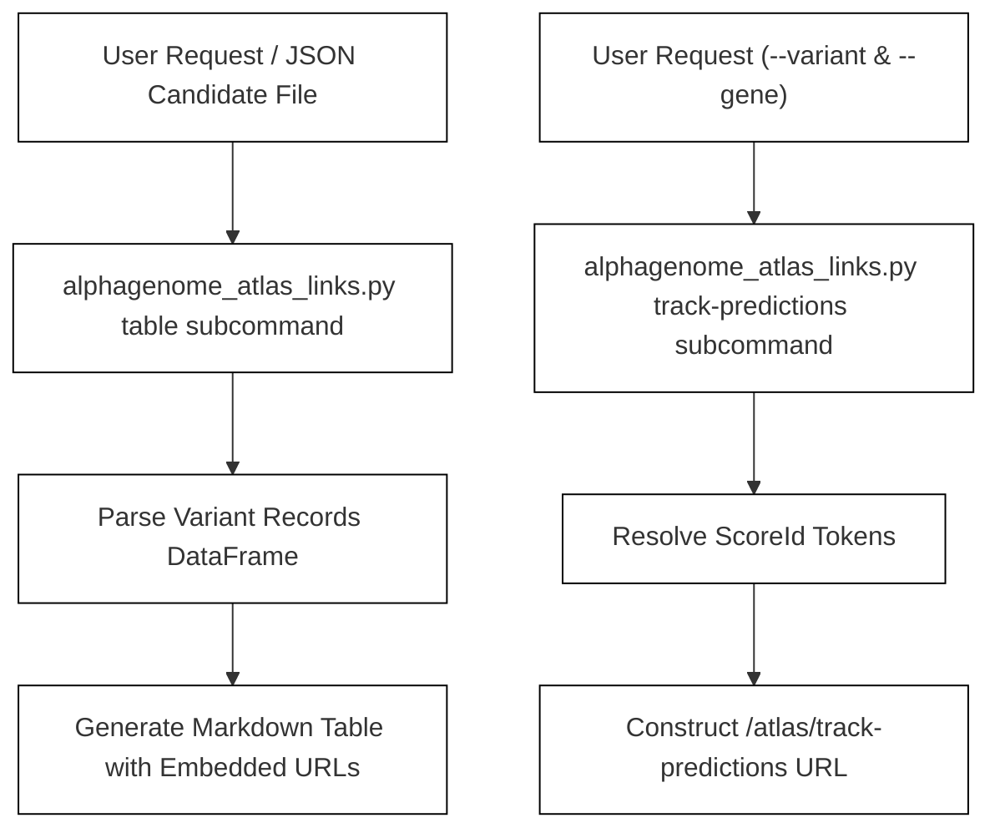

<!-- source: DeepWiki mcp.deepwiki.com · repo google-deepmind/science-skills · page 5.3 AlphaGenome Atlas Website Deep Links · fetched 2026-10-26 -->

# AlphaGenome Atlas Website Deep Links

<details>
<summary>Relevant source files</summary>

The following files were used as context for generating this wiki page:

- [skills/alphagenome_atlas_website_links/SKILL.md](skills/alphagenome_atlas_website_links/SKILL.md)
- [skills/alphagenome_atlas_website_links/pyproject.toml](skills/alphagenome_atlas_website_links/pyproject.toml)
- [skills/alphagenome_atlas_website_links/scripts/alphagenome_atlas_links.py](skills/alphagenome_atlas_website_links/scripts/alphagenome_atlas_links.py)

</details>


## Purpose and Scope

This page documents the implementation and usage of the AlphaGenome Atlas website deep-linking skill (`alphagenome-atlas-website-links`), located in `skills/alphagenome_atlas_website_links/` [skills/alphagenome_atlas_website_links/SKILL.md:1-9](). The skill provides a command-line interface (`scripts/alphagenome_atlas_links.py`) [skills/alphagenome_atlas_website_links/SKILL.md:18-23]() and associated data models [skills/alphagenome_atlas_website_links/scripts/alphagenome_atlas_links.py:48-92]() to construct, validate, and format validated URLs for the AlphaGenome Atlas web application (`https://deepmind.google.com/science/alphagenome/atlas`) [skills/alphagenome_atlas_website_links/SKILL.md:11-16](). It covers single-variant views, genomic locus/interval exploration, candidate variant table formatting, and multi-modality reference versus alternate (`Ref vs. Alt`) track predictions [skills/alphagenome_atlas_website_links/SKILL.md:3-8]().

Sources:
- `skills/alphagenome_atlas_website_links/SKILL.md:1-24`
- `skills/alphagenome_atlas_website_links/scripts/alphagenome_atlas_links.py:15-28`

---

## Mandatory Deep-Linking Policy and CLI Architecture

Whenever presenting, discussing, or scoring genetic variants using AlphaGenome, agents and pipelines **must always provide clickable deep-links** to the AlphaGenome Atlas [skills/alphagenome_atlas_website_links/SKILL.md:18-23](). The Python script `scripts/alphagenome_atlas_links.py` automates this generation across four core subcommands: `variant`, `locus`, `table`, and `track-predictions` [skills/alphagenome_atlas_website_links/scripts/alphagenome_atlas_links.py:15-28]().

### Core Data Structures

Configuration parameters for single variants and genomic intervals are encapsulated via immutable dataclasses (`VariantLinkConfig` and `LocusLinkConfig`) [skills/alphagenome_atlas_website_links/scripts/alphagenome_atlas_links.py:48-92]().



*Figure 1: Data flow bridging natural language variant requests to the `VariantLinkConfig` and URL generation pipeline.*

Sources:
- `skills/alphagenome_atlas_website_links/SKILL.md:18-24`
- `skills/alphagenome_atlas_website_links/scripts/alphagenome_atlas_links.py:15-92`

---

## URL Query Parameter Schema

The AlphaGenome Atlas web application parses several query parameters to configure the viewport, filters, and track layouts. The schema is defined as follows:

| Parameter | Type | Required | Description |
| :--- | :--- | :--- | :--- |
| **`q`** | string | **Yes** | Primary search target. Supports 1-based closed intervals (`chr11:5288500-5290500`), gene symbols (`BRCA1`), Ensembl IDs (`ENSG00000012048`), or 1-based variants (`chr7:27170000:A>G`) [skills/alphagenome_atlas_website_links/SKILL.md:54-56](). |
| **`m`** | enum | No | View mode. Defaults to `entity` for genes/variants and `locus` for coordinate intervals. Options: `locus`, `entity`, `variant`, `motifs` [skills/alphagenome_atlas_website_links/SKILL.md:57-59](). |
| **`i`** | string | No | Centered viewport zoom interval in 1-based closed `chr:start-end` format (e.g. `chr11:5289310-5289690`) [skills/alphagenome_atlas_website_links/SKILL.md:60-62](). |
| **`f`** | string | No | Comma-separated filter predicates in `KEY:VALUE` format (e.g., `BIOSAMPLE_NAME:K562,SCORER_MODALITY:RNA-seq`) [skills/alphagenome_atlas_website_links/SKILL.md:63-66](). |
| **`lItems`** | string | No | Layout item sequence, AVI score track toggle (`avi`), section heatmaps, and pinned tracks [skills/alphagenome_atlas_website_links/SKILL.md:67-69](). |
| **`scores`** | string | No | Comma-separated list of `ScoreId` tokens for `/atlas/track-predictions` comparisons [skills/alphagenome_atlas_website_links/SKILL.md:70-72](). |
| **`md`** | enum | No | Active modality tab selector (`RNA_SEQ`, `SPLICE_JUNCTIONS`, `SPLICE_SITE_USAGE`, `DNASE`) [skills/alphagenome_atlas_website_links/SKILL.md:73-75](). |
| **`tpRenames`** | string | No | Custom title overrides for specific score predictions (`ScoreId:CustomTitle`) [skills/alphagenome_atlas_website_links/SKILL.md:76-77](). |
| **`tpLegendTitle`** | string | No | Custom legend title for the track predictions chart card [skills/alphagenome_atlas_website_links/SKILL.md:78-79](). |

> [!IMPORTANT] **Variant Query Format**: Variants supplied to `q` must strictly follow the `chr:pos_1_based:ref>alt` format (e.g. `chr7:27170000:A>G` or URL-encoded `chr7:27170000:A%3EG`) [skills/alphagenome_atlas_website_links/SKILL.md:81-83](). Do not use colon-separated alleles (`A:G`) or dbSNP rsIDs [skills/alphagenome_atlas_website_links/SKILL.md:83-84]().

Sources:
- `skills/alphagenome_atlas_website_links/SKILL.md:52-85`

---

## Multi-Modality Filtering and Assay Group Gotchas

Filters passed via the `f` parameter are categorized into three logical evaluation groups [skills/alphagenome_atlas_website_links/SKILL.md:88-95]:

1. **Biosample Group** (`BIOSAMPLE_NAME`, `BIOSAMPLE_TYPE`): Evaluated using **AND** logic [skills/alphagenome_atlas_website_links/SKILL.md:92-95].
2. **Assay Group** (`SCORER_MODALITY`, `ASSAY_TRANSCRIPTOR_FACTOR`, `ASSAY_HISTONE_MARK`): Evaluated using **OR** logic [skills/alphagenome_atlas_website_links/SKILL.md:96-97].
3. **Gene Group** (`GENE_NAME`): Evaluated using **OR** logic [skills/alphagenome_atlas_website_links/SKILL.md:98-99].

### The Assay Modality Exclusion Rule

`RNA-seq` and `DNase` tracks lack transcription factor metadata (`transcriptionFactorCode === ""`) [skills/alphagenome_atlas_website_links/SKILL.md:102-104]. If a filter string `f` contains *only* `ASSAY_TRANSCRIPTOR_FACTOR` predicates, `RNA-seq` and `DNase` tracks fail the Assay evaluation group and are hidden from the heatmap [skills/alphagenome_atlas_website_links/SKILL.md:104-106].

To prevent this, `scripts/alphagenome_atlas_links.py` automatically injects explicit `SCORER_MODALITY:RNA-seq` and `SCORER_MODALITY:DNase` filters when transcription factors are requested [skills/alphagenome_atlas_website_links/SKILL.md:107-114]:

```
f=BIOSAMPLE_NAME:<CellLine>,SCORER_MODALITY:RNA-seq,SCORER_MODALITY:DNase,ASSAY_TRANSCRIPTOR_FACTOR:<TF1>
```

Sources:
- `skills/alphagenome_atlas_website_links/SKILL.md:88-116`

---

## Layout Configuration, AVI Scores, and Pinned Tracks

The `lItems` parameter controls track ordering, the inclusion of AlphaGenome Variant Impact (AVI) scores, and pinned track configurations [skills/alphagenome_atlas_website_links/SKILL.md:118-124].

* **AVI Variant Impact Track (`avi`)**: Renders the top-level AlphaGenome Variant Impact score track for an interval or variant [skills/alphagenome_atlas_website_links/SKILL.md:122-124].
* **Database Modality Sections (`section:<MODALITY>`)**: Renders unpinned heatmaps across matching tracks for modalities such as `RNA_SEQ`, `DNASE`, `CHIP_TF`, `ATAC`, and `CAGE` [skills/alphagenome_atlas_website_links/SKILL.md:125-128].
* **Pinned Tracks**: Base-pair resolution tracks supporting Contribution Weight Matrix (CWM) logos and active ISM motif instances [skills/alphagenome_atlas_website_links/SKILL.md:140-143].

Pinned tracks follow this key schema [skills/alphagenome_atlas_website_links/SKILL.md:145-149]:
```
pinned:<TrackMetadataName>:<StrandNumber>:<ScorerShortName>:heatmap:HEATMAP_TILESET_SOURCE_ACTIVE_ISM_SCORES:<TilesetId>
```

Sources:
- `skills/alphagenome_atlas_website_links/SKILL.md:118-152`

---

## Track Predictions and Candidate Table Formatting

The CLI provides specialized subcommands for tabular batch reports and Ref vs. Alt comparative track predictions [skills/alphagenome_atlas_website_links/scripts/alphagenome_atlas_links.py:15-28]:



*Figure 2: Subcommand routing for candidate tables and track-predictions comparison views.*

* **`table` Subcommand**: Reads a JSON file of variant candidate records (e.g., `top_variants.json`) [skills/alphagenome_atlas_website_links/SKILL.md:40-41] and outputs a formatted Markdown table containing clickable markdown links pointing directly to the variant in the Atlas [skills/alphagenome_atlas_website_links/SKILL.md:40-41].
* **`track-predictions` Subcommand**: Constructs URLs for `/atlas/track-predictions` [skills/alphagenome_atlas_website_links/SKILL.md:43-48], enabling side-by-side reference versus alternate predictions for specific gene models, biosamples, and score tokens.

Sources:
- `skills/alphagenome_atlas_website_links/SKILL.md:30-48`
- `skills/alphagenome_atlas_website_links/scripts/alphagenome_atlas_links.py:15-28`

---

