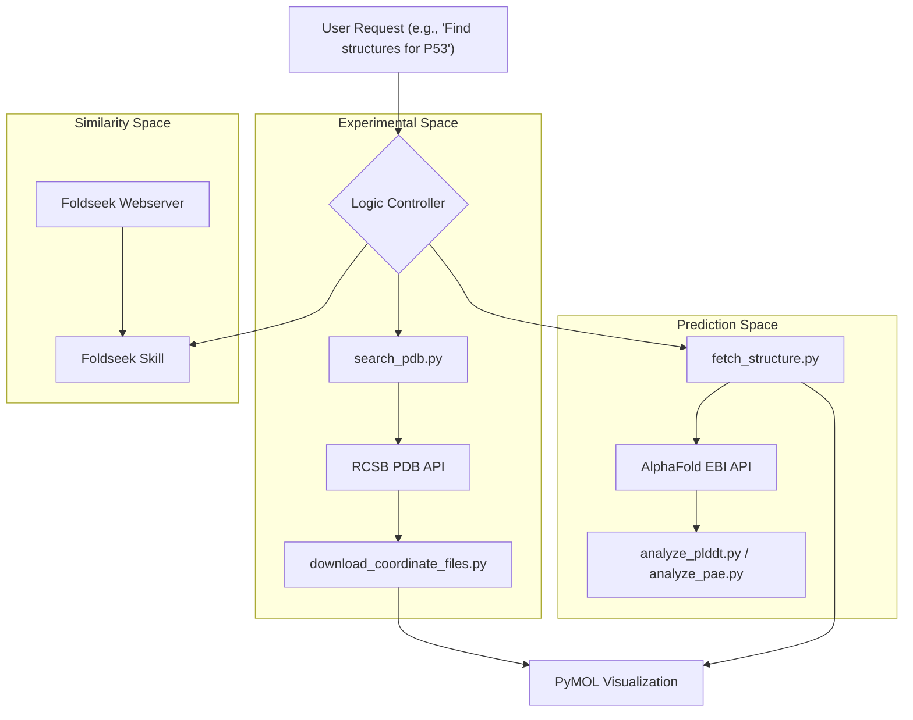
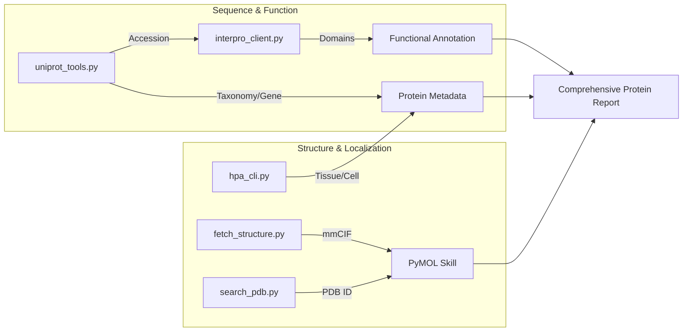

<!-- source: DeepWiki mcp.deepwiki.com · repo google-deepmind/science-skills · page 6 Protein Structure and Function Skills · fetched 2026-10-26 -->

# Protein Structure and Function Skills

Relevant source files

The following files were used as context for generating this wiki page:

- [skills/pdb_database/SKILL.md](skills/pdb_database/SKILL.md)
- [skills/uniprot_database/scripts/uniprot_tools.py](skills/uniprot_database/scripts/uniprot_tools.py)

This section provides an overview of skills designed for the retrieval, analysis, visualization, and functional annotation of proteins. These tools bridge the gap between amino acid sequences and their three-dimensional experimental or predicted structures, enabling deep investigation into protein domains, interactions, and cellular roles.

The toolkit integrates major biological databases including the **Protein Data Bank (PDB)**, **AlphaFold DB**, **UniProt**, and **InterPro**, along with specialized tools for structural search (**Foldseek**) and visualization (**PyMOL**).

### Structural Data Flow

The following diagram illustrates how natural language requests for protein structures are mapped to specific code entities and external databases, bridging natural language space to code entity space.

**Protein Structure Discovery Workflow**

Sources: [skills/pdb_database/SKILL.md:36-135](), [skills/alphafold_database_fetch_and_analyze/SKILL.md:47-86]()

---

## 6.1 Protein Data Bank (PDB)
The PDB skill provides access to experimentally-determined 3D structures. It utilizes `search_pdb.py` for RCSB Search API v2 attribute-based queries, `download_coordinate_files.py` for mmCIF and PDB coordinate fetching with sharding, `fetch_pdb_metadata.py` for GraphQL Data API queries, and `fetch_schema.py` for retrieving searchable attributes [skills/pdb_database/SKILL.md:41-52]().

For details, see [Protein Data Bank (PDB)](#6.1).
Sources: [skills/pdb_database/SKILL.md:1-132]()

## 6.2 AlphaFold Database
This skill retrieves AI-predicted structures from the EBI AlphaFold Database. It includes `fetch_structure.py` for downloading mmCIF, PAE, and metadata with fragment fallbacks, alongside analysis tools like `analyze_plddt.py` and `analyze_pae.py` for rigid-domain detection and disorder evaluation.

For details, see [AlphaFold Database](#6.2).
Sources: [skills/alphafold_database_fetch_and_analyze/SKILL.md:1-116]()

## 6.3 Foldseek Structural Search
Foldseek enables fast structural similarity searches across massive databases including `afdb50`, `pdb100`, `mgnify_esm30`, and `cath50`. The skill manages multipart ticket submission, the polling lifecycle, result retrieval, and filters by E-value, Q-Cov, and Probability metrics.

For details, see [Foldseek Structural Search](#6.3).
Sources: [skills/alphafold_database_fetch_and_analyze/SKILL.md:34-35]()

## 6.4 PyMOL Structural Visualization
The PyMOL skill automates protein structure visualization using mandatory headless initialization (`-cq`, OSMesa), the PyMOL `cmd` API, selection macros, pLDDT confidence coloring, ligand isolation, polar contact detection, and ray tracing, following execution patterns outlined in repository recipes.

For details, see [PyMOL Structural Visualization](#6.4).
Sources: [skills/alphafold_database_fetch_and_analyze/SKILL.md:107-113]()

## 6.5 UniProt Protein Knowledgebase
UniProt serves as the central hub for protein metadata. The script `uniprot_tools.py` [skills/uniprot_database/scripts/uniprot_tools.py:38-196]() supports `get`, `search`, `stream`, `count`, `map`, and `sparql` modes across UniProtKB, UniParc, UniRef, and UniSave, managing bulk streaming via `HttpClient` [skills/uniprot_database/scripts/uniprot_tools.py:44-45]() and custom parsing for gzipped responses [skills/uniprot_database/scripts/uniprot_tools.py:61-68]().

For details, see [UniProt Protein Knowledgebase](#6.5).
Sources: [skills/uniprot_database/scripts/uniprot_tools.py:1-196]()

## 6.6 InterPro Protein Domain Database
InterPro provides functional annotation via domain architectures. The `interpro_client.py` script implements `fetch` and `count` commands, domain architecture (IDA) searches, InterPro-N fallbacks, and lazy pagination across member databases.

For details, see [InterPro Protein Domain Database](#6.6).
Sources: [skills/uniprot_database/SKILL.md:6-8]()

## 6.7 Human Protein Atlas
The Human Protein Atlas (HPA) skill focuses on spatial protein distributions. The `hpa_cli.py` script handles Ensembl ID resolution, tissue expression retrieval via IHC XML parsing, subcellular localization mapping, atlas entry queries, and classification by tissue specificity categories.

For details, see [Human Protein Atlas](#6.7).
Sources: [skills/uniprot_database/SKILL.md:6-8]()

## 6.8 Protein Sequence Analysis: MSA and Similarity Search
This skill covers sequence-level comparisons, featuring Multiple Sequence Alignment (MSA) via `msa_align.py` (Clustal Omega through EBI jdispatcher), `mmseqs2_search.py`, and `uniprot_blast.py` for input formatting, job polling, and output parsing.

For details, see [Protein Sequence Analysis: MSA and Similarity Search](#6.8).
Sources: [skills/uniprot_database/SKILL.md:6-8]()

---

### Entity Mapping: Functional and Structural Annotation

The diagram below connects natural language intents and functional pipelines (`uniprot_tools.py`, `interpro_client.py`) with structural coordinate fetchers (`fetch_structure.py`, `search_pdb.py`) to construct comprehensive protein annotations.

**Functional-Structural Synthesis**

Sources: [skills/uniprot_database/scripts/uniprot_tools.py:86-115](), [skills/alphafold_database_fetch_and_analyze/SKILL.md:22-28](), [skills/pdb_database/SKILL.md:52-72]()

---

