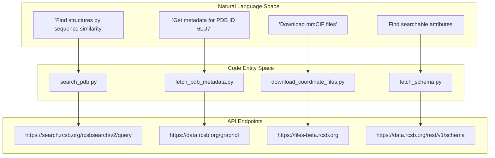
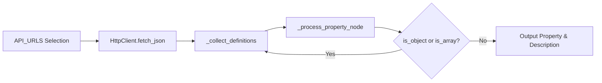

<!-- source: DeepWiki mcp.deepwiki.com · repo google-deepmind/science-skills · page 6.1 Protein Data Bank (PDB) · fetched 2026-10-26 -->

# Protein Data Bank (PDB)

Relevant source files

The following files were used as context for generating this wiki page:

- [skills/pdb_database/SKILL.md](skills/pdb_database/SKILL.md)
- [skills/pdb_database/scripts/download_coordinate_files.py](skills/pdb_database/scripts/download_coordinate_files.py)
- [skills/pdb_database/scripts/fetch_pdb_metadata.py](skills/pdb_database/scripts/fetch_pdb_metadata.py)
- [skills/pdb_database/scripts/fetch_schema.py](skills/pdb_database/scripts/fetch_schema.py)
- [skills/pdb_database/scripts/search_pdb.py](skills/pdb_database/scripts/search_pdb.py)

The Protein Data Bank (PDB) skill provides tools for searching, retrieving metadata, and downloading 3D structural data for biological macromolecules [skills/pdb_database/SKILL.md:4-8](). It interfaces with the RCSB PDB Search API v2 for discovery, the GraphQL Data API for detailed metadata retrieval, and RCSB file servers for coordinate file downloads [skills/pdb_database/SKILL.md:4-8]().

Sources: [skills/pdb_database/SKILL.md:4-8]()

---

## System Overview

The PDB skill is structured into four primary functional scripts that interact with different RCSB endpoints. All scripts utilize a shared `HttpClient` from the `polite-http` package to ensure consistent rate limiting and error handling [skills/pdb_database/SKILL.md:24-28](), [skills/pdb_database/scripts/search_pdb.py:33-35]().

### Natural Language to Code Mapping: Search and Retrieval

The following diagram maps user intents to the specific code entities and API endpoints used to fulfill them.

**Intent to Entity Mapping**

Sources: [skills/pdb_database/scripts/search_pdb.py:15-35](), [skills/pdb_database/scripts/fetch_pdb_metadata.py:15-30](), [skills/pdb_database/scripts/download_coordinate_files.py:15-31](), [skills/pdb_database/scripts/fetch_schema.py:15-30]()

---

## Searching PDB (`search_pdb.py`)

The `search_pdb.py` script interfaces with the RCSB Search API v2 [skills/pdb_database/scripts/search_pdb.py:15-19](). It supports complex structured queries including text searches, sequence similarity, structure similarity, and chemical descriptor matches [skills/pdb_database/SKILL.md:38-118]().

### Implementation Details
- **Query Handling**: Accepts a JSON string via `--query` [skills/pdb_database/scripts/search_pdb.py:44-45](). If the JSON contains a top-level `"query"` key, it is treated as a full request payload; otherwise, it is wrapped in a `"query"` block [skills/pdb_database/scripts/search_pdb.py:50-55]().
- **Return Types**: Supports multiple return levels: `entry`, `assembly`, `polymer_entity`, `non_polymer_entity`, `polymer_instance`, and `mol_definition` [skills/pdb_database/scripts/search_pdb.py:121-141]().
- **Count-Only Mode**: When `--count-only` is enabled, the script sets `paginate: { "start": 0, "rows": 0 }` and extracts only the `total_count` from the API response [skills/pdb_database/scripts/search_pdb.py:62-66](), [skills/pdb_database/scripts/search_pdb.py:96-103]().
- **Pagination**: By default, it sets `return_all_hits: True` unless `--page_start` or `--rows` are explicitly provided [skills/pdb_database/scripts/search_pdb.py:67-79]().

Sources: [skills/pdb_database/scripts/search_pdb.py:40-107]()

---

## Downloading Coordinates (`download_coordinate_files.py`)

This script retrieves atomic coordinate files in either `mmcif` or `pdb` format from the RCSB file servers (`https://files-beta.rcsb.org`) [skills/pdb_database/scripts/download_coordinate_files.py:15-31]().

### Sharding and Sanitization Logic
RCSB stores files in a sharded directory structure based on the PDB ID [skills/pdb_database/scripts/download_coordinate_files.py:63-71]().
1. **Sanitization**: PDB IDs are converted to lowercase [skills/pdb_database/scripts/download_coordinate_files.py:36-36](). 4-character IDs are prefixed with `pdb_0000` (e.g., `6lu7` becomes `pdb_00006lu7`) [skills/pdb_database/scripts/download_coordinate_files.py:37-39]().
2. **Sharding**: The shard directory is determined by taking the 2nd and 3rd characters from the end of the sanitized ID (`shard_chars = sanitized_id[-3:-1]`) [skills/pdb_database/scripts/download_coordinate_files.py:65-65]().
3. **URL Construction**: The script builds the path using the pattern `/pub/wwpdb/pdb/data/entries/{shard_chars}/{sanitized_id}/structures/{sanitized_id}.{ext}.gz` [skills/pdb_database/scripts/download_coordinate_files.py:68-71]().
4. **Bulk Download Safeguard**: If more than 1,000 IDs are provided, the script aborts and directs the user to the official bulk archive script [skills/pdb_database/scripts/download_coordinate_files.py:46-54]().

Sources: [skills/pdb_database/scripts/download_coordinate_files.py:34-84]()

---

## Metadata and Schema Discovery

### GraphQL Data API (`fetch_pdb_metadata.py`)
Used for retrieving granular metadata for specific PDB entries from `https://data.rcsb.org/graphql` [skills/pdb_database/scripts/fetch_pdb_metadata.py:15-41](). It URL-encodes a raw GraphQL query string and writes the resulting JSON response to the specified output file [skills/pdb_database/scripts/fetch_pdb_metadata.py:39-46]().

Sources: [skills/pdb_database/scripts/fetch_pdb_metadata.py:33-46]()

### Schema Fetcher (`fetch_schema.py`)
Because the RCSB Search API supports hundreds of attributes, `fetch_schema.py` is used to discover searchable fields [skills/pdb_database/SKILL.md:41-44](), [skills/pdb_database/scripts/fetch_schema.py:15-16](). It crawls the RCSB JSON schema across data and search endpoints to generate a human-readable, greppable list of properties [skills/pdb_database/scripts/fetch_schema.py:33-60](), [skills/pdb_database/scripts/fetch_schema.py:62-93]().

**Data Flow: Schema Processing**

Sources: [skills/pdb_database/scripts/fetch_schema.py:33-60](), [skills/pdb_database/scripts/fetch_schema.py:62-93](), [skills/pdb_database/scripts/fetch_schema.py:96-180]()

---

## Key Functions and Classes

| File | Entity | Role |
| :--- | :--- | :--- |
| `search_pdb.py` | `search_pdb` | Main entry point for Search API v2; handles JSON payload construction, pagination, and count-only operations [skills/pdb_database/scripts/search_pdb.py:38-107]() |
| `download_coordinate_files.py` | `sanitize_id` | Standardizes PDB IDs to the 10-character sharded format required by the beta file archive [skills/pdb_database/scripts/download_coordinate_files.py:34-39]() |
| `fetch_schema.py` | `_process_property_node` | Recursive function that extracts descriptions, types, and enums from complex JSON schema nodes [skills/pdb_database/scripts/fetch_schema.py:96-180]() |
| `fetch_pdb_metadata.py` | `get_pdb_metadata` | Executes URL-encoded GraphQL queries against the RCSB Data API [skills/pdb_database/scripts/fetch_pdb_metadata.py:33-46]() |

Sources: [skills/pdb_database/scripts/search_pdb.py](), [skills/pdb_database/scripts/download_coordinate_files.py](), [skills/pdb_database/scripts/fetch_schema.py](), [skills/pdb_database/scripts/fetch_pdb_metadata.py]()

---

