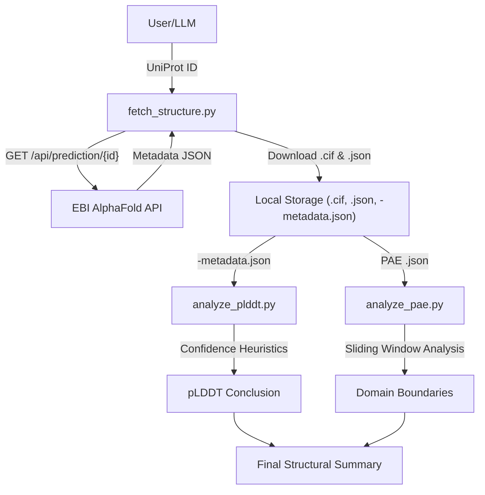
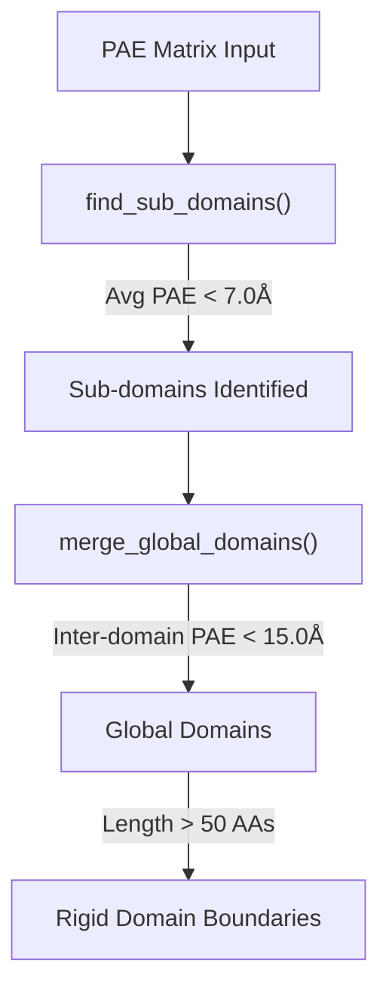

<!-- source: DeepWiki mcp.deepwiki.com · repo google-deepmind/science-skills · page 6.2 AlphaFold Database · fetched 2026-10-26 -->

# AlphaFold Database

<details>
<summary>Relevant source files</summary>

The following files were used as context for generating this wiki page:

- [skills/alphafold_database_fetch_and_analyze/scripts/fetch_structure.py](skills/alphafold_database_fetch_and_analyze/scripts/fetch_structure.py)

</details>


The AlphaFold Database (AFDB) skill provides tools to retrieve and analyze predicted protein structures from the EMBL-EBI AlphaFold Database. It automates the process of fetching structure files (mmCIF), Predicted Aligned Error (PAE) matrices, and metadata, followed by heuristic analysis of structural confidence and domain architecture.

## Overview and Data Flow

The skill is organized into primary scripts that handle data acquisition and structural interpretation. It relies on the `science-skills-common` `HttpClient` to manage requests to the EBI API with a 1.0 QPS rate limit.

### System Architecture: From User Request to Analysis

The following diagram illustrates the flow of data from a UniProt ID input to the generation of structural conclusions, linking the natural language space to specific codebase entities.

**AlphaFold Data Retrieval and Analysis Flow**

Sources: [skills/alphafold_database_fetch_and_analyze/scripts/fetch_structure.py:32-35](), [skills/alphafold_database_fetch_and_analyze/scripts/analyze_plddt.py:33-42](), [skills/alphafold_database_fetch_and_analyze/scripts/analyze_pae.py:98-106]()

## Data Acquisition: `fetch_structure.py`

The `fetch_structure.py` script is the entry point for data retrieval. It interacts with the AlphaFold API at `https://alphafold.ebi.ac.uk/api/prediction/{uniprot_id}` using an `HttpClient` instance configured with a rate limit of 1.0 QPS [skills/alphafold_database_fetch_and_analyze/scripts/fetch_structure.py:30-36]().

### Key Features
- **Canonical Entry Selection**: If the API returns multiple entries (e.g., isoforms), the script prefers the entry matching the provided UniProt ID exactly [skills/alphafold_database_fetch_and_analyze/scripts/fetch_structure.py:65-68]().
- **Fragment Fallback**: For proteins exceeding 2,700 amino acids, AlphaFold provides structures in fragments. The script downloads the first fragment and issues a mandatory warning [skills/alphafold_database_fetch_and_analyze/scripts/fetch_structure.py:83-91]().
- **Isoform Fallback**: If no canonical entry is found, it falls back to the longest available isoform [skills/alphafold_database_fetch_and_analyze/scripts/fetch_structure.py:72-81]().

| File Type | Extension | Description |
| :--- | :--- | :--- |
| **mmCIF** | `.cif` | The 3D coordinate file. pLDDT scores are stored in the B-factor column [skills/alphafold_database_fetch_and_analyze/SKILL.md:114-115](). |
| **PAE** | `.json` | Predicted Aligned Error matrix for assessing domain relationships [skills/alphafold_database_fetch_and_analyze/scripts/fetch_structure.py:101](). |
| **Metadata** | `-metadata.json` | API response containing global metrics and fraction-based pLDDT stats [skills/alphafold_database_fetch_and_analyze/scripts/fetch_structure.py:93-97](). |

Sources: [skills/alphafold_database_fetch_and_analyze/scripts/fetch_structure.py:32-151]()

## Confidence Analysis: `analyze_plddt.py`

This script parses the `-metadata.json` file to evaluate the reliability of the predicted structure using the pLDDT (Predicted Local Distance Difference Test) metric.

### Confidence Categories
The script categorizes the protein based on the `globalMetricValue` and fractions of residues in specific pLDDT ranges:
- **Very High**: > 90 pLDDT
- **Confident**: 70 - 90 pLDDT
- **Low**: 50 - 70 pLDDT
- **Very Low**: < 50 pLDDT (often associated with intrinsic disorder)

### Logic and Thresholds
The script uses several internal thresholds to generate a `pLDDT Conclusion`:
- `CONFIDENT_THRESHOLD` (0.7): Combined fraction of Confident and Very High residues [skills/alphafold_database_fetch_and_analyze/scripts/analyze_plddt.py:26,65-68]().
- `NOTABLE_DISORDER_THRESHOLD` (0.15): If more than 15% of residues are "Very Low", the protein is flagged as containing disordered regions even if the rest is confident [skills/alphafold_database_fetch_and_analyze/scripts/analyze_plddt.py:28,69-72]().
- `MOSTLY_DISORDERED_THRESHOLD` (0.5): If more than 50% of residues are "Very Low", the protein is flagged as likely highly intrinsically disordered [skills/alphafold_database_fetch_and_analyze/scripts/analyze_plddt.py:30,91-95]().

Sources: [skills/alphafold_database_fetch_and_analyze/scripts/analyze_plddt.py:26-30](), [skills/alphafold_database_fetch_and_analyze/scripts/analyze_plddt.py:45-111]()

## Domain Boundary Analysis: `analyze_pae.py`

The `analyze_pae.py` script processes the PAE matrix to identify rigid domains and flexible linkers. PAE represents the expected error in the distance between residue $i$ and residue $j$. Low PAE between two residues suggests they are part of the same rigid body.

### Implementation Logic
The analysis follows a two-step process:

1.  **`find_sub_domains`**: Uses a sliding window (size 20) to identify continuous stretches where the average PAE is below 7.0Å [skills/alphafold_database_fetch_and_analyze/scripts/analyze_pae.py:28-61]().
2.  **`merge_global_domains`**: Merges adjacent sub-domains if the average PAE between their boundaries is below 15.0Å, indicating they move together as a single global domain [skills/alphafold_database_fetch_and_analyze/scripts/analyze_pae.py:64-95]().

**PAE Analysis Logic**

Sources: [skills/alphafold_database_fetch_and_analyze/scripts/analyze_pae.py:28-95]()

### Interpretation of Results
- **Single Domain**: The protein is a single well-folded rigid unit [skills/alphafold_database_fetch_and_analyze/scripts/analyze_pae.py:159-163]().
- **Multiple Domains**: The protein has independent domains separated by flexible joints [skills/alphafold_database_fetch_and_analyze/scripts/analyze_pae.py:164-168]().
- **No Domains**: The protein is likely entirely disordered or lacks tertiary structure [skills/alphafold_database_fetch_and_analyze/scripts/analyze_pae.py:169-173]().

Sources: [skills/alphafold_database_fetch_and_analyze/scripts/analyze_pae.py:28-95](), [skills/alphafold_database_fetch_and_analyze/scripts/analyze_pae.py:158-174]()

## Usage and Warnings

### Mandatory Warnings
The skill enforces strict communication requirements for the following conditions:
1.  **Large Proteins**: Proteins > 2,700 AAs are fragmented; users must be warned that only one fragment was analyzed [skills/alphafold_database_fetch_and_analyze/SKILL.md:93-97]().
2.  **Intrinsic Disorder**: If high disorder is detected (low pLDDT or lack of PAE domains), users must be cautioned against whole-protein docking or structural homology searches [skills/alphafold_database_fetch_and_analyze/SKILL.md:107-113]().

### Command Examples
```bash
# 1. Fetch data
uv run scripts/fetch_structure.py P00520 -o ./output/

# 2. Analyze confidence
uv run scripts/analyze_plddt.py ./output/AF-P00520-F1-metadata.json

# 3. Analyze domains
uv run scripts/analyze_pae.py ./output/AF-P00520-F1-predicted_aligned_error_v6.json
```
Sources: [skills/alphafold_database_fetch_and_analyze/SKILL.md:57-85]()

---

