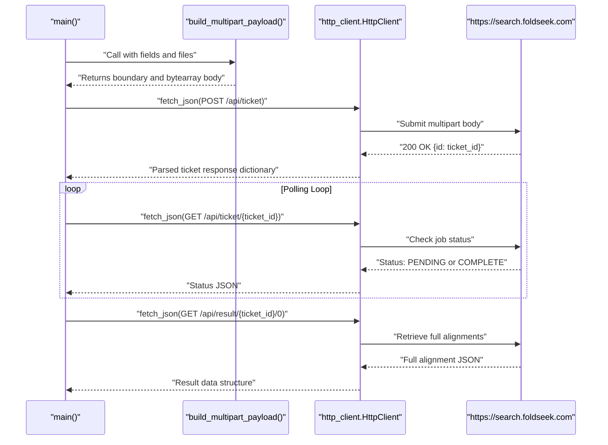
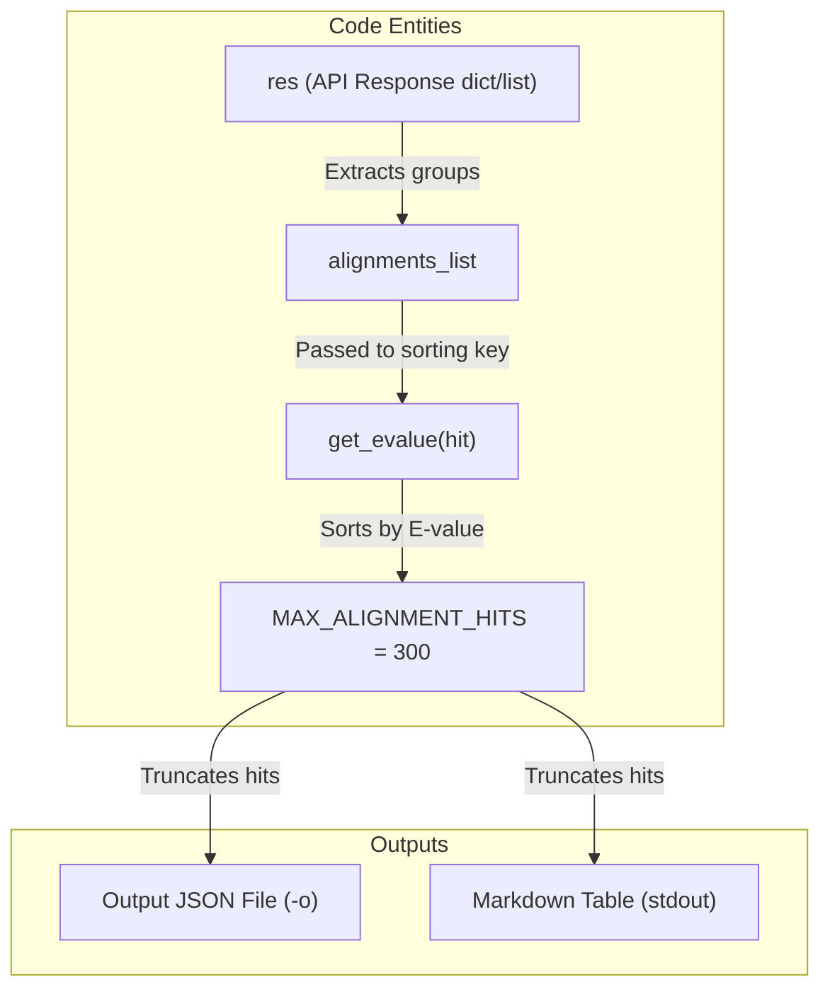

<!-- source: DeepWiki mcp.deepwiki.com · repo google-deepmind/science-skills · page 6.3 Foldseek Structural Search · fetched 2026-10-26 -->

# Foldseek Structural Search

Relevant source files

The following files were used as context for generating this wiki page:

- [skills/foldseek_structural_search/scripts/search.py](skills/foldseek_structural_search/scripts/search.py)

The Foldseek skill provides a mechanism to perform high-throughput 3D structural searches of protein coordinate files against massive structural databases. It utilizes the Foldseek web server API to identify structural homologues based on 3D shape rather than primary sequence alone.

## Overview and Scope

The Foldseek structural search skill is implemented in `skills/foldseek_structural_search/scripts/search.py`. It requires a physical coordinate file (PDB or mmCIF) as input and executes a three-phase lifecycle: multipart ticket submission, asynchronous status polling, and structured result retrieval [skills/foldseek_structural_search/scripts/search.py:91-187](). 

### Key Characteristics
- **Strict File Input**: The skill requires a local `.pdb`, `.cif`, or `.mmcif` file path provided as a positional argument [skills/foldseek_structural_search/scripts/search.py:93-96]().
- **Rate Limiting**: Utilizes `http_client.HttpClient` configured with `qps=1` targeting `https://search.foldseek.com` [skills/foldseek_structural_search/scripts/search.py:49-49]().
- **Hit Truncation**: Results are parsed and filtered up to a maximum alignment hit count of `MAX_ALIGNMENT_HITS = 300` [skills/foldseek_structural_search/scripts/search.py:45-45]().

### Supported Databases
The script validates user-supplied database arguments against `ALLOWED_DATABASES` [skills/foldseek_structural_search/scripts/search.py:33-43](), which includes:
- `afdb50` [skills/foldseek_structural_search/scripts/search.py:34-34]()
- `afdb-swissprot` [skills/foldseek_structural_search/scripts/search.py:35-35]()
- `pdb100` [skills/foldseek_structural_search/scripts/search.py:36-36]()
- `BFVD` [skills/foldseek_structural_search/scripts/search.py:37-37]()
- `mgnify_esm30` [skills/foldseek_structural_search/scripts/search.py:38-38]()
- `cath50` [skills/foldseek_structural_search/scripts/search.py:39-39]()
- `gmgcl_id` [skills/foldseek_structural_search/scripts/search.py:40-40]()
- `bfmd` [skills/foldseek_structural_search/scripts/search.py:41-41]()
- `afdb-proteome` [skills/foldseek_structural_search/scripts/search.py:42-42]()

Sources: [skills/foldseek_structural_search/scripts/search.py:33-49](), [skills/foldseek_structural_search/scripts/search.py:91-96]()

---

## Implementation Details and Lifecycle

The search workflow follows a robust client-server polling pattern implemented inside `main()` [skills/foldseek_structural_search/scripts/search.py:91-187]().

### Multipart Payload Construction
Because the Foldseek API endpoint expects a file upload alongside form metadata (`mode` and `database[]`), `search.py` implements a custom `build_multipart_payload()` function to assemble the raw `multipart/form-data` byte payload with a dynamically generated UUID boundary [skills/foldseek_structural_search/scripts/search.py:52-85]().

Sources: [skills/foldseek_structural_search/scripts/search.py:52-87](), [skills/foldseek_structural_search/scripts/search.py:132-183]()

---

## Data Flow, Metrics, and Truncation

After successfully polling until `COMPLETE`, the script fetches raw alignment JSON from the result endpoint, serializes it to disk, and flattens the structural hits for Markdown table generation [skills/foldseek_structural_search/scripts/search.py:177-207]().

### Code Entity Data Mapping
The following diagram illustrates how raw response structures are mapped through helper routines like `get_evalue()` to generate truncated, sorted results [skills/foldseek_structural_search/scripts/search.py:194-214]().

Sources: [skills/foldseek_structural_search/scripts/search.py:45-45](), [skills/foldseek_structural_search/scripts/search.py:194-214]()

### Key Alignment Metrics
The resulting summary table exposes critical structural comparison metrics extracted from each alignment record:

| Metric | Description |
| :--- | :--- |
| **Target ID** | Identifier of the matching structural database entry. |
| **Q-Cov** | Query Coverage: proportion of the query structure covered by the alignment. |
| **Prob** | Probability score (0.0 to 1.0) indicating structural homology confidence. |
| **E-value** | Expectation value; lower values denote higher statistical significance. |
| **Seq Identity** | Percentage sequence identity over the aligned region. |
| **Aln Length** | Number of aligned residues in the structural match. |

Sources: [skills/foldseek_structural_search/scripts/search.py:189-192]()

---

