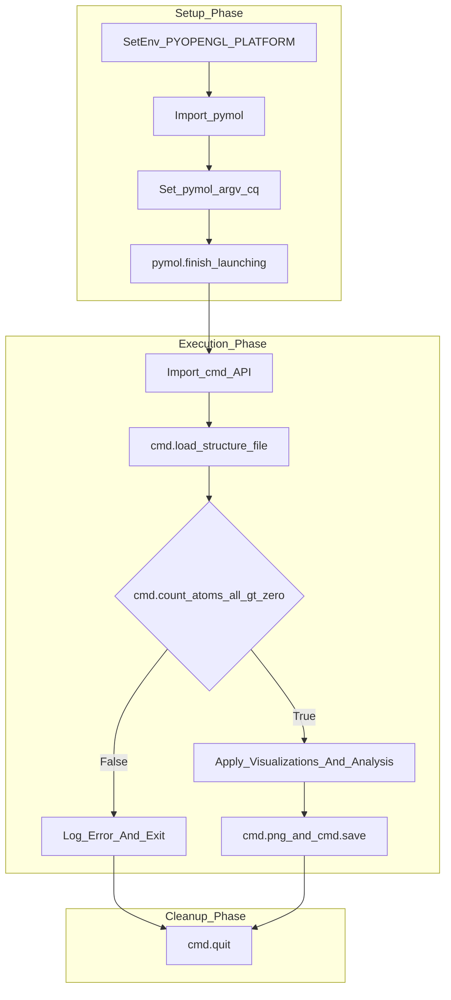
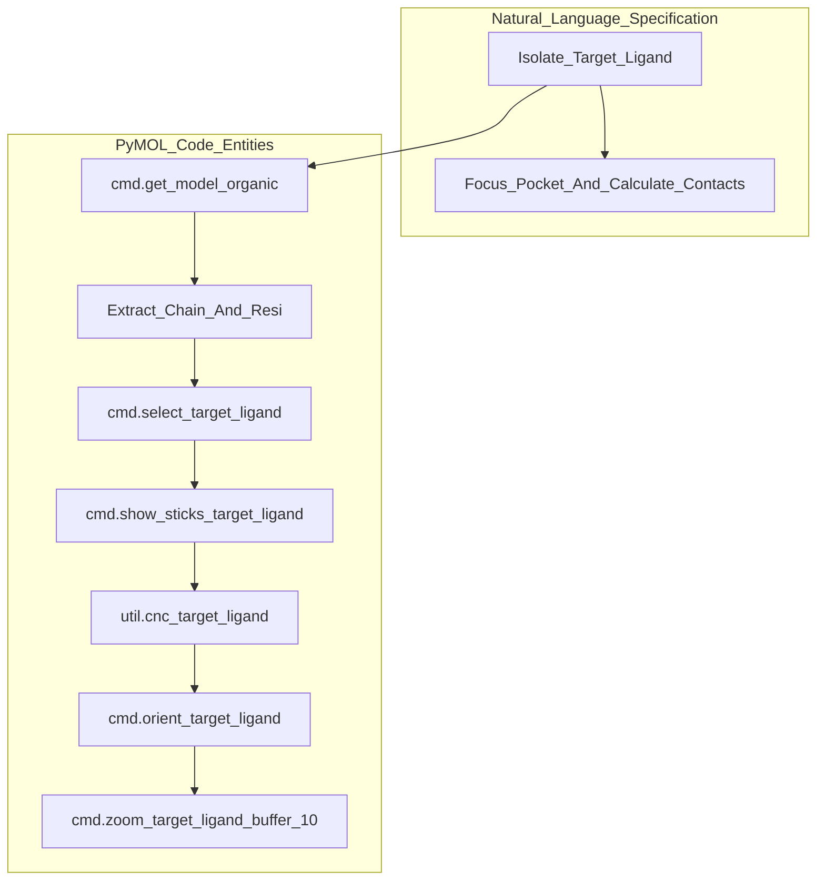

<!-- source: DeepWiki mcp.deepwiki.com · repo google-deepmind/science-skills · page 6.4 PyMOL Structural Visualization · fetched 2026-10-26 -->

# PyMOL Structural Visualization

<details>
<summary>Relevant source files</summary>

The following files were used as context for generating this wiki page:

- [skills/pymol/SKILL.md](skills/pymol/SKILL.md)
- [skills/pymol/references/RECIPES.md](skills/pymol/references/RECIPES.md)

</details>


## Purpose and Scope

The PyMOL structural visualization page covers the programmatic control of molecular visualization, structural analysis, and high-quality rendering using PyMOL within the Science Skills ecosystem [skills/pymol/SKILL.md:3-9](). It operates in a headless environment via OSMesa software rendering, enabling automated generation of publication-quality images (`.png`) and PyMOL session files (`.pse`) without requiring a GPU or X server [skills/pymol/SKILL.md:25-27](). This page documents headless initialization, the `cmd` API, selection macros, pLDDT and B-factor coloring, ligand isolation, polar contacts, ray tracing, and recipes derived from `skills/pymol/references/RECIPES.md`.

Sources: [skills/pymol/SKILL.md:3-9](), [skills/pymol/SKILL.md:25-27]()

---

## Headless Initialization and Lifecycle

PyMOL requires a precise initialization sequence to execute correctly in a headless, script-driven environment. Deviating from this order—specifically the timing of imports relative to `finish_launching()`—will cause process crashes or deadlocks [skills/pymol/SKILL.md:55-57]().

### Mandatory Initialization Pattern
1.  **Environment Setup**: Set `os.environ["PYOPENGL_PLATFORM"] = "osmesa"` before importing PyMOL to enforce software rendering [skills/pymol/SKILL.md:94-94]().
2.  **Argument Configuration**: Assign `pymol.pymol_argv = ["pymol", "-cq"]` (`-c` for command-line, `-q` for quiet mode) [skills/pymol/SKILL.md:97-97]().
3.  **Launch**: Execute `pymol.finish_launching()` prior to importing `cmd` [skills/pymol/SKILL.md:98-98]().
4.  **Import**: Import `from pymol import cmd` [skills/pymol/SKILL.md:100-100]().
5.  **Termination**: Always conclude scripts with `cmd.quit()` to prevent hanging processes [skills/pymol/SKILL.md:53-54]().

### Initialization Flow Diagram

The following diagram maps the logical execution phases of a PyMOL script to the underlying code functions (`pymol.finish_launching`, `cmd.load`, `cmd.count_atoms`, `cmd.quit`).



Sources: [skills/pymol/SKILL.md:53-57](), [skills/pymol/SKILL.md:89-111]()

---

## Pre-Flight and Structure Verification

Before script execution or rendering, strict file checks and verification steps must be performed to ensure data integrity [skills/pymol/SKILL.md:60-65]().

*   **Pre-Flight File Check**: Verify that the requested structure file exists on the host machine before executing PyMOL commands [skills/pymol/SKILL.md:60-62]().
*   **Structure Load Verification**: Immediately after invoking `cmd.load()`, verify successful loading by evaluating `cmd.count_atoms("all")` [skills/pymol/SKILL.md:63-64](). If the atom count equals 0, log an error and invoke `cmd.quit()` immediately [skills/pymol/SKILL.md:64-65]().
*   **Alpha-Carbon Trace Detection**: Automatically check if the structure is an alpha-carbon trace (`cmd.count_atoms("name CA") == cmd.count_atoms("all")`), and apply the corresponding CA-only cartoon representation recipe if true [skills/pymol/SKILL.md:67-69]().

Sources: [skills/pymol/SKILL.md:60-69]()

---

## Selection Macros and Logic

PyMOL provides selection macros to target specific structural subsets, residues, chains, or atoms [skills/pymol/references/PYMOL_REFERENCE.md:29-75]().

### Common Selectors

| Selector | Code Syntax Example | Target Description |
| :--- | :--- | :--- |
| Chain | `chain A` | Entire protein chain A [skills/pymol/references/PYMOL_REFERENCE.md:35-35]() |
| Residue Index | `resi 100-200` | Specific residue ranges [skills/pymol/references/PYMOL_REFERENCE.md:37-37]() |
| Secondary Structure | `ss h` | Alpha helices (`h`), beta sheets (`s`), loops (`l+''`) [skills/pymol/references/PYMOL_REFERENCE.md:41-41]() |
| Organic Ligands | `organic` | Non-polymer small molecule ligands [skills/pymol/references/PYMOL_REFERENCE.md:48-48]() |
| Proximity / Shell | `byres (polymer.protein within 4 of organic)` | Complete residues within 4 Å of ligand [skills/pymol/references/PYMOL_REFERENCE.md:67-67]() |

*   **Case Sensitivity**: Chain identifiers are case-sensitive (`chain A` versus `chain a`) [skills/pymol/references/PYMOL_REFERENCE.md:139-139]().
*   **Naming Rules**: Custom selection names must be alphanumeric and begin with a letter [skills/pymol/references/PYMOL_REFERENCE.md:154-157]().

Sources: [skills/pymol/references/PYMOL_REFERENCE.md:29-75](), [skills/pymol/references/PYMOL_REFERENCE.md:139-157]()

---

## AlphaFold pLDDT Coloring

For AlphaFold models, the B-factor column (`b`) stores the pLDDT confidence score [skills/pymol/SKILL.md:124-124](). The skill implements canonical threshold-based color assignments to represent local model confidence [skills/pymol/references/RECIPES.md:31-49]().

```python
# Define AlphaFold's canonical pLDDT colors
cmd.set_color("af_very_low", [0xFF, 0x7D, 0x45])   # orange, pLDDT < 50
cmd.set_color("af_low",      [0xFF, 0xDB, 0x13])   # yellow, 50 <= pLDDT < 70
cmd.set_color("af_confident", [0x65, 0xCB, 0xF3])  # light blue, 70 <= pLDDT < 90
cmd.set_color("af_very_high", [0x00, 0x53, 0xD6])  # dark blue, pLDDT >= 90

# Apply thresholds cumulatively from lowest to highest
cmd.color("af_very_low", "polymer.protein")
cmd.color("af_low", "polymer.protein and b > 50")
cmd.color("af_confident", "polymer.protein and b > 70")
cmd.color("af_very_high", "polymer.protein and b > 90")
```

Sources: [skills/pymol/SKILL.md:124-124](), [skills/pymol/references/RECIPES.md:31-49]()

---

## Structural Operations and Interaction Workflows

PyMOL supports advanced structural manipulations, alignments, and ligand-focused binding site analyses [skills/pymol/SKILL.md:131-137]().

### Alignment and Superposition
*   **`cmd.align`**: Sequence-dependent structural alignment [skills/pymol/references/PYMOL_REFERENCE.md:116-116]().
*   **`cmd.super`**: Sequence-independent secondary structure superposition [skills/pymol/references/PYMOL_REFERENCE.md:117-117]().
*   **`cmd.cealign`**: Combinatorial Extension algorithm for aligning proteins with low sequence identity [skills/pymol/SKILL.md:137-137]().

### Ligand Isolation Workflow
When analyzing multi-chain complexes or structures containing ligands, isolating a single target ligand prevents overly zoomed-out visualizations [skills/pymol/references/RECIPES.md:144-155]().



Sources: [skills/pymol/SKILL.md:131-137](), [skills/pymol/references/RECIPES.md:144-155]()

---

## Rendering, Output Formats, and RECIPES.md Patterns

Because headless OSMesa environments lack hardware acceleration, rendering rules must be strictly followed:

*   **Software PNG Generation**: Use `cmd.png(path, width, height, dpi)` [skills/pymol/SKILL.md:47-48](). Never use hardware-accelerated `cmd.draw()` or `cmd.ray()` with hardware settings [skills/pymol/SKILL.md:47-48]().
*   **Opaque Backgrounds**: Set `cmd.set("ray_opaque_background", 1)` to enforce a solid background [skills/pymol/SKILL.md:108-108]().
*   **Session Persistence**: Always save a `.pse` session file using `cmd.save()` alongside PNG outputs so users can inspect structures locally [skills/pymol/SKILL.md:51-52]().
*   **Output Limits**: Large sessions with complex surfaces can exceed memory limits; adjust `--max_output_mb` if rendering large multi-structure batch jobs [skills/pymol/SKILL.md:151-152]().

Sources: [skills/pymol/SKILL.md:47-52](), [skills/pymol/SKILL.md:108-110](), [skills/pymol/SKILL.md:151-152]()

---

