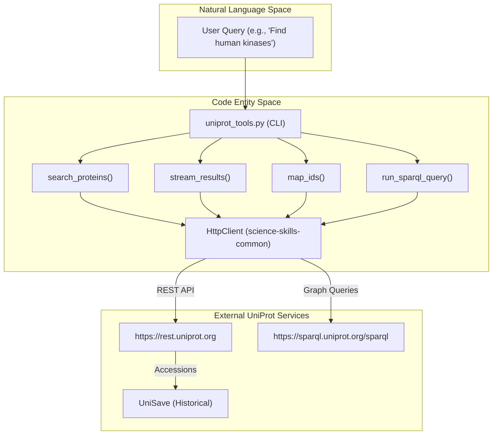
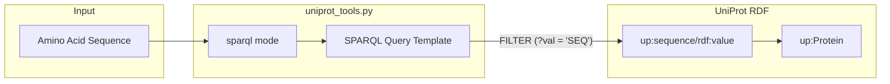

<!-- source: DeepWiki mcp.deepwiki.com · repo google-deepmind/science-skills · page 6.5 UniProt Protein Knowledgebase · fetched 2026-10-26 -->

# UniProt Protein Knowledgebase

Relevant source files

The following files were used as context for generating this wiki page:

- [skills/uniprot_database/scripts/uniprot_tools.py](skills/uniprot_database/scripts/uniprot_tools.py)

## Purpose and Scope

This page documents the UniProt skill (`uniprot_tools.py`), which provides programmatic access to the UniProt Protein Knowledgebase (UniProtKB), the non-redundant sequence archive (UniParc), clustered sequence sets (UniRef), and historical database snapshots (UniSave). It covers protein discovery, cross-referencing, retrieval of curated biological data, ID mapping, SPARQL queries, and high-volume database streaming.

Sources: [skills/uniprot_database/SKILL.md:23-28](), [skills/uniprot_database/scripts/uniprot_tools.py:15-16]()

---

## Implementation Overview

The primary interface is `uniprot_tools.py`, which wraps the UniProt REST API and SPARQL endpoint [skills/uniprot_database/scripts/uniprot_tools.py:15-16](). It utilizes the shared `HttpClient` for rate-limited requests (1.0 QPS) and automatic error handling [skills/uniprot_database/scripts/uniprot_tools.py:44-47]().

### Data Flow and Connectivity

The following diagram illustrates the relationship between user intents, the CLI entry points, underlying Python functions, and external UniProt services.

**UniProt Skill Architecture**

Sources: [skills/uniprot_database/scripts/uniprot_tools.py:44-47](), [skills/uniprot_database/SKILL.md:55-90]()

---

## Core Functions and Modes

The tool operates in several distinct modes tailored to data volume and query complexity.

### 1. Search and Discovery
The `search_proteins` function provides an interface for exploring the database. It handles automatic pagination for results exceeding 500 entries (the UniProt server limit) to ensure a stable download [skills/uniprot_database/scripts/uniprot_tools.py:95-103]().

*   **Pagination Logic**: If a limit is not specified or exceeds 500, the tool uses a generator to fetch subsequent pages via the `Link` header provided by UniProt [skills/uniprot_database/scripts/uniprot_tools.py:119-130]().
*   **Format Handling**: Supports JSON, FASTA, TSV, and TXT. For TSV, the tool ensures headers are only yielded once during paginated fetches [skills/uniprot_database/scripts/uniprot_tools.py:188-193]().

### 2. Bulk Streaming
The `stream_results` function is optimized for large-scale retrieval (up to 10,000,000 records). Unlike the search mode, it does not support limits and is intended for full dataset exports [skills/uniprot_database/SKILL.md:74-77]().

### 3. ID Mapping Service
The `map` mode utilizes the UniProt ID Mapping service to convert identifiers between UniProt and over 100 external databases [skills/uniprot_database/SKILL.md:84-86]().
*   **Databases**: Reference identifiers for mapping (e.g., `UniProtKB_AC-ID`, `PDB`, `Ensembl`, `GeneID`) are documented in [skills/uniprot_database/references/id_mapping_databases.md:16-163]().
*   **Submission Workflow**: Mapping involves submitting a job, polling for completion using the `jobId`, and then fetching the results [skills/uniprot_database/scripts/uniprot_tools.py:321-344]().

### 4. SPARQL Endpoint
For complex queries, such as exact sequence matching or multi-database federated queries, the `sparql` mode interacts with the UniProt RDF graph [skills/uniprot_database/SKILL.md:81-83]().

**Sequence Search Data Flow**

Sources: [skills/uniprot_database/SKILL.md:130-164](), [skills/uniprot_database/scripts/uniprot_tools.py:434-447]()

Sources: [skills/uniprot_database/scripts/uniprot_tools.py:95-193](), [skills/uniprot_database/SKILL.md:74-86]()

---

## Dataset Reference

The skill supports multiple datasets within the UniProt ecosystem:

| Dataset | Description | Tool Option |
| :--- | :--- | :--- |
| **UniProtKB** | Curated functional information (Swiss-Prot/TrEMBL). | `--dataset uniprotkb` |
| **UniParc** | Non-redundant sequence archive (all sequences). | `--dataset uniparc` |
| **UniRef** | Clustered sequences (UniRef100, 90, 50). | `--dataset uniref` |
| **UniSave** | Historical versions of UniProtKB entries. | `--dataset unisave` |

Sources: [skills/uniprot_database/SKILL.md:25-28](), [skills/uniprot_database/SKILL.md:61-63]()

---

## Search Syntax and Fields

The REST API supports a rich query syntax using field-specific prefixes. Common fields include:
*   `accession`: UniProtKB AC [skills/uniprot_database/references/search_query_fields.md:11]()
*   `gene`: Gene Name [GN] [skills/uniprot_database/references/search_query_fields.md:15]()
*   `organism_name`: Organism [OS] [skills/uniprot_database/references/search_query_fields.md:16]()
*   `cc_function`: Functional annotations [skills/uniprot_database/references/search_query_fields.md:55]()

Experimental evidence filters can be applied using the `_exp` suffix (e.g., `cc_function_exp`) [skills/uniprot_database/references/search_query_fields.md:6-7]().

Sources: [skills/uniprot_database/references/search_query_fields.md:1-60]()

---

## Technical Considerations

*   **Double Gzipping**: UniProt occasionally double-gzips responses. The `_get_decompressed_data` function in `uniprot_tools.py` checks for the GZIP magic number (`\x1f\x8b`) and decompressively handles these cases [skills/uniprot_database/scripts/uniprot_tools.py:61-68]().
*   **Rate Limiting**: The skill enforces a 1.0 QPS limit globally across the script to prevent 429 errors from the UniProt API [skills/uniprot_database/scripts/uniprot_tools.py:44-45]().
*   **License Compliance**: Users must be notified of UniProt license terms. The skill checks for a `LICENSE_NOTIFICATION.txt` file to track if this notification has been provided [skills/uniprot_database/SKILL.md:17-21]().

Sources: [skills/uniprot_database/scripts/uniprot_tools.py:44-68](), [skills/uniprot_database/SKILL.md:17-21]()

---

