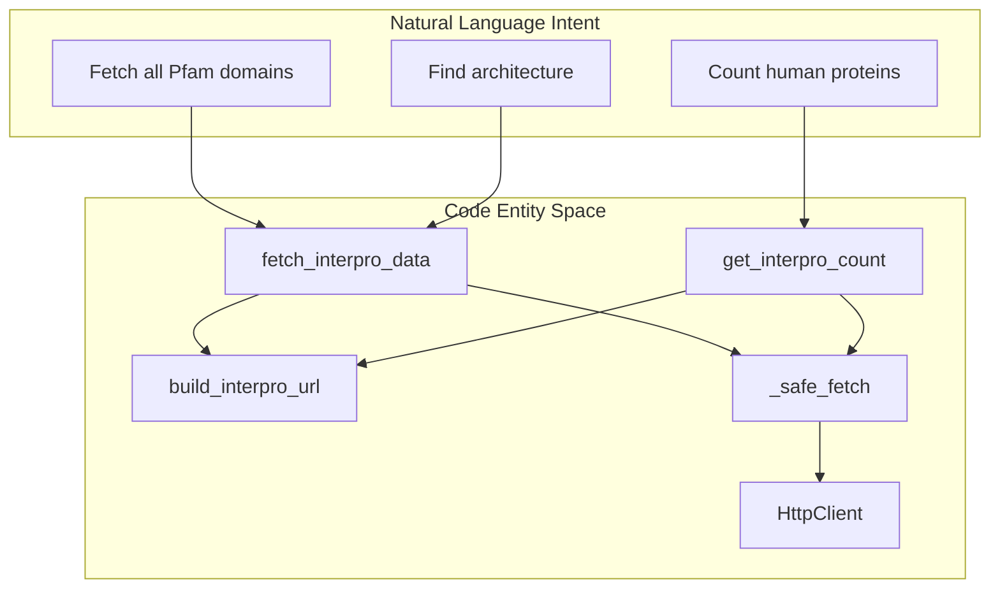
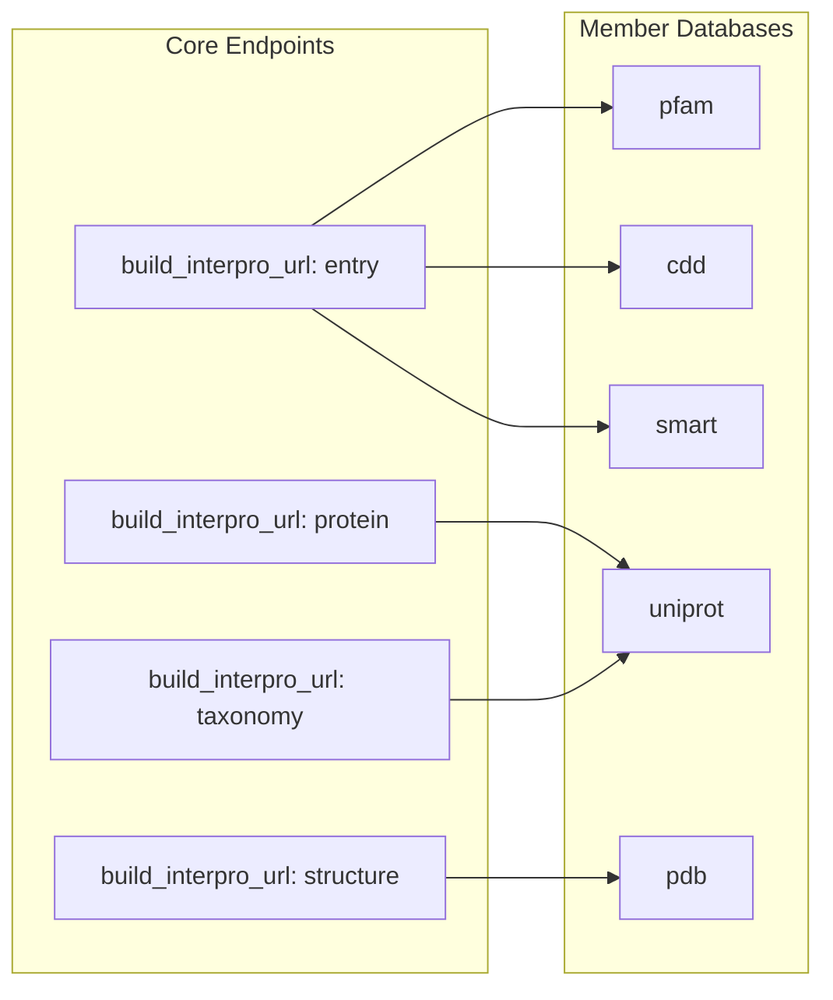

<!-- source: DeepWiki mcp.deepwiki.com · repo google-deepmind/science-skills · page 6.6 InterPro Protein Domain Database · fetched 2026-10-26 -->

# InterPro Protein Domain Database

Relevant source files

The following files were used as context for generating this wiki page:

- [skills/interpro_database/scripts/interpro_client.py](skills/interpro_database/scripts/interpro_client.py)

## Purpose and Scope

The InterPro database skill provides a programmatic interface to the EMBL-EBI InterPro resource, which aggregates functional information from multiple member databases (e.g., Pfam, CDD, SMART, PROSITE) into a single searchable resource [skills/interpro_database/scripts/interpro_client.py:36-40](). This skill supports domain identification, protein family search, species distribution analysis, and domain architecture (IDA) discovery via `interpro_client.py` [skills/interpro_database/scripts/interpro_client.py:36-204]().

Sources: [skills/interpro_database/scripts/interpro_client.py:36-204]()

## Implementation Overview

The core of the skill is `interpro_client.py`, a robust wrapper around the InterPro REST API [skills/interpro_database/scripts/interpro_client.py:15-39](). It leverages the shared `polite_http` library (`http_client.HttpClient`) configured with a rate limit of 2.0 QPS [skills/interpro_database/scripts/interpro_client.py:34-39]().

### Data Flow and URL Construction

The InterPro API uses a hierarchical path structure. The `build_interpro_url` function strictly enforces these patterns to prevent malformed requests [skills/interpro_database/scripts/interpro_client.py:42-107]().

| Pattern Level | Path Structure |
| :--- | :--- |
| **Root Endpoint** | `/{endpoint}` [skills/interpro_database/scripts/interpro_client.py:93-106]() |
| **Source DB** | `/{endpoint}/{source_db}` [skills/interpro_database/scripts/interpro_client.py:93-106]() |
| **Accession** | `/{endpoint}/{source_db}/{accession}` [skills/interpro_database/scripts/interpro_client.py:93-106]() |
| **Linked Entity** | `/{endpoint}/{source_db}/{accession}/{linked_endpoint}/{linked_source_db}/{linked_accession}` [skills/interpro_database/scripts/interpro_client.py:93-106]() |

Sources: [skills/interpro_database/scripts/interpro_client.py:42-107]()

### Code Entity Map: API Interaction

This diagram maps natural language intent to specific code entities in `interpro_client.py`.

Sources: [skills/interpro_database/scripts/interpro_client.py:42-204]()

## Key Functions

### `fetch_interpro_data`
A generator function that yields results page-by-page using lazy evaluation [skills/interpro_database/scripts/interpro_client.py:189-204](). It dynamically fetches subsequent pages only when necessary, handling pagination parameters and limits.

### `get_interpro_count`
Retrieves the total number of matches for a query without downloading the full dataset [skills/interpro_database/scripts/interpro_client.py:130-187](). It forces `page_size=1` to minimize payload size while extracting the `count` field from the response [skills/interpro_database/scripts/interpro_client.py:175-187]().

### `_safe_fetch`
A private helper (`_safe_fetch`) that handles InterPro-specific HTTP status codes [skills/interpro_database/scripts/interpro_client.py:109-128](). It catches HTTP 408 background task timeouts, waiting 60 seconds and retrying up to a configured minute limit before raising errors [skills/interpro_database/scripts/interpro_client.py:121-127]().

Sources: [skills/interpro_database/scripts/interpro_client.py:109-204]()

## Domain Architecture (IDA) Search

InterPro allows searching for proteins by their Iterative Domain Architecture (IDA) through query parameters passed to endpoints [skills/interpro_database/scripts/interpro_client.py:130-187]().

| Parameter | Purpose |
| :--- | :--- |
| `ida_search` | Comma-separated list of InterPro/Pfam accessions [skills/interpro_database/scripts/interpro_client.py:137-187]() |
| `ordered` | Mandates that domains appear in the specified sequential order [skills/interpro_database/scripts/interpro_client.py:137-187]() |
| `exact` | Mandates exact composition (no extra domains allowed) [skills/interpro_database/scripts/interpro_client.py:137-187]() |
| `ida_ignore` | Excludes specific architectures from the search [skills/interpro_database/scripts/interpro_client.py:137-187]() |

Sources: [skills/interpro_database/scripts/interpro_client.py:130-187]()

## Member Databases and Endpoints

The InterPro REST API exposes multiple core endpoints that can target various member databases via URL path construction in `build_interpro_url` [skills/interpro_database/scripts/interpro_client.py:42-107]().

Sources: [skills/interpro_database/scripts/interpro_client.py:42-107]()

### Endpoint-Specific Parameters

*   **`/entry`**: Supports endpoint routing for family, domain, and homologous superfamily entries [skills/interpro_database/scripts/interpro_client.py:42-107]().
*   **`/protein`**: Supports protein-level queries linked to UniProt source databases [skills/interpro_database/scripts/interpro_client.py:42-107]().
*   **`/structure`**: Supports structural database links (e.g., PDB) [skills/interpro_database/scripts/interpro_client.py:42-107]().

Sources: [skills/interpro_database/scripts/interpro_client.py:42-107]()

## InterPro-N Deep Learning Fallback

InterPro-N provides deep-learning-based functional annotations for protein sequences lacking traditional signature matches. Through `interpro_client.py`, queries can access these predictions seamlessly using the standard REST endpoints with appropriate parameter filters.

Sources: [skills/interpro_database/scripts/interpro_client.py:36-204]()

---

