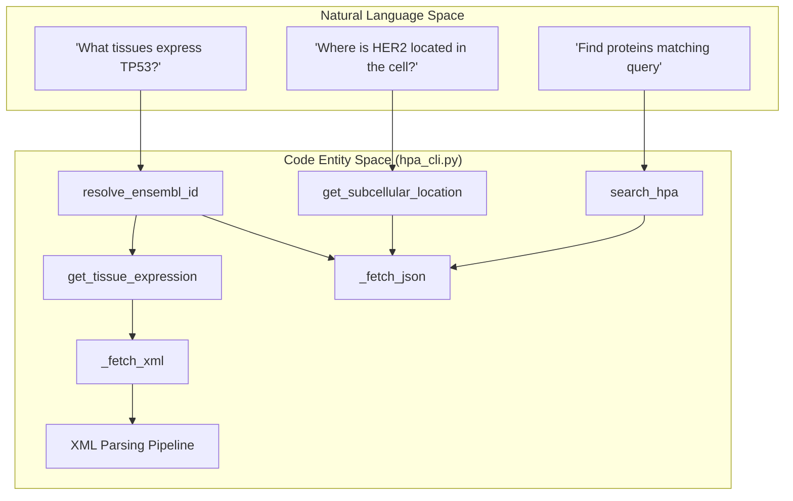
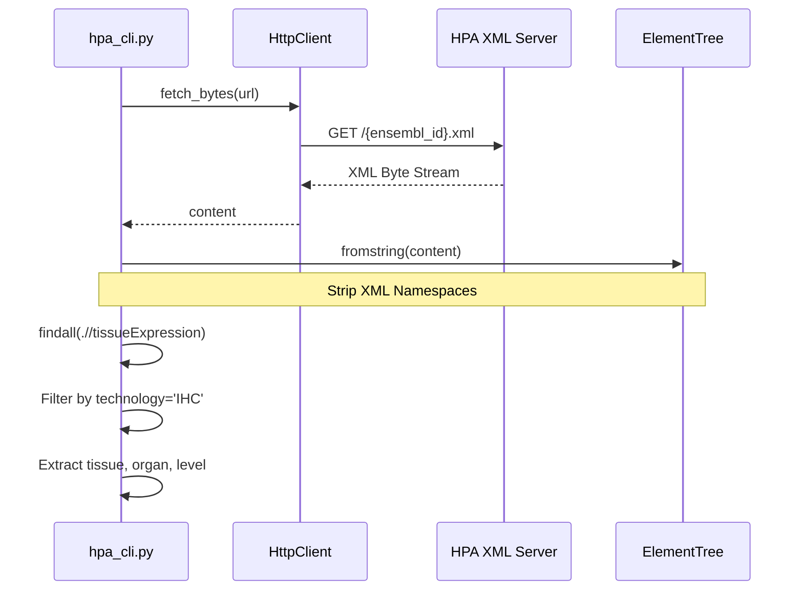

<!-- source: DeepWiki mcp.deepwiki.com · repo google-deepmind/science-skills · page 6.7 Human Protein Atlas · fetched 2026-10-26 -->

# Human Protein Atlas

Relevant source files

The following files were used as context for generating this wiki page:

- [skills/human_protein_atlas_database/SKILL.md](skills/human_protein_atlas_database/SKILL.md)
- [skills/human_protein_atlas_database/scripts/hpa_cli.py](skills/human_protein_atlas_database/scripts/hpa_cli.py)
- [skills/reactome_database/scripts/reactome_analysis.py](skills/reactome_database/scripts/reactome_analysis.py)

The Human Protein Atlas (HPA) skill provides a technical interface to retrieve semi-quantitative protein expression, spatial localization, and tissue specificity data. While RNA-seq services (like GTEx) provide transcript-level data, the HPA integration focuses on protein-level evidence derived from Immunohistochemistry (IHC) and Immunocytochemistry (ICC) across normal human tissues, cancer types, and cell lines [skills/human_protein_atlas_database/SKILL.md:8-16]().

Sources: [skills/human_protein_atlas_database/SKILL.md:8-16]()

## System Overview

The HPA integration is implemented via `hpa_cli.py`, which interacts with two primary HPA endpoints: a JSON-based search API for metadata and an XML-based endpoint for detailed tissue expression entries [skills/human_protein_atlas_database/scripts/hpa_cli.py:35-56]().

### Natural Language to Code Entity Mapping

The following diagram illustrates how high-level biological requests are mapped to specific CLI commands and internal functions.

**Request Flow: User Query to HPA Logic**

Sources: [skills/human_protein_atlas_database/scripts/hpa_cli.py:59-204](), [skills/human_protein_atlas_database/SKILL.md:56-60]()

## Implementation Details

### Data Retrieval Pipeline
The CLI uses a dual-protocol approach depending on the granularity of the requested data [skills/human_protein_atlas_database/scripts/hpa_cli.py:39-56]():

1.  **JSON Search API (`_fetch_json`)**: Used for mapping symbols, retrieving subcellular locations, and general searches. It targets `api/search_download.php` using `HttpClient.fetch_bytes()` [skills/human_protein_atlas_database/scripts/hpa_cli.py:39-49]().
2.  **XML Entry API (`_fetch_xml`)**: Used for granular IHC data. It targets `{ensembl_id}.xml` [skills/human_protein_atlas_database/scripts/hpa_cli.py:52-56]().

**Data Flow: XML Parsing Pipeline**

Sources: [skills/human_protein_atlas_database/scripts/hpa_cli.py:52-116]()

### Key Functions

| Function | Description | Implementation Detail |
| :--- | :--- | :--- |
| `resolve_ensembl_id` | Maps Gene Symbol to Ensembl ID | Queries columns `g,eg,gs,gd` and performs a case-insensitive match on the `Gene` field [skills/human_protein_atlas_database/scripts/hpa_cli.py:59-82](). |
| `get_tissue_expression`| Retrieves IHC protein levels | Parses XML to find `<tissueExpression>` nodes where `technology="IHC"`. Extracts `level` (High, Medium, Low, Not Detected) [skills/human_protein_atlas_database/scripts/hpa_cli.py:85-123](). |
| `get_subcellular_location` | Retrieves organelle localization | Queries search API with columns `g,eg,scl,scml,scal` to get main and additional locations [skills/human_protein_atlas_database/scripts/hpa_cli.py:125-144](). |
| `get_atlas_entry` | Full metadata retrieval | Combines a multi-column JSON search with an XML fetch to extract verification reliability [skills/human_protein_atlas_database/scripts/hpa_cli.py:146-195](). |
| `search_hpa` | Attribute-based search | Queries search API with specific criteria columns [skills/human_protein_atlas_database/scripts/hpa_cli.py:197-204](). |

Sources: [skills/human_protein_atlas_database/scripts/hpa_cli.py:59-204]()

## Search Syntax and Categories

The `search-hpa` command utilizes specific parameters and formatting conventions for filtering records through the HPA search download API [skills/human_protein_atlas_database/scripts/hpa_cli.py:39-49]().

### Query Logic
*   **Case-insensitivity**: Query parameters and values are handled case-insensitively by the HPA search backend [skills/human_protein_atlas_database/scripts/hpa_cli.py:70-71]().
*   **API Parameters**: Requests pass parameters via `_fetch_json` setting explicit column selections like `g`, `eg`, `gd`, `scl`, and `ectissue` [skills/human_protein_atlas_database/scripts/hpa_cli.py:39-49]().

### Tissue Specificity Categories
HPA data retrieved via XML and search columns categorize protein and RNA expression patterns across tissues.

| Category | Definition |
| :--- | :--- |
| **High / Medium / Low / Not Detected** | Semi-quantitative protein abundance levels determined via immunohistochemistry (IHC) assay scoring [skills/human_protein_atlas_database/scripts/hpa_cli.py:108-112](). |
| **Main vs Additional Locations** | Distinction between primary organelle localization (`Subcellular main location`) and secondary associated structures (`Subcellular additional location`) [skills/human_protein_atlas_database/scripts/hpa_cli.py:136-140](). |

Sources: [skills/human_protein_atlas_database/scripts/hpa_cli.py:39-140](), [skills/human_protein_atlas_database/SKILL.md:33-36]()

## Infrastructure and Rate Limiting

The skill utilizes the shared `polite-http` library for robust and compliant network communication.

*   **Client Configuration**: The `HttpClient` is initialized with `BASE_URL` (`https://www.proteinatlas.org/`) and a conservative rate limit of **2.0 QPS** to comply with HPA usage terms [skills/human_protein_atlas_database/scripts/hpa_cli.py:35-36]().
*   **Dependencies**: Managed via `uv` PEP 723 inline script metadata, requiring `polite-http` [skills/human_protein_atlas_database/scripts/hpa_cli.py:20-25]().
*   **Output Convention**: Commands write JSON structures directly to user-specified paths or default locations as required by the file-output-first design pattern [skills/human_protein_atlas_database/SKILL.md:72-74]().

Sources: [skills/human_protein_atlas_database/scripts/hpa_cli.py:20-36](), [skills/human_protein_atlas_database/SKILL.md:72-74]()

---

