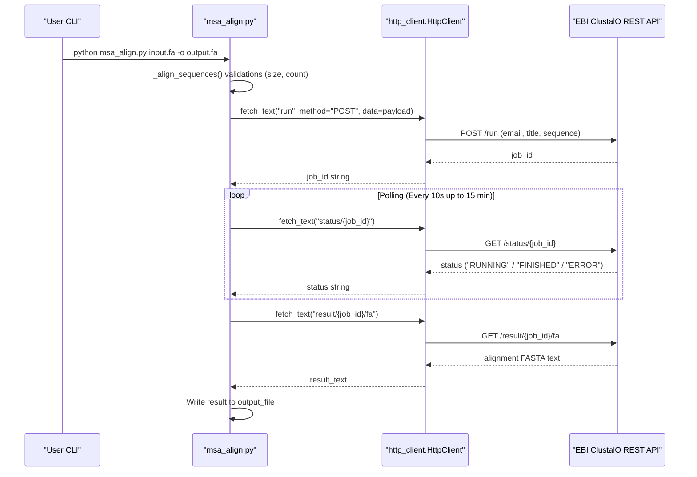

<!-- source: DeepWiki mcp.deepwiki.com · repo google-deepmind/science-skills · page 6.8 Protein Sequence Analysis: MSA and Similarity Search · fetched 2026-10-26 -->

# Protein Sequence Analysis: MSA and Similarity Search

<details>
<summary>Relevant source files</summary>

The following files were used as context for generating this wiki page:

- [skills/protein_sequence_msa/scripts/msa_align.py](skills/protein_sequence_msa/scripts/msa_align.py)
- [skills/protein_sequence_similarity_search/scripts/mmseqs2_search.py](skills/protein_sequence_similarity_search/scripts/mmseqs2_search.py)
- [skills/protein_sequence_similarity_search/scripts/uniprot_blast.py](skills/protein_sequence_similarity_search/scripts/uniprot_blast.py)

</details>


## Purpose and Scope

This page documents the protein sequence analysis skills within the codebase, covering similarity search utilities (`mmseqs2_search.py` and `uniprot_blast.py`) and multiple sequence alignment (`msa_align.py`). These tools interface with external web services (ColabFold MMseqs2 and EBI JDispatcher REST endpoints) to find sequence homologues, run BLAST queries across diverse databases, and compute global alignments.

Sources: [skills/protein_sequence_msa/scripts/msa_align.py:23-26](), [skills/protein_sequence_similarity_search/scripts/mmseqs2_search.py:15-21](), [skills/protein_sequence_similarity_search/scripts/uniprot_blast.py:15-19]()

---

## Natural Language Space to Code Entity Space

The following diagram maps high-level user goals in natural language to the concrete Python script implementations and external API endpoints invoked by the system.

```mermaid
graph TD
    UserQuery[""User Sequence Analysis Request""] --> Intent{""Determine Task Type""}
    
    Intent -- "Quick Homologue Search" --> MM[""mmseqs2_search.py""]
    Intent -- "Database-Specific BLAST" --> BL[""uniprot_blast.py""]
    Intent -- "Multiple Sequence Alignment" --> MSA[""msa_align.py""]

    subgraph "Code Entity Space"
        MM --> |"POST /ticket/msa"| CFClient[""http_client.HttpClient(COLABFOLD_HOST, qps=2)""]
        BL --> |"POST /run"| EBIBlastClient[""http_client.HttpClient(BASE_URL, qps=2)""]
        MSA --> |"POST /run"| EBIMsaClient[""http_client.HttpClient(EBI_URL, qps=1)""]
    end

    CFClient --> |"Poll /ticket/{id}"| ColabFoldAPI[""ColabFold API Server""]
    EBIBlastClient --> |"Poll /status/{id}"| EBIBlastAPI[""EBI NCBI BLAST API""]
    EBIMsaClient --> |"Poll /status/{id}"| EBIMsaAPI[""EBI Clustal Omega API""]

    ColabFoldAPI --> |"A3M Archive"| ParseA3M[""parse_a3m() / search_mmseqs2()""]
    EBIBlastAPI --> |"JSON Results"| ParseBlast[""HttpClient.fetch_json()""]
    EBIMsaAPI --> |"FASTA Alignment"| WriteFA[""file write output_file""]
```
Sources: [skills/protein_sequence_msa/scripts/msa_align.py:39-42](), [skills/protein_sequence_similarity_search/scripts/mmseqs2_search.py:57-60](), [skills/protein_sequence_similarity_search/scripts/uniprot_blast.py:70-71]()

---

## Sequence Similarity Search

### ColabFold MMseqs2 Search (`mmseqs2_search.py`)
`mmseqs2_search.py` performs rapid protein homologue searches using the ColabFold MMseqs2 API [skills/protein_sequence_similarity_search/scripts/mmseqs2_search.py:15-21]().

*   **Client Configuration:** Uses `http_client.HttpClient` configured with `COLABFOLD_HOST = "https://api.colabfold.com"` at `qps=2` [skills/protein_sequence_similarity_search/scripts/mmseqs2_search.py:44-57]().
*   **Input Handling:** `read_sequence()` accepts either a file path (raw or FASTA format, stripping headers if present) or a raw sequence string [skills/protein_sequence_similarity_search/scripts/mmseqs2_search.py:60-87]().
*   **Job Lifecycle:** Submits via `POST` to `{COLABFOLD_HOST}/ticket/msa`, parses the returned `ticket_id`, and polls `{COLABFOLD_HOST}/ticket/{ticket_id}` until completion [skills/protein_sequence_similarity_search/scripts/mmseqs2_search.py:180-214]().
*   **Result Parsing:** `parse_a3m()` processes the retrieved A3M alignment file, extracts header statistics according to `FASTA_COLUMNS` (`target`, `bit_score`, `identity`, `e_value`, `q_start`, `q_end`, `q_len`, `t_start`, `t_end`, `t_len`), computes query coverage (`q_cov`), and sorts hits by `e_value` [skills/protein_sequence_similarity_search/scripts/mmseqs2_search.py:45-139]().

Sources: [skills/protein_sequence_similarity_search/scripts/mmseqs2_search.py:15-139]()

### EBI BLAST Search (`uniprot_blast.py`)
`uniprot_blast.py` runs EBI NCBI BLAST (`blastp`) against comprehensive sequence databases [skills/protein_sequence_similarity_search/scripts/uniprot_blast.py:15-19]().

*   **Client Configuration:** Connects to `https://www.ebi.ac.uk/Tools/services/rest/ncbiblast` via `HttpClient` at `qps=2` [skills/protein_sequence_similarity_search/scripts/uniprot_blast.py:70-71]().
*   **Database Validation:** Validates selected databases against `ALLOWED_DATABASES` (e.g., `uniprotkb`, `uniref50`, `pdb`, `uniprotkb_swissprot`, etc.) [skills/protein_sequence_similarity_search/scripts/uniprot_blast.py:39-65]().
*   **Execution Flow:**
    1.  Submits parameters (`program=blastp`, `stype=protein`, `sequence`, `database`, optional `email`) to `${BASE_URL}/run` [skills/protein_sequence_similarity_search/scripts/uniprot_blast.py:137-153]().
    2.  Polls `${BASE_URL}/status/{job_id}` every 30 seconds until status returns `FINISHED` (with a 15-minute timeout) [skills/protein_sequence_similarity_search/scripts/uniprot_blast.py:168-203]().
    3.  Fetches JSON results from `${BASE_URL}/result/{job_id}/json` [skills/protein_sequence_similarity_search/scripts/uniprot_blast.py:210]().

Sources: [skills/protein_sequence_similarity_search/scripts/uniprot_blast.py:39-210]()

---

## Multiple Sequence Alignment (MSA)

### Clustal Omega (`msa_align.py`)
`msa_align.py` submits multi-sequence FASTA inputs to the EBI Clustal Omega REST service [skills/protein_sequence_msa/scripts/msa_align.py:23-26]().

*   **Client Configuration:** Uses `http_client.HttpClient` pointing to `https://www.ebi.ac.uk/Tools/services/rest/clustalo/` with `qps=1` [skills/protein_sequence_msa/scripts/msa_align.py:39-41]().
*   **Validation Rules:** Enforces a maximum file size of 4 MB, requires between 2 and 4,000 sequences, and verifies non-empty input [skills/protein_sequence_msa/scripts/msa_align.py:72-96]().
*   **Credential Requirement:** Requires the `USER_EMAIL` environment variable loaded from `~/.env` [skills/protein_sequence_msa/scripts/msa_align.py:101-104,150]().

### MSA Polling and Execution Flow


Sources: [skills/protein_sequence_msa/scripts/msa_align.py:54-147]()

---

## Technical Constraints and Rate Limiting Summary

| Script | Target API | QPS Limit | Timeout | Key Environment Variables |
| :--- | :--- | :--- | :--- | :--- |
| `mmseqs2_search.py` | ColabFold API | `qps=2` | 15 minutes | None |
| `uniprot_blast.py` | EBI NCBI BLAST | `qps=2` | 15 minutes | `USER_EMAIL` (recommended) |
| `msa_align.py` | EBI Clustal Omega | `qps=1` | 15 minutes | `USER_EMAIL` (mandatory) |

Sources: [skills/protein_sequence_msa/scripts/msa_align.py:37-41](), [skills/protein_sequence_similarity_search/scripts/mmseqs2_search.py:43-57](), [skills/protein_sequence_similarity_search/scripts/uniprot_blast.py:69-71]()

---

