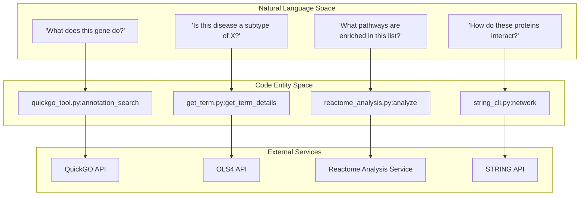
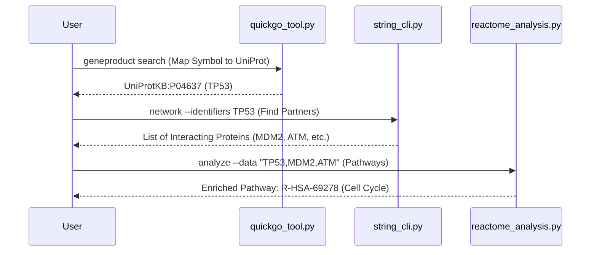

<!-- source: DeepWiki mcp.deepwiki.com · repo google-deepmind/science-skills · page 7 Biological Ontology and Pathway Skills · fetched 2026-10-26 -->

# Biological Ontology and Pathway Skills

Relevant source files

The following files were used as context for generating this wiki page:

- [skills/embl_ebi_ols/scripts/ols_utils.py](skills/embl_ebi_ols/scripts/ols_utils.py)
- [skills/human_protein_atlas_database/SKILL.md](skills/human_protein_atlas_database/SKILL.md)
- [skills/human_protein_atlas_database/scripts/hpa_cli.py](skills/human_protein_atlas_database/scripts/hpa_cli.py)
- [skills/reactome_database/scripts/reactome_analysis.py](skills/reactome_database/scripts/reactome_analysis.py)

The Biological Ontology and Pathway skills provide tools for navigating the complex hierarchies of biological knowledge and functional relationships. These skills allow for the programmatic querying of gene functions, disease ontologies, biochemical pathways, and protein-protein interaction networks.

### Core Domain Mapping

The following diagram illustrates how natural language biological concepts map to specific code entities and external services within the repository.

**Concept to Code Entity Map**

Sources: [skills/embl_ebi_ols/SKILL.md:36-64](), [skills/quickgo_database/SKILL.md:71-124](), [skills/reactome_database/SKILL.md:139-152](), [skills/string_database/SKILL.md:49-63]()

---

## 7.1 EMBL-EBI Ontology Lookup Service (OLS)
The OLS skill provides a unified interface to over 250 biomedical ontologies, including GO, DOID, HP, MONDO, and ChEBI via OLS4 endpoints [skills/embl_ebi_ols/scripts/ols_utils.py:39-41](). It is the primary tool for resolving term definitions and navigating hierarchical relationships (parents, children, and ancestors).

*   **Key Scripts**: `get_ontology.py`, `get_term.py`, `get_property.py`, `get_individual.py`, `search_ols.py`, `suggest_ols.py`, `get_stats.py`, and `ols_utils.py` [skills/embl_ebi_ols/scripts/ols_utils.py:22-41]().
*   **Capabilities**: Supports OBO ID/IRI lookups, transitive relation traversal (e.g., `part_of`, `develops_from`), and handling double-encoded IRIs.

For details, see [EMBL-EBI Ontology Lookup Service (OLS)](#7.1).

Sources: [skills/embl_ebi_ols/SKILL.md:12-80](), [skills/embl_ebi_ols/scripts/ols_utils.py:22-41]()

---

## 7.2 QuickGO Gene Ontology Database
QuickGO focuses specifically on the Gene Ontology (GO) and Evidence & Conclusion Ontology (ECO). It is used to map gene products to Biological Processes (BP), Molecular Functions (MF), and Cellular Components (CC).

*   **Key Scripts**: `quickgo_tool.py`.
*   **Subcommands**: `go`, `eco`, `annotation`, and `geneproduct`.
*   **Features**: Supports GO Slim generation, DAG traversal, taxon filtering, and filtering by evidence codes (e.g., prioritizing experimental evidence over electronic predictions).

For details, see [QuickGO Gene Ontology Database](#7.2).

Sources: [skills/quickgo_database/SKILL.md:56-70](), [skills/quickgo_database/scripts/quickgo_tool.py:168-215]()

---

## 7.3 Reactome Pathway Database
Reactome provides tools for pathway enrichment analysis and detailed mapping of biochemical reactions utilizing the Analysis Service and Content Service APIs [skills/reactome_database/scripts/reactome_analysis.py:15-22](). It is managed through a client initialized with rate limiting [skills/reactome_database/scripts/reactome_analysis.py:41-43]().

*   **Key Scripts**: `reactome_analysis.py`.
*   **Capabilities**: Overrepresentation analysis, expression analysis, species comparison, content service queries, diagram export, and FDR/p-value filtering.
*   **State Management**: Uses a token-based system where analysis results are stored on the Reactome server.

For details, see [Reactome Pathway Database](#7.3).

Sources: [skills/reactome_database/SKILL.md:23-46](), [skills/reactome_database/scripts/reactome_analysis.py:15-43]()

---

## 7.4 STRING Protein Interaction Network
The STRING skill queries protein-protein interactions (PPIs), including functional and physical associations. It provides confidence scores derived from various sources like experimental data, text mining, and co-expression.

*   **Key Scripts**: `string_cli.py`.
*   **Requirements**: Mandatory NCBI Taxon ID (e.g., `9606` for Human).
*   **Commands**: `map`, `network`, `partners`, `image`, `homology`, `enrichment`, and `valuesranks`.
*   **Output**: Returns detailed confidence score matrices in TSV format.

For details, see [STRING Protein Interaction Network](#7.4).

Sources: [skills/string_database/SKILL.md:24-40](), [skills/string_database/references/interactions.md:6-28]()

---

### Skill Interoperability

These skills are often used in sequence to move from a raw gene list to a biological narrative.

**Workflow Integration**

Sources: [skills/quickgo_database/SKILL.md:80-87](), [skills/string_database/references/interactions.md:12-18](), [skills/reactome_database/SKILL.md:143-148]()

---

