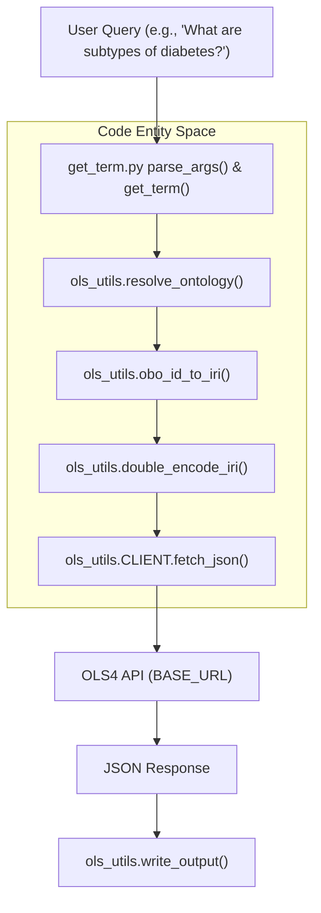
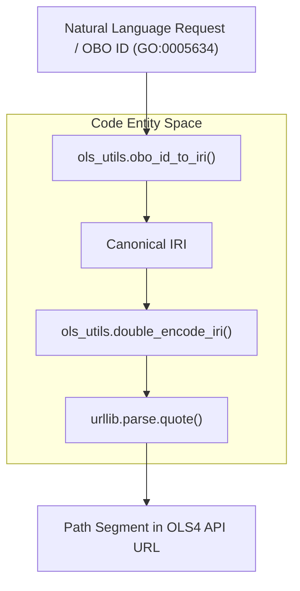

<!-- source: DeepWiki mcp.deepwiki.com · repo google-deepmind/science-skills · page 7.1 EMBL-EBI Ontology Lookup Service (OLS) · fetched 2026-10-26 -->

# EMBL-EBI Ontology Lookup Service (OLS)

Relevant source files

The following files were used as context for generating this wiki page:

- [skills/embl_ebi_ols/scripts/get_individual.py](skills/embl_ebi_ols/scripts/get_individual.py)
- [skills/embl_ebi_ols/scripts/get_ontology.py](skills/embl_ebi_ols/scripts/get_ontology.py)
- [skills/embl_ebi_ols/scripts/get_property.py](skills/embl_ebi_ols/scripts/get_property.py)
- [skills/embl_ebi_ols/scripts/get_stats.py](skills/embl_ebi_ols/scripts/get_stats.py)
- [skills/embl_ebi_ols/scripts/get_term.py](skills/embl_ebi_ols/scripts/get_term.py)
- [skills/embl_ebi_ols/scripts/ols_utils.py](skills/embl_ebi_ols/scripts/ols_utils.py)
- [skills/embl_ebi_ols/scripts/search_ols.py](skills/embl_ebi_ols/scripts/search_ols.py)
- [skills/embl_ebi_ols/scripts/suggest_ols.py](skills/embl_ebi_ols/scripts/suggest_ols.py)

The EMBL-EBI Ontology Lookup Service (OLS) skill provides a comprehensive interface to the OLS4 API, enabling programmatic access to over 250 biomedical ontologies (e.g., Gene Ontology, Disease Ontology, Human Phenotype Ontology). It supports term discovery, hierarchical navigation, and metadata retrieval for classes, properties, and individuals [skills/embl_ebi_ols/scripts/ols_utils.py:22-26]().

## Implementation Overview

The skill is implemented as a collection of Python scripts that leverage a shared utility module, `ols_utils.py`, and the core `HttpClient` for managed API access [skills/embl_ebi_ols/scripts/ols_utils.py:22-41]().

### Core Architecture

The system bridges natural language requests for biological concepts to structured API queries against the OLS4 endpoint.

**Data Flow: Natural Language to Code Execution**

Sources: [skills/embl_ebi_ols/scripts/get_term.py:141-167](), [skills/embl_ebi_ols/scripts/ols_utils.py:37-95]()

### Key Shared Components (`ols_utils.py`)

The `ols_utils` module centralizes critical logic for interacting with the OLS4 API:

*   **Global Client**: Initializes an `HttpClient` with a base URL of `https://www.ebi.ac.uk/ols4/api` and a rate limit of 5.0 QPS [skills/embl_ebi_ols/scripts/ols_utils.py:37-40]().
*   **OBO ID Mapping**: Provides `obo_id_to_iri()` to convert standard IDs like `GO:0005634` into canonical IRIs (`http://purl.obolibrary.org/obo/GO_0005634`) [skills/embl_ebi_ols/scripts/ols_utils.py:77-80]().
*   **Double Encoding**: Implements `double_encode_iri()`, which is strictly required by the OLS4 API for passing IRIs in URL path segments [skills/embl_ebi_ols/scripts/ols_utils.py:82-84]().
*   **Ontology Resolution**: `resolve_ontology()` maps OBO prefixes (e.g., "HP", "CL") to their lower-case ontology slugs used by the API [skills/embl_ebi_ols/scripts/ols_utils.py:87-95]().

Sources: [skills/embl_ebi_ols/scripts/ols_utils.py:28-100]()

---

## Skill Capabilities

### 1. Term Retrieval (`get_term.py`)
Fetches detailed information for a specific class. It supports both direct (is-a) and hierarchical (is-a + transitive relations like "part of") relations [skills/embl_ebi_ols/scripts/get_term.py:15-31]().

| Relation Type | Description |
| :--- | :--- |
| `parents`/`children` | Direct `subClassOf` relationships only [skills/embl_ebi_ols/scripts/get_term.py:24-25](). |
| `hierarchicalParents`/`hierarchicalChildren` | Includes transitive properties like `part of` or `develops from` [skills/embl_ebi_ols/scripts/get_term.py:26-28](). |
| `ancestors`/`descendants` / `hierarchicalAncestors`/`hierarchicalDescendants` | Transitive closure of the relationship [skills/embl_ebi_ols/scripts/get_term.py:24-28](). |
| `graph` | Returns the full graph JSON representation for the term [skills/embl_ebi_ols/scripts/get_term.py:29-30](). |

Sources: [skills/embl_ebi_ols/scripts/get_term.py:15-56]()

### 2. Search and Suggestion
*   **`search_ols.py`**: Performs full-text search against the OLS search API [skills/embl_ebi_ols/scripts/search_ols.py:15-18](). Key parameters include `--exact` for exact label matches and `--defining` to restrict results to authoritative defining ontologies [skills/embl_ebi_ols/scripts/search_ols.py:144-158]().
*   **`suggest_ols.py`**: Provides fast autocomplete suggestions for partial term names, optimized for interactive term discovery [skills/embl_ebi_ols/scripts/suggest_ols.py:15-19]().

Sources: [skills/embl_ebi_ols/scripts/search_ols.py:43-80](), [skills/embl_ebi_ols/scripts/suggest_ols.py:48-62]()

### 3. Properties and Individuals
*   **`get_property.py`**: Retrieves details for ontology properties (relations), including property hierarchies (parents, children, ancestors, descendants) and root properties [skills/embl_ebi_ols/scripts/get_property.py:15-19]().
*   **`get_individual.py`**: Fetches instances (individuals) of ontology classes, including their direct types and all types (including ancestors) [skills/embl_ebi_ols/scripts/get_individual.py:15-19]().

Sources: [skills/embl_ebi_ols/scripts/get_property.py:34-121](), [skills/embl_ebi_ols/scripts/get_individual.py:33-112]()

### 4. Metadata and Statistics
*   **`get_ontology.py`**: Lists available ontologies with pagination or retrieves metadata (term counts, status, update dates) for a specific ontology ID [skills/embl_ebi_ols/scripts/get_ontology.py:15-19]().
*   **`get_stats.py`**: Returns global OLS index statistics from the v2 stats API, including counts of ontologies, classes, properties, and individuals [skills/embl_ebi_ols/scripts/get_stats.py:15-19]().

Sources: [skills/embl_ebi_ols/scripts/get_ontology.py:33-96](), [skills/embl_ebi_ols/scripts/get_stats.py:32-55]()

---

## Technical Reference

### IRI Processing Pipeline

The OLS API requires a specific transformation for OBO identifiers before they can be used in path-based endpoints.

Sources: [skills/embl_ebi_ols/scripts/ols_utils.py:77-84]()

### Rate Limiting and Error Handling
The OLS skill enforces a maximum rate limit via the shared `HttpClient` instance configured with `qps=5.0` [skills/embl_ebi_ols/scripts/ols_utils.py:40](). Errors such as 404 Not Found or HTTP failures are caught and handled via `ols_utils.error_exit()` to output structured JSON error payloads [skills/embl_ebi_ols/scripts/ols_utils.py:97-100]().

Sources: [skills/embl_ebi_ols/scripts/ols_utils.py:37-41](), [skills/embl_ebi_ols/scripts/ols_utils.py:97-100]()

---

