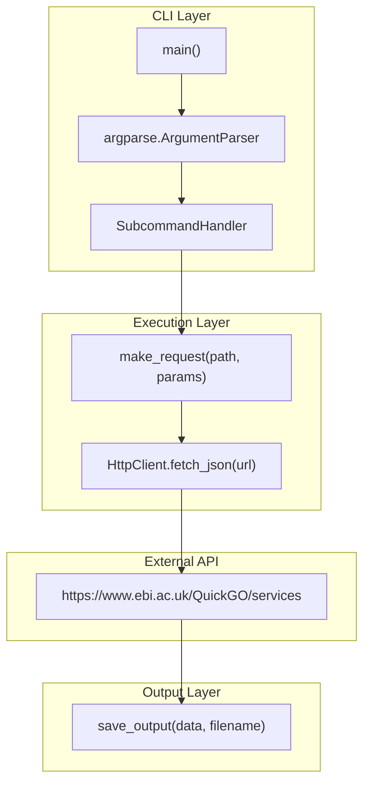
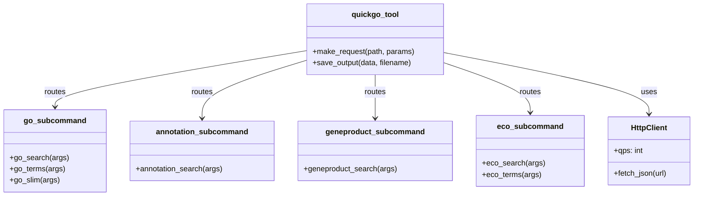

<!-- source: DeepWiki mcp.deepwiki.com · repo google-deepmind/science-skills · page 7.2 QuickGO Gene Ontology Database · fetched 2026-10-26 -->

# QuickGO Gene Ontology Database

Relevant source files

The following files were used as context for generating this wiki page:

- [skills/quickgo_database/scripts/quickgo_tool.py](skills/quickgo_database/scripts/quickgo_tool.py)

The QuickGO Gene Ontology Database skill provides a technical interface to the QuickGO and Evidence & Conclusion Ontology (ECO) REST APIs maintained by the Gene Ontology Annotation (GOA) group at EMBL-EBI. It is designed for mapping gene products to functional attributes, exploring the Gene Ontology Directed Acyclic Graph (DAG), and retrieving evidence-based annotations.

Sources: [skills/quickgo_database/scripts/quickgo_tool.py:15-20]()

## Implementation Overview

The skill is implemented as a Python CLI tool `quickgo_tool.py` that utilizes the `science-skills-common` `HttpClient` for managed API interactions [skills/quickgo_database/scripts/quickgo_tool.py:34-39]().

### Technical Architecture and Data Flow

The system bridges natural language queries (e.g., searching for "apoptosis") to structured API requests against the EBI services via specific Python functions.

**Natural Language to Code Entity Mapping**
| Concept | Code Entity / Command | API Endpoint |
| :--- | :--- | :--- |
| **Gene Symbol Resolution** | `geneproduct_search` [skills/quickgo_database/scripts/quickgo_tool.py:145-164]() | `/geneproduct/search` |
| **Functional Annotation** | `annotation_search` [skills/quickgo_database/scripts/quickgo_tool.py:108-143]() | `/annotation/search` |
| **Ontology Hierarchy** | `go_terms` [skills/quickgo_database/scripts/quickgo_tool.py:71-79]() | `/ontology/go/terms/` |
| **Evidence Validation** | `eco_terms` [skills/quickgo_database/scripts/quickgo_tool.py:99-105]() | `/ontology/eco/terms/` |

**Request Processing Pipeline**
The following diagram illustrates how `quickgo_tool.py` processes a request through the shared infrastructure.

Sources: [skills/quickgo_database/scripts/quickgo_tool.py:36-168]()

## Core Subcommands and Reference

The tool implements primary subcommands, each corresponding to a specific domain of the QuickGO ecosystem.

### 1. Gene Ontology (`go`)
Used for retrieving GO term definitions and navigating the ontology structure via `go_search`, `go_terms`, and `go_slim` [skills/quickgo_database/scripts/quickgo_tool.py:62-88]().
*   **Search**: Text-based lookup for GO terms (`go_search`) [skills/quickgo_database/scripts/quickgo_tool.py:62-69]().
*   **Terms**: Retrieves specific term details (`go_terms`). Supports `relation` types: `ancestors`, `descendants`, `children`, `complete`, and `paths` [skills/quickgo_database/scripts/quickgo_tool.py:71-79]().
*   **Slims**: Maps fine-grained GO terms to a high-level "slim" set for functional summaries (`go_slim`) [skills/quickgo_database/scripts/quickgo_tool.py:81-88]().

### 2. Annotations (`annotation`)
The primary functional mapper linking gene products to GO terms handled by `annotation_search` [skills/quickgo_database/scripts/quickgo_tool.py:108-143]().
*   **Aspects**: Supports filtering by `aspect` parameter (biological process, molecular function, cellular component) [skills/quickgo_database/scripts/quickgo_tool.py:134-135]().
*   **Evidence Filtering**: Allows filtering by `evidenceCode` [skills/quickgo_database/scripts/quickgo_tool.py:128-129]().

### 3. Gene Products (`geneproduct`)
Resolves common symbols to formal database identifiers via `geneproduct_search` [skills/quickgo_database/scripts/quickgo_tool.py:145-164]().

### 4. Evidence Ontology (`eco`)
Queries the Evidence & Conclusion Ontology using `eco_search` and `eco_terms` [skills/quickgo_database/scripts/quickgo_tool.py:90-105]().

Sources: [skills/quickgo_database/scripts/quickgo_tool.py:62-164]()

## Operational Constraints

### Rate Limiting
The `HttpClient` is initialized with a `qps=10` limit (`_CLIENT = http_client.HttpClient(BASE_URL, qps=10)`) [skills/quickgo_database/scripts/quickgo_tool.py:36-39](). This ensures compliance with EBI's API usage policies.

### Pagination and Filtering
*   **Limit**: Requests enforce a maximum of 100 results per page (`min(args.limit, 100)`) [skills/quickgo_database/scripts/quickgo_tool.py:63, 137, 158]().
*   **Taxon**: Parameter `taxonId` can be passed to query specific organism annotations [skills/quickgo_database/scripts/quickgo_tool.py:126-127, 155-156]().

Sources: [skills/quickgo_database/scripts/quickgo_tool.py:36-164]()

## System Entity Map

The following diagram maps the CLI arguments and internal functions to the underlying data structures and client implementations.

Sources: [skills/quickgo_database/scripts/quickgo_tool.py:34-168]()

## Reference Files
*   **CLI Implementation**: `skills/quickgo_database/scripts/quickgo_tool.py` [skills/quickgo_database/scripts/quickgo_tool.py:1-205]()

Sources: [skills/quickgo_database/scripts/quickgo_tool.py:1-205]()

---

