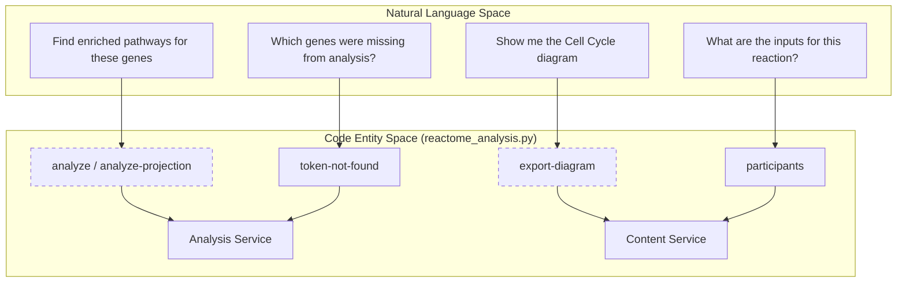
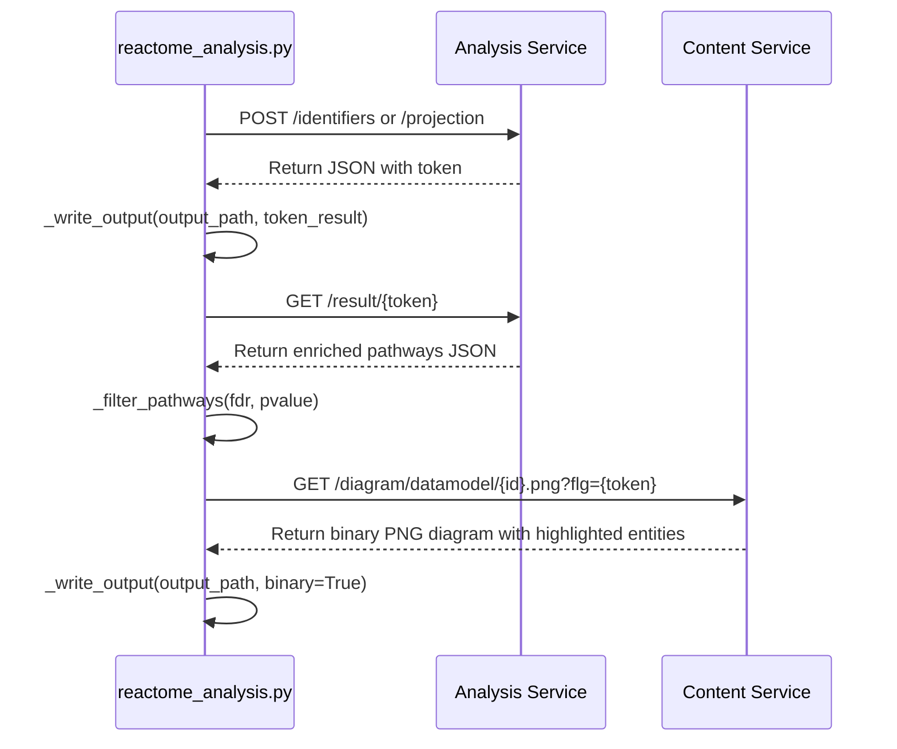
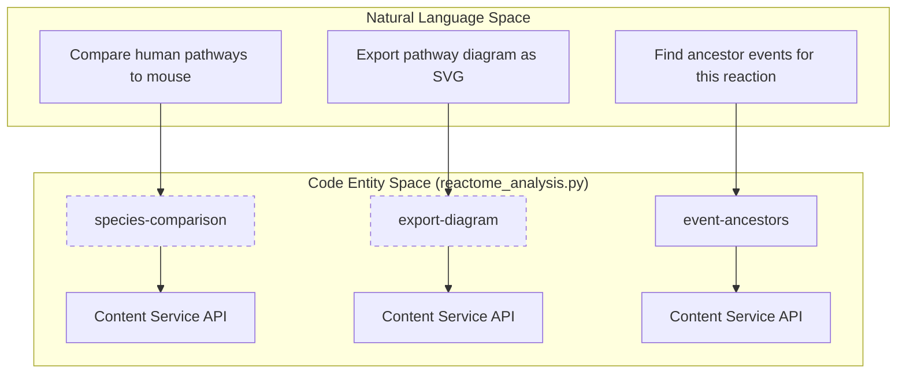

<!-- source: DeepWiki mcp.deepwiki.com · repo google-deepmind/science-skills · page 7.3 Reactome Pathway Database · fetched 2026-10-26 -->

# Reactome Pathway Database

Relevant source files

The following files were used as context for generating this wiki page:

- [skills/human_protein_atlas_database/SKILL.md](skills/human_protein_atlas_database/SKILL.md)
- [skills/human_protein_atlas_database/scripts/hpa_cli.py](skills/human_protein_atlas_database/scripts/hpa_cli.py)
- [skills/reactome_database/scripts/reactome_analysis.py](skills/reactome_database/scripts/reactome_analysis.py)

## Purpose and Scope
This leaf page documents the `reactome_database` skill, specifically focusing on `skills/reactome_database/scripts/reactome_analysis.py`. This script implements a command-line interface (CLI) to the Reactome Analysis Service and Content Service APIs, providing pathway enrichment analysis, identifier mapping, token-based result retrieval, content service graph queries, species comparisons, diagram exports, and FDR/p-value filtering [skills/reactome_database/scripts/reactome_analysis.py:15-22]().

Sources: [skills/reactome_database/scripts/reactome_analysis.py:15-22]()

---

## Overview and Architecture

The implementation centers around `skills/reactome_database/scripts/reactome_analysis.py`, which coordinates requests across two distinct API base URLs using a shared polite HTTP client initialized to `1 QPS` [skills/reactome_database/scripts/reactome_analysis.py:41-43]():
*   **Analysis Service**: `https://reactome.org/AnalysisService` handles compute-intensive tasks such as overrepresentation analysis, functional projections, and identifier mapping [skills/reactome_database/scripts/reactome_analysis.py:41]().
*   **Content Service**: `https://reactome.org/ContentService` manages knowledgebase graph queries, pathway hierarchy traversal, event participants, cross-references, and diagram exports [skills/reactome_database/scripts/reactome_analysis.py:42]().

**User Intent to Code Command Mapping**

Sources: [skills/reactome_database/scripts/reactome_analysis.py:41-45](), [skills/reactome_database/scripts/reactome_analysis.py:1020-1126]()

---

## Core Infrastructure and Helper Functions

The CLI script utilizes several internal helper functions to format parameters, read input data, handle multipart uploads, and process output data:

*   `_write_output(output_path, content, binary)`: Writes text or binary payloads to disk and emits a warning if the file size exceeds `100,000` bytes to prevent context window exhaustion [skills/reactome_analysis.py:47-65]().
*   `_build_params(args)`: Maps camelCase parameter names (`species`, `pageSize`, `page`, `sortBy`, `order`, `resource`, `interactors`, `includeDisease`) from parser arguments [skills/reactome_analysis.py:119-145]().
*   `_read_data(args)`: Reads input data from `--file` or `--data` flags, automatically replacing comma-separated values with newline-delimited strings if necessary [skills/reactome_analysis.py:148-160]().
*   `_build_multipart(filepath, mime)`: Constructs multipart form data boundaries for file-based uploads [skills/reactome_analysis.py:163-180]().
*   `_fill_path(template, args)`: Interpolates URL path placeholders (e.g., `{id}`, `{token}`) and URL-encodes designated fields defined in `_ENCODE_FIELDS` (`id`, `species_id`, `species`, `species_name`) [skills/reactome_analysis.py:183-196]().

Sources: [skills/reactome_database/scripts/reactome_analysis.py:47-196]()

---

## Enrichment Analysis and Token-Based State

Reactome uses a **token-based system** for analysis results. When a user submits a gene list or expression matrix for enrichment, the Analysis Service returns an analysis result object containing a `token` valid on the server for 7 days [skills/reactome_database/SKILL.md:92-93](). Subsequent retrieval of pathways, non-mapping identifiers, or specific sub-result pages queries this token directly.

### FDR and p-Value Filtering

The function `_filter_pathways(result_text, fdr, pvalue)` parses JSON analysis results and filters the `pathways` array based on entity FDR or p-value thresholds, updating `pathwaysFound` accordingly [skills/reactome_analysis.py:67-96](). Additionally, `_summarize_result(result_text, limit)` truncates oversized list responses to avoid downstream memory and parsing issues [skills/reactome_analysis.py:97-117]().

**Analysis and Diagram Generation Flow**

Sources: [skills/reactome_database/scripts/reactome_analysis.py:67-117](), [skills/reactome_database/scripts/reactome_analysis.py:1126]()

---

## Content Service Queries and Diagram Export

The Content Service interface supports deep traversal of biological knowledge graphs:
*   **Reactions and Participants**: The `participants` command extracts inputs, outputs, catalysts, and regulators [skills/reactome_database/scripts/reactome_analysis.py:1126]().
*   **Species Comparison**: The `species-comparison` command evaluates pathway overlap and divergence between *Homo sapiens* and target species [skills/reactome_database/scripts/reactome_analysis.py:1126]().
*   **Diagram Export**: The `export-diagram` command renders PNG or SVG visual representations of pathways, supporting entity highlighting via tokens (`flg`) or explicit selection identifiers (`sel`) [skills/reactome_database/scripts/reactome_analysis.py:1126]().

**Content and Diagram Service Mapping**

Sources: [skills/reactome_database/scripts/reactome_analysis.py:1126]()

---

## Command Summary Table

| Command | Service | Purpose |
| :--- | :--- | :--- |
| `analyze` | Analysis | Submit identifiers for overrepresentation or expression analysis [skills/reactome_database/scripts/reactome_analysis.py:1052]() |
| `analyze-projection` | Analysis | Project identifiers to another species during analysis [skills/reactome_database/scripts/reactome_analysis.py:1070]() |
| `token-result` | Analysis | Retrieve full or filtered pathway results using a 7-day token [skills/reactome_database/scripts/reactome_analysis.py:1082]() |
| `token-not-found` | Analysis | Retrieve identifiers that failed mapping [skills/reactome_database/scripts/reactome_analysis.py:1100]() |
| `species-comparison` | Analysis | Compare pathway coverage across species [skills/reactome_database/scripts/reactome_analysis.py:1126]() |
| `query` | Content | Query any Reactome object by stable ID [skills/reactome_database/scripts/reactome_analysis.py:1126]() |
| `participants` | Content | Retrieve inputs, outputs, and regulators for events [skills/reactome_database/scripts/reactome_analysis.py:1126]() |
| `xref-mapping` | Content | Map external database identifiers to Reactome objects [skills/reactome_database/scripts/reactome_analysis.py:1126]() |
| `export-diagram` | Content | Generate raster or vector pathway diagrams with optional token highlighting [skills/reactome_database/scripts/reactome_analysis.py:1126]() |

Sources: [skills/reactome_database/scripts/reactome_analysis.py:1020-1126](), [skills/reactome_database/references/api_reference.md:1-98]()

---

