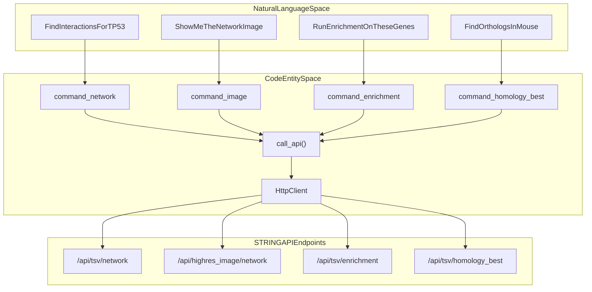
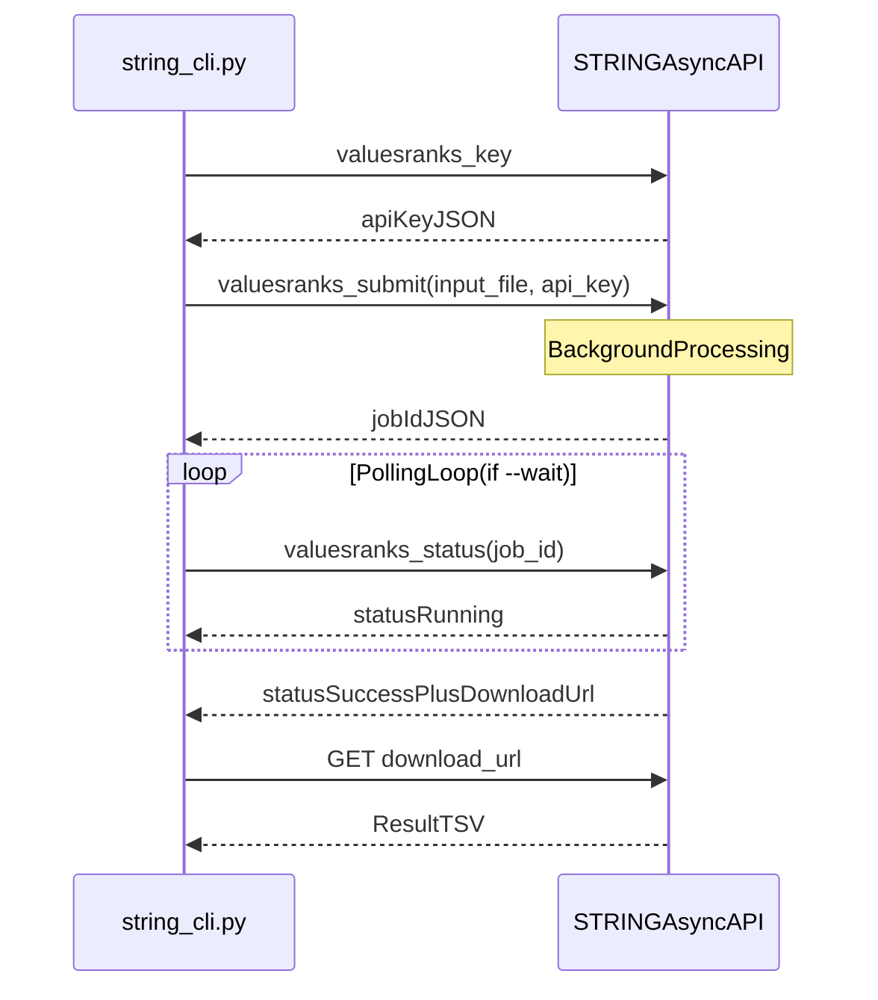

<!-- source: DeepWiki mcp.deepwiki.com · repo google-deepmind/science-skills · page 7.4 STRING Protein Interaction Network · fetched 2026-10-26 -->

# STRING Protein Interaction Network

Relevant source files

The following files were used as context for generating this wiki page:

- [skills/string_database/scripts/string_cli.py](skills/string_database/scripts/string_cli.py)

## Purpose and Scope
The STRING (Search Tool for the Retrieval of Interacting Genes/Proteins) skill provides a robust command-line interface wrapper for the STRING API v12.0 [skills/string_database/scripts/string_cli.py:15-18](). It enables programmatic access to protein-protein interaction (PPI) networks, functional enrichment analyses, homology mapping, network image generation, and asynchronous large-scale values/ranks submissions [skills/string_database/scripts/string_cli.py:107-221]().

Sources: [skills/string_database/scripts/string_cli.py:15-18](), [skills/string_database/scripts/string_cli.py:107-221]()

## System Overview

The skill is implemented as a Python CLI script, `string_cli.py`, which communicates with the STRING REST API endpoints [skills/string_database/scripts/string_cli.py:15-18](). It utilizes the `polite_http` package to execute HTTP POST requests with embedded caller identity headers and error handling [skills/string_database/scripts/string_cli.py:35-79]().

### Natural Language to Code Entity Mapping

The following diagram maps high-level natural language user requests to the specific CLI commands and underlying API execution pathways defined in the code.

**Figure 1: Request Mapping Architecture**

Sources: [skills/string_database/scripts/string_cli.py:85-221](), [skills/string_database/scripts/string_cli.py:35-79]()

## Core Requirements & Conventions

### NCBI Taxon ID
The STRING API requires an explicit NCBI Taxon ID (e.g., `9606` for human, `10090` for mouse) to resolve identifiers within the correct organism context [skills/string_database/scripts/string_cli.py:103-105](). The CLI enforces this via the `--species` argument across relevant subcommand parsers [skills/string_database/scripts/string_cli.py:95-105]().

### Output Conventions
All subcommands mandate an `--output` argument specifying the destination file path [skills/string_database/scripts/string_cli.py:89-93](). Data returned from the API is written directly in Tab-Separated Values (TSV) or designated formats to prevent excessive LLM context consumption [skills/string_database/scripts/string_cli.py:53-79]().

### Identifier Mapping
Users can map free-text protein names or external database identifiers into STRING internal identifiers using the `map` command before querying downstream interaction or enrichment endpoints [skills/string_database/scripts/string_cli.py:107-114]().

Sources: [skills/string_database/scripts/string_cli.py:89-114](), [skills/string_database/scripts/string_cli.py:53-79]()

## Command Reference

### Interaction Networks and Partners
The `network` and `partners` subcommands retrieve protein-protein interaction (PPI) data under different scopes and confidence constraints [skills/string_database/scripts/string_cli.py:115-146]().

| Command | Purpose | Key Parameters |
| :--- | :--- | :--- |
| `network` | Retrieves the interaction network among a specified list of protein identifiers [skills/string_database/scripts/string_cli.py:115-122]() | `--identifiers`, `--species`, `--required_score`, `--network_type`, `--add_nodes`, `--output` [skills/string_database/scripts/string_cli.py:95-124]() |
| `partners` | Finds interacting partner proteins for the given identifiers up to a set limit [skills/string_database/scripts/string_cli.py:140-146]() | `--identifiers`, `--species`, `--limit`, `--output` [skills/string_database/scripts/string_cli.py:95-105,145-146]() |

#### Network Types and Confidence Scores
*   **Network Types**: The `--network_type` argument accepts either `functional` (default) or `physical` interaction networks [skills/string_database/scripts/string_cli.py:121-122]().
*   **Confidence Scores**: Interaction outputs include combined scores and evidence-specific metrics (`score`, `escore`, `dscore`, `tscore`, `ascore`) representing experimental, database, textmining, and coexpression evidence channels.

Sources: [skills/string_database/scripts/string_cli.py:115-146]()

### Functional Enrichment and Annotation
STRING supports various functional classification and enrichment workflows [skills/string_database/scripts/string_cli.py:158-188]().

*   **`enrichment`**: Performs statistical overrepresentation tests for GO, KEGG, Pfam, and InterPro categories on a given list of proteins [skills/string_database/scripts/string_cli.py:160-165]().
*   **`ppi-enrichment`**: Evaluates whether the set of proteins exhibits significantly more interactions than expected by random chance [skills/string_database/scripts/string_cli.py:184-187]().
*   **`functional-terms`**: Inverse search capability allowing users to query proteins associated with specific term texts (e.g., `Melanoma`, `GO:0008543`) [skills/string_database/scripts/string_cli.py:175-183]().

Sources: [skills/string_database/scripts/string_cli.py:158-188]()

### Homology and Image Generation
*   **`homology` and `homology-best`**: Retrieve cross-species homology scores or best hits to identify orthologs across target genomes [skills/string_database/scripts/string_cli.py:147-159]().
*   **`image`**: Generates visual network diagrams supporting formats (`image`, `highres_image`, `svg`) and flavors (`evidence`, `confidence`, `actions`) [skills/string_database/scripts/string_cli.py:125-138]().

Sources: [skills/string_database/scripts/string_cli.py:125-159]()

## Values/Ranks Async API

For large-scale omics datasets (such as genome-wide differential expression values), STRING exposes an asynchronous Values/Ranks workflow [skills/string_database/scripts/string_cli.py:194-221]().

**Figure 2: Async Values/Ranks Workflow**

### Implementation Details
1.  **Key Acquisition**: `valuesranks-key` fetches a temporary anonymous API key required to authenticate batch jobs [skills/string_database/scripts/string_cli.py:194-200]().
2.  **Job Submission**: `valuesranks-submit` uploads a tab-separated file containing protein identifiers and quantitative association values paired with species and false discovery rate thresholds (`--ge_fdr`) [skills/string_database/scripts/string_cli.py:201-211]().
3.  **Status Monitoring**: `valuesranks-status` queries job progress and handles automatic polling and retrieval when `--wait` is enabled [skills/string_database/scripts/string_cli.py:212-221]().

Sources: [skills/string_database/scripts/string_cli.py:194-221]()

---

