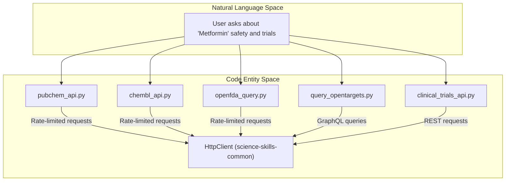
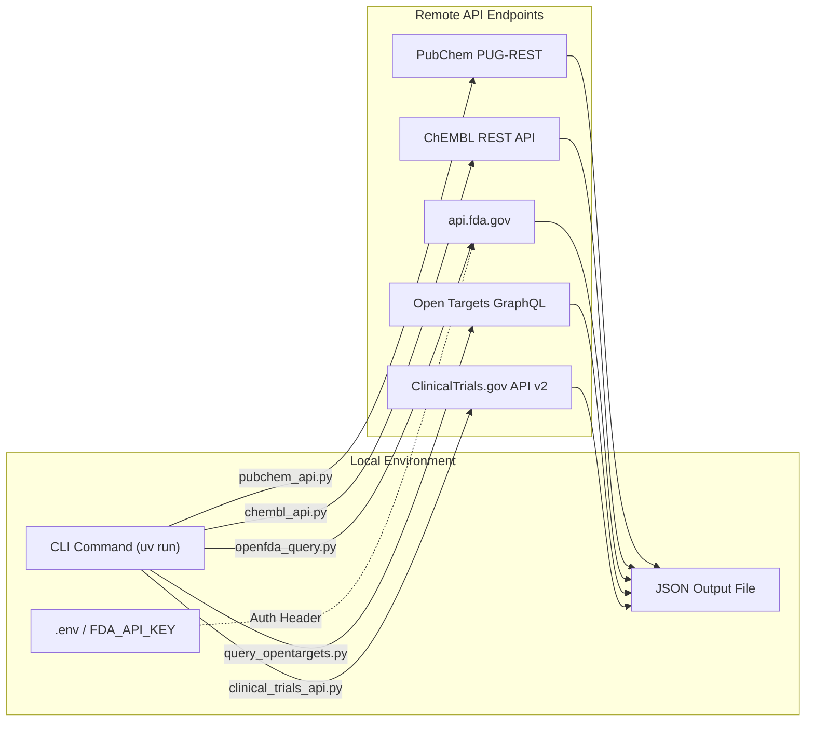

<!-- source: DeepWiki mcp.deepwiki.com · repo google-deepmind/science-skills · page 8 Cheminformatics, Drug, and Clinical Data Skills · fetched 2026-10-26 -->

# Cheminformatics, Drug, and Clinical Data Skills

Relevant source files

The following files were used as context for generating this wiki page:

- [skills/openfda_database/SKILL.md](skills/openfda_database/SKILL.md)
- [skills/openfda_database/references/recipes.md](skills/openfda_database/references/recipes.md)
- [skills/pubchem_database/scripts/pubchem_api.py](skills/pubchem_database/scripts/pubchem_api.py)

This section covers skills for interacting with chemical compounds, drug discovery platforms, regulatory databases, target identification tools, and clinical trial registries: **PubChem**, **ChEMBL**, **openFDA**, **Open Targets**, and **ClinicalTrials.gov**. These tools bridge chemical structure data with biological activity, target disease association, regulatory status, and clinical trial evidence.

### Relationship Overview

These skills form an integrated pipeline from chemical entity resolution to clinical validation. PubChem handles basic chemical properties and similarity search, ChEMBL tracks bioactivity and drug targets, Open Targets connects targets to diseases using genetic evidence, openFDA provides regulatory and safety data, and ClinicalTrials.gov tracks clinical evaluation.

| Database | Primary Focus | Key Identifiers |
| :--- | :--- | :--- |
| **PubChem** | General chemical properties, safety, and cross-references. | CID, SMILES, InChI |
| **ChEMBL** | Bioactivity (IC50/Ki), drug targets, and mechanisms of action. | ChEMBL ID, UniProt Accession |
| **openFDA** | Regulatory status, adverse events, and drug labeling. | NDC, Brand Name, MedDRA PT |
| **Open Targets** | Target-disease associations, genetic evidence, and druggability. | Ensembl ID, Disease EFO ID |
| **ClinicalTrials.gov** | Clinical study designs, phases, statuses, and interventions. | NCT ID, Condition |

Sources: [skills/pubchem_database/scripts/pubchem_api.py:37-38](), [skills/openfda_database/scripts/openfda_query.py:44-44]()

---

## 8.1 PubChem Chemical Database

The PubChem skill provides comprehensive access to chemical information, including compound resolution (name/InChI to CID), physical property retrieval, and safety information via the PUG-REST and PUG-View APIs [skills/pubchem_database/scripts/pubchem_api.py:15-20]().

**Key Capabilities:**
*   **Resolution:** Convert common names or InChI strings to PubChem CIDs and SMILES [skills/pubchem_database/scripts/pubchem_api.py:75-97]().
*   **Properties:** Fetch computed properties like Molecular Weight, XLogP, and TPSA [skills/pubchem_database/scripts/pubchem_api.py:100-103]().
*   **Advanced Search:** Perform similarity and substructure searches server-side [skills/pubchem_database/scripts/pubchem_api.py:142-152]().
*   **BioAssays:** Identify proteins or genes a chemical interacts with [skills/pubchem_database/scripts/pubchem_api.py:154-160]().

For details, see [PubChem Chemical Database](#8.1).
Sources: [skills/pubchem_database/scripts/pubchem_api.py:1-185]()

---

## 8.2 ChEMBL Bioactivity Database

The ChEMBL skill focuses on bioactive molecules and their interactions with biological targets. It is the primary tool for retrieving quantitative data like IC50, Ki, and drug mechanisms.

**Key Capabilities:**
*   **Target Lookups:** Search for targets by name or UniProt accession.
*   **Bioactivity Data:** Retrieve and normalize activity values (e.g., converting all units to nM).
*   **Drug Information:** Access mechanisms of action and clinical trial phases.
*   **Structural Search:** Perform similarity and substructure searches directly against the ChEMBL database.

For details, see [ChEMBL Bioactivity Database](#8.2).
Sources: [skills/chembl_database/SKILL.md:1-181]()

---

## 8.3 openFDA Drug and Device Database

The openFDA skill provides a unified interface to 28 different FDA endpoints covering drugs, devices, food, and more [skills/openfda_database/SKILL.md:4-8](). It is essential for safety monitoring and regulatory research.

**Key Capabilities:**
*   **Adverse Events:** Query FAERS (drugs) or CAERS (food) for reported side effects [skills/openfda_database/references/recipes.md:8-16]().
*   **Precise Matching:** Uses the `.exact` field suffix to match whole phrases (e.g., specific brand names) instead of tokenized words [skills/openfda_database/SKILL.md:140-144]().
*   **Bulk Retrieval:** Supports paginated downloads up to a safety cap of 25,000 records [skills/openfda_database/SKILL.md:133-135]().
*   **MedDRA Integration:** Handles Preferred Terms (PTs) for clinical reactions [skills/openfda_database/SKILL.md:103-107]().

For details, see [openFDA Drug and Device Database](#8.3).
Sources: [skills/openfda_database/SKILL.md:1-173](), [skills/openfda_database/scripts/openfda_query.py:1-80](), [skills/openfda_database/references/api_endpoints.md:1-158]()

---

## 8.4 Open Targets Platform

The Open Targets platform skill enables integration of genetics, genomics, and transcriptomics data to identify and prioritize drug targets. It supports queries against the Open Targets GraphQL API.

**Key Capabilities:**
*   **Target-Disease Association:** Query target-disease pairs scored by evidence type (GWAS, expression, animal models).
*   **Genetics and Fine-Mapping:** Access GWAS studies, credible sets, and L2G (Locus-to-Gene) predictions.
*   **Druggability:** Evaluate target tractability across protein classes (antibody, small molecule, PROTAC).
*   **Custom GraphQL:** Execute specialized queries for deep multi-omics filtering.

For details, see [Open Targets Platform](#8.4).
Sources: [skills/open_targets/SKILL.md:1-100]()

---

## 8.5 ClinicalTrials.gov Database

The ClinicalTrials.gov skill provides access to worldwide clinical study records through the ClinicalTrials.gov API v2.

**Key Capabilities:**
*   **Study Search:** Search by keywords, conditions, or interventions.
*   **Filtering:** Filter trials by recruitment status, study phase, and eligibility criteria.
*   **Study Schema:** Inspect primary/secondary outcomes, sponsor details, and trial locations.

For details, see [ClinicalTrials.gov Database](#8.5).
Sources: [skills/clinical_trials/SKILL.md:1-100]()

---

## Data Flow: From Search to Structure

The following diagram illustrates how these skills interact with their respective remote APIs and the local environment.

Sources: [skills/openfda_database/scripts/openfda_query.py:43-45](), [skills/pubchem_database/scripts/pubchem_api.py:36-37]()

---

